### 19.532 미완료 수집 보완·부분 재개 완료 (2026-10-16)

미완료 출처만 보완하는 `collection.recover`를 기존 수집 모듈에 추가했다. 외부 MCP5도구를 유지하며 내부는12모듈67작업이다. 원래 보고서와 실패 run은 보존하고, 같은 출처·같은 날짜 창의 검증한 원문과 동일 설정의 파싱을 재사용한다. 새 본문 요청만 묶음 예산을 소비하고, 다른 실패가 섞여도 미룬 기사를 계속 처리한다. 해시로 결속한 `collection-input.json`으로 결과 저장 전 중단된 run도 복구한다. 활동 중인 소유자·잘못된 원문·창·체크포인트 변조는 거부한다.

Google 피드를 확인한 Google 운영 RSS로 옮기고 NASA의 여러 H1 제목 파싱을 바로잡았다. NVIDIA는 조사 창 안의 명시 원문 날짜와 RSS 재노출 날짜를 각각 보존한다. 전자신문의 순서가 바뀐 동일 반복 행은 상한 안에서 합치고, 로봇신문은 공통 NDSoft archive로 연결했다. 이미지 본문이 미검토여도 명시 제목/날짜로 목록의 연도를 대조하되 기사 후보로 승인하지 않는다. HTTP validator가 없는 cold 캐시와 정책 점검 목록이 불필요한 과거 본문 복원을 요구하던 병목, 이전 checkout의 완료 작업이 새 MCP 작업을 막던 결함도 수정했다.

실제 미완료7경로 중5경로를 마쳐 전체56→61/63완료다. 전자신문230건·TechCrunch105건, 로봇신문의 일반 기사96건과 이미지 원문4건을 확보했다. 로봇신문은 중단 전108응답을 재사용했다. 이미지4건의 whole-image 숫자/표 구조와 셀트리온 robots 확인은 자료 검토 대기로 유지한다. 부족한 본문을 기사·지식 근거로 올리지 않는다.

기본 수집 복구는 전체 보고서를 다시 만들지 않고 `base_report/report_sources`를 반환한다. 전체 통합은 `build_report: true`로 분리하고 보관 자료 대기를 `report_wait`로 보존한다. 실제 독립5도구 MCP 계획·worker·분할 결과 읽기와 표적130개가 통과했다. 원고59개·별도 생성69개의 기존 SHA가 모두 같다. 새 GPT 개발 판본 `gpt-collection-recovery-20261016-v1`의451파일을 고정하고 코드 완료 gate를 ready로 등록했다. 선택 로컬 실행은 활성화하지 않았다. 전체 suite/build·새 원고·승인·Drive 업로드·배포·commit/push·예약 추가0이며 GPT 기본과 기존 예약을 유지한다. [검증](../.local/research/collection-recovery-20261016/verification.json), [코드 완료 gate](../.local/research/collection-recovery-20261016/final-operation-gate.json), [남은 자료 확인](../.local/research/collection-recovery-20261016/remaining-source-checks.json), [실행 방법536](LOCAL_AI_NEWS_RUNBOOK.md#536-미완료-수집만-보완하기-2026-10-16)에 근거를 남겼다.

### 19.531 GPT 기본 개발 종료·실제 연결/복구·ready 등록 (2026-10-16)

사용자 요청의 개발 종료4항목(C1–C4)을 완료했다. 주 시스템 WBS12/12·완료 구현14/14를 유지하고, GPT의6개 필수 근거와 로컬 선택 수용을 분리했다. `data/research-operation-policy.json`은 ready이며 GPT(Codex)+기존 Drive 연결의 regular_execution_allowed=true다. 로컬 모델/OAuth의 정규 실행은 executor_not_ready/false로 별도 대기한다. 추가 유료 API·새 예약은 없다.

v2 완료 영수증과 코드·실행 설정448파일 manifest를 고정했다. 코드/파일 목록/설정이 바뀌면 과거 완료 근거로 운영하지 않는다. 신규 MCP·독립 모듈의 기본은 Codex 정책이며 명시 로컬 operator는 기존 로컬 정책을 유지한다. 기존4시 예약은 같은 시간·ID·세션·ACTIVE 상태를 보존하고 GPT gate와 최신 CLI/새 MCP 연결 지침을 적용했다.

실제5도구 MCP에서 원문에 결속된 GPT 요청 대기→Codex 결과 제출→동일 요청 재개→완료 재사용, native 승인 SHA 불변을 확인했다. 기존 Drive raw ZIP의 전체/member SHA를 확인해 실제 cold 자료를 복원했다. 원문 재수집·기사 재작성 없이 기존 큐레이션의 승인2건과 원래 발행 인계 SHA를 재사용했다.

최종 연결에서 선정2건을 읽을 때 보류 원문 전체를 다시 요구하는 병목을 발견해 선정 group 단위로 조회·인계·projection을 연결했다. 전체 풀 명시 조회의 검증, 계획/관계 검토 SHA, 선정 원문/승인 변조 차단은 유지한다. 관련 없는 개발 probe 대기1개는 다른 waiter0을 확인해 superseded로 보존했으며 원문 삭제0·pending download0이다.

표적35개가 최종 통과했고 변경/실패 표적만 재실행했다. 전체 suite/build·정규 회차·사이트 배포·commit/push는 실행하지 않았다. 증거는 `.local/research/development-close-20261016/`, 불변 종료 기록은 `.local/research/development-releases/gpt-connected-drive-20261016-v1/receipt.json`이다. 80,967bytes의 [Drive 종료 packet](https://drive.google.com/file/d/10QlXF8MhRip0MgHl0Om5kHyZx0n5DNq2/view)도1회 보관 후 실제 raw SHA를 확인했다. 원래 작성4폴더와 공개 콘텐츠는 변경하지 않았다. 정규7회 관찰·기사 잔량·독립 모델 평가·실제 새 배포는 개발 완료와 별도다. [운영 절차](LOCAL_AI_NEWS_RUNBOOK.md#535-gpt-개발-종료판본-고정다음-운영-2026-10-16).

### 19.530 독립 로컬 Drive OAuth·보관과 복원 (2026-10-16)

로컬 Desktop OAuth·loopback/PKCE/state·offline refresh와 Drive 전송 adapter를 구현했다. 외장 .local/.storage/credentials/drive의0700/0600 비공개 파일만 사용하며 모델·MCP 결과·Git·archive에 인증 정보를 넘기지 않는다. 기존 collection.storage의 remote-status/pull/push/import와 scripts/research-drive.mjs가 같은 공통 구현을 호출한다. 공개 MCP5도구·12모듈66작업을 유지한다.

고정 Drive ID와 resumable session journal로 중단된 업로드·응답 유실을 명시 재개한다. 검증한 ZIP member만 기존 hydrate로 복원하고, push는 내용 SHA로 만든 복구 catalog도 저장·실제 bytes 검증한다. 이미 완료한 묶음은 재사용하며 기존 원문/승인/기사 ID와 native 재개 관문은 보존한다. 정책 루트 밖·공유 파일·shortcut·상이한 판본/해시를 거부한다.

격리된 표적14개와 기존 모듈 계약1개가 통과했다. 실제 loopback callback/state/PKCE, refresh/401/취소, 전송 중단·최종 응답 유실·session 만료, ZIP upload→raw readback→verify→evict→hydrate와 새 private root catalog 복원까지 확인했다. 실제 프로젝트 CLI는 setup_required·정규 개발 대기/원격요청0을 확인했다. Desktop client JSON과 최초 Google 동의가 아직 없어 실제 계정 local OAuth 왕복은 미검증이다. 실제 모델·정규 회차·Drive 쓰기·배포·전체suite·commit/push를 실행하지 않았고 개발 완료를 승격하지 않았다. [설정·복구 절차](DRIVE_STORAGE.md#독립-로컬-drive-oauth-2026-10-16).

### 19.529 개발 완료 전 정규 운영 대기·GPT 기본·실패 재개 보강 (2026-10-16)

사용자 지시로 정규 운영은 개발 완료 뒤에만 허용한다. 새 `data/research-operation-policy.json`은 현재 development이고 완료 근거는 없다. 부작용 없는 상태 CLI와 기존 validation.progress가 같은 operation_gate를 읽는다. 과거 시스템 WBS 완료율·저장 이전 성공으로 운영 허가를 대신하지 않는다. 현재 실제 조회는 development_pending / regular_execution_allowed=false / 수집·모델·원격 쓰기0이다.

기존4시 heartbeat의 시간·ID·대상 세션을 유지하면서 개발 관문부터 확인하도록 갱신했다. 개발 대기는 정상 종료이며 정규 수집·집필·Drive 쓰기·배포를 수행하지 않는다. GPT(Codex) 추론 정책을 명시하고, 로컬 Gemma 선택지도 같은 MCP/체크포인트를 사용한다. 로컬 정규 실행의 --regular도 모델/MCP/잠금 생성 전에 같은 관문을 확인한다. 직접 개발 검증은 명시한 범위에서 구분한다. MCP는5도구·12모듈66작업을 유지한다.

실패한 native job의 명시 재개 직전에 이전 state/오류와 SHA를 attempts에 보존한다. 추론·Drive 복원 대기와 실패·완료 결과 재사용을 구분하고 완료 결과가 저장된 worker는 재실행 없이 복구한다. ps 권한 오류는 worker 종료로 오판하지 않고 worker_status_unknown·재개 불가로 반환하며 로컬 운영자도 중단 지점을 보존한다. 실제 권한 확인 전에는 중복 worker나 잠금 회수를 허용하지 않는다.

표적16개(신규9·기존 관련 회귀7)가 통과했다. 실제 상태 CLI·validation.progress의 개발 대기를 확인했고, 복구 시험은 비공개 fixture에서 이전 실패 SHA 보존·결과 재사용·종료 확인 불가 시 재실행0을 확인했다. 전체suite/실제 모델/정규 회차/Drive 쓰기/배포/commit/push는 실행하지 않았다. 완전 독립 로컬 Drive 인증 adapter는 후속 항목이며 현재 연결이 없으면 waiting_for_storage로 인계한다. 기존 콘텐츠·운영 수용 WBS와 실제 정규회차 횟수는 올리지 않는다.

### 19.528 Drive 중심 저장 전환 완료 (2026-10-14)

비공개 원문·파싱·실행 payload를 Drive에 보관하고 로컬에는 목록/색인과 최대2GiB의 검증된 작업 캐시를 유지한다. 공통 safePath/readJSON/원본 쓰기·독립 CLI·collection.storage와 worker의 waiting_for_storage를 연결했다. compact MCP는5도구,12모듈66작업이다. 같은 bytes는 내용 SHA로 한 번 보관하고 상대 경로·판본·승인·기사 ID는 보존한다. 인증·런타임·작은 운영 기록과 변경 중인 미보관 자료는 로컬에 유지한다.

초기298,204경로/19,300,370,522bytes를46,073개 내용으로 분류했다. 기존 Drive archive197개를 재사용하고 신규118ZIP의 실제 원격 SHA·모든 member SHA를 확인했다. 전체512등록과 원래298,204경로의 원격 보관을 검증한 뒤269,063개 동일 사본/17,166,781,741bytes(약16GiB)를 정리했다. 복구 목록은 [Drive catalog](https://drive.google.com/file/d/1-11OghUBQ3yQNjk6huzfHWbhMYDJnzq5/view)에 보관하고 실제 다운로드 SHA와 전체 records를 확인했다.

실제 cold source/승인 조회는 먼저 STORAGE_PENDING을 반환했고, 해당 Drive ZIP에서37개 파일을 복원한 뒤 native source/승인 SHA가 전환 전과 일치했다. 새 stdio MCP5도구의 parsing.inspect도 completed다. 저장/모듈28개·archive11개·Drive Python10개의 서로 다른 관련 검사가 통과했다. 전체 suite/build는 반복하지 않았다. 인증·symlink·누락된 미보관 파일과 ZIP 생성의 다운로드 대기/재개, native 완료 checkpoint 재사용을 확인했다. 증거는 `.local/research/drive-cold-store-20261014/`에 남긴다.

실제 할당된 프로젝트 전체는 약21.8→5.5GiB로 줄었고 복원 뒤 작업 사본2,136,045,668bytes는2GiB 상한 안에 있다. 다운로드는 기존 연결된 Drive 도구를 사용한다. 이 연결이 없는 독립 로컬 운영은 waiting_for_storage를 유지하며 원문 재수집·빈 자료로 대체하지 않는다. 새 운영 결과는 별도 보관 대기로 남고 검증 전 정리하지 않는다. 원고·공개 데이터·예약·모델·Git 이력은 변경하지 않았다. 기존 시스템/콘텐츠 WBS나 실제 정규회차 횟수를 이번 저장 전환으로 올리지 않는다.

### 19.527 뉴스 카드 여백·기본 노출량·12건 더 보기 공개 완료 (2026-10-14)

기간별 카드의 좌우 padding을0으로 덮어쓰던 스타일과 마지막 카드의 하단 여백/테두리 충돌을 수정했다. 모바일18px·PC22px, 제목2줄·요약2줄·태그3개로 기본 목록을 압축했다. native disclosure에서 전문/나머지 태그/기존 상세 설명을 그대로 읽고 원문·기사 링크를 유지한다. 펼칠 때 중복 미리보기는 숨긴다. 과거 브리핑의 펼친 기사 본문은 유지한다.

뉴스·기간별 목록은 공통 모듈로 최초12건과12건 더 보기를 제공한다. 전체 검색/필터/기간 결과·건수와 표시 상한을 분리하고 show URL/뒤로가기/필터 초기화/한국시간 날짜 전환을 연결했다. 실제39건 중12→24→뒤로12, 내용 펼치기·Space 접기·분야 필터를 확인했다. 카드 높이416.37→258.07px(약38% 감소), 모바일390px viewport(client375px)/PC1135px 넘침0·콘솔 오류0이다.

3496d922 / [Publish Garden38447027135](https://github.com/SKYAN0213/tech-knowledge-garden/actions/runs/38447027135)의 CI1,291/1,291·build·deploy가 통과했다. 로컬 표적22개·생성/링크 검증은1회씩이며 전체 검사를 로컬에서 반복하지 않았다. 최신 공개230원본/302기사·35용어·RSS40·Drive 상태는 실제 bytes 전후 동일하다. 로컬main19e8cfcf와 미발행 작업을 보호하고 이번 UI delta11파일만 적용했다. 콘텐츠/운영 WBS 상태를 이번 화면 변경으로 승격하지 않는다. 증거는 `.local/research/compact-news-cards-20261014/`와 런북534다.

### 19.526 뉴스의 7일 후 발표일 정리 공개 완료 (2026-10-14)

뉴스 목록은 최초 브리핑 발행일부터 7일 미만은 발행일, 7일 이상은 원문 발표일로 묶고 날짜 내림차순으로 정리한다. 날짜 제목의 발표/브리핑 발행과 카드의 서로 다른 두 날짜를 구분한다. 반복 수록·재검토로 최초 발행일을 갱신하지 않으며 과거 브리핑 회차의 구성은 고정한다. 생성/브라우저의 공통 규칙은 한국시간 날짜를 사용하고 페이지 열기·복귀·자정에 필터와 기존 기사 요소를 보존해 재배치한다.

현재 공개본이23ca2376 / Drive230원본·302기사·35용어로 진행된 것을 확인해 해당 원격을 기준으로 UI8파일만0609ec3f에 발행했다. 로컬19e8cfcf·dirty 원고를 덮어쓰거나 과거219원본을 재발행하지 않았다. 로컬에는 이번 UI patch만 적용했다. 원문 모델·Drive 상태·RSS40의 실제 공개 bytes는 전후 동일하다. 기존 콘텐츠/운영 WBS를 이번 UI 변경으로 승격하지 않는다.

표적28/28·생성/링크·[전체 CI1,285/1,285 및 build/deploy38441146487](https://github.com/SKYAN0213/tech-knowledge-garden/actions/runs/38441146487)가 통과했다. 공개 모바일390px viewport(client375px)/데스크톱1135px에서 넘침0·콘솔 오류0, 분야/검색 필터·뒤로가기를 확인했다. 10/7 발행·10/6 발표한 소식이10/14에10/6 발표 아래 표시되는 실제 경계를 확인했다. 증거는 `.local/research/news-chronology-20261014/{result.md,verification.json,build-ci.log,after-public-hashes.json,public-news-dates-mobile.jpg}`와 런북533이다.

### 19.525 브리핑 통합·단일 메뉴·기간 선택 오류 수정 공개 완료 (2026-10-12)

브리핑 홈에 최근 주요 소식·분야별 기사·누적 주제18개·지난124회를 통합했다. 기존 `/briefings/index`, `#ongoing-topics`, `#briefing-archive`는 같은 본문과 기록으로 연결된다. 주요 메뉴는 브리핑·뉴스·지식·기업·기간별 소식·연결 지도 하나이며 지식/기업/기간 화면의 중복 탭과 별도 기간 링크를 제거했다. 기간별 화면의 붙어 나온 날짜 링크는 주간 선택 목록으로 바꾸고 직접 날짜 입력·공유 URL·뒤로가기를 유지했다.

19e8cfcf / [Publish Garden38219401078](https://github.com/SKYAN0213/tech-knowledge-garden/actions/runs/38219401078)의 전체 CI1,261/1,261·build·deploy가 통과했다. 로컬은 이번 표적33개·기존 Drive219원본 확인·생성/링크 검증만 수행했다. 실제 공개 모바일390px/데스크톱1280px에서 단일 메뉴·기간19→43건·뒤로가기·페이지 넘침0·브라우저 오류0을 확인했다. 첫 화면은 이전 브라우저 캐시였으며 새로고침 후 새 배포를 확인했다.

UI9파일만 커밋했고 기존 공개219원본/263기사·27용어·18주제·19기업·15주간·Drive snapshot/RSS40 GUID를 보존했다. 재정리 중인351/35 원고와 다른 dirty 변경은 포함하지 않았다. 이전 분모의 콘텐츠/운영 수용을 이번 UI 완료로 올리지 않는다. 증거는 `.local/research/parallel-20261012/navigation-unification/{result.md,verification.json,after-public-state.json,build-ci.log,public-weekly-mobile.jpg,public-briefing-desktop.jpg}`다. 런북532와 `READER_INTERFACE.md`를 따른다.

### 19.524 RSS 화면 문구 제거와 공개 UI 배포 완료 (2026-10-12)

사용자가 반복 RSS 문구 제거와 공개 배포를 승인했다. 홈·header·sidebar·브리핑의 RSS 구독/브리핑 RSS 링크를 제거하고 기존 /rss 호환 페이지를 브리핑 피드로 표시한다. XML 피드·자동 발견·기존 주소/GUID를 유지한다. [공개 홈](https://skyan0213.github.io/tech-knowledge-garden/)의 데스크톱·모바일, HD 회사 선택/뒤로가기·브리핑 RSS prompt0을 실제 확인했다.

이번 발행은 이미 Git/Drive에 발행된219원본을 그대로 사용한 **UI-only release**다. 재정리 중인 local351/35 작업본의118수정·8추가는 포함하지 않는다. 공개 투영은263기사·27용어·18주제·19기업 표기·15발표 주간이며 기존 원본 snapshot/GUID40개가 동일하다. 19.523의351/35는 개발 작업본이고 그 전체의 원격/공개 전환으로 표시하지 않는다.

UI9파일·직접 UI tests6·문서1을 commit ab5f9632에 고정했고, 기존 legacy test의 RSS 표시 기대값1줄만4931e14e로 수정했다. 기존 같은 파일의47줄 개발 수정과 다른 dirty 변경은 보존했다. 작성 원본·수집 config·package·workflow 파일은 발행 commit에서 변경하지 않았다. 별도 isolate base의35표적·Drive working-copy219·생성/사이트검증을 통과했다. 최종 [Publish Garden38210708784](https://github.com/SKYAN0213/tech-knowledge-garden/actions/runs/38210708784)의1254개 전체 CI·build·deploy가 통과했다. 최초 CI의 RSS 기대값1실패는 기록하고 관련 표적만 로컬 재확인했다.

[공개 파일 readback](../.local/research/parallel-20261012/rss-public-release/live-readback.json)은 실제 공개7파일과 배포된 Actions artifact의 bytes 일치, Drive sync·RSS GUID 불변을 확인한다. [결과](../.local/research/parallel-20261012/rss-public-release/result.md), [데스크톱](../.local/research/parallel-20261012/rss-public-release/public-home-desktop.jpg), [모바일](../.local/research/parallel-20261012/rss-public-release/public-home-mobile.jpg)에 근거를 남겼다. Drive 새로운 raw 읽기·upload·native 추가 발행·모델·원문 취득·예약 재개0이다.

### 19.523 공개 탐색 화면과 native 후속조사 접점 완료 (2026-10-12)

남아 있던 CLI/MCP 결과의 웹 접점과 native 질문 후속 경로를 독립3분기·부모 통합으로 완료했다. 새 홈은 최근 브리핑의 주요 소식과 분야별 기사, 전문용어·누적 주제·지난 브리핑을2열로 배치하며 모바일에서는1열로 읽는다. 기존 전체 뉴스는 `News/index`로 유지한다. `Knowledge/index`, `Companies/index`, `Briefings/weekly`에서 용어 정의/관련 사건, 회사별 시간순 기사, 원 발표일 기준 기간 탐색을 제공한다. 기사 URL·RSS GUID·Quartz 용어 본문과 위키 링크를 보존한다. 뉴스/브리핑/홈에 지도·운영 안내·빈 분석을 추가하지 않았다.

기존 공개 canonical351기사·검토 전문용어35·누적 주제18·회사 탐색 태그20·발표 주간19를 whitelisted 읽기 투영으로 생성한다. unpublished native395 색인이나 대기/제외 자료를 공개 기사로 올리지 않았다. KUKA와 KUKA Group의 실제 태그는 각각 조회하며 정체성 병합을 하지 않는다. 별칭·표현명 선택은 공개 뷰에만 추가해 수집 registry와 고정된 질문 계획의 SHA를 유지했다. 일반 기업/제품명은 전문용어 노드로 만들지 않는다.

전체 검색은 이미 공개한 문장을 반환하며 인용 사실의 사건 ID·발표일·기사·해당 원문을 연결한다. 정의 날짜는 검토일, 기업/누적 주제의 행 날짜는 최근 기사로 표시한다. 다른 날짜의 사실을 행 날짜로 바꾸거나 다른 사건의 원문을 근거로 붙이지 않는다. 검색 결과에서 탐색 폴더 제목을 제거했다. 검색 종류·용어/기업/기간·기존 뉴스 필터를 URL에 보존하고 뒤로가기를 복구한다. 브라우저에서 발견한 searchbox의 native Escape 소비를 명시 키보드 닫기로 고쳤으며 닫은 뒤 검색 버튼에 포커스를 돌려준다.

`collection.followups`에 `parent_material_id`와 정확한 질문 계획/질문 참조를 추가했다. canonical 후보에 먼저 등록하지 않아도 현재 검토에서 직접 인용한 native 부모 원문/parse의 후속 링크를 기존 공통 collector로 전달한다. 공식 새 stdio compact5→독립 worker→결과 페이지/SHA를 확인한 v2 job은 completed/native planned이며 링크2개와 exact lineage가 유지됐다. source/model0·새 source document/parse0이며 원 backlog·event/inquiry plan·followup input SHA가 불변이다. 최초 UI 표현명 때문에 바뀐 watchlist bytes는 계획 검증에서 거부됐고, 부모가 이번 한 줄만 원복한 뒤 v2에서 확인했다. v1 실패 영수증은 보존한다. 오래 실행 중인 기존 연결의 이전 계약은 그대로 두었으며 다음 MCP 재연결이 필요하다.

이번 서로 다른 표적40개는 홈/CSS9·공개 지식11·native 후속6·검색5·탐색 필터4·기존 뉴스 필터4·검색 키보드1이다. 실패한 신규 표적만 고친 뒤 재확인했고 이전 E1–E8의52개·완료 모델·전체 suite·원고 승인·수집을 반복하지 않았다. 실제 build 뒤 `node scripts/verify-site.mjs`는 HTML548·검색549·기사351·노드35·관계22·RSS40을 통과했다. CUA로1280×720·390×844 렌더링, 가로 넘침0, 용어 필터→관련 기사, HD 선택/뒤로가기, 날짜 하루 조회9건, 뉴스 분야 필터, 검색 근거와 Esc를 확인했다. 브라우저 console error0이며 임시 viewport는 복구했다.

이번 W1–W5는5/5, 기존 시스템 구축12/12와 E1–E8 완료는 유지한다. [통합 결과](../.local/research/parallel-20261012/reader-integration/result.md), [공개 readback](../.local/research/parallel-20261012/reader-integration/public-readback.json), [MCP v2](../.local/research/parallel-20261012/inquiry-native-parent/mcp-readback-v2.json), [데스크톱](../.local/research/parallel-20261012/reader-integration/home-desktop.jpg), [모바일](../.local/research/parallel-20261012/reader-integration/home-mobile.jpg)에 증거를 남겼다. 현재 로컬 공개 앱은 `http://127.0.0.1:8088/tech-knowledge-garden/`로 열었다. commit/push·GitHub 실제 공개 변경·Drive upload·예약 재개는 실행하지 않았다. 코드·화면 구축 완료와 외부 발행/정규 운영을 구분한다.

### 19.522 핵심 정보·질문 조사·지식 탐색의 병렬 보강 통합 (2026-10-12)

독립3분기와 공통 통합에서 E1–E8을 구현했다. 원문 핵심 사실 전달 검사, 브리핑 편중/추가 정보 구성, 발표 이후 질문 추적, 공통 질문별 조사, 용어 학습/기간별 묶음, HD 포함 로봇 제조사 비교, 승인 사실 질문 검색, 비공개 실행 지표/원고 피드백이다. 기존 Knowledge·Signals·TrendTopics·source/event/approval를 참조하고 별도 지식 DB·crawler·유료 API를 추가하지 않았다.

현재12모듈65작업이며 외부 compact MCP는5도구다. 실제 stdio worker의 `curation.status`, `knowledge.explore`, `validation.completeness` 조회3개가 완료됐다. 신규 큐레이션은 사실 검토 다음 중요 사실 검토를 요구하고 최종 문장별 조건·의미 대조를 편집 승인에 연결한다. 기존 완료 원고와 과거 고정 입력은 재작성·재승인하지 않는다. 여러 원문 사건을 단일 후보 처리기로 넘기던 작성 경로, 새 검토 대기 상태의 발행 인계, 다른 세션에서 완료한 원고의 대기 해제를 함께 수정했다.

서로 다른 관련 표적52개가 최종 통과했다(완성도12, 질문/확장16, 탐색12, 구성5, 공통 통합5, 모듈 계약1, 미승인 발행 경계1). 전체 suite·기존 모델 벤치마크·전체 build를 반복하지 않았다. [공통 증거](../.local/research/parallel-20261012/common/result.md)와 [MCP readback](../.local/research/parallel-20261012/common/mcp-readback.json)에 결과를 기록했다.

실제 기존 승인2원고의 새 구성/인계/운영 지표는 원문 요청0·모델0·재작성0, 전체 직접 확인16.458초이며 원문·승인·기존선정·canonical 후보 장부의 SHA를 보존했다. 이 시간은 저장 승인·현재 이력 검증을 포함한 이번 호출이며 하루 수집/모델 처리 시간의 추정값이 아니다. 질문 조사1회는7개 비공개 검색 후보를2.300초에 저장했고 같은 run 재개는63ms·추가 요청0이다. 검색 후보를 승인된 새 기사로 세지 않았다.

기존395개 승인 사건·42정의·18주제 색인에서 [검색](../.local/research/parallel-20261012/knowledge-explorer/search.html), [빈 피킹](../.local/research/parallel-20261012/knowledge-explorer/concept.html), [주간 묶음](../.local/research/parallel-20261012/knowledge-explorer/weekly.html), [HD 포함 로봇5사](../.local/research/parallel-20261012/knowledge-explorer/companies.html) HTML/Markdown을 생성했다. 정확한 회사 정체성/비교 검토와 기간·단위·조건이 맞는 사실만 비교한다. 기사 빈도·동시 등장으로 성과나 인과를 만들지 않는다. HTML 생성·값·링크·숨김 검사는 완료했으며 **실제 브라우저/모바일 시각 확인은 file URL 정책 제한으로 미수행**이다. 배포·Drive·예약·commit/push는 수행하지 않았다. 기존 시스템 WBS12/12와 이 보강의 구현 완료/화면 수용을 구분한다.

### 19.521 작성 전 큐레이션·미수록 후보 경쟁·기존 작성 재사용 (2026-10-12)

사용자 요청으로 `classification.review`와 사건 원문 선별 사이에 독립 `curation` 모듈을 넣었다. `prepare/evaluate/select/advance` 네 작업이 기존 공통 CLI/worker/MCP 계약을 사용하며 현재12모듈60작업·compact5도구·명시 상세64도구다. 별도 원문·지식 저장소, crawler, 유료 API, 예약은 추가하지 않았다. 기존12항목 시스템 WBS의 S2-02·S6-01·S6-02 근거를 보강한다.

오늘 후보와 과거 미수록 사건의 원 계획/원문 참조를 한 풀에 고정한다. 원문·범위·신규성·현재 유효성·기존 기사 대조가 선행 조건이고, 신규성30/영향25/구체성20/지식 가치15/시의성10, 최소70/우선85점으로 순위를 정한다. 오래됐다는 이유로 자동 감점·만료하지 않고 상한만 적용한다. 점수 제안은 미검토이며 명시 큐레이터 대조, 사실 승인, 편집 승인을 구분한다. 원문/관련 기사/정책 변경은 새 풀의 재검토로 연결하고 완료 점수/원고를 재사용한다.

새 통합 회차는 `curation_required`에서 작성 전에 멈추며 선정 참조를 한 번 연결한다. 여러 원 회차가 선정되면 `curation.advance`로 점수 순서의 실행·공유 모델/시간 예산·checkpoint 재개·승인 온톨로지·native 인계를 합친다. 기본 수행자는 기존 Gemma 정책을 사용하고 Codex 위임도 같은 계약이다. 로컬 planner의 자체 점수 승인/검토 입력·큐레이션 우회·실패 후보 재시도는 차단한다.

[실제 원문·이력 검토](../.local/research/local-ai/curation/runs/curation-current63-20261012-v1/source-history-review-v2.json)는 기존48사건 풀에서 Roche 적응증 허가90점·바른손M카드 공지86점을 선정했다. 원 발표일은10월9일/10일, 사실·기사 검토일은10월11일, 브리핑 첫 소개 대상 날짜는10월12일이다. 나머지46사건은 이 실행에서 점수 미검토로 보류하며 전체 기사 작성/무인 운영 완료로 세지 않는다.

[native 재사용 확인](../.local/research/local-ai/curation/runs/curation-current63-20261012-v1/live-reuse-proof.json)은 기존 승인2원고와 온톨로지·통합 발행 인계의 정확한 SHA를 검증했고 신규 수집0·모델0·작성0이다. 발견된 온톨로지 입력의 단일 run/배열 API 오접속을 수정하고 완료 native plan을 사건마다 반복 호출하지 않도록 했다. [실제 MCP worker](../.local/research/local-ai/curation/runs/curation-current63-20261012-v1/mcp-readback.json)는5도구·12모듈60작업과 `curation.select` 저장 결과를 확인했다.

[첫 소개 projection](../.local/research/local-ai/curation/runs/curation-current63-20261012-v1/first-feature-projection.json)은 승인2기사를10월12일 비공개 브리핑으로 만들면서 원 발표일·기사 ID를 유지한다. current 큐레이션과 정확한 native 승인으로만 수집 구간 이전의 미수록 사건을 허용하며 기존 중복·관측 cutoff·미래 발표 검사는 유지한다. 실제 canonical/Drive/웹/RSS/GitHub 갱신·새 예약·commit/push는 수행하지 않았다. 표적 검증과 계약은 [모듈 문서](RESEARCH_MODULES.md#독립-큐레이션)와 [런북528](LOCAL_AI_NEWS_RUNBOOK.md#528-큐레이션-모듈과-미수록-기사의-첫-소개-2026-10-12)을 따른다.

서로 다른21개 표적 사례가 최종 통과했다: 큐레이션17, 로컬 planner 경계1, 기존 native 공개 경계2, 현재 모듈 catalog1이다. 실패한 표적만 원인 수정 후 재실행했다. JSON 키 순서가 다른 동일 사건의 중복 선정을 막고, 실제 Codex 위임 요청의 task_id/request_sha256를 통합 결과에 유지한다. 모델 제안 검사는 fixture이며 새 Gemma 큐레이션 품질 평가·전체 suite·공개 서비스 수용 검증으로 세지 않는다. 포맷·JSON·좁은 diff 검사와 실제 원문/승인/선정 SHA readback을 별도로 확인한다.

### 19.520 기본 모델 Gemma 전환과 수집량·작성량 시간 분리 (2026-10-12)

사용자 요청으로 기본 로컬 모델을 설치된 `gemma4:31b-mlx`로 변경했다. `data/research-model-policy.json`의5역할과 공통 CLI·로컬 운영자 기본값이 같은 모델을 사용한다. 설치 digest는`637cc0ff15709212de4aa694be67e3af5e80533ca538c86ad69c53c511e40840`, Ollama는`0.34.4`다. 실제 `/api/show`가 지원하는 thinking 값은`false/true`다. 사건 후보·사실 추출·기사/개념 작성은`false`, 근거 대조는`true`이며 역할별 기존 컨텍스트·출력·시간 예산은 유지했다. 기존 Codex 정책·완료 Qwen 응답·원문·승인·기사·정규 운영 상태는 보존했다. 정책이 고정된 기존 실행을 Gemma로 덮어쓰지 않고 새 job/run에서 변경 정책을 사용한다.

`reasoning.execute`도 새 실행에서 현재 로컬 역할 정책의 모델을 읽는다. Codex의`medium`을 Gemma에 그대로 전달해 실패하던 경로를 재현한 뒤, 실행 모델이 해당 로컬 역할 모델일 때만 그 역할의 thinking 값을 사용하도록 수정했다. 원 요청 메시지·Schema·context/output 예산·Codex 요청 SHA는 유지하고 실제 로컬 정책/think를 별도 실행 기록에 남긴다. 명시적으로 다른 로컬 모델을 지정하면 원 요청의 think를 유지하며 완료 결과는 다시 생성하지 않는다. 새 표적`Gemma local handoff`1개는 원 실패 재현 후 최종 통과했다. 기존 완료 검사와 전체 suite는 반복하지 않았다.

[실제 Gemma 전환 확인](../.local/research/local-ai/runs/model-switch-gemma-20261012-v1/verification.json)은 저장된 동일 메시지/Schema를 역할별로 재생해4호출 모두 정형 출력 검사를 통과했다. 최소 사건 후보1배치22.704초, 사실6개 추출72.804초, 근거6개 대조187.166초, 기사 출력99.444초다. 사실·대조·작성3역할 합계359.414초(약6분), 분류 표본을 포함한4호출 합계382.118초다. 서로 다른 역할의 기존 고정 입력을 재생한 진단이며 새 사실에서 새 기사를 끝까지 생성한 일일 실행·의미 검토·편집 승인이 아니다. 전체 일일 시간이나 품질/속도 순위를 이 한 사례로 확정하지 않는다. 원 Qwen 예산4파일의 bytes/SHA는 동일하며 추가 원문 GET·Drive/공개 쓰기는0이다.

수집 원문 수와 작성 기사 수는 다른 분모다. 수집·파싱에는 LLM 호출이 없고, 최소 사건 후보 추출은 미캐시 기사 원문 전체를 블록 단위로 읽는다. 선별 이후에만 선택한 사건의 근거를 추출·대조하고 기사를 작성한다. 원문별 사실 추출은 선택한 블록 범위를 합쳐 공유하며 보류/재사용 사건의 새 작성은0이다. 기사 수 제한은 발행 목록이 아니라 검토된 사건 계획의`write/update/correction`대상에 적용해야 모델 작업량이 줄어든다. 현재 분야당 최대5·전체 최대40 기준을 이번 변경으로 줄이지 않았다.

운영 시간은 **수집·파싱 + 신규 원문의 분류 배치 + 선별 원문/블록의 근거 처리 + 작성 기사 + 지식 갱신·보관·배포 + 검토/외부 대기**로 계산한다. 최근 수집 표본 약6분(63경로 중60수집·3불완전), 원문당 분류1배치 약23초, 선별 기사당 위3역할 약6분을 단순 가정하면 신규 원문50/작성5는 약55분,100/5는 약75분,50/10은 약85분이다. 이 수치는 수집부터 기사 처리까지만의 추정이며 남은 지식·Drive·배포·승인 대기를 포함하지 않는다. 원문 하나에 여러 분류 배치가 필요하거나 여러 원문을 한 기사에 종합하면 근거 처리도 늘고, 완료 캐시를 재사용하면 줄어든다. 로컬 운영자 자체의 다음 도구 선택 호출도 별도다. 하루 전체 발행 완료의 실측은 아직 없다.

### 19.519 외장 접근 복구·공통 회차 연결·로컬 장문 처리와 재개 완료 (2026-10-11)

외장 저장소 `/Volumes/X5Storage/Projects/Personal/Apps/tech-knowledge-garden`의 실제 루트·Git·문서·원문 읽기가 다시 가능하다. 큰 기존 변경 트리를 보존하고 [시스템 WBS](LOCAL_AI_NEWS_IMPLEMENTATION_PLAN.md#현재-진척과-다음-완료-증거)의 S6-02와 S3-04를 완료로 갱신했다. 현재 **시스템 구축12/12 완료·부분0**이다. 아래19.518의10/2는 당시 이력이며 콘텐츠 잔량·독립 평가·실제 공개·예약은 별도 운영 범위다.

공통 `round-workflow.mjs`는 수집 보고서→회차 고정→사건 검토/추론 대기→승인→지식 색인→발행 준비를 같은 입력·SHA로 연결한다. 실제63경로의 부분 수집 보고서·48사건 plan을 사용해 승인2기사/11사실의 지식·발행 준비 참조를 확인했고 같은 회차 재개에서 원문/모델/기사 작성0회였다. 완료한 단계는 재생성하지 않는다. 원문·정책·승인 SHA 변경은 거부하고 실패/검토/추론 대기는 필요한 입력과 함께 저장한다. [실제 MCP 연결·재개](../.local/research/parallel-20261010/common/system-round-mcp-readback-20261011-v1.json)를 재사용하며 기본5도구·11모듈56작업을 유지한다.

수집 계획에 실행 전용 시간/창 제한을 넣어 거절되던 직접 결함과 CLI의 작업 디렉터리 의존을 수정했다. 호출자 상대 파일은 디렉터리 변경 전에 읽고 native 수집기는 저장소 루트에서 동작한다. 절대/상대 config는 같은 저장소 상대 SHA로 고정한다. `/tmp`에서 실제 기존 등록 목록을 사용한 [독립 CLI 계획 결과](../.local/research/parallel-20261010/common/system-round-collection-cli-readback-20261011-v3.json)는63경로126창·37.183초·추가 원문 GET/모델/기사 작성0이다. 이는 실행 경로와 계획 생성의 확인이며 새63경로 수집을 반복한 결과가 아니다.

로컬 모델의 완료 응답8개를 보존한 뒤 공유 Ollama의 대기 시간을 위한 새 명시 budget으로2배치를 추가 완료했다. 다음 요청은 약301초에 `fetch failed`로 끝났고 원 native 기록을 보존했다. Node의 별도300초 HTTP 제한과 역할 시간 예산을 일치시키도록 Ollama 전용 dispatcher를 추가했다. 같은 프로세스의 전역 fetch·출처 수집기는 변경하지 않는다. 이 전송 설정을 위해 Node22 지원 범위에 맞는 `undici@7.30.0`만 직접 의존성으로 등록했다. 과거 원 실패는 하위 cause가 저장되지 않아 HTTP 오류 코드를 소급 생성하지 않으며, 새 실패는 하위 코드/메시지도 보존한다. [Node 공식 custom dispatcher](https://nodejs.org/api/globals.html#custom-dispatcher)와 설치된 Undici의 header/body timeout 계약을 사용한다.

전체 Frontiers 원문212블록/103574자 처리를 완료했다. 완료10배치/80블록을 그대로 두고 남은132블록을 실제 메시지·Schema·출력 예산에 맞춘2배치로 처리했다. 원 parse·블록 ID/순서/본문·모델 digest·원 정책 provenance를 유지했다. 처음79블록은465.230초, 같은 입력 재개의 마지막53블록은189.625초였다. 각 invocation의1새 호출 상한을 확인했고 첫 결과의 SHA가 재개 후에도 동일했다. 공유 모델의 대기는 이 시간에 포함된다. 작은 배치의 남은17요청을2요청으로 줄였고 모델·서비스·다른 프로젝트의 실행을 변경하지 않았다.

[최종 원문·응답·재개 대조](../.local/research/local-ai/runs/system-s3-04-frontiers-pending-20261011-v8/full-source-final-audit.json)는 완료 응답12배치의 실제 전송 블록이 원212블록과 각각1회씩 정확히 일치함을 확인했다. 실패3번과 원 budget을 보존하고 총15시도를 기록했다.36미검토 사실의46근거가 원 source_version/parse/블록/본문에 연결된다. 사실/편집 승인·새 기사·공개·정규 운영 횟수는 만들지 않았다. API의 실제 큰 입력은11668·7590 prompt tokens였으며 입력 추정·32k 적재를 전체32k 수용이나 모든 사실의 의미 검증으로 표현하지 않는다. 전후 모델 메모리 표본은 저장 API 관측값이며 peak나 이 프로젝트만의 리소스로 해석하지 않는다.

장문 검증은 최초 작은 배치부터 최종 완료까지1시간 이상 걸렸다. 병목은 공유 모델 대기·과도한8블록 cap·별도 HTTP 제한이었고 실패 영수증과 단계별 해결 근거를 위 감사에 남겼다. 완료 모델 요청·원문·기존 테스트를 반복해 시간을 채우지 않았다. 이후에는 새 근거 없는 동일 재시도를 하지 않고 완료 범위와 남은 블록을 구분해 공통 입력 예산으로 진행한다.

[현재 WBS의 실제 MCP 조회](../.local/research/parallel-20261010/common/system-final-wbs-mcp-readback-20261011-v2.json)는 같은 계획 SHA의12완료/0부분을 읽는다. 도구5·모듈11·작업56과 보호774참조를 대조하며 `evidence_verified:false`를 유지한다. 문서 상태 조회와 위 대표 실제 자료의 검증을 구분하고 이전 운영22개4/16/2를 시스템 완료로 올리지 않는다.

새 결함에 대한 서로 다른 표적6개는 최종 통과했다. 수집 계획1·저장소 밖 native CLI1·양의 유휴 lease1·추출/정책 시간 상한1·HTTP 타이머/실제 loopback2다. 최초 실패한 표적만 수정 후 재실행했다. 완료한 검사와 전체 suite·웹 생성·Drive 쓰기·공개·예약 변경·commit/push는 실행하지 않았다. `TKG_OLLAMA_KEEP_ALIVE`는 기본5m를 유지하고 명시1..300초만 받으며 강제 해제나 서비스 재시작은 하지 않는다.

### 19.518 시스템 구축 목표로 WBS·MCP 진행 조회 정정 (2026-10-11)

사용자가 "내 목표는 시스템을 만드는 것"으로 완료 범위를 정정했다. 주 WBS는 [계획의 시스템12항목](LOCAL_AI_NEWS_IMPLEMENTATION_PLAN.md#현재-진척과-다음-완료-증거)이며 현재 **10완료·2부분**이다. 아래19.517의 개발 묶음14/14와 운영22개4/16/2는 각 시점의 서로 다른 이력이다. 기사 잔량·독립 평가·7회 운영·실제 공개는 주 구축 분모에 합산하지 않는다.

| 남은 시스템 항목 | 구현할 내용·완료 조건 |
|---|---|
| S3-04 로컬 추론의 입력·시간 예산 | 긴 원문을 기존 역할별 입력/Schema/출력 예산과 공통 batch로 처리. 대표 실제 입력의 근거·상세를 보존하고 timeout은 제한된 재개 상태로 남겨 다음 사건 진행. 짧은32k 적재를 전체 장문 성공으로 올리지 않음 |
| S6-02 회차 조정기 전체 통합 | 기존 수집→고정 회차→edition.advance→추론/검토 재개→승인→지식→발행 준비를 같은 lineage로 연결. 기사별 임시 harness 없이 정상/중복/차단·중단을 진행·대기·재개하고 완료 단계를 재실행하지 않음 |

우선 조정기를 연결하고 로컬 입력 예산은 독립적으로 보강한다. 그 뒤 같은 CLI/MCP 경로에서 수행자를 선택해 대표 전 구간과 실패/재개를 확인한다. 개별26기사 작성이나 독립60판정·실제7회 경과를 이2작업의 종료 조건으로 삼지 않는다. 기존8분야·로봇/전략/논문/교수 창업·무료 우선·Drive 최종 보관과 source/사실/편집/접근/공개 승인 규칙은 그대로다.

공통 `plan-progress.mjs`에 새12행의 엄격 집계와 기존 운영 상태의 별도 반환을 추가했다. `validation.progress`의 주 범위는 `system_construction`, 상태는 `current_system_wbs`다. 누락/중복/잘못된 라벨·이전 WBS 참조는 `invalid_system_wbs`로 반환하며 기존22개로 성공을 대신하지 않는다. 시스템 표가 없는 역사 문서는 기존 조회를 유지한다. old work_queue는 완료 묶음과 운영 입력으로 명시하고 주 완료 분모가 아님을 제공한다. `delivery-status`의 overall_completion도 동일한 분모와 scope·완료행 비율 근거를 표시한다. publication job의 직접 의존 코드 지문에 plan-progress를 포함했다.

표적 검사는 `node --test tests/research-system-wbs-progress.test.mjs tests/research-plan-progress.test.mjs tests/research-work-completion-progress.test.mjs` **15pass/0fail**다. 신규5개는 주/운영 분모 분리, 구축 완료의 운영 수용 비승격, 잘못된 표의 실패, native 조회 무변경, 역사 문서 조회를 확인했다. 기존10개는 변경한 공통 조회의 직접 회귀이며 전체 suite·모델·수집·렌더링은 실행하지 않았다.

새 compact stdio MCP에서 `module-system-wbs-progress-20261011-v1` 조회1job을 attempt1로 완료했다. 기본5·11모듈56작업, 입력/결과·실제 소비 구현 SHA·분할 결과를 대조했다. 주12/10/2와 nested 운영22/4/16/2·별도 완료 묶음14/14가 정확히 반환됐다. `evidence_verified:false`를 유지하므로 문서 라벨 조회를 새 품질 인증으로 표현하지 않는다. 보호8참조 SHA 불변, source/model/승인/정본/원격/예약 변경0이다. [실제 MCP readback](../.local/research/parallel-20261010/common/system-wbs-mcp-readback-20261011-v1.json)의 SHA는 `b21726acda4ea57fee1dd66bb2ac3b1beaf081e1d785b943646dcba3ce1cdf57`이다.

이번 완료는 **WBS·종료 조건·진행 조회 정정**이다. S3-04·S6-02의 실제 구현 완료나 로컬 무인 운영·전체 데이터 정리·공개 배포 성공으로 표시하지 않는다. 콘텐츠 장부26미작성/18보류·과거 원문4/의존 이력3·독립0/60·정규0/7·PAUSED와 release_required는 별도 운영 상태로 보존했다.

### 19.517 현재 회차53자료 분류·후속 조사 보강·기사6건 승인과 최종 MCP 소비 (2026-10-11)

기존 분기 결과를 실제 저장 입력·코드·승인 결과와 다시 대조하고 남은 공통 계약을 통합했다. **구현 큐14/14 완료**와 **필수 운영22개4완료·16부분·2미착수**는 다른 분모다. 미작성 기사26건은 남은 편집 작업이며 사용자 승인 대기가 아니다. 아래19.516 및 이전 기록은 각 시점의 이력이다.

| 범위 | 현재 확인 결과 |
|---|---|
| 공통 수집·회차 고정 | 실제 새62경로67창65성공·2실패와 기존 IEEE 실패1을 연결. native63경로60수집·3불완전·미시도0, 기사parse55·고유raw123. 원 관측 시각·실패·기간을 보존 |
| 원문 관계·선별 | AWS2별도 plan을 보존하고 나머지53자료→48사건(작성30·보류18) native 분류 완료. 전문52·부분1, 저장2357블록 중2119열람. 기존351기사의 URL1463·논문 식별자13과 대조한 범위를 전체 본문 의미 중복 감사로 확대하지 않음 |
| 현재 회차 기사 | AWS2·GitHub2·Roche/바른손2는34검토 사실·상세26문단의 육하원칙 기사, native 편집 승인·정확한 원문 판본/parse/event 후보 연결 완료. 6건 모두 approved-unpublished. 현재 회차 미작성26·보류18 |
| 별도 기존 후보 편집 | Waymo·IFR·야스카와3기사24사실 승인·private 후보 연결 완료. 위6기사와 합한9건을 정본351/native347 또는 공개 건수에 더하지 않음 |
| 후속 탐색 | 저장 수집 보고서의 path/SHA를 공통 입력으로 사용. 부분 수집 칸의 실패·미시도 경로를 복구 대상으로 유지. RSS 전달 서버 대신 허용된 실제 발행 호스트를 검색하며 원 RSS·route/recovery ID와 같은 발행사 중복 억제를 보존 |
| 논문 판본 | work ID가 같아도 단절된 식별자 집합은 합치지 않음. 공유 정규 식별자 또는 원문 검토된 bridge appearance와 그 전이만 인정. source-bound 검토·동일 식별자의 다른 work 충돌 guard 유지 |
| 권위 원본 대조 | Drive219파일/1,603,906bytes를 이전에 전수 취득. 원격 차이126중120파일/945,926bytes의 private 표현 준비·6보류. 새 소비에서 local drift0·capture stale을 확인하고 기존 stage/렌더/원격 실행을 재사용 |

GitHub의 발표 시각은 원문 날짜10/10·10/9와 한국 표시일10/11·10/10으로 나뉜다. 첫 private 승인 입력이 한국 표시일을 source-day에 넣어 기존 날짜 guard에서 거절됐으며, 원 입력과 실패를 보존하고 새 명시 검토 입력만 교정했다. 완료 writer/reader 재실행과 제품 날짜 guard 변경은0이다. CodeQL의 macOS/Xcode 조합·compiled build 모드·GitHub Enterprise 적용 조건을 보존했다. Roche의 승인·ATOMIC 결과는 회사 발표에 귀속하고 시험 대상·비교군·36개월 조건을 유지했다. 바른손은 침입 확인·10/9통지·10/10보도·향후 조치를 분리하고 실제 유출 완료로 쓰지 않았다.

추가한 서로 다른 표적10개가 최종 통과했다. `tests/research-targeted-frontier-gaps.test.mjs`4개, `tests/research-paper-version-identity.test.mjs`4개, `tests/research-targeted-publisher-host.test.mjs`2개다. 최초 실패 표적만 원인 수정 후 재확인했고 이전 완료 검사·전체 suite는 반복하지 않았다. 독립 저장 코드 감사에서는 필요한 소비 경로를 확인한 범위에서 새 핵심 코드 누락은 발견하지 않았다. 과거 P5-01의 미체크 구현 항목은 실제 구현과 운영 수용을 구분하도록 고쳤다.

최종 새 stdio compact MCP에서 **collection.targeted plan-only·validation.progress·publication.delivery_status 3job을 각각 attempt1로 완료**했다. 기본5도구·11모듈56작업, 전체 분할 결과·입력·최종 leaf 구현 SHA를 대조했다. Google 표적은 실제 `site:cloud.google.com`·회사 유형·원 RSS/복구 ID를 유지하고 새 검색 계획4개만 생성했다. 진행 조회는14/14·운영4/16/2·지식ready107/blocked3·독립0/60·정규0/7·PAUSED·release_required와 Drive120/6을 정확히 소비했다. 보호128파일 SHA 불변, 추가 source/model/preview/정본/원격 실행0이다. [실제 MCP 결과](../.local/research/parallel-20261010/common/remaining-wbs-mcp-readback-20261011-v5.json)의 SHA는 `9d92edbcf8893c5ed4d9e0deb519d63d9055fc527e1c957c7dac7cd8422909a8`이다.

[통합 기록](../.local/research/parallel-20261010/common/remaining-wbs-integration-20261011-v4.json), [53자료 원문 분류](../.local/research/local-ai/runs/c-remaining53-source-classification-20261011-v1/final-handoff.json), [GitHub 승인/후보 연결](../.local/research/local-ai/runs/remaining-wbs-github-candidate-binding-20261011-v1/final-readback.json), [Roche·바른손 최종 인계](../.local/research/local-ai/runs/c-roche-barun-native-continuation-20261011-v1/final-handoff.json), [독립 코드/WBS 감사](../.local/research/parallel-20261010/publication/current-wbs-independent-audit-20261011-v1.json)를 재개 입력으로 사용한다. 감사 당시 구현12/14와 과거MCP의10/10·Drive117/9를 최종 수치로 사용하지 않는다.

남은 것은 미작성26기사·보류18사건의 필요 후속 검토, 허용 원문4와 그에 의존하는 Signals3, 독립 사람60판정, 실제 장문/같은 조건 자원 수용, fresh Drive/raw 공개·필요 UI 상호작용·실제 복귀와 정규7회 비교다. 사용자 결정은 기존08시 예약 PAUSED 유지/재개와 exact native 공개 전환의2건이다. 독립 판정을 자체 AI 정답으로 대체하거나 실제 회차/시간 조건을 승인 클릭으로 채우지 않는다. 이번 통합은 공개·Drive 쓰기·예약·모델/서비스 변경·commit/push·새 백업0이다.

### 19.516 남은 개발4건 완료·완료 preview 재사용·확인 입력 통합 (2026-10-11)

기존 수집·작성·발행 세션을 계속 사용하고 부모가 같은 코드 계약과 저장 자료를 통합했다. 현재 개발 묶음4/4는 아래 완료 작업이며 전체 운영 WBS22개의4완료·16부분·2미착수와 다른 분모다. 기본 MCP5·11모듈56작업/상세60을 유지한다.

| 작업 | 구현과 실제 확인 |
|---|---|
| 수집 | 비영어/등록출처 질의에 기존 Yahoo를 선택하고 언어·기간·요청·실패 provenance를 native 기록에 보존. 원 DDG parser/Google403을 반복하지 않음. 실제 중국어 질의1→결과0/후보0/coverage false, 저장 결과 재사용 요청0 |
| 기사 | 새 writer·source-bound author·reader에 같은 사실/내용어의 리드 재서술 차단. 추가 조건·수치·부호·부정과 원 응답·기존 승인/fingerprint 유지. 저장 개발2응답 모두 재서술 block 확인. 요청32k/API보고16k 관측을 품질 CLI에서 분리 |
| 발행 | 완료 generation checkpoint와 현재 승인·원문·projection·출력 bytes를 확인한 후 prepare/release가 재사용. generation과 consumer의 시점/SHA를 분리. exact request의 사용자 결정·외부 증거·로컬 준비·실패를 next_actions로 제공 |
| 공통 조회 | 기존 validation.progress에 선언된 개발/확인 큐와 지정 지식 checkpoint·독립 사람 검토 수·발행 next_inputs 연결. missing 검토는 null, 손상/변경은 오류. 원문/정답 payload·새 승인·예약·원격 실행을 만들지 않음 |

신규 직접 표적은 서로 다른21개가 최종 통과했다(수집5·작성9·발행3·부모4). 최초 fixture 실패만 원인에 맞게 고쳐 해당 실패 표적을 재확인했다. 완료 검사와 전체 suite는 반복하지 않았다. 저장 모델2응답과 원 source/approval·독립 사람 packet은 보존했고 새 모델 호출·원문 GET은0이다. loopback 검색 API만 새1질의이며 upstream 요청/원문 성공은 미확인이다.

실제 prepare CLI를 한 번 실행해 비공개 전달 계획과3파일/26,294bytes를 준비했다. Edition1·Knowledge 색인1 update, AMR 노트1 create다. upload_allowed/release_approved는 false이며 정본/원격 쓰기는0이다. 기존 preview manifest `d397de69204474f1e5af506662a0974b67187d15ac7a4117780c083d955dc3c3`와 generation state `fa134fb4a542a935dba670675bfaeba3f7b8f3a840f171457b465dc87a979de1`은 그대로다. 새 렌더링·필수 build/verify 반복 없이 실제 소비했다. [전달 준비 readback](../.local/research/parallel-20261010/common/remaining-wbs-authoring-preparation-20261011-v3.json)을 따른다.

새 stdio MCP에서 확장된 validation.progress와 publication.delivery_status만 각1회 실행했다. 두 job 모두 attempt1 완료, 결과/입력/소비 코드의 SHA와 전체 분할 결과를 확인했다. 개발4/4·사용자 결정2·독립 검토 잔량60(개발40/보류20)·기존 PAUSED·준비된 transfer-plan을 정확한 native 참조로 읽었다. local_requirements/development_gaps/failures는 빈 배열이며 권위 원격 증거와 같은 invocation 비교/조건부 fallback 복귀는 별도다. 보호52참조 SHA 불변, 추가 source/model/renderer0이다. MCP readback SHA는 `4b037fe0ba7066ce4b7cefa46aea16d7db8c1bc85ecd0e27b5716d83af8a759c`다.

[이번 통합 기록](../.local/research/parallel-20261010/common/remaining-wbs-integration-20261011-v3.json)과 [새 진행 조회 MCP 결과](../.local/research/parallel-20261010/common/remaining-wbs-mcp-readback-20261011-v3.json)에 최종 제품·입력·분기 인계·실제 소비를 연결한다. 이전19.515의 생성/검사44건과6개 읽기 job은 각 당시의 완료 증거로 재사용한다.

사용자 결정은 기존08시 예약의 PAUSED 유지/재개와 exact private preview의 native 공개 전환이다. 원문60건(개발40/보류20)의 독립 판정은 확인 버튼으로 대체할 수 없는 검토 작업이다. 남은 허용 원문4·실제32k 수용·fresh Drive/raw 공개 결과·7회 운영 비교·실제 복귀는 별도 외부/기간 조건이다. 기사351/native347·지식ready107/110·Signals30/33·Topics18/18·독립0/60·정규0/7을 유지한다. 공개·Drive·예약·모델/서비스 변경·commit/push·새 백업은0이다.

### 19.515 남은 WBS 병렬 구현·실제 비공개 발행·MCP 소비 통합 (2026-10-11)

기존 수집·작성·발행 세션을 다시 사용해 독립 작업을 병렬로 진행하고 공통 계약과 실제 소비 경로를 통합했다. 실제 루트는 `/Volumes/X5Storage/Projects/Personal/Apps/tech-knowledge-garden`이며 Google Drive는 최종 보관 위치, `vault`는 로컬 작업본이다. 이전에 완료한 기사·지식·수집·전체 검사는 재실행하지 않았다.

| 분기 | 이번 완료한 구현·확인 |
|---|---|
| 수집 | 기존 공통 검색·선택·수집을 `collection.targeted`와 `collection.followups`로 독립 실행. 최초 미검토 발견에 실제 본문을 연결하고 기존 판본 충돌·승인 교체는 차단. 관련 없는 정책 재확인 상한을 명시 입력으로 고정 |
| 출처 분류 | 발행 기관 국가와 규제 관할을 서로 다른 공식 근거 선언으로 등록·조회. 언어·주소·회사 본사에서 추정하지 않음. 완료 catalog는 exact 활성 경로와 저장 onboarding receipt가 일치할 때 재사용 |
| 기사 | 실제 제공 claim ID의 enum·중복 금지와 공통 참조 검증. 원문 timestamp의 한국 표시일을 유지하고 사실의 임의 날짜로 대체하지 않음. OpenAI 전송 Schema에서 uniqueItems 키워드만 분리하고 내부 검증·두 SHA를 보존 |
| 발행 | 고정 native 인계에 선택적 비공개 preview를 연결. 완료 출력은 다시 렌더링하지 않고 읽음. 승인된 기존 전문용어8개의 탐색 링크 복구, 분류된 원문 인용 표지와 역사 null cutoff의 생성/검증 불일치 수정 |
| 공통 조회 | `validation.progress`에서 기존 계획과 마지막 설치된 지식 checkpoint/차단 항목을 함께 조회. 현재 정본 재검토·sync·의미 승인을 수행하지 않음. 직접 사용하는 코드·Python 검증기의 SHA를 실제 module job 지문에 반영 |

수집의 중국어 표적 검색1질의는 provider 실패·0후보·coverage false다. 실패를 새 소식 없음으로 바꾸지 않았다. 다른 후속 조사에서는 저장된 TechCrunch 본문의 정확한 링크를 따라 Waymo 공식 발표를 확보했다. 발표일은 `2026-10-08`, 추출6블록이며 사실 검토 대기로 남겼다. 승인 기사 수는 늘리지 않았다. 신규 source GET2·robots1, 관련 없는 정책 재확인0·기존4차단 원문 요청0이다. 검색 엔진 내부 요청 수는 계측하지 않았다. 등록203·활성63·탐색137·제외3·프로필148은 보존했다. 실제 발행 기관 국가와 관할의 공식 선언은 각각203/203 unknown이다.

작성에서는 동일한 검토 사실4개로 로컬 개발 호출2건만 실행했다. 요청16k는63.814초, 요청32k는23.081초이며 두 요청의 prompt/Schema SHA는 같다. 후자는 wire 설정32768이지만 API `/api/ps`가 보고한 context_length는16384여서 실제32k 수용으로 판정하지 않았다. 전자는 미적재, 후자는 적재 상태였으므로 성능 순위로 해석하지 않는다. Node RSS 최대107,495,424/116,178,944bytes, 모델 descendant RSS 최대15,329,624,064/15,294,824,448bytes, API size/size_vram 최대19,049,350,908/19,719,442,152bytes를 각각 보존했다. 이 값들은 겹치며 물리 GPU 최대 메모리가 아니다. 두 후보는 실제 ID만 참조했으나 리드의 내용을 설명에서 반복해 승인하지 않았다. 비공개 Codex 교정은 모델 원 응답·독립 사람 평가와 구분한다. 모델·런타임·기본 provider는 변경하지 않았다.

발행의 첫 v1 실제 validate 실패와 원 요청은 보존했다. 원인은 기존 전문용어8개의 탐색 연결 누락, 분류된 소급 기사3회차의 원문 표지 계약, 7월9회차의 명시 null cutoff 판정이었다. 실제 metadata·기사 제목/검토·분류·인용 무결성에 맞게 생성/검증 계약을 좁혀 수정했다. 과거 수집 날짜·발표일을 만들거나 원 기사·승인·정본을 다시 쓰지 않았다.

그 뒤 같은 승인 인계·기사·AMR 노트에서 새 request/preview ID로 실제 v2를 한 번 실행했다. `2026-10-11T01:03:11.052Z`부터 `01:03:37.663Z`까지 **26.611초**, refresh·knowledge-sync/check·validate·build·verify·consistency·outputs가 완료됐다. authoring3·public572·digest143, 총718파일의 bytes/SHA를 대조했다. 사건 `bcbd171efb3de844`, 원 발표일10/7, 원문3주소, 기사↔AMR 용어의 연결이 웹·브리핑·Markdown·RSS에서 일치한다. 기존 RSS40개의 GUID·pubDate·순서를 보존했다. 기존 개념8개의 노트 bytes는 그대로이고 탐색 링크만 비공개 색인에 복구했다. 원문·승인22파일·정본764파일·원 실패 참조6개가 실행 전후 같다.

[비공개 브리핑](../.local/research/local-ai/runs/parallel-publication-private-preview-20261011-v2/preview-workspace/public/briefings/2026/10/2026-10-08_0800_tech_ai_briefing.html), [비공개 상세 기사](../.local/research/local-ai/runs/parallel-publication-private-preview-20261011-v2/preview-workspace/public/news/bcbd171efb3de844.html), [실제 발행 readback](../.local/research/parallel-20261010/publication/native-private-preview-consumer-readback-20261011-v2.json)에 결과가 있다. manifest SHA는 `d397de69204474f1e5af506662a0974b67187d15ac7a4117780c083d955dc3c3`다. private 상태는 `ready_for_explicit_review`, 전달 상태는 `release_required`다. release 승인·Drive·공개·브라우저 상호작용 검증은 수행하지 않았다. 과거 partial 자료의 이 실행을 정규 회차로 세지 않는다.

변경한 동작의 서로 다른 표적44개가 최종 통과했다. 부모10·수집15(독립 수집8/국가·재사용7)·작성15(참조·날짜6/원문 표지5/OpenAI 전송4)·발행4(소비3/탐색1)다. 실패한 신규 표적만 원인을 수정한 뒤 재확인했고 완료 검사는 반복하지 않았다. 전체 suite는 실행하지 않았다. 비공개 생성의 필수 validate/build/verify는 실제 소비를 확인하는 새 경로에서 한 번 완료했다.

현재 코드로 새 stdio MCP 서버를 실제 초기화해 기본5도구·내부11모듈56작업·명시 상세60도구를 확인했다. targeted/followups는 저장 결과를 재사용하고 inventory/progress를 읽었다. 새 preview의 request_delivery/delivery_status도 실제 MCP에서 완료 결과를 재사용했다. 읽기6개 job 모두 attempt1 완료, 전체 분할 결과·입력 결속·최종 소비 코드 지문을 확인했다. 추가 source GET·모델 호출·렌더링0, 보호819파일 SHA 전후 일치다. [MCP readback](../.local/research/parallel-20261010/common/remaining-wbs-mcp-readback-20261011-v2.json), SHA `feceee63d49c24ccae3eba7de8f29a440b85a309106b4baaf69ea76c5803f0c6`을 따른다. writer의 최초 실행 뒤 공통 contracts에 국가 선언이 추가됐고 OpenAI 전송 분리가 추가된 사실은 과거/현재 지문을 각각 보존했으며 기존 결과를 새 실행 결과로 바꾸지 않았다.

현재 작업 기사351/native347·원문 확보4대기, 지속110/ready107·blocked3·pending0·review_pending0, 정의35·이력42·관계24·Signals30/33·Topics18/18은 변하지 않았다. stored workflow의 상위 상태 `review_pending`은 하위 review_pending0과 별도 필드로 그대로 읽는다. 차단3건은 기사 승인 부족이며 기사4잔량과 중복 합산하지 않는다. [전체 운영 WBS](LOCAL_AI_NEWS_IMPLEMENTATION_PLAN.md#현재-진척과-다음-완료-증거)는 필수22개 **4완료·16부분·2미착수**, P6-03은 제외다. 독립 사람0/60·실제 정규 비교0/7·기존 `tech-ai-briefing-08` PAUSED와 재개 입력 대기를 유지한다.

[이번 통합 기록](../.local/research/parallel-20261010/common/remaining-wbs-integration-20261011-v2.json)에 분기·최종 제품·원 인계·MCP·남은 완료 증거를 연결했다. 다음에는 허용된 원문4건, 독립40+20 검토, 실제32k/같은 cold·warm 조건 자원 확인, 필요한 현재 출처 coverage, 권위 Drive/공개 raw readback·실제 복귀, 서로 다른 기존08시7회 비교를 각 조건에 따라 진행한다. 이번 묶음의 정본 쓰기·신규 기사 승인·Drive 업로드·공개 배포·예약 변경·commit/push·새 백업은0이다.

### 19.514 기존 세 분기 통합·원문 날짜 복구·운영 복귀 경계 (2026-10-11)

사용자의 WBS 완료 요청에 따라 기존 수집·평가·발행 세션을 다시 사용하고 실제 동결 결과를 통합했다. 완료한 수집·기사·지식·검사는 재실행하지 않았다. 실제 루트는 `/Volumes/X5Storage/Projects/Personal/Apps/tech-knowledge-garden`이며 Google Drive는 최종 보관 위치, `vault`는 로컬 작업본이다.

| 분기 | 이번 완료 결과 |
|---|---|
| 수집·파싱 | 본문에 날짜가 없는 공식 readable capture를 명시 정책으로 보존. 원문 날짜 null과 실제 수집 시점을 유지하며 공식 RSS의 RFC2822 게시 시각을 별도 근거로 연결. 날짜만 있는 헤더를 timestamp 근거로 수용하던 결함 수정 |
| 기사·변화 기록 | Astra·Sol 원문과 RSS를 직접 읽어 사실10개·기사2개를 native 승인. Signals2개는 기존 관측2+7개와 날짜 외 내용을 보존해 native 기사10개·사용 사실50개에 결속 |
| 지식 통합 | 승인된 기사2개·Signals2개만 로컬 작업본에 적용. 같은 workflow에서 영향받은8항목만 갱신. ready105→107, Signals28/33→30/33, 기존 ready105의 승인 SHA 보존 |
| 평가·자원 | 모델 호출에 제한된 로컬 RSS·Ollama 모델 상태 관측을 연결. 기존 KUKA 응답4개를 재사용하고 AirJoule 개발 사례만1회 호출해 시간·자원·원문별 품질 판단을 분리 |
| 발행·복귀 | 명시 검토에 의한 `publication.fallback`을 구현. 같은 회차의 승인 legacy만 선택하고 원 실패·미확인 쓰기·Drive 충돌을 보존. 자동 planner의 판단 제출과 새 run으로 native 재진입 차단 |
| 공통 MCP·조회 | 기본5도구 유지, 내부11모듈54작업·명시 상세58도구. 수집 목록에 언어·조사 축·취재 범위·접근 검토 시각을 제공하고 날짜 검증 helper를 실제 소비 모듈의 job 지문에 포함 |

Astra의 공식 RSS 게시 시각은 `2026-09-09T11:00:00Z`, Sol은 `2026-09-22T18:00:00Z`다. Sol의 한국 기준 표시일은9/23이다. 기존 9/22 표시일 변경은 원 회차 bytes/SHA·기사 ID·이전 날짜를 고정한 명시 소급 검토로 승인했다. 본문에 없던 날짜를 원문 parse에 채우지 않았으며 RSS 시각과 직접 본문 근거를 각각 남겼다. 다른 기사·관측 ID·원 주소는 보존했다. 원문 취득의 원403·정책 기록도 그대로다. [수집 최종 인계](../.local/research/local-ai/runs/collection-pending-source-recovery-20261011-v2/final-handoff.json), [Signals 승인 인계](../.local/research/parallel-20261010/knowledge/common-team-k2-signals-native-binding-handoff-20261011-v1.json)를 따른다.

실제 지식 job은 `module-knowledge-missing-openai-links-20261011-v3`이며 단일 attempt로8항목을 처리했다. 현재 index·installed checkpoint SHA를 대조했다. 작업 기사351/native347·잔여4, graph395사건, 지속110항목/ready107·blocked3·pending0·review_pending0이다. 정의35·이력42·관계24·Topics18/18을 유지했다. Nature·Fujitsu·Lakewood·Ørsted의 원문 전문/접근 정책 확보4건은 날짜 복구2건과 구분한다. 그중3회차의 Signals가 현재 기사 승인 부족으로 차단된다. 근거를 만들거나 즉시 공개 제외로 바꾸지 않았다.

AirJoule 개발 사례는 동일 정책의 `article_write` 한 번에66.900초·관측56샘플이었다. Node client RSS 최대103,546,880bytes, 전체 Ollama descendant RSS 최대16,448,143,360bytes, 단독 모델로 귀속한 descendant RSS 최대16,111,779,840bytes, API가 보고한 size/size_vram18,891,050,728bytes를 서로 다른 값으로 보존했다. 이 값들은 겹치며 합계나 물리 GPU 최대 메모리가 아니다. load 중 API 관측1회가 시간 초과됐고 그 샘플의 모델 귀속은 null이다. 다른 역할·32k·동일 cold/warm 조건·하루 처리량은 미측정이다. 원고의 claim ID 오타2개는 근거 없는 참조로 차단했다. 기존 KUKA 영문 원고의 반복도 차단하며 개발용 Codex 품질 메모를 독립 사람 정답으로 세지 않는다. [자원·품질 인계](../.local/research/parallel-20261010/knowledge/common-team-p3-f4-resources-quality-handoff-20261011-v1.json)에 원 요청·응답·정책·계측 SHA가 있다.

실제 기존 전달 요청에서 fallback 준비물 검사1회는 `native_private_preview_required`와 `approved_legacy_path_required`로 차단됐다. 원 request/handoff/6승인의8개 SHA는 그대로이고 global fallback 선택은 생성되지 않았다. 로컬 구현과3개 회귀를 실제 운영 복귀 성공으로 세지 않는다. Drive metadata 조회는 선택한 폴더의 Editions124·Knowledge44·Signals33·TrendTopics18을 관측했으나 raw bytes·동기화·쓰기 권한은 확인하지 않았다. 최신 운영 절차는 [기존08시 인계](../.local/research/parallel-20261010/publication/operational-handoff-20261011-v1.md)에 있다.

새 표적 검사는 서로 다른24개가 최종 통과했다. 수집10·평가6·발행3·부모 공통5(목록2·자동 검토 차단1·catalog1·날짜 helper 지문1)이다. 처음 실패한 표적만 수정 후 재실행했고 전체 suite·build·완료 분기 검사를 반복하지 않았다. [통합 readback](../.local/research/parallel-20261010/common/remaining-wbs-integration-20261011-v1.json), SHA `aed38f59dc5351a72031f5edf57e7783eeb53d3d098732a275159fb4568dab9a`에 적용4파일·native 승인·현재 index·분기 코드 지문을 고정했다. 새 stdio MCP를 실제 초기화해5도구·11/54 Schema를 대조했고 수집 목록·WBS 조회·기존 전달 상태의 읽기3개 job이 완료됐다. 저장 결과를 끝까지 분할 조회해 SHA와 input/job 결속을 확인했다. [새 MCP readback](../.local/research/parallel-20261010/common/remaining-wbs-mcp-readback-20261011-v1.json)의 SHA는 `0b6283cdd58d6dc845d9dfb65b559519fb7b3d36e93d4050566db0f18ac08140`다. 저장 요청은 release_required이며 실제 Drive/공개/정규 회차는 수행하지 않았다.

필수 운영 WBS22개는 **4완료·16부분·2미착수**, P6-03 무인 승격은 제외다. 코드·자료 진척이 늘었으나 독립 사람 검토는0/60·실제 정규 비교는0/7이다. 기존 `tech-ai-briefing-08`은 PAUSED이며 재개 입력 대기다. 다음 완료 증거는 잔여4원문 확보, 독립 사람 검토, 서로 다른 기존08시7회 비교, 권위 Drive/공개 raw readback 및 실제 복귀 수용이다. 예약 변경·Drive 업로드·공개 배포·commit/push·새 백업은 수행하지 않았다.

### 19.513 남은 WBS의 기존 분기 병렬 구현·독립 평가·정규 비교 연결 (2026-10-11)

사용자의 WBS 완료 요청에 따라 기존 수집·평가·발행 분기를 재개했고, 부모가 공통 MCP·작업 지문·자동 검토 경계와 결과를 통합했다. 완료된 기사97건 연결·지식105항목·원문 수집·F1~3·D1/D2를 입력으로 재사용했다. 실제 작업 루트는 `/Volumes/X5Storage/Projects/Personal/Apps/tech-knowledge-garden`이다. 별도 앱 대화·예약·관리 DB·유료 API는 만들지 않았다.

| 이번 범위 | 실제 완료 결과 |
|---|---|
| 공통 파싱 | HTML 병합 셀의 원 셀/span/배치와 PDF 두 열·표/셀 bbox·캡션·표 조건·각주/호출 위치를 공통 opt-in 프로필로 보존. Micron14조건·WPI17조건 확인 |
| 정상 수집 연결 | Micron/WPI exact source 프로필2개 추가, 기존146개 순서·값 보존. 총148프로필이며 출처 registry203·활성63의 분모와 구분 |
| 독립 평가 인계 | 고유 원문60건/개발40·보류20, source/parse/SHA·split·이전 열람 기록·빈 양식60 준비. 원문 복사0, 실제 사람 gold0/60·제출0 |
| 첫 비용 기준선 | 같은 KUKA3원문/16사실·동일 모델/역할 설정에서 후보별 실제3호출91.637+65.138+69.772=226.547초. 기존 사건 통합1호출123.139초 재사용 |
| 운영 비교 연결 | 전달 요청의 invocation/basis4핀과 `shadow_basis/record/status` 연결. P6-01은 legacy 공개1회와 native 비공개 비교를 같은 완전 수집 회차에 결속 |
| 독립 MCP | 기본5도구·내부11모듈53작업·명시 상세57도구. WBS 단일 문서 조회·평가prepare/read/import/audit·정규 비교 조회를 기존 서버로 제공 |
| 실제 MCP 확인 | 새 stdio 서버 초기화·정확한5도구·11/53 Schema 대조 후 WBS/evaluation/shadow 읽기3개 job 완료. 전체 분할 결과·입력 결속·저장 SHA 확인 |

P2-02의 원래 다섯 기능 조건을 실제 파싱 결과·원페이지 위치·정상 source 옵션 전달과 대조해 **완료**로 판정했다. Micron은89블록·12표, WPI는11페이지 중5·7페이지의2표(헤더 포함13행/5행)·두 열 순서·다른 열의 평균/표준편차 조건·그림 설명·각주를 직접 원페이지와 대조했다. source SHA/영역/원 block text_hash에 결속하며 모호한 행·열·판본 변화·미등록 영역은 partial로 유지한다. WPI 나머지9페이지는 미등록 구조이며 새 native도 `source_document_complete:false`, `reviewed:false`, `numeric_verification:unreviewed`다. 전체 논문 열람이나 수치 승인으로 승격하지 않았다. 위치와 원5기준 matrix는 [수집 결과](../.local/research/parallel-20261010/collection/result.md)와 [수집 분석](SOURCE_COLLECTION_ANALYSIS.md)에 있다.

평가 인계는 기존33fixture파일/31유효revision/29고유원문(개발28·보류1)과 새31고유원문(개발12·보류19)을 합쳤다. 실제 준비60개·개발40/보류20·69원문 참조를 고정했으며 빈 양식과 준비 수를 사람 정답으로 세지 않는다. 기존 보류1건의 작업자 과거 열람도 명시해 새 blind로 표시하지 않는다. 사람이 실제로 원문을 읽고 별도 검토 파일을 제출해야 native import가 가능하다. 잘못된 split·바뀐 source/parse/SHA·AI의 사람 검토 대체를 거부한다. [독립 사람 검토 안내](../.local/research/local-ai/runs/evaluation-human-60-source-first-20261011-v1/evaluation-review/REVIEW_REQUEST.md)를 따른다. HTML의199개 내부 링크·빈 양식은 정적으로 확인했으나 브라우저의 file 프로토콜 제한 때문에 실제 렌더링은 미검증이다.

비용은 요청 준비와 추론을 분리한다. 준비량은53,502→28,430bytes·3→1회이며, 첫 후보별 실제3회 호출을 추가해 총226.547초와 기존 통합123.139초를 확보했다. KUKA 영문/독문은 같은 사건이고 AMR 제품 설명은 보충 원문이다. 각 호출은 단일 attempt·`problems=[]`·미승인이고 요청/응답/checkpoint SHA가 일치했다. 기존 통합 원고는 재생성하지 않았다. 시점·cold/warm 상태가 통제되지 않아 일반 개선율이나 하루 처리량으로 단정하지 않는다. Node client RSS와 모델/GPU 메모리는 다르며 후자는 미측정이다. [최초 실제 비용 인계](../.local/research/parallel-20261010/knowledge/common-team-f4-legacy-native-baseline-handoff-20261011-v1.json)의13개 SHA를 부모가 대조했다.

발행은 새 native 후보를 비공개로 유지하고 기존 경로의 하루1회 공개만 계수한다. 실제 예약 invocation·완전한 동일 수집 basis·native 승인/미리보기·fresh Drive/legacy 공개 readback·명시 비교 검토가 모두 결속돼야 shadow1회가 된다. 과거/중복 회차·부분 수집·새 후보 공개·바뀐 원문/승인/HTML/RSS/Markdown은 거부한다. 자동 operator는 `evaluation_import`와 `shadow_record`를 대신 제출하지 못한다. 기존 예약 `tech-ai-briefing-08`은 **PAUSED**, 실제 비교 **0/7**이다. [기존08시 운영 인계](../.local/research/parallel-20261010/publication/operational-handoff-20261011-v1.md)를 준비했고 재개 여부의 사용자 입력을 기다린다. Drive 대상 폴더 metadata 읽기는 성공했으나 쓰기/raw readback·새 경로 공개·복귀 시험은 실행하지 않았다.

검증은 서로 다른33개 표적으로 제한했다. 수집 HTML8·새 PDF5, 평가7, 발행4+새 비공개 회귀1, 부모 WBS3·자동 검토 차단1·Python worker 지문1·선택 MCP 검사2·11/53 catalog1이 최종 통과했다. 처음 실패한 표적만 원인을 수정해 다시 확인했으며 전체 suite·완료 분기 검사는 반복하지 않았다. 실제 MCP3개 job은 새로운 읽기 작업의 통합 확인이며 수집/모델 호출0이다. 정확한 결과는 `.local/research/parallel-20261010/common/wbs-evaluation-shadow-mcp-readback-20261011-v1.json`(SHA `af2354be4f96434394bf37518f1fcb364f804227b5021d1758e9c3df5e327369`)에 있다.

실제 WBS 조회는 필수22개 **4완료·16부분·2미착수**, P6-03 무인 승격 제외다. 기사351/native345·보류6, 지식110/ready105·기사 의존5차단은 이전 완료 자료를 유지했다. 보류6은 즉시 공개 제외로 바꾸지 않고 실제 공식 원문/날짜·정책 허용 native 취득을 기다린다. 다음 재개점은 실제 사람 gold40+20, 기존08시의 서로 다른7회 비교, 새 경로 지원 운영·Drive/공개·복귀 수용이다. 준비 packet·자체 검토·테스트 결과로 이 수를 늘리지 않았다. 전체 build·백업·Drive 업로드·공개 배포·commit/push·예약 변경은 수행하지 않았다.

### 19.512 기존 분기 최종 통합·지식 판본 감지·누락 기사 승인 연결 (2026-10-10)

기존 수집·지식·발행 분기의 중간 결과와 실제 native 산출물을 대조하여 남은 작업을 이어갔다. 수집 C1~3과 발행 D1~2의 완료 결과는 재실행하지 않았다. 지식 분기의 스트림·컨텍스트 오류 2회 뒤 보존된 결과를 기존 작업 에이전트에 인계했고, 주제10개와 변화 기록14개를 검토·반영했다. 추가 네 기록의 사건·발표일 연결과 한 해설의 실제 재검토도 마무리했다. 현재 작업 루트는 `/Volumes/X5Storage/Projects/Personal/Apps/tech-knowledge-garden`이다.

| 이번 범위 | 실제 완료 결과 |
|---|---|
| 기존 분기 통합 | C1~3, K1~2의 구현·가능한 native 판정, D1~2 결과를 부모에서 통합. 근거 부족 자료는 완료 판정에서 분리 |
| 기사 승인 연결 | 이전 누락103건 중97건 연결. 현재 작업 기사351건 중345건의 원문·사실·편집 native 승인 연결 확인. 기존 ID·발표일 보존 |
| 지식 기록 | 지속110항목 중 ready105·review_pending0·pending0·blocked5. 현재 정의35·관계24, Signals28/33, Topics18/18. 정의 이력42 유지 |
| 판본 감지 | 같은 원문 버전에서도 기사·노트·근거·관계 승인 파일의 SHA 변화와 명시 판본 계보를 감지. 관련 항목만 재확인하며 과거 판본과 무관한 결과는 보존 |
| 독립 MCP | 서버 기본5개 도구·내부11모듈45작업 유지. `knowledge.sync.article_links_file`로 이미 승인된 기사를 정확한 basis·ID·native 파일 SHA에 결속 |
| 수집 | 등록203·자동63·탐색137·제외3·검증대기0. TechCrunch 저장32원문에서 정상29건 복구·활성화 완료. 다른 탐색 조건과 제외 정책의 제한된 재확인 경로 기록 |

공통 보강은 별도 지식 저장소나 새 MCP 도구를 만들지 않고 기존 계약을 확장했다.

- 기사 선택은 사실·편집 승인을 생성하지 않는다. 원고·검토 사실·문서·parse·편집 검토·승인6파일과 해당될 때 전문용어 검토 파일까지 고정한다. source-only·미승인·다른 basis·잘못된 사건 ID·변경된 승인 SHA·명시 계보 없는 교체를 거부한다.
- 지식 작업별 의존성을 분리하고 직접 사용하는 코드·공통 검증기의 지문을 포함했다. 변경된 원문/기사 판본과 현재 노트의 근거를 재결속하며, 최종 pointer 설치 직전 Signals의 Edition SHA도 다시 확인한다. 실행 중 권위 자료가 바뀌면 이전 결과를 보존한다.
- 발생일 `occurred_at`은 게시일 `event_date`와 별도다. 같은 사건의 검증된 사실·effective_period로만 실제 발생일을 결속한다. Jiyi의06-27 발생·06-28 게시를 분리하고 과거 bytes를 보존했다. 다른 사건의 사실은 이 날짜를 승인할 수 없다.
- Topic은 기존 `validateTrendRecords`의 근거·날짜·검토 시점 기준을 통과한 뒤 ready가 된다. 검토가 오래된 해설 하나 때문에 다른 준비된 지식의 전체 색인이 실패하지 않도록 해당 Topic만 내부 차단한다.
- 부분 소급에서는 분류가 없던 six-w 기사의 상태·기존 형식 플래그와 관련 없는 기사 본문을 유지한다. 분류된 기사도 원문 인용 번호를 유지하여 `S10→S9` 같은 재배치를 막았다. 원본 번호가 불연속이면 기존 보존 형식으로 기록한다.
- `25,000달러로`의 조사 처리 결함을 수정했다. 숫자·통화·조건 검증은 유지했다. 실제 승인본의 `4~8시간`은 기존 Markdown 이스케이프 해제 함수를 이용해 읽기 확인하며 승인된 원고를 다시 쓰지 않았다.

실제 적용은 최초 기사29건 뒤 남은68건, 지식6개 뒤18개와 필요한 판본 교정만 수행했다. 원문·본문·상세 설명·발표일·원문 링크를 native 승인본과 대조했다. Signals의 관측 ID·기사 ID·본문·이력을 유지하며 게시 시각을 정확한 verified claim에 맞췄다. evaluation의 미검토 Aggregate Metrics 참조는 제거했고, 사건3개·발표일2개의 실제 원문을 다시 읽어 해설을 검토한 날짜만10-10으로 기록했다.

최종 실제 MCP job은 `module-knowledge-missing-article-links-20261010-v6`이다. 결과를 끝까지 분할 조회하고 SHA를 대조했으며 최종 index와 installed checkpoint도 일치했다. graph는 native 사건393개·판본 계보11개다. 현재 기사345/351과 graph393은 서로 다른 분모다. 최종 index의 준비된 정의35·Signals28·Topics18·관계24를 확인했다. 공통 구현 변경에 따른 의존성 재확인은 원문 재수집·모델 생성·기사 재승인과 구분한다.

검증은 판본/승인 선택/실행 중 Edition 변경/발생일/조사/소급 상태/인용 번호/해설 검토 시점의 표적 회귀와 실제 MCP·native 적용 readback으로 제한했다. 기존 전체 suite·완료했던 분기 테스트·모델·전체 수집·build·백업·Drive·공개 배포·commit/push·추가 예약은 반복하거나 실행하지 않았다. 부분 적용 후 읽기 확인의 Markdown 비교 실패는 원고 쓰기를 반복하지 않고 기존 변환 함수로 해소했으며 해당 복구 receipt에 기록했다.

남은 기사6건은 Nature·Fujitsu·Lakewood-Amedex·Ørsted의 접근/정책 근거4건과 Astra·Sol의 원 발표일 근거2건이다. 임의 날짜·가짜 성공·불충분한 원문으로 승인하지 않았다. Signals5회차는 이들 중5사건의 native 기사 승인을 기다리며, 별도 승인 대기 기사 수와 중복 합산하지 않는다. 현재5차단의 이유는 모두 `current_article_approvals_missing`이다. 날짜/용어/해설 검토 결함의 차단은 해소됐다.

최종 재개 자료는 `.local/research/parallel-20261010/common/integration-readback-20261010-v6.json`, `knowledge-article-links-mcp-20261010-v6.json`, `native-articles-apply-20261010-v1/v2.json`, `native-knowledge-apply-20261010-v1/v2/v3/v4.json`과 각 분기의 기존 result.md다. 적용 v2의 기사 preflight는 통과했지만 최초 before SHA는 보고서 저장 전에 사라졌으므로 복구 receipt에 이 사실을 구분했다. 최종 native 원고와 현재 바이트의 대조는 완료했다. 과거 Git 이력·복구 사본을 재작성하지 않았다.

전체 운영 수용은 필수22개의3완료·17부분·2미착수, 독립 평가0/60·새 정규 비교0/7을 유지한다. 이번 핵심 통합 완료와 실제 Drive·공개·정규 운영 수용을 별도로 기록한다. 다음은 근거가 확보된 보류 자료만 연결하거나 O1의 실제 기존08시 운영 수용이다. [현재 WBS](LOCAL_AI_NEWS_IMPLEMENTATION_PLAN.md#현재-진척과-다음-완료-증거)를 따른다.

### 19.511 공통 결함 수정·MCP 기본5개·기존 분기 병렬 재개 (2026-10-10)

사용자 요청대로 기존 세 분기 세션에 작업을 전달했다. 수집은 C1~3, 지식은 K1~2, 발행은 D1~2를 맡고 부모는 R1/R2를 구현했다. 완료된 원문·기사·지식 생성은 반복하지 않았다. 실제 루트는 `/Volumes/X5Storage/Projects/Personal/Apps/tech-knowledge-garden`이며 기존 dirty 변경과 각 담당의 소유 파일을 보존했다.

**현재 기본 MCP와 Codex 등록/실제 연결은5도구다.** 내부11모듈·45작업을 같은 native 계약으로 유지하며 명시 상세 모드는49도구다. `research_modules`, `research_execute`, `research_job_status`, `research_job_result`, `research_job_resume`만 기본 노출한다. 공식 `codex mcp add`로 compact를 지정했고, 실제 `app-server initialize → mcpServerStatus/list(serverName=tech-knowledge-research)`에서 정확한5개 이름·tools_error=null을 확인했다. 이 연결 확인의 model turn/domain job/새 thread는0이다. 이미 연결된 다른 클라이언트의 cached 목록은 재연결 때 갱신된다.

부모 공통 수정:

- R1-a: 자동 operator의 `edition.advance.retry_groups`와 `revision_reviews` 차단. 기존 사실/편집 검토·잠금 회수 차단과 명시 재개는 유지했다.
- R1-b: mixed partial의 모든 reasoning_tasks·review_rows·failures를 인계하고 planner를 멈춘다. 기존 단일 reasoning_task도 보존한다.
- R1-c: knowledge와 event 작업의 ontology/knowledge-links SHA, 발행의 실제 request/authoring/import/readback/delivery/publisher helper SHA를 포함했다. 변경된 구현으로 저장 job을 자동 재사용하지 않는다.
- R1-d: `edition.advance`, 공통 daily/core와 ontology knowledge-index/impact CLI에 `connection_review_run`을 전달한다. 정확한 기존 승인 파일은 입력에 고정하며 잘못된 참조는 workflow/모델 실행 전에 거부한다.
- R1-e: BioIN·로봇신문 정상/빈4개 저장 collection-basis 단계에 현재 RunState의 stage 함수를 적용했다. action0·원 state/basis bytes 불변이었다. run-state 변경의 완료 단계 재사용만 확인했으며 현재 collectionBasis/전체 onboarding 재인증은 아니다. 이후 R1-f 수집 helper 변경도 새 코드 지문으로 처리한다.
- R1-f: TechCrunch 저장32원문에서 후보0인 detail_incomplete를 detail repair에 재사용하지 못하는 직접 결함을 재현했다. 공통 partial 검증을 재사용하는 별도 `verifyStoredDetailRepair`를 추가하고 실제 captured 실패 detail/parse 연결을 요구했다. 공개 `verifyStoredPartialCandidates`의1개 이상·완전한 기사·원문/기간/목록 경계/정책/hash 요건은 유지했다. 새 복구 run/job에서 원 bytes로 재개하도록 수집 담당에 전달했다.
- R2: 서버 기본 compact, `--operations` 허용 목록, `research_modules`의 Schema 제외 목록/작업별 계약 조회를 구현했다. scope 밖의 실행과 job 상태·결과·재개를 거부한다. native 발행4작업은 기존5개를 통해 호출하며 실제 `deliver/delivery_receipt`는 자동 planner에서 제외한다.

같은 현재 catalog의 직렬화 작업 계약은 전체 자동 선택36개18,927자/22,252bytes, inventory1개238자/312bytes였다. 전체 contract28,833자와 Schema 제외 목록11,109자·inventory 계약530자도 보존했다. 실제 전체 prompt·모델 토큰·지연 측정값은 아니다. scope 선택을 resume에서 바꾸지 못하며 상세 호환도 검증했다.

| 병렬 항목 | 현재 결과·다음 입력 |
|---|---|
| C1 수집 설정 | 분기에서 BioIN 관측 metadata 정리 완료. 과거 정상/빈 receipt와 현재 runtime 증거를 구분 |
| C2/C3 수집·파싱 | TechCrunch 저장 원문29건 복구·조회 시점 빈0건·실제 native 재개/반복 병합 검증 후 활성화 완료. 현재 등록203·활성63·탐색137·제외3·검증대기0. 기존63경로 전체의 새 회차 완료와 구분. ScienceDaily 날짜 혼합/PMLR 날짜 없는 feed는 별도 조건으로 유지. 나머지 결과는 collection/result.md |
| K1/K2 지식 | 현재 기사10건의 사용 사실59개·저장 원문을 대조. Topic10개는 누락 native 사건28개, Signals15개는74개가 선행 조건. 같은 원문의 새 기사 판본에서 file_hashes를 감지하는 결함은 지식 분기에서 수정·표적 검증 중. 실제 승인 도착한 영향 항목만 재개하며 기존ready85를 재생성하지 않음 |
| D1 전달 접점 | 분기에서 request_delivery/deliver/delivery_receipt/delivery_status4작업·실제 native 요청 completed/reused·release_required 확인. 부모의 runtime 지문과 자동 선택 제외에 통합 |
| D2 채널 생성 | 실제 공통 generator로 KUKA/AMR의 web/RSS/GitHub 요약·전체 설명·공식3원문·사건ID·기존 RSS GUID/시각 일치 확인. UI 수정·브라우저·공개 readback과 구분 |

발행 분기의 실제 요청은 `runs/parallel-publication-delivery-20261010-v1/publication-delivery/input.json`, SHA `da637fdd795a45e2369699c73c16e6a4327549bd40ac4a3a0afbb3cbdda0fb71`이다. 기존 KUKA 기사 `bcbd171efb3de844`, 원 발표일2026-10-07, required knowledge와 exact handoff를 재사용했다. 로컬 D1/D2의 서로 다른14개 검증은 분기 result.md와 delivery-development-final-20261010.json에 기록돼 있다. 실제 Drive/public 상태는 false다.

부모 표적 검증:

```sh
node --test --test-concurrency=1 integrations/research-mcp/test/operator.test.mjs integrations/research-mcp/test/server.test.mjs tests/research-common-operations.test.mjs
# 25개 중23통과. 의도된 default compact 변경을 상세 호환 test에 명시하고 CLI guard fixture를 바로잡은 뒤 실패2개만 재실행해 통과.
node --test --test-name-pattern='MCP runtime check launches|ontology CLI returns' integrations/research-mcp/test/server.test.mjs tests/research-common-operations.test.mjs
# 실패했던2개 통과.
node --test --test-concurrency=1 --test-name-pattern='unknown tools, semantic|eleven independently|event core validates|event core stops|native daily core uses|core coordinates the stored|core collects only' integrations/research-mcp/test/operator.test.mjs tests/research-modules.test.mjs tests/research-common-operations.test.mjs tests/research-event-workflow.test.mjs tests/research-daily-core.test.mjs
# 후속 영향7표적 통과. 위25개와 겹치는2개를 빼면 새5개.
node --test --test-name-pattern='zero-candidate detail repair' tests/research-partial-intake.test.mjs
# 신규 복구 차단 재현1개 실패 확인.
node --test --test-concurrency=1 tests/research-partial-intake.test.mjs tests/research-archive-source-reuse.test.mjs
# 수정 후16개 통과. 부모의 서로 다른46개 최종 사례이며 반복 통과를 중복 합산하지 않음.
```

실제 연결·catalog 크기·저장 runtime 결과는 `.local/research/parallel-20261010/common/{compact-readback,contract-size-readback,collection-runtime-reuse-readback}.json`이다. 부모 공통·문서 diff/계약 검사는 이 묶음의 최종 검증으로 수행한다. 전체 suite/build/전체 graph/vault 복사·ZIP/백업·원격 보관·commit/push/배포·추가 예약·유료 API는 실행하지 않았다. 수집 분기의 새 탐색 관측은 별도다.

운영 수용은 기존3완료/17부분/2미착수·필수22개, 독립 사람 평가0/60·새 정규 비교0/7을 유지한다. R1/R2와 로컬 D1/D2의 구현 완료를 전체 소급 기사103개·지식25개 또는 실제 운영 완료로 바꾸지 않는다. 수집의 활성화 receipt `source-onboarding/de3abdba-232c-4bfc-aeaa-14fd02b157fe/applied.json` SHA `b255b5438c8f272891c302c465ef9250d81108609697521bb5c1ae4b533a76bd`와 현재 inventory203/63/137/3을 부모가 읽어 확인했다. 발행 소유6파일·채널4파일 SHA와 실제 전달 요청/native completed도 부모가 대조했다. 다음은 R3가 제공하는 정확한 native 승인 사건을 필요한 지식·발행 선택에 연결하는 것이다.

### 19.510 MCP 도구·운영 WBS와 기존 세션 배정 재점검 (2026-10-10)

사용자 요청에 따라 현재 코드·전역 MCP 등록 인수·기존 세 분기 세션의 상태/결과·저장 SHA를 읽기 전용으로 대조하고 기존 계획과 모듈 문서를 갱신했다. 코드는 수정하지 않았으며 세션 생성/재개·worker/모델/수집·예약·Drive/공개·commit/push는 실행하지 않았다. 현재 운영자·추론 교체의 구현 완료는19.509, 핵심 F1~F3의 실물 완료는19.506을 유지한다.

현재는11모듈·41작업·상세45도구/compact5도구다. **compact는 구현됐지만 서버 기본값과 현재 Codex 등록은 상세 모드**다. 외부 노출은 기존5개로 줄이고 내부 native41작업은 유지하며, 필요한 단계의 operation/Schema만 선택하는 후속 작업으로 배정했다. 로컬 운영자는 검토 관련7작업을 제외한34작업을 planning 입력에 여전히 포함한다. 도구 수와 모델 입력 복잡도는 구분한다.

확인한 후속 결함은 자동 운영자의 `edition.advance.retry_groups` 입력 미차단, 혼합 partial 회차의 검토/복수 추론 인계 누락, knowledge job의 ontology/knowledge-links 구현 SHA 누락이다. BioIN의 활성화 후 route_check 메타데이터로 인한 route SHA 불일치도 분리했다. 이 결함들은 정적 호출 경로·실제 저장 지문 비교로 확인했으며 이번에 재현 실행·수정하지 않았다. 공통 core의 connection_review_run 전달과 후속 run-state 변경의 수집 재개 호환은 부모 통합 항목이다.

| 진척 축 | 다시 확인한 상태 |
|---|---|
| 수집 설정 | 등록201·활성62·탐색136·제외3·검증대기0. 실제62전부의 운영 회차 증거는 없음 |
| 수집 결과 | 로봇신문/BioIN 정상·빈/재개·병합의18산출물 SHA·28원문/immutable parse 확인. 기존55회차53완료/2부분·32칸partial을 사후 덮어쓰지 않음 |
| 기사 | 작업 vault의351 verified/소급 미판정0과 native248연결/잔103을 구분 |
| 지식 | 지속110항목ready85/review_pending10/blocked15. 현재 정의35·이력42·관계24, Signals18/33·Topics8/18. Signals 의존 누락74사건은 전체 잔103과 중복 합산하지 않음 |
| 전달 | v3 인계·required knowledge 자동 전달·legacy 재개·입력 투영은 완료. 새 원고의Drive/공개/정규 운영 검증false |
| 평가·운영 | fixture33개(개발32·보류1), source_reviewed_candidate/Codex 검토. 독립 사람gold0/60·새 경로 정규 비교0/7 |
| 필수 수용 | 기존 계획표의3완료/17부분/2미착수, 필수22항목 유지. 파서가 읽는 문서 판정이며 코드 완성률·자동 실물 수용 점수가 아님 |

[현재 독립 배정과 재개 문구](LOCAL_AI_NEWS_IMPLEMENTATION_PLAN.md#mcp-도구와-독립-개발-배정-재점검-2026-10-10)에 C1~3 수집, K1~2 지식, D1~2 전달, R1~5 부모 공통/기사/평가, O1 실제 운영을 기록했다. 기존 세션 제목과ID·소유 파일·exact 입력/출력·의존 해제 조건·최소 검증을 명시했다. 전체 소급·출처 확장을 기다리지 않고 이미 승인된 자료로 독립 개발하며, 보호 공통 파일은 부모가 한 번 통합한다. 이번에는 분기 세션에 새 구현 메시지를 보내지 않았다.

현재 진행표의 과거 큰 잔량과 낡은 활성/지식 수치를 정리하고23개 기존 WBS ID·22필수·3/17/2 판정을 보존했다. RESEARCH_MODULES의 상충 도구 수와 실제 검사 선택자도 수정했다. 기존 `loadPlanProgress` 함수를 그대로 읽어 문서에 적용한 결과 `current_plan_wbs`, 기준일2026-10-10,23행/22필수/3완료/17부분/2미착수와 P6-03 제외가 일치했다. 실제 catalog 선언의11/41/45/5,독립 작업13개·기존 thread3개·변경 문서의 로컬 링크, `git diff --check -- docs/LOCAL_AI_NEWS_IMPLEMENTATION_PLAN.md docs/LOCAL_AI_NEWS_CURRENT_BUILD.md docs/RESEARCH_MODULES.md`도 확인했다. worker나 기능 테스트·전체 suite·빌드를 실행한 것은 아니다.

### 19.509 Codex·로컬 수행자 교체와 MCP 간소화 완료 (2026-10-10)

운영자(Codex/독립 로컬 MCP 운영기)와 단계별 추론 수행자(Ollama/Codex 결과 위임)를 분리했다. `search_plan`, `fact_extract`, `evidence_compare`, `article_write`, `concept_write` 모두 같은 provider 계약을 사용한다. 기존 기본 Qwen 정책을 보존하고 `data/research-model-policy-codex.json`을 선택 정책으로 추가했다. 역할별 혼합 설정도 가능하다. 정책/코드 SHA가 바뀐 native 작업은 새 ID를 사용하고, 고정된 Codex 요청을 로컬 모델에 넘길 때는 같은 요청의 `reasoning.execute`를 사용한다.

새 reasoning 모듈4작업은 pending/read/submit/execute다. 원문 입력·역할·설정·출력 Schema와 정확한 SHA를 고정하고 대기를 `waiting_for_reasoning`으로 저장한다. 대기만으로 실패 생성 예산을 소비하지 않는다. 제출된 정형 결과의 Schema·SHA·불변성을 검사하고 원래 worker에서 재사용한다. Codex 위임은 현재 대화가 입력을 읽고 결과를 제출하는 방식이며 서버의 자동 Codex 세션/API 호출을 뜻하지 않는다. 구조화 결과 제출은 사실·관계·편집 승인과 독립적이다. 기사/지식 큐의 native 검토 관문과 이전 공개 ID를 유지한다.

실제 catalog는11모듈·41작업이며 상세 MCP45도구 또는 compact5도구다. 상세 모드는 기존 연결의 호환을 보존하고 새 연결의 `--tool-profile compact`은 목록/실행/상태/결과/재개만 노출한다. compact에서도 작업별 원래 Schema와 비활성 모듈 검사를 수행한다. 전역 Codex 등록 설정은 이 묶음에서 바꾸지 않았으며 이미 연결된 도구 목록은 새 연결/설정 다시 읽기가 필요하다. 로컬 운영기는 공식 Client/Server SDK2.3.1로 compact 서버에 접속한다.

독립 실행기는 도구 선택→검증→고정 ID 실행→저장 결과 확인→다음 판단을 반복한다. 구조화 인수는 활성 작업의 기존 계약을 사용하고, 임의 shell/파일 명령·자동 사실/관계/편집 승인·모호한 실패 재실행을 차단한다. 추론 의도·실패·완료 작업 SHA와 phase를 보존한다. 도구 부작용 전에 planner가 실패했음이 확인될 때만 명시 재개로 planner를 다시 호출한다. 작업 ID가 있는 응답 유실은 같은 job을 조회하고, phase 증거 없는 과거 실패와 모호한 동기 호출은 재실행하지 않는다.

실물 확인:

- 저장된 KUKA/TD SYNNEX 2026-10-07 원문에서 Codex 요청 대기→실제 Codex의 사건 결과 제출→classification worker 재개/완료를 확인했다. 후보1개·미검토·`relationship_review`, writer 허용false이며 원문 블록과 회차 SHA를 보존했다. `.local/research/model-exchange-live-readback-20261010.json`에 정확한 native job/task/result 참조를 남겼다. `model_calls`1은 native 위임 완료의 계수이며 새 로컬/API 생성 호출이 아니다.
- 최초 Qwen 운영 실험은 inventory worker1회를 완료했으나 두 번째 종료 응답이 비정상이라 실패 기록을 보존했다. 다음 실험은 문자열 인수 내부가 잘못된 JSON이라 실행 전에 차단됐다. 이중 직렬화를 제거해 실제 입력 Schema의 구조화 객체로 바꾼 뒤 해당 실패를 명시 재개했다. Qwen `qwen3.8:27b-mlx`, 실제 runtime0.34.4에서 도구 선택→inventory worker1회→저장 결과 읽기→종료를 완료했다. 수정 후 두 planner 호출은18.420초/50.307초였다. 실패 시도의25.679초와 첫 실험은 별도로 보존하며 원문 수집 비용으로 계산하지 않는다. 근거는 `.local/research/model-exchange-operator-readback-20261010.json`과 같은 root의 `operator-runs/model-exchange-inventory-20261010-v2/`다.

검증은 역할 교체·대기·정확한 원문 입력·Codex/로컬 결과·불변 재사용·동시 제출6종, 기존 모듈/정책/사건/기사/지식/MCP 표적 회귀, 지식 큐의 Codex 대기/재개, 출력 실패/스트림6종을 수행했다. 초기 관련164종 중 지식 큐2종의 실패는 구현 원인으로 수정하고 해당 표적만 재검증했다. 최종 구조화 인수 변경 뒤 직접 영향을 받는 실행기8표적(안전한 재개/과거 실패/문자열 거부3, 상세 모드/잘못된 인수/응답 유실/검토 대기/로컬 수행5)이 통과했다. 코드/정책 변경 거부도 별도 표적1종을 다시 확인했다. 전체suite·빌드·전체 원문 재수집은 반복하지 않았다.

[모듈·교체 사용법](RESEARCH_MODULES.md)과 [로컬 운영 실행기](../integrations/research-mcp/OPERATOR.md)에 실행/재개 계약을 기록했다. 이번 수행자 교체 개발 묶음은 완료했다. 전체 운영 수용은3완료/17부분/2미착수·독립0/60·정규0/7을 유지하며 Drive/공개 발행·예약 전환은 수행하지 않았다. 배포 검증으로 실물 현황 조회나 미검토 사건 후보를 집계하지 않는다.

### 19.508 실제 MCP 실행 점검과 Codex 연결 완료 (2026-10-10)

기존 stdio MCP에 초기 workflow 안내·실제 경로/활성 모듈을 전달하고, 이미 실패/중단된 작업을 재호출하면 보존된 상태와 `isError=true`를 함께 반환하도록 개선했다. 비동기 이후 실패는 상태 조회에서 확인하며 자동 재시도하지 않는다. 같은 native 승인·원문 관문을 유지한다.

`npm run research:mcp:check --silent`는 실제 서버 초기화·도구/모듈 계약·읽기 전용 inventory worker·결과 페이지/입력 바인딩/SHA를 검증한다. `--publication-run`으로 승인 인계도 조회한다. 실패·서버 종료·timeout·잘못된 입력은 종료 코드1이다. 수집·모델·vault 복사/build·원격 발행은 호출하지 않는다.

공식 `codex mcp add`로 현재 호스트에 `tech-knowledge-research`를 등록했다. 설치된 Codex0.162.0-alpha.2의 app-server가 실제 설정을 읽고 해당 서버를 초기화하여 현재10모듈·37작업·41도구 전체를 발견했고 `toolsError=null`이었다. 기존 프로젝트에서 새 대화나 MCP 설정 다시 읽기 후 사용한다. 작업 중 다른 지식 세션에서 `knowledge.sync/status`2개가 추가되어 시작 시35작업/39도구에서 늘었으며, 이를 이번 구현으로 집계하지 않는다. 모델 turn·새 대화 생성0이다.

관련 표적7종의 최종 결과 통과(MCP/점검3, 현재 catalog1, worker 저장/재개/변경 입력3). 점검 실패의 실제 CLI 종료 코드1도 확인했다. 실물 MCP inventory·publication 상태 worker가 완료됐으며 기존 기사 `event-core-live-writer-20261010-v1`과 지식 `core-amr-notes-20261009-v1` 인계는 `approval_ready`다. 원고·초안·모델 예산·native workflow·RSS·기존 회차6파일 SHA는 불변이다. 실제 근거는 `.local/research/parallel-20261010/publication/mcp-runtime-readback-20261010-v2.json`, `codex-connection-readback.json`, 같은 폴더 `result.md`에 보존했다.

로컬 실행·Codex 연결 개선을 완료했다. 전체 운영 수용3완료/17부분/2미착수·독립0/60·정규0/7과 Drive/공개 발행 미실행 경계는 유지한다. 전체suite/build·재수집·모델·commit/push는 실행하지 않았다.

### 19.507 승인 인계의 모듈·core·preview 통합 완료 (2026-10-10)

발행 인계 작업에서 남긴 registry/runtime·독립 CLI/MCP·사건 core·지식 승인 전달·legacy 큐 재개를 구현했다. 현재 실제 catalog는10모듈·35작업·공통4개를 포함한39 MCP도구다. 기존 지식 모듈의4개 추가 작업과 병렬 파싱 작업의 이미지 검토1개를 포함하며 이번 변경이 그 전체 작업을 새로 작성한 것으로 집계하지 않는다.

`edition.advance`/사건 `research:core`는 native latest 저장 후 정확한 SHA로 불변 v3 인계를 만들고 `publication_handoff/publication`을 반환한다. 체크포인트에 인계를 다시 넣지 않아 해시 순환을 막았다. publication worker는 workflow와 실제 승인/발행 검증 코드 SHA를 고정한다. preview는 인계의 정확한 지식 승인을 자동 전달하고, 읽기 전용 `loadPreviewPublicationInputs`로 같은 관문을 전체 복사/build 없이 확인할 수 있다.

legacy 큐는 자기 완료 승인 때문에 입력 지문이 바뀌어 processor를 다시 호출하던 결함을 수정했다. 명시한 누적 그래프의 정확한 승인 run/ID/파일에 대응하면 기존 native editorial 관문으로 인계하며, stale 추출 해소·새 수정 판본·원문 변경·명시 검토를 구분하는 관문은 유지했다.

총43종의 관련 표적 최종 결과 통과(모듈/사건/인계/MCP35종, 큐/지식8종). 첫 실행의 fixture2건과 큐 누적 인계1건은 원인을 고친 뒤 실패 표적과 변경된 큐 관련 표적만 재실행했다. 실제 `event-core-live-writer-20261010-v1`을 publication worker→지식 자동 전달→기존 메모리상 회차 투영까지 확인했다. 기사 ID `bcbd171efb3de844`·발표일2026-10-07·AMR 연결과 원고/초안/예산/RSS/기존 회차/native workflow6개 파일의 SHA가 불변이다. 투영15,988bytes·SHA `b86fd66b29c2d704cc9f3d32664b5eb03415c1b7ea39e237e99f9dfad023550b`이며 canonical 적용은 하지 않았다.

실제 모델·재수집0, 전체suite·전체preview/build·Drive·배포·commit/push 미실행이다. 로컬 발행 인계의 남은 코드 연결은 완료했고 전체 운영 수용3완료/17부분/2미착수·독립0/60·정규0/7은 유지한다. 비공개 결과와 재현 명령은 `.local/research/parallel-20261010/publication/result.md`, 실물 근거는 같은 폴더 `integration-live-readback.json`이다.

### 19.506 사건 중심 모듈 구현과 실제 로컬 기사 승인 (2026-10-10)

9모듈·28작업·32 MCP도구로 원문 수집/파싱→고정 회차→최소 사건 추출/원문 관계 판정→선별→공유 사실 추출/검토→기사 작성/명시 승인→온톨로지를 연결했다. 새 `research:core`는 사건 경로를 기본으로 사용하며 기존 고정 큐는 원래 경로로 재개한다. 자동 사실 승인·새 DB·새 예약·유료 API·전역 MCP 등록은 추가하지 않았다. [실행 계약](RESEARCH_MODULES.md)을 따른다.

실제55경로 저장 회차의53완료/2부분/미시도0을 보존했다. 공식 AMR 자료를 공통 수집기로 보충해 새 고정 회차596자료/490기사 후보/612원문을 만들었다. 현재 registry200·활성60은 별도 분모다. 새 native core의 계획 실행도 미검토490후보·작성0·legacy 큐 생성0이었다.

실물 `event-core-live-writer-20261010-v1`은 KUKA·TD SYNNEX 10월7일 공동 발표 영문/독문과 공식 AMR 기술 설명3원문을 기사1개로 종합했다. 같은 발행자1곳의 자료이며 독립 출처3개로 계산하지 않는다. Qwen3.8:27b-mlx의 새 사실 추출2호출(162.796초)·작성1호출(123.496초) 뒤 GPT가 원문·조건을 대조했다.16사실을 검토하고 근거 없는 분기별 일정·지원 순서·과도한 무정지 표현을 교정했다. 검토/교정/승인 추가 모델 호출0이다. 최소 후보 실물 작업은 별도2호출/260.299초이며 숫자가 아닌 지역/제품 값은 미검토 문제로 보존했다. 이후 회사 소개 블록의 불필요한 후보 호출을 공통 필터로 줄였으며 개선 후 실측으로 바꾸지 않는다.

기존 ID `bcbd171efb3de844`·발표일2026-10-07·AMR 전문용어 연결을 유지했다. 이전 공개6사실은5유지/1상태 정정의 명시 계보로 모두 연결했다. 동일 본문/발표일의 이전6사실 추출은 정확한 인용으로 재사용했다. 온톨로지는296사건 중1교체·나머지295승인 입력 불변, 이력10→11이며 영향 기사1/정의1/관련 이력1이다. 동일 입력 재실행 모델0/작성0·그래프 SHA 동일, 실제 RSS XML SHA도 승인 전후 불변이다. native CLI 재개도 같은 그래프/모델0/작성0을 확인했다. 배포 readback으로 집계하지 않는다.

한 원문의 여러 사건은 선택 블록 합집합에서 사실만 한 번 추출한다. 완료/검토 대기 사건이 다음 슬롯을 소비하던 정체를 수정했다. 실패 사건은 자동 반복하지 않고 `retry_groups`로만 다시 시도하며 실패한 모델 호출도 native 장부에서 계수한다. 정확한 Signals/TrendTopics 승인 run의 영향 조회 입력을 지원하고 모델 작업 전에 승인 파일을 확인한다. 영향 조회가 무관한 공개 정의 충돌로 중단되던 결함도 수정했다. 연결된 판본의 근거를 조회하며 공개 정의 충돌 관문은 유지한다.

핵심/기존 회귀70/70과 이후 변경된 영향6+새 충돌1·진행/재시도2·MCP 계약3을 통과했다. 범위/예산/검토 재개4표적 중 실패1건은 실제 provider의 `structured` API로 주입하도록 fixture를 고치고 해당1건만 재실행해 통과했다. 초기 fixture 날짜/검토 배열/확인 필드·중복 보류 사건도 원래 계약에 맞게 수정했으며 검증 관문은 완화하지 않았다. 전체suite·build·Drive·공개 배포·commit/push는 실행하지 않았다. 실제 원고 `.local/research/local-ai/runs/event-core-live-writer-20261010-v1/preview.md`, 근거 `event-core-live-readback-20261010-v1.json`·`event-native-core-final-readback-20261010-v1.json`, 로그 `event-module-final-regressions-20261010-v1.log`와 후속 표적 로그는 비공개 연구 폴더에 있다.

| 핵심 WBS | 현재 상태 | 남은 확인 |
|---|---|---|
| F1 고정 회차·사건 선별·작성 | 구현/실물 최종 승인 완료 | 없음 |
| F2 다중 원문·조건·출처 | 구현/실물3원문1기사 완료 | 없음 |
| F3 재사용·수정·후속·정정 | 구현/실물 수정·재개/회귀 완료 | 공개 적용은 기존 발행 경로 |
| F4 실행·처리량 비교 | 계측/실물 실행 완료, 부분 | 기존 후보별 같은 입력의 비용 비교 미측정 |
| 전체 운영 수용 | 3완료/17부분/2미착수 유지 | 독립60건·정규7회·잔여 소급·Drive·공개 검증 |

이 변경은 핵심 모듈 구현 완료이며 전체 서비스 운영 수용 완료와 구분한다. 후속 작업은 native 승인 결과를 재사용한다. 비용 비교를 이유로 승인된 기사를 무조건 다시 생성하지 않는다.

### 19.505 독립 모듈·MCP와 사건 선별 후 작성 경계 (2026-10-10)

9개 독립 모듈(수집·파싱·회차·분류·선별·근거·작성·지식·검증)과 26개 작업을 구현했다. CLI와 공식 TypeScript SDK stdio MCP가 같은 입력 Schema·native 실행기를 사용한다. 공통 상태/결과/재개/목록을 포함한 MCP 도구는30개다. 모델 작업1·네트워크 수집1·기본 worker4의 제한, 고정 입력/리뷰 파일/코드 SHA, 결과 분할 조회와 해시 검증, 명시 재개와 저장 직후 중단 복구를 적용했다. 전역 MCP 설정·기존 예약·모델 정책·Drive·공개본은 변경하지 않았다.

기본 흐름은 원문 수집·파싱→기존 회차 보고서 고정→미확정 사건 후보→원문 근거로 관계 판정→작성 대상 선별→사건 근거 추출/검토→기사 작성/승인이다. 임의 run만으로 새 작성 모듈을 호출할 수 없고, 미선별 사건과 선택한 사건 밖의 검증 사실은 모델 준비 전에 차단한다. 임시 그룹 ID와 공개 사건 ID를 구분한다. 같은 그룹을 다른 writer run으로 다시 선별하면 최초 run을 반환한다. 전문 parse·발표일·조건은 보존한다. 기존 승인·온톨로지·공통 selector/bundle을 재사용했다.

실제55경로 저장 회차의595자료/490기사 후보를 고정하며53완료·2부분·미시도0을 그대로 보존했다. 현재 registry200·정기 활성60은 별도 분모다. 회차 보고서를 매 자료마다 읽던 반복을 제거하고 호출 안에서 한 번 해시 검증해 색인화했다. 각 source/parse의 바이트 검증은 유지한다. 490개 후보 조회의 worker 내부 시간520ms. KUKA·TD SYNNEX 10월7일 발표 영문/독문 전문을 대조해 사건1·원문2의 native 묶음을 선별했고, 재선별 run은 기존 SHA/run을 재사용·두 번째 writer 생성0이었다. 새 원문 요청·모델 호출·기사 생성0이다.

표적26검사 중 최초24통과·인자/선별 schema 결함2수정 후 해당2통과. 보고서 캐시/근거 범위/재개 관련3표적 재확인과 발표일 차이의 사건 날짜 대조1검사를 통과해27종을 확인했다. 실제 SDK 초기화→도구 목록→작업→상태→결과를 확인하고 publish/Drive-sync CI에 별도 integration lockfile 설치와 MCP 검사를 연결했다. CI 실행·전체suite·사이트build·Drive·배포·commit/push는 하지 않았다. [실행·입출력·WBS](RESEARCH_MODULES.md), 비공개 실제 근거 `.local/research/module-live-verification-20261010-v2.json`을 따른다.

F1~F4는 부분 구현이다. 다음은 기존 수집/승인 결과를 재사용하면서 최소 사건 후보의 모델 구조화와 실제 다중 원문 기사 하나의 작성·승인을 연결한다. 한 원문 여러 사건의 사실 전용 추출 공유·블록별 추론, 기존 기사 보완/후속/정정의 선택적 반영과 작성 비용 비교는 남는다. 전체 운영 수용3완료/17부분/2미착수·독립0/60·정규0/7은 유지한다.

### 19.504 출처 전수 감사·공통 수집 확장·반복 실패 범위 분리 (2026-10-10)

등록195주소와 새 파생5주소를 실제 조사해 **200/200 용도 판정**을 완료했다. 공개 응답177, 일시 접근 실패20, 저장 robots 금지3을 구분했다. 현재 자동 의도62(정기 활성60·검증 대기2), 탐색 전용135, 자동 요청 제외3이다. source-channels116·catalog73은 같은 출처 목록과 겹친다. 홈페이지 접근을 날짜·상세 원문 수집 완료로 세지 않는다.

Techman Robot·IFR·A3·Cambridge Enterprise·The Robot Report 산업용 로봇5경로를 기존 날짜 목록/RSS·본문 profile로 추가했다. 정상 원문10개와 각각 빈 관측 창, 재개, 반복 병합을 native 검증한 뒤 일일 경로를55→60으로 활성화했다. 등록 메타데이터를 갱신할 때 목록 재요청이 발생하던 공통 입력 결함도 수정했다. 활성화 후 동일 정상 run 재개는 체크포인트·원문/파싱 목록 해시가 그대로 유지됐다. 새5경로 정상+빈 수집 병렬 구간31.66초, 원문18파일2.46MiB다.60경로 전체 실행 시간·메모리 peak는 미측정이다.

디일렉은 공개 범위를163항목 중144원문·회원 메타데이터19개로 검증했다. 저장된 제목·발표일·회원 안내·본문 없음의 근거가 일치할 때만 상세 요청에서 제외하며 날짜/제목 변화 또는 명시적 재개 시 다시 확인한다. IEEE는 뉴스 외 `Type-whitepaper`를 분리해 원래 피드·관련 링크·근거를 유지하고 정상2원문·빈 창을 확인했다. DART 상세 접근 금지·KIND 일정·ScienceDaily 날짜 순서·TechCrunch 보존 기간·PMLR volume 메타데이터는 탐색으로 유지한다. 일시 실패20개는 삭제하지 않는다.

현재 근거·주소·모드·남은 확인은 `node scripts/research-collection.mjs --inventory`로 조회한다. 공통 감사/판정/접근 예외 명령은 [등록 지침](SOURCE_REGISTRATION.md), 실제 수집 비용·WBS·잔여135탐색/2자동 검증은 [수집 분석](SOURCE_COLLECTION_ANALYSIS.md)을 따른다. 관련 JS 회귀 검사와 Python 목록 범위2개, 마지막 등록/재개 회귀22개를 통과했다. 전체suite·LLM·Drive·공개 배포는 실행하지 않았다. F1~F4 사건 선별·작성의 기존 구현 대기, 전체 운영 수용3완료/17부분/2미착수, 정규0/7은 유지한다.

### 19.503 다중 경로 원문 수집·회차 자료 목록·시간과 자원 실측 (2026-10-09)

사용자가 먼저 요청한 여러 출처 수집·파싱을 실행했다. 활성55경로/110창 중 **53경로·108창 완료(이번107·기존 검증1 재사용)**, IEEE의 외부 백서와 디일렉의 회원 전용19건으로2경로 부분 수집, 미시도 창은 없다. 수집 구간15분9초, 고유 source/parse595개(기사 후보 원문/parse490개), 원문611파일77.42MiB다. 후반 프로세스 RSS 관측 최대243MiB이며 전체 peak·회선 전송량은 미측정이다. LLM 호출0이다. registry195·channels111·catalog68과 활성55는 중복되는 분모다.

`research-collection.mjs`로 이 회차의 판본·parse·hash·발견 경로를 모아 조회한다. 원문을 복제하거나 같은 사건 판정·승인으로 승격하지 않는다. Wiley 공개 소개도 기존 공통 collect로 확보해 저장 피드의 링크와 연결했다. 최근 한 경로 재시도가 다른 느린 출처의 실행 시간을 가리던 정렬 문제를 보강했다. 관련37테스트 통과와 실제 회차 목록/본문 readback을 확인했으며, 보강 후 전체 재수집은 하지 않았다. 상세 목록·비용·WBS·명령은 [수집 범위와 비용 분석](SOURCE_COLLECTION_ANALYSIS.md)에 기록했다.

수집 구현의 추가 경로 개발과 두 부분 경로의 공개 접근 범위 처리가 먼저다. F1~F4 전체는 완료로 바꾸지 않으며 사건 분류·작성·지식, 전체 소급·운영7회·Drive·공개 완료 수는 이 실행에서 늘리지 않았다. 다음은 미활성 RSS/날짜 목록의 공통 adapter 적용과 원문 확보 결과를 기반으로 한 F1 입력 계약 통합이다.

### 19.502 핵심 경로: 심층4기사·Jalapeño 반영과 성능 관측 연결 (2026-10-09)

수집·작성 효율화 설계를 [구현 계획](LOCAL_AI_NEWS_IMPLEMENTATION_PLAN.md#수집작성-시나리오-효율화-설계-2026-10-09)에 반영했다. 기본 단위는 수집의 원문 판본과 작성의 사건으로 나누며, 회차 수집 입력 고정 → 사건 관계 판정·선별 → 선택된 사건의 다중 출처 작성 → 변경된 사건만 재개 순서다. F1~F4는 설계 반영/구현 대기이며 기존 기사·Signals·주제 완료 수는 늘리지 않았다. 다음 핵심 구현은 F1의 실제 수직 슬라이스로,103과거 기사 재작성이나 배포·보관 완료를 선행하지 않는다.

원래 목표의 핵심인 수집·작성·근거·지식 연결을 우선하고 배포·Drive·보관 확장은 유보한다. 저장 원문을 재사용하고 MIT·삼성 공식 보충 자료2개를 공통 수집기로 확보해 심층4기사와 Jalapeño를 기존5회차에 실제 반영했다. RamanOmics의 실험 조건·수치, 현대차의3월/9월 전략과 VLA 연결, 삼성의2025년 냉각 사업 인수/2026년 Helix 투자, Envisagenics의 공동창업/자문 역할을 보존했다. Jalapeño는3사실의 숫자 조건을 정확한 원문 행에 결합하고 상세8문단을 유지했다. 검증기를 완화하지 않았다.

| 핵심 WBS | 실제 결과 | 잔여 |
|---|---|---|
| 공통 수집·작성 | 후보68·경로55·profile137; 이번 공식 보충 원문2개 공통 수집 | 기존 운영 수용 조건 |
| 기사 재구축 | 작업351/351 verified; native 연결248/351(70.7%) | 승인 후보 없는103기사; 기존 원고 차이·사실 의미5건 해소 |
| 전문용어 | 현재 정의 선택35/35·index42정의·46개념 | 기존 관계41개의 근거 의존 판정 |
| 변화 기록 | Signals18/33·TrendTopics4/18 native 연결 | Signals15·주제14 |
| 실제 반영 | graph296사건1,961사용 사실·2,615근거 블록·356원문 판본; 이번5기사52사용 사실·기존5회차 | 남은 기사·관측·주제 |
| 전체 운영 수용 | 완료3/부분17/미착수2 유지 | 독립0/60·정규0/7·Drive·배포 후순위 |

RSS40 GUID/pubDate/link와 고정 사건 ID를 보존했고124브리핑351News46개념을 갱신했다. Jalapeño 관측의 연결 입력에 본문에서 사용하지 않은1사실이 포함돼 조회가 거부됐다. 해당 연결만14사용 사실로 재검토했으며 수집·기사 승인·graph·회차 적용은 반복하지 않았다. 최종 index21,185ms. 모델·전체suite·build·Drive·배포·commit/push0. 한시간 무진척 병목은 없다.

현재 graph는 `core-five-deep-current-linked-20261009-v1`, index는 `core-five-deep-knowledge-index-20261009-v1.json`, trend 선택은 `core-reviewed-trend-runs-20261009-v7.json`이다. 기존 `core-core-progress-20261009-v1.json`을 갱신했다. 적용과 finalize helper는 완료됐으므로 재실행하지 않는다. 다음은 구현 계획 F1의 사건 단위 수집·선별·작성 수직 슬라이스다.103기사의 저장 원문·기존 검토는 해당 경로에서 재사용한다. 전체 목표는 active다.

### 19.501 핵심 경로: 주·보조 테마 공통 계약 수정·로봇 기사5건 반영 (2026-10-09)

공통 작성기가 주 테마 태그만 허용해 보조 테마의 실제 투자·제휴 분류가 승인되지 않던 결함을 수정했다. 일반·심층 작성 스키마에 선택적 `secondary_theme`를 추가하고, 명시한 두 테마의 태그만 허용한다. 주·보조 테마 중복과 다른 테마의 태그는 거부한다. 승인 projection은 필드가 있을 때만 보존하므로 기존 승인 원고의 fingerprint와 필드 구조는 그대로다.

저장된 제조사·보도 원문7판본을 재사용해 FANUC·Hitachi, HD현대로보틱스·에이딘, LS일렉트릭, FANUC AI Welding Agent, Universal Robots Gen 7의5기사를 승인하고 기존4회차에 상세 설명13문단을 반영했다. HD 투자130억 원과 에이딘 유치160억 원의 관계는 추정하지 않았다. 기존 공급 분야1사실은 실제 저장 본문을 읽고 재검토했다. FANUC의 보류된 자동 실행 사실을 승격하지 않고 작업자 실행·조정 선택이 확인된 사실만 사용했다. Gen 7은 연산 능력40%·설치 면적30%·무게20% 초과 감소의 지표와 회사 귀속을 유지한다. 회사·제품을 전문용어 노드로 추가하지 않았다.

| 핵심 WBS | 현재 실제 결과 | 남은 핵심 |
|---|---|---|
| 공통 수집·작성 | 등록 후보68·경로55·기사 profile137; 주·보조 테마 계약 반영 | 기존 운영 수용 조건 유지 |
| 기사 재구축 | 작업351/351 verified; native 근거243/351(69.2%) | native 후보 미연결103·원고 차이4·사실 의미 재검토1 |
| 전문용어 | 현재 정의 선택35/35·index42정의·46개념; FANUC의 agents 명시 연결 보존 | 기존 관계41개의 근거 의존 판정 |
| 변화 관측·누적 주제 | Signals17/33·TrendTopics4/18 native 연결 | 관측16회차·주제14개 |
| 실제 연결·반영 | graph291사건1,909사용 사실·2,537근거 블록·346원문 판본; 기존4회차와5News 반영 | 나머지 원고·관측·주제를 같은 경로로 연결 |
| 전체 운영 수용 | 완료3/부분17/미착수2 유지 | 독립0/60·정규0/7·Drive·배포는 별도 미완료 |

공통 승인·작성 관련6개와 기존 보조 분류 projection1개 표적을 통과했다. native graph/index와 실제 기사 본문·원문·분류·용어·발표일을 대조했고 RSS40 GUID/pubDate/link가 유지됐다. index 생성10,972ms. 승인된 단계는 재실행하지 않고 실패한 편집 입력 단계만 수정했다. 원문 HTTP·모델·전체suite·build·Drive·배포·commit/push0이다. 한시간 무진척 반복은 없다.

현재 graph `core-five-robot-current-linked-20261009-v1`, 읽기 모델 `core-five-robot-knowledge-index-20261009-v1.json`, 결과 `core-five-robot-result-20261009-v1.json`과 기존 `core-core-progress-20261009-v1.json`을 재사용한다. 두 helper는 완료됐으므로 다시 실행하지 않는다. 다음은 RamanOmics·삼성 Helix·현대차 전략·Envisagenics의 심층 원고 차이4건과 Jalapeño 사실 의미1건이다. 논문 전문·창업 역할·현재 상세 내용은 보존하고 저장 원문을 재사용한다. 전체 목표는 active다.

### 19.500 핵심 경로: 저장 원문12개 재사용·기사11건 상세 보강·이력 연결 (2026-10-09)

배포·Drive·검증 보관 확장은 후순위다. 이미 저장된 GitHub8건·Google1건·OpenAI2건과 NIST 정의 원문을 공통 파서·사실 검토·GPT 편집·native 승인 경로로 재사용했다. 11기사55사실을 승인하고 기존7회차에 반영했다. 신규 수집·로컬 모델 재생성·유료 API 호출 없이 현재 native 기사 근거 연결은227→238/351이다. 기존 기사 ID·원 발표일·8개 분야·전문용어 ID를 유지했다.

PR 병합과 푸시 보호의 차이, CodeQL의 데이터 흐름·경보 위치, npm OIDC 구성별 즉시 게시와 사람 승인, Dependabot 재활성화와 인증 우선순위, Actions 워크플로 신원·실행기 지원 종료 API·캐시 기본값을 구체적인 설명으로 추가했다. Longfellow는 기부 발표라는 제목으로 고치고 NIST 정의를 연결했다. 원고의 검토 날짜와 보안 감사·상호운용성 관련 불필요한 해명 문단은 제거했다. ARC-AGI-3는 두 설정을 함께 바꾼 실험 및175,000문자/토큰 차이를 유지했고, GPT 서빙 비용20%와 초안 토큰 효율15% 이상을 구분했다.

| 핵심 WBS | 현재 실제 결과 | 남은 핵심 |
|---|---|---|
| 공통 원문 수집 | 등록 후보68·수집 경로 설정55·기사 profile137; 이번 저장 원문12개 재사용 | 경로별 운영 수용 조건은 기존 WBS 유지; 등록을 전체 검증 완료로 세지 않음 |
| 기사 재구축 | 작업351/351 verified; native 근거238/351(67.8%) | 미연결103·기존 원고/승인 차이9·사실 의미 재검토1 |
| 전문용어 정의·기사 연결 | 현재 정의 선택35/35·index42정의·46개념; 이번 명시 용어 배정9종 유지 | 기존 관계41개의 근거 의존 판정 |
| 변화 관측 | Signals17/33 native 연결 | 16회차 |
| 누적 주제 | TrendTopics4/18 native 연결 | 14주제; 재검토 대기 파생 요약1개 |
| 공통 조회·반영 | graph286사건1,876사용 사실·2,504근거 블록·339원문 판본;124브리핑351News46개념 갱신 | 잔여 원고·근거·주제를 같은 경로로 연결 |
| 전체 운영 수용 | 완료3/부분17/미착수2 유지 | 독립0/60·정규0/7·Drive·공개 배포는 별도 미완료 |

기존9월13일 파생 학습 요약이10월9일 재검토한 관측에 의존해 실제 refresh가 차단됐다. 원 판단을 오늘 날짜로 재승인하지 않았다. 해당 요약·이전 topic bytes·정확한 변경 근거는 비공개 의존 검토에 보존하고 재검토 전까지 그 요약만 공개 projection에서 제거했다. 주제의 다른 이력·본문은 그대로이며 native 주제 완료 건수는 늘리지 않았다. 원 관측 ID·회차와 실제 원문 timestamp를 유지한다. 실패한 원 날짜 복원은 native 검증기가 거부했고 적용하지 않았다. 승인 관문·날짜 조건·전체 검증 코드는 완화하지 않았다.

실제 native index/impact, 기사11건의 리드·설명·원문·전문용어·발표일 승인본 일치, RSS40 GUID/pubDate/link 보존을 확인했다. 최종 index 생성12,688ms. 데이터 변경으로 표적suite/전체suite/build를 반복하지 않았으며 helper 문법·변경 diff 검사를 했다. 원문 HTTP·모델·Drive·배포·commit/push0이다. 한시간 무진척 반복은 없다. 부분 실패 뒤 기사 승인·graph·7회차 반영을 재실행하지 않고 남은 projection 단계만 재개했다.

현재 graph는 `core-eleven-stored-current-linked-20261009-v1`, 읽기 모델은 `core-eleven-stored-knowledge-index-20261009-v1.json`, trend 선택은 `core-reviewed-trend-runs-20261009-v6.json`이다. `core-eleven-stored-result-20261009-v1.json`과 기존 `core-core-progress-20261009-v1.json`을 재사용한다. 남은10개 native 후보를 실제로 읽어9개는 승인 원고 차이, Jalapeño1개는 현행 사실 검토 미달임을 구분했다. 다음은 이미 승인된 원문·상세 문장을 재사용해 이 차이를 해소하고 남은103기사·16Signals·14주제를 연결한다. 완료한 수집·모델·배포 단계로 돌아가지 않는다. 전체 목표는 active다.

### 19.499 핵심 경로: GPT 심층 작성 연결·GalaxyDiT 전문·변화9회차 재사용 (2026-10-09)

로컬 모델을 재호출해야만 심층 원고를 저장할 수 있던 공통 편집 경로를 보강했다. `research-editorial-author.mjs --deep`은 기존 native deep-context를 검증해 GPT/사람이 검토한 심층 원고를 저장한다. 논문 전문·버전, 기업 비교의 두 원문 날짜, 연구 사업화 관계·역할, 각 문단의 사실과 역할을 같은 검증기로 대조한다. 문맥이 없거나 바뀌면 거부하며 자동 승인·가짜 모델 checkpoint·유료 API는 없다. 일반 기사 경로는 유지한다.

실제 GalaxyDiT 연구 페이지와 이미 저장된 arXiv 전문130블록을 재사용해9사실을 검토하고 기존 상세 원고7문단·논문 메타데이터·CFG/DiT 두 용어 연결을 그대로 승인했다. Table2의1.85와 초록의1.87을 혼동하지 않았고, 모델·GPU·프레임·VBench 점수 변화·메모리 조건을 보존했다.7개 기존 관측 회차와 성능 주제를 native 근거에 연결했다. IonQ·Nauticus2회차의 빈 Signals도 검토된 기사 근거에 연결하되 관측을 만들지 않았다.

이력 조회의 실제 실패를 수정했다. 동일 본문에 대한 근거 재승인의 자기 before hash를 순환으로 보던 결함을 고쳤다. 원문 시각이 한국 자정을 넘을 때 최초 원문 달력 날짜와 한국시간 기사 날짜를 정확한 사실 시각과 따로 대조한다. 원고에서 사용하지 않은 Microsoft1사실은 이력 연결에서 제외하고 원문·검토 장부에는 남겼다. 이미 승인된 Signals가 아직 native 승인이 없는 주제를 포함하면 모든 원문·사건·날짜를 검사하고 승인된 주제만 조회에 투영한다. 원 Signals를 삭제하거나 빈 검토로 바꾸지 않는다. 에이전트·평가 주제의 나머지 근거 연결은 다음 묶음이다.

| 핵심 WBS | 현재 결과 | 잔여 |
|---|---|---|
| 기사 소급 | 작업351/351 verified; native 승인 근거227/351 | 후보 미연결114·검증 실패/원고 차이10 |
| 전문용어 | 현재 정의 선택35/35; index42정의; GalaxyDiT 두 명시 연결 | 기존 관계 근거 의존 판정 |
| 변화 기록 | Signals16/33·TrendTopics4/18 native 연결 | Signals17·주제14 |
| 주제 조회 | 성능5사건+기존3주제; 분석 없음 | 미승인 주제의 관측은 원 장부에 보존 |
| 공통 작성·조회 | GPT 심층 경로·근거 재승인·원문/한국시간 날짜 처리 | 나머지 기사·주제 근거 연결 |
| 전체 운영 수용 | 완료3/부분17/미착수2 유지 | 독립0/60·정규0/7·Drive/배포 후순위 |

GPT 심층/일반 작성 표적3개, 이력 회귀8개, 날짜 경계3개, 부분 주제/제외 사실2개 표적이 통과했다. 반복되지 않은 표적 결과를 재사용했고 전체suite/build는 실행하지 않았다. 실제275사건1,821사용 사실 index/impact와124브리핑351News46개념 갱신을 완료했다. GalaxyDiT News bytes와 RSS40 GUID/pubDate/link는 그대로다. 원문 HTTP·모델·Drive·배포·commit/push0. 한시간 무진척 재시도는 없다.

최신 그래프 `core-galaxy-current-history-linked-20261009-v1`, 읽기 모델 `core-galaxy-history-knowledge-index-20261009-v1.json`, trend 선택 `core-reviewed-trend-runs-20261009-v5.json`을 재사용한다. 중간 helper는 검증 실패와 승인 결과를 보존한다. 마지막 native-index-finalize까지 완료됐으므로 전체 helper를 다시 실행하지 않는다. 다음은114개 미연결 기사의 저장 원문을 공통 편집 경로에 연결하고, 원고 차이10건은 상세 내용·용어·논문·관계를 보존하며 보강한다. 전체 목표는 active다.

### 19.498 핵심 경로: 승인23기사 연결·상세 원고9건 반영·AGIBOT 수집 복구 (2026-10-09)

배포·Drive·보관 기능 확장을 후순위로 유지한다. 여러 승인본의 실제 사용 claim·parse·원고가 동일한14건은 명시적으로 선택했고, 기존 승인 상세 설명8건은 작업 Editions와 News에 반영했다. AGIBOT1건은 저장된 원문에서 다시 작성해 연결했다. 현재351기사 중 승인 근거 연결은203→226건, 잔여125건이다. 전체 native 그래프274사건에는 현재 기사와 겹치지 않는48개 이전 승인 사건이 포함된다.

AGIBOT은 새 전용 수집기 대신 공통 HTML 파서 프로필을 추가했다. 본문·제목·공개 날짜 위치를 지정하고, 날짜와 발표 내용이 함께 있는 첫 문단을 보존해 기존0블록에서17블록을 복구했다. 숨겨진 주석 timestamp는 발표일로 사용하지 않는다. 회사 원문과 회사 발행 PRNewswire 자료를 읽고6사실·상세4문단을 승인했다. 원문에 없는 난창 공장 귀속은 제거했고 생산·품질검사 수치와 참석자 역할은 회사 발표로 귀속했다. Signals와 기업 주제의 기존 관측 ID·6월28일 사건 날짜를 유지하면서10월9일 검토일을 분리했다. 빈 분석은 생성하지 않았다.

| 핵심 WBS | 현재 결과 | 잔여 |
|---|---|---|
| 기사 소급 | 작업 기사351/351 verified; 승인 근거 연결226/351 | native 후보 미연결115·검증 실패/원고 차이10 |
| 전문용어 | 현재 승인 정의 선택35/35; index42정의 | 기존 관계의 근거 의존 판정 |
| 변화 기록 | Signals7/33·TrendTopics3/18 | Signals26·주제15 |
| 공통 수집·조회 | AGIBOT 프로필 실제 저장 원문 추출; graph274사건1,812사용 사실 | 나머지 기사·이력의 승인 근거 연결 |
| 전체 운영 수용 | 완료3/부분17/미착수2 유지 | 독립0/60·정규0/7·배포/Drive 후순위 |

실제124브리핑351News46개념을 갱신했고 기존 사건 ID·발표일·RSS40 GUID/pubDate/link를 보존했다. RSS 내용은 수정된 승인 원고를 반영한다. AGIBOT 프로필 표적1/1과 변경 diff 형식 검사를 통과했다. 숫자 검증에서 원문에 없는 영어 단위·조건 표기가 거부돼 정확한 원문 표현으로 고친 뒤 승인했다. 검증 관문은 변경하지 않았다. 원문 HTTP·모델 호출·전체suite/build·Drive·배포·commit/push0이다. 실제 index는10,093ms였다. 한시간 무진척 병목은 없다.

현재 그래프는 `core-agibot-source-history-linked-20261009-v1`, 읽기 모델은 `core-agibot-history-knowledge-index-20261009-v1.json`, trend 선택은 `core-reviewed-trend-runs-20261009-v4.json`이다. 적용 helper는 완료됐으므로 반복하지 않는다. 다음은 저장된 원문이 있는 미연결 기사와 남은 Signals/주제를 공통 승인 경로로 연결한다. 기존 상세 내용·용어 연결을 잃는 자동 덮어쓰기는 하지 않는다.

### 19.497 핵심 경로: 기존 승인 기사107건 재사용·누적 기록과 공통 조회 연결 (2026-10-09)

사용자 지시에 따라 배포·Drive·검증 보관용 확장은 후순위다. 직전144사건 그래프에서 옷감 집기 논문/RobCo의2건, 최근 브리핑23건, 현재 작성 원고와 정확히 일치한82건을 재수집·모델 호출 없이 연결했다. 총107건 추가로 native 그래프251사건·1,657사용 사실·42정의가 됐다. 현재 작성 기사351건과 교집합은203건이다. 그래프의 나머지48개 기존 승인 사건을 새 공개 기사나 현재351건의 완료 건수로 세지 않는다.

Signals의 사실 추적도 조회별 immutable reader를 재사용한다. 사실마다 전체 그래프를 다시 검사하지 않으며 새 조회의 전체 검증은 유지한다. 연구/사업화2주제와2실제 관측, Signals6회차를 원문 근거에 연결했다. 검토한 빈 Signals5회차에는 사건·분석을 만들지 않았다. 논문의 비교 조건, RobCo의 회사 귀속 투자/출시 계획, 원문 발표일과 재검토일을 보존했다. KUKA/TD SYNNEX와 GitHub MCP의 용어 연결 수정본은 원 사실 payload·claim/parse hash를 대조하고 명시적인 새 Signals 승인으로 연결했다. 이전 bytes는 native before_content에 남긴다.

`research-ontology.mjs knowledge-index|impact --trend-reviews FILE`을 구현해 일일 core와 같은 승인 선택을 조회에서도 재사용한다. 중복/잘못된 ID·64개 초과·native 승인 누락과 다른 명령에 전달한 옵션은 거부한다. impact는 해당 변화 노트와 기존 note-review-run을 중복 없이 연결한다. 현재 v3 선택은 `.local/research/core-reviewed-trend-runs-20261009-v3.json`, 현재 read model은 `core-current-knowledge-index-20261009-v3.json`이다. 적용 helper를 다시 실행하지 않는다.

| 핵심 WBS | 실제 완료 | 남은 핵심 |
|---|---|---|
| P0-01/P4-03 기사 소급 | 작업 vault351/351 verified, 소급 기사/회차/metadata 잔량0 | 승인 근거 그래프 연결은 현재 기사203/351; 잔여148 |
| P4-02 전문용어 | 현재 native 정의 선택35/35, index42정의 | 기존 관계의 전체 근거 의존 판정 |
| P4/P5 변화 기록 | Signals6/33, TrendTopics2/18; 실제 관측2건 | Signals27·TrendTopics16 |
| 핵심 공통 조회 | graph251사건1,657사실; 같은 CLI/index/impact/core 계약 | 남은 native 입력과 누적 기록 연결 |
| 전체 운영 수용 | 완료3/부분17/미착수2 유지 | 독립0/60·정규0/7·배포/Drive 후순위 |

현재 기사 잔여148건은 native 후보 없음116, 후보 불일치/검증 실패18, 동일 원고의 여러 native 승인14다. 이 분류는 재수집 필요 판정이 아니다. 저장된 소급 transition packet/승인 선택을 먼저 확인해 정확한 승인본을 재사용한다. 자동으로 최신 timestamp를 고르거나 native 실패를 건너뛰지 않는다. 원고·검토 전체가 동일한82개만 이번 묶음에서 확정했다.

변화 조회 회귀7개와 새 CLI 관문1개를 통과했다. 새 CLI의 실제169사건 index가 기존 읽기 결과와 깊은 비교로 일치하고 KUKA 사건의 Signals 의존성을 확인했다. 이후 실제251사건 index는8,719ms로 생성했고 작성 Editions bytes 전부를 보존했다. 최신 v3 index에서 승인6묶음의 이력을 읽었다. 전체suite/build·원문 요청·모델·Drive·배포·commit/push0이다. 직전 RSS40 식별자는 그대로이며 이번 연결 작업은 새 회차를 생성하지 않는다. 한시간 무진척 재시도는 없었다. 다음은14개 동일 원고 승인 선택과18개 실패/불일치를 실제 소급 packet에 대조하고 남은 누적 기록을 연결하는 것이다. 전체 목표는 active다.

### 19.496 핵심 경로: 남은 전문용어14개 반영·현재 승인 정의 잔량0 (2026-10-09)

배포·Drive·전체suite보다 핵심 구현과 작업 vault 반영을 우선한다. 보안·추론2개는 기존 사실을 정확히 재검증한 별도 native 승인으로 반영했고, 나머지12개는 공통 수집·저장 원문·사실 검토·노트 승인 경로로 반영했다. 기존 큰 승인 묶음의 다른 노트 실패를 무시하거나 사실 검증 관문을 낮추지 않았다. CFG/DiT·문맥 압축·KV/프롬프트 캐시·추측 디코딩·VLA·제로샷·지연 백분위수·OIDC·영지식 증명·공급망 보안을 포함한다.

이번 원문 수집22시도에서 직접20개를 확보했다. OpenAI 직접403 두 기록은 유지하고 실제 읽은 공식 글의 관측 줄·원 URL·reference·bytes를 기존 readable import로 연결했다. NIST 영지식 증명 정의의1블록도 실제 정의를 담은 정상 추출임을 확인했다. 새 사실 묶음은 저장·재사용한28원문/28parse·33검토 사실이다. 원문마다 새 수집기를 만들거나 로컬 모델의 같은 단계를 재호출하지 않았다.

기존 기사 ID·용어 ID·정확한 별칭과 근거 있는 연결을 보존했다. 원문 발표일과 검토일을 분리하고 NVIDIA·OpenAI·GitHub·Google 실제 사건 이력을 유지했다. VLA의 근거 없는2026연대기, 영지식 증명의 독자용 검증 해명과 빈 변화 섹션은 제거했다. 논문 초록을 전문 해설로 바꾸지 않았고, 두 설정을 함께 바꾼 ARC 결과를 문맥 압축만의 효과로 쓰지 않았다.

| 핵심 WBS | 현재 결과 | 잔여 |
|---|---|---|
| P0-01/P4-03 기사 소급 | 351/351사건 verified, 미검토 기사/회차/metadata0 | 기존 Signals·TrendTopics 의존 판정 |
| P4-02 현재 전문용어 정의 | 적용된 native 승인 SHA 선택35/35, 현재 정의 승인 잔량0; 이번14노트 반영 | 기존 누적 판단과 관계의 전체 의존 검토 |
| P4/P5 지식 조회 | native index42정의·144사건903사실, 기사 배정 없는25정의는 사건 배열을 비워 유지 | 남은 실제 기사 배정·누적 기록 연결 |
| 전체 운영 수용 | WBS 완료3/부분17/미착수2 유지 | 독립0/60·정규0/7·Drive/공개 배포 후순위 |

현재 선택 목록·index·결과는 core-reviewed-knowledge-*-20261009-v2이며 v1을 덮어쓰지 않았다. 전체 index 생성9,253ms, 기존 ontology graph SHA 불변·RSS40bytes 불변·inventory diagnostics0·Obsidian 지도22관계 동기화를 확인했다. 이번은 데이터·문서 변경으로 표적suite/전체suite/build·모델·Drive·배포·commit/push를 반복하지 않았다. 실제 적용 승인 readback·원문 무결성과 바뀐 파일 diff 검사를 수행했다. 독서용 결과는 [전문용어 원고](../.local/research/core-specialist-knowledge-reader-20261009-v1.md)다. 다음은 Signals33개·TrendTopics18개와 authored 관계41개의 근거 의존 판정이며 완료한 기사·14정의·모델 단계로 돌아가지 않는다. 한시간 무진척 재시도는 없으며 전체 목표는 active다.

### 19.495 핵심 경로: 기사 소급 잔량0·승인 지식 재사용·조회 병목 제거 (2026-10-09)

배포·Drive·전체suite를 선행하지 않고 마지막6월23일 SAMPLE의13단위를6기사23사실11설명 문단으로 실제 전환했다. SAMPLE 고유 상태·경로와 기록된07:00~17:00의 한국시간 cutoff를 보존했다. 공통 번호형 전환에 명시적인 sample outline, source-free 개념 설명 구분, naive 한국시간 검토를 추가했다. 12원문을 시도해10개를 확보했고, 막힌 OpenAI 두 글은 실제 읽은 도입부만 기존 readable import로 받았다. 고정v1 논문 초록2개, LangChain 설문과 CycloneDX 제안의 공통 기사 profile을 적용했다. 제안을 채택 표준으로, 초록을 전문 분석으로, 설문을 시장 성장으로 바꾸지 않았다.

에이전트 평가·관측성 정의2개를 저장 원문과 검토 사실로 다시 승인·반영했다. trace/span 구조, 실행 기록과 실제 결과, 설문 모집단과 기간을 설명하고 실제 기사 날짜의 이력을 연결했다. 근거를 잃은 관측성 연대기·독자용 변명을 제거했다. 원래 bytes는 비공개 native note 승인에 보존했다.

`--knowledge-reviews FILE`은 명시한 `{run,path,sha256}` 배열을 기존 native 승인·현재 Knowledge bytes에 검증한다. knowledge/index/impact와 일일 core에서 같은 경로를 사용한다. 새 기사 배정이 없는 용어도 승인된 정의를 재사용하며 기사·사건·지도 노드나 관계를 만들지 않는다. 현재 정의 변경 뒤에도 기존 기사에 사용한 정의의 hash·bytes·사실·사건 날짜는 보존한다. 같은 날짜의 정의 충돌은 정확한 적용 승인 선택이 있을 때만 해결한다. 승인 없이 날짜나 현재 문서만 보고 최신 정의를 추정하지 않는다.

조회 병목은 사실마다 전체 ontology를 검증하고 provenance를 선형 탐색하던 부분이었다. `createOntologyReader`가 작업 안에서 독립 복제·검증한 snapshot과 claim/edge 색인을 재사용한다. 입력과 반환값을 바꿔도 그 snapshot은 바뀌지 않으며 새 reader는 변경 graph를 다시 검사한다. index는 승인 노트도 run별 한 번 읽는다. 실제144사건903사실·28정의 index 생성은5,850ms였고 기존 산출물과 깊은 비교가 일치했다. 전역 cache, 검증 생략 flag, 새 지식 저장소는 추가하지 않았다.

| 핵심 WBS | 현재 결과 | 잔여 |
|---|---|---|
| P0-01/P4-03 기사 소급 | 작업 vault351사건 모두 verified, 미검토 기사/회차/metadata0; 기존 비공개 empty18회차126단위 유지 | 지식·Signals·TrendTopics 의존 판정과 최종 원격 수용 |
| P1/P2 원문·공통 파서 | 저장 원문 재사용, 실제 설문/제안 profile2개와 sample 전환 | 등록 경로별 전체 수용 조건 유지 |
| P4-02 전문용어 | 현재 승인 SHA 선택21개, native index28정의; 정의2개 실제 수정 | 현재 정의 승인 잔여14개(그중2개는 구형 사실 검토가 현행 관문에 미달) |
| P4/P5 core 조회 | graph144사건903사실 보존, 지식/영향 조회·일일 core 연결 | 남은 정의·관계·누적 판단을 같은 경로로 검토 |
| 전체 수용 | 완료3/부분17/미착수2 유지 | 독립0/60·정규0/7·Drive/공개 배포 후순위 |

기사 결과는 `.local/research/core-jun23-sample-result-20261009-v1.json`, 지식 결과와 정확한 잔여 목록은 `.local/research/core-reviewed-knowledge-result-20261009-v1.json`이다. 새 index의11개 독립 정의는 기사 배정이 없어 사건 이력 배열을 비워 둔다. raw 승인 파일의 SHA 일치만으로 사실 검토를 통과한 것으로 세지 않으며 실패 사유는 비공개 결과에만 기록한다. SAMPLE 표적3개와 지식/영향/core 회귀27개를 확인했고 수정한 실패2개만 재실행해 통과했다. RSS40bytes·graph bytes 불변, inventory diagnostics0. 모델/원문 재요청·전체suite/build·Drive·배포·commit/push 없음. 다음은 잔여14정의의 실제 근거 검토와 기존 관계/누적 판단 연결이며 완료한 기사·모델 단계로 돌아가지 않는다.

### 19.494 핵심 경로: 재사용 가능한 인용 관계·6월28일 전환 (2026-10-09)

사용자 우선순위에 따라 배포·원격 보관·전체 검증 반복을 핵심 구현의 선행 조건에서 분리한다. 수집 → 사실 → 상세 기사 → 중복/용어 연결의 기존 공통 경로를 완성하고, 완료된 수집·승인·모델 출력은 재사용한다. 전체 목표의 배포·운영 수용 항목은 삭제하거나 완료로 바꾸지 않는다.

`legacy-citation.mjs`와 공통 소급 전환에 `source_citation_reviews`를 추가했다. 실제 저장 원문·파싱 무결성, 승인 원고 일치, 인용 블록과 링크, 원 출처의 경로·query 정체성을 확인한다. 읽은 보도가 미열람 원문을 인용한 관계는 공식 대체 근거나 독립 검증으로 승격하지 않는다. 실제 근거 root가 없거나 문장·링크·원고가 바뀌면 전환을 차단한다. preview와 최종 edition projection 양쪽 검사를 연결했다. 원 인용과 검토 사유는 비공개 packet에만 남는다.

6월28일06:04의 승인된 Apple/CXMT 보도1건·4사실·2설명 문단을 재사용하여 원본8단위를 실제 전환했다. FT는 접근 실패 상태를 유지하고, The Verge에 귀속된 내용만 작성했다. 기존 회차 경로·발표일·마감과 RSS 식별자를 유지하며 잘못된 소프트웨어 공급망 개념 연결, 추측과 운영 문구를 제거했다. 실제 결과는 `.local/research/core-jun28-dawn-result-20261009-v1.json`이다. 적용 helper는 이미 완료되어 다시 실행하지 않는다.

| 핵심 WBS | 현재 결과·잔여 |
|---|---|
| 공통 원문/인용 연결 | 공식 대체와 보도의 인용 관계를 분리, 저장 bytes와 승인 원고에 연결 |
| 기존 자료 전환 | verified345사건, 잔여1회차13단위·metadata검토1(SAMPLE) |
| 전문용어·온톨로지 | 46공개 개념 유지; native138사건·880사실·17용어, 기존 노드/관계 전부 보존 |
| 전체 수용 WBS | 완료3·부분17·미착수2; 독립 평가0/60·정규 운영0/7 유지 |

인용 관계 신규 표적과 기존 부분 검토/공식 대체 회귀3개를 통과했고 실제 로컬 전환 readback·inventory diagnostics0을 확인했다. 전체suite/build·모델 재호출·Drive·배포·commit/push는 수행하지 않았다. 다음은 SAMPLE의 일반 설명·실제 과거 사건 구분과 기존 지식의 근거 의존성 검토다. 샘플의 양수 기사 수나 알려진 cutoff를 지워 빈 회차로 가장하지 않는다. 핵심 구현과 최종 배포 수용은 별도다.

### 19.493 핵심 경로: 6월24일 실제10기사 전환·전문용어 이력 연결 (2026-10-09)

직전 확보한 원문을 재다운로드하지 않고 6월24일07:00의24단위를10기사46검토 사실26설명 문단으로 전환했다. Claude Tag·Copilot BYOK·Appia·AgentCore·SharePoint Apps·주간 릴리스·브라우저 공유 저장소와 논문3건을 각각 독립 사건으로 보존했다. 공통 번호형 전환기를 실제 원고에 적용했고 기존 회차 경로·날짜·시각·coverage를 유지했다. 같은 도구를 다시 소개한 표는 원 사건에 연결하며 운영 안내·근거 없는 전망을 제거했다.

- OpenAI 직접403 기록은 유지하고 실제 읽은 공식 글을 기존 readable import로 받았다. 정확한 URL·도구 reference·관측 줄·원문/전사 hash·날짜 헤더를 검증했다. Appia FAQ의 기술적 적합성과 법적 준수를 구분하며 날짜 없는 FAQ를 별도 새 사건으로 만들지 않았다.
- AWS의 서비스 등급별 프로젝트 비용과 고객별 토큰 로그·비용 추정을 구분했다. 원문의 healthcare 예제를 실제 고객 도입 성과로 바꾸지 않았고, 향후 확장용 role이나 인증 설명/코드 차이를 검증된 보안 구현으로 확대하지 않았다.
- Microsoft 최초 프리뷰 계획과9월23일의 명칭·일정 수정을 명시적으로 구분했다. 과거 판단을 새 일정으로 덮어쓰지 않았다. 논문3건은 정확한v1·초록 범위와 실제 비교 조건을 보존했다. 수치의 literal·단위·실험 조건도 native 검토 사실에 기록했다.
- AI Agents·MCP·메타데이터 필터링의 기존 승인 정의에 사실 근거로 기사 이력을 명시 배정했다. 회사·제품·일반 단어나 공동 등장으로 지도 노드/선을 만들지 않았다. Hugging Face 개발 생태계 두 글은 읽기 묶음으로 표시하되 서로 다른 사건·전체 설명·원문을 유지하고 인과·공통 전략으로 연결하지 않았다.

| 핵심 WBS | 이번 실제 결과·잔여 |
|---|---|
| 원문→검토 사실→기사→실제 회차 | 1회차·10기사·46사실·26설명 문단·24원본 단위 |
| 전문용어·변화 이력 | 3기존 전문용어의 명시적 기사 연결; native137사건876사실17용어 |
| 전체 소급 검토 | 잔여2회차21단위·metadata복구1; 직전3회차45단위 |
| 전체 수용 WBS | 완료3·부분17·미착수2; 독립0/60·정규0/7 유지 |

실제 inventory227작성본·104v2회차·344verified 사건·46공개 개념, diagnostics0·RSS40이다. graph2979노드4735edge는 직전2776노드4391edge를 그대로 보존하며 ID중복0이다. native 원문/사실/편집/논문/개념 승인10건과 실제 공개용 News 필드 및 digest의 모든 리드·설명·원문 링크 대조를 완료했다. 처음의 digest 문자열 비교는 Markdown의 정상 밑줄 escape를 누락으로 오판했다. 실제 Markdown AST의 표시 문장으로 좁혀 확인했으며 기사나 생성기를 바꾸지 않았다. 전체suite/build·로컬 모델 호출·Drive·배포·commit/push0, 한시간 무진척 병목 없음.

[읽는 원고](../.local/research/core-jun24-morning-reviewed-reader-20261009-v1.md). 실제 적용 결과는 `core-jun24-morning-result-20261009-v1.json`이다. 적용 helper 전체를 다시 실행하지 않는다. 다음 잔여는6월23일 SAMPLE의 배경 설명/실제 사건 구분과 metadata 복구,6월28일의 FT 원문 경계다. 전체 목표는 active이며 배포·보관보다 핵심 구현을 우선한다.

### 19.492 핵심 경로: 초기 문서 공통 전환·미기록 회차 처리 (2026-10-09)

배포·Drive·전체 검사를 확대하지 않고 소급 전환의 구조적 병목을 처리했다. 공통 전환기는 `outline_review.format: numbered-news/v1`으로 기존 제목→번호가 있는 섹션→하위 기사 형식을 처리한다. 정확한 표지와 섹션 순서, 기사 번호·부모·깊이를 확인하며 원문 텍스트·offset·단위 ID·hash·기사 제목은 바꾸지 않는다. 원문 목록과 기사 사이의 연결에는 기존 명시적 `source_list_review`를 그대로 요구한다. 임의의 제목 정규화나 일반 단어의 개념 승격은 추가하지 않았다.

7월14일16:04 원본은 HEAD와 실제 작성본을 대조했다. 원본의 7개 구간에는 기사·논문·원문 링크가 없고 frontmatter도 비어 있었다. 기존 기사 없는 회차 검토와 미기록 coverage 검토를 함께 적용하여 근거 없는 ‘새 소식 없음’ 문장을 제거했다. 조사 시작·종료 시각은 null로 유지했고 사건·오늘 뉴스·모델 처리 실적을 새로 만들지 않았다. 정확한 원본은 비공개 검토 packet에 보존하고 기존 회차 경로를 유지했다.

| 핵심 WBS | 이번 실제 결과·잔여 |
|---|---|
| 공통 소급 전환 | 번호형 섹션·h3 기사·원문 목록 연결 지원, 원본 ID/hash 보존 |
| 전체 소급 검토 | 잔여3회차45단위·metadata복구1; 직전4회차52단위·복구2 |
| 기사·전문용어 | verified334사건·46공개 개념 유지; 새 사건/관계 없음 |
| 전체 수용 WBS | 완료3·부분17·미착수2; 독립0/60·정규0/7 유지 |

미기록 빈 회차 표적1개, 번호형 원문 연결 및 기존 부분 검토·출처 연결 표적3개를 통과했다. 실제 refresh 후 inventory diagnostics0, RSS40이다. 테스트 fixture는 운영 데이터와 분리했다. 모델 호출·전체suite/build·Drive·배포·commit/push0, 한시간 무진척 병목 없음. 실제 적용 결과는 `.local/research/core-jul14-unrecorded-empty-20261009-v1-result.json`이다. 6월24일 실제 원본은24단위·10기사로 공통 해석했으나 원문 사실 검토와 기사 승인이 끝나기 전에는 전환 완료로 세지 않는다. 다음은 해당 원문과 고정 논문 판본을 재사용한 집필·승인·실제 회차 반영이다. 6월23일 SAMPLE과6월28일 FT 근거 경계는 별도 잔여다. 목표 active.

6월24일 원문11경로와 논문 고정v1 3경로를 실제 공통 수집기로 한 번 시도했다. 13원문·13parse·397블록을 확보했고 OpenAI 원문1개는 직접403이다. arXiv 최초 주소와 v1의 제목·초록 블록·발표일을 각각 대조하여 일치를 확인했다. 이 결과는 source-ready 기록이며 사실 검토나 기사 승인이 아니다. 차단 경로를 반복 호출하지 않고 기존 readable import나 실제 공식 대체 근거를 다음에 검토한다. `.local/research/core-jun24-source-ready-20261009-v1.json`과 run의 저장 bytes를 재사용한다.

### 19.491 핵심 경로: 6월26일00:05 실제10기사 전환·공통 날짜 형식 보강 (2026-10-09)

기존16단위를10기사49사용 사실29설명 문단으로 실제 전환했다. GitHub 합본은 모델 자동 선택과 기업 자격증명 회수의 독립 사건으로 분리하고 반복 도구 소개는 Moon Bot·NeMo·Talos 기사에 합쳤다. 기존 원본·잘못된 인용과 검토 이유는 비공개 전환 packet에 보존했다. 원 회차 날짜·시각·coverage를 유지하고 로컬 News·Briefings·digest를 갱신했다. RSS는40항목이다.

- 원문19경로를 공통 수집기로 한 번 시도했다. 새 실패를 없던 소식으로 처리하지 않는다. 원문 직접403과 읽기 관측을 따로 보존한 기존 readable import로 OpenAI 연구 글을 확보했다. 기사·사실 승인10건은 GPT 편집 경로이며 로컬 모델 출력으로 가장하지 않았다.
- 없는 Copilot coding agent 보안 URL의 실제6월24일 공식 발표를 찾아 기업 계정의 자격증명 일괄 회수로 정정했다. Pi와 Pipecat을 구분하고, 원문의 시제품·연말 배치 계획, 모델 추정 작업 시간·개인 표본, NeMo H100/라우팅 조건, Talos 환자·진단 건수와 검증 집단을 보존했다. 논문3건은 실제v1 초록을 확보하고 최초 주소와 제목·본문·발표일을 대조했다.
- 공통 날짜 승인기는 Markdown 헤더의 실제 단일 줄·본문 블록·텍스트/원문 hash를 확인한다. JSON-LD의 compact ISO offset은 원문을 보존한 채 같은 시각으로 비교한다. Article datePublished와 같은 시각의 datePublished time element를 허용하며 정정 시각·다른 시각·본문 아닌 위치·누락 근거는 거부한다. 저장 bytes를 바꾸거나 재수집하지 않는다.
- Codex 업무·Moon Bot의 명시적 도구 실행과 상태 유지 사실을 기존 native 승인 AI Agents 정의·사건 이력에 연결했다. 일반 이름이나 공동 등장으로 새 개념/관계는 만들지 않았다.

| 핵심 WBS | 실제 결과·잔여 |
|---|---|
| 원문→사실→기사→실제 회차 | 1회차10기사49사실29설명 문단16단위 |
| 전문용어·변화 이력 | AI Agents의 새 기사2건; native127사건830사실17용어 |
| 전체 소급 검토 | 잔여4회차52단위·metadata복구2; 직전5회차68단위 |
| 공통 날짜 형식 | Markdown 단일 줄·compact JSON-LD offset·동일 시각 time element |
| 전체 수용 WBS | 완료3·부분17·미착수2; 독립0/60·정규0/7 유지 |

실제 inventory227작성본334verified 사건46공개 개념·diagnostics0이다. 온톨로지2776노드4391edge는 이전2586노드4068edge를 그대로 보존하고 ID중복0이다. 날짜만 있는 원문/Markdown 표적2개와 JSON-LD 표적2개를 통과했다. 초기 private helper의 사건ID 오타와 승인되지 않은 플랫폼 태그는 원문대로 수정하고 실패 승인만 재개했다. 최종 확인 helper가 비논문에 논문 필드를 확인한 오류는 실제 반영·refresh 후 발생했다. 같은 회차를 다시 쓰지 않고 저장 projection SHA·실제 기사/논문 필드·inventory 확인 단계만 재개했다.

모델 호출·전체suite/build·Drive·배포·commit/push0, 한시간 무진척 병목 없음. [읽는 원고](../.local/research/core-jun26-midnight-reviewed-reader-20261009-v1.md). 실제 적용 결과는 `core-jun26-midnight-local-applied-result-20261009-v1.json`, 후속 확인은 `core-jun26-midnight-finish-readback-20261009-v1.mjs`다. 적용 helper 전체를 재실행하지 않는다. 다음은 초기6월24일/23일 문서 구조와7월14일metadata복구, 기존 FT 대체 출처 경계와 전문용어 정의의 남은 검토다. 목표 active이며 핵심 구현을 우선한다.

### 19.490 핵심 경로: 6월26일 두 회차 실제 전환·논문 판본과 날짜 보존 (2026-10-09)

6월26일06:01·12:04의 기존24단위를 11기사·53사용 사실·31설명 문단으로 실제 전환했다. 새 noon 묶음은 GitHub 공식 발표2건과 arXiv v1 초록4건의 6기사·25사실·13설명 문단이다. 기존 source·parse·native 승인을 재사용하고 원고를 실제 Editions에 반영해 로컬 News·Briefings·digest를 갱신했다. 회차·coverage와 RSS40을 보존했다.

- 공통 날짜 관문에 `source-publication-day`를 추가했다. 정확한 source/version/parse·직접 근거를 가진 사용 사실·일치한 원문 헤더 날짜를 요구하며, 시각 없는 날짜를 한국시간으로 추정하지 않는다. 원본에 이미 수록된 이전 날짜 논문은 명시적 과거 수록 검토로 연결한다. 같은 날짜의 cutoff 앞뒤가 불명확하면 이 경로로 승인할 수 없다.
- 논문 승인기가 일반 arXiv 주소를 거부해 원문에 명시된 v1 주소를 실제 확보하고 최초 주소와 제목·본문·발표일 일치를 대조했다. 공개 원고에 사전공개·초록 범위와 판본 식별자를 유지하며 전문 해설로 승격하지 않는다.
- 연구·도구 구간의 운영 메모는 정확한 원본·출처·명시적 검토로만 분리한다. 실제 하위 기사가 있으면 모든 하위 기사를 독립적인 승인 사건으로 연결해야 한다. 미검토 하위 기사나 사건 근거를 함께 숨길 수 없다.
- dawn 묶음의 MCP·행 단위 보안·메타데이터 필터링 연결, 비용센터의 최초 발표일과 공식 역할 정정, AWS 샘플과 실제 성과의 구분을 유지했다. 일반 단어·기업 노드나 공동 등장 관계는 추가하지 않았다.

| 핵심 WBS | 실제 결과·잔여 |
|---|---|
| 원문→사실→기사→실제 회차 | 이번 두 회차11기사53사실31설명 문단24기존 단위 |
| 전문용어·변화 이력 | 기존 용어의 기사 이력; native117사건781사실17용어 |
| 전체 소급 검토 | 잔여5회차68단위·metadata복구2; 이번 시작7회차92단위 |
| 공통 전환 규칙 | 원문 날짜 정밀도·고정 논문 판본·하위 기사 보존 운영 메모 분리 |
| 전체 수용 WBS | 완료3·부분17·미착수2; 독립0/60·정규0/7 유지 |

실제 inventory227작성본324verified 사건46공개 개념·diagnostics0이다. 최신 graph `core-jun26-noon-six-reviewed-v1-20261009-v1`은2586노드4068edge이며 이전2519노드3972edge를 그대로 보존하고 ID중복0이다. 과거 날짜/중복/출처5개, 날짜만 있는 원문2개, 하위 기사 보존 운영 메모1개 표적을 통과했다. 날짜 테스트 fixture의 함수명 오류를 수정하고 실패 표적만 재실행했다. 실제 모델 호출0·전체suite/build0·Drive/배포/commit/push0이다. 한시간 무진척 병목은 없다.

[06:01 원고](../.local/research/core-jun26-dawn-reviewed-reader-20261009-v1.md), [12:04 원고](../.local/research/core-jun26-noon-reviewed-reader-20261009-v1.md). 두 `core-jun26-*-local-applied-result-20261009-v1.json`이 실제 적용 결과다. 다음은6월26일00:05 원문 묶음과 초기6월23일/24일 문서 구조,7월14일metadata복구다. 6월28일 FT 대체 출처 경계는 미확정 상태를 유지한다. 완료한 원문·승인·검사를 반복하지 않는다. 목표 active이며 배포·보관보다 핵심 구현을 우선한다.

### 19.489 핵심 경로: 6월26일06:01 실제 전환·정확한 과거 발표일 보존 (2026-10-09)

기존 원본11단위를 GitHub Actions 단계 병렬화·npm 계정 보호·비용센터 팀 귀속·AWS Chaplin·AWS 데이터 메시5기사28사용 사실18설명 문단으로 전환했다. 공식 원문5개를 한 번 확보하고 기사별 source selection·GPT 사실 검토·native 원고/용어 승인 결과를 재사용했다. AWS 합본은 실제 서로 다른 구현2건으로 분리하고, Actions/npm 도구 소개는 해당 사건으로 합쳤다. 회차·RSS 식별자와 날짜·시각·coverage는 보존했다.

- 공식 비용센터 글의 최초 발표는6월25일19:15:19 KST로 원 회차 cutoff보다 앞선다. 공통 `historical_date_review`는 이미 원본에 포함된 사건의 정확한 원문 시각·한국시간 발표일·이른 발표 확인·과거 수록 검토를 요구한다. coverage를 바꾸거나 새 사건을 끼워 넣지 않는다. 이후 게시물·날짜 불일치·원 기사 anchor 불일치는 거부한다. 이 검토는 pre-v2 소급 전환에만 적용하며 일일 신규 발행 관문을 완화하지 않는다.
- 비용센터 이용 대상에 billing manager를 잘못 포함했다는 공식6월26일 편집자 정정을 본문에 귀속해 반영했다. 최초 발표일은6월25일로 유지하고, 현재 확인한 정정 내용을 과거 판단으로 덮어쓰지 않는다.
- AWS Health의 샘플 계정·화면 수치를 고객 실적이나 비용 절감으로 쓰지 않았다. 데이터 메시의 구조화 SQL 조회와 메타데이터 검색, 도구 호출 권한 검사와 모델의 SQL 작성, 행/열 보안과 스캔 한도를 구분했다. 원문 코드는 실행하지 않았다.
- 기존 native 승인 정의의 MCP·행 단위 보안·메타데이터 필터링에 실제 기사 사실을 명시적으로 배정했다. 기업·제품 노드나 공동 등장에 의한 개념 선을 만들지 않았다. 저장된 이전 온톨로지 노드·edge를 그대로 보존했다.

| 핵심 WBS | 실제 결과·잔여 |
|---|---|
| 원문→사실→기사→실제 회차 | 1회차·5기사·28사실·18설명 문단·11기존 단위 전환 |
| 전문용어·변화 이력 | MCP·행 단위 보안·메타데이터 필터링 연결; native111사건756사실17용어 |
| 전체 소급 검토 | 잔여6회차81단위·metadata복구2; 직전7회차92단위 |
| 공통 전환 규칙 | 원본에 이미 포함된 cutoff 이전 사건의 실제 날짜 보존 구현 |
| 전체 수용 WBS | 완료3·부분17·미착수2; 독립0/60·정규0/7 유지 |

실제 inventory227작성본318verified 사건46공개 개념·diagnostics0이다. 최신 graph `core-jun26-dawn-five-reviewed-linked-20261009-v1`은2519노드3972edge이며 이전2410노드3773edge를 그대로 보존하고 ID중복0이다. 새 과거 날짜 및 기존 중복·공식 대체·운영 메모의 표적5/5를 한 번 통과했다. 이번 모델 호출0·전체suite/build0·Drive/배포/commit/push0이다.1시간 무진척 병목은 없다.

[읽는 원고](../.local/research/core-jun26-dawn-reviewed-reader-20261009-v1.md). 결과 `core-jun26-dawn-local-applied-result-20261009-v1.json`. 다음6월26일12:04의 공식 발표2건·논문4건은 이미 수록된 날짜/원문 판본부터 확인한다. 6월28일 FT 대체 경계와 초기6월23일/24일의 다른 문서 구조·metadata2는 기존 pending을 유지한다. 완료한 원문·승인·검사를 반복하지 않는다. 목표 active이며 배포·보관보다 핵심 경로를 우선한다.

### 19.488 핵심 경로: 6월27일 두 회차 전환·공통 코드 파싱·로컬 모델 실제 완주 (2026-10-09)

6월27일12:04와00:04 원본에 Mythos 접근 복구 보도·GitHub Desktop 3.6·AWS S3 PDF MCP 구현 3기사를 실제 반영했다. 20사용 사실·15설명 문단으로18기존 단위를 전환했다. 회차 날짜·시각·coverage와 사건 주소를 보존하고 MCP의 기존 검토 정의에 기사·날짜별 사건을 연결했다. 같은 Desktop 소식의 뉴스·도구 구간은 한 사건으로 합쳤다. 조사 실패·cutoff 메모·근거 없는 전망은 독자 원고에 출력하지 않는다.

- 공통 HTML 파서는 `pre`·`code`의 줄바꿈·들여쓰기와 syntax span 사이의 토큰을 보존한다. 필수 코드가 누락·평탄화되면 partial로 판정한다. AWS의 실제 section 본문·코드 위치는 기존 XPath profile로 등록했다. 저장 bytes를 재파싱해155블록·17코드 예제·필수 누락0을 확인했으며 원문 코드를 실행하지 않았다.
- Desktop 한 기사에서 `qwen3.8:27b-mlx`의 사실 추출→근거 대조→원고 작성3단계를 실제3회 호출로 완료했다. 추출·대조 결과는 재사용했다. GPT 원문 검토 후6사실·5설명 문단을 native 승인했다. 모델의 ‘6월26일 최초 출시’ 표현은 공식 binary release의6월24일과 구분해 ‘6월26일 기능 발표’로 정정했으며 최초 모델 원고를 덮어쓰지 않았다. 무인 승인이나 독립평가 완료로 세지 않는다.
- 공통 legacy 전환의 `omitted_operations`는 정확한 원본·hash·단위·전체 내용·출처 목록과 명시적 검토를 요구한다. 실제 하위 기사가 없는 연구 후보 자격/시각 메모에만 사용한다. 중복 구간의 공식 대체 출처도 원 인용·같은 사건·발표일·승인 원고 출처를 대조한 검토를 요구하며 기사 근거를 자동 삭제하지 않는다.

| 핵심 WBS | 실제 결과·잔여 |
|---|---|
| 수집·파싱 | 공통 코드 보존·필수 누락 감지 구현; 저장 원문 재사용 |
| 원문→사실→기사→실제 회차 | 2회차·3기사·20사실·15설명 문단·18기존 단위 전환 |
| 전문용어·변화 이력 | MCP 명시적 기사 연결; native graph106사건728사실17용어 |
| 전체 소급 검토 | 잔여7회차92단위·metadata복구2; 직전9회차110단위 |
| 로컬 모델 | 한 기사3역할 실제 완료; GPT 사실·편집 검토 포함 |
| 전체 수용 WBS | 완료3·부분17·미착수2; 독립0/60·정규0/7 유지 |

실제 inventory227작성본313verified 사건46공개 개념·diagnostics0이다. 최신 graph `core-jun27-midnight-two-reviewed-linked-20261009-v1`은2410노드3773edge이며 직전2362노드3692edge를 그대로 보존하고 ID중복0이다. 이번 공통 파서 표적4/4와 전환 표적4/4를 통과했다. 전환 테스트의 첫 실패는 fixture 끝 개행 가정을 수정한 뒤 해결했다. 전체suite/build·Drive·배포·commit/push는 수행하지 않았다. 동일 실패1시간 병목은 없다.

[00:04 읽는 원고](../.local/research/core-jun27-midnight-reviewed-reader-20261009-v1.md) · [12:04 읽는 원고](../.local/research/core-jun27-noon-reviewed-reader-20261009-v1.md). 실제 결과는 각각 `core-jun27-midnight-local-applied-result-20261009-v1.json`, `core-jun27-noon-local-applied-result-20261009-v1.json`이다. 다음은 남은 과거 회차의 원문·승인 재사용과 일일 핵심 연결이다. 6월28일 FT 대체 경계와 기존 tenant 대조 실패는 그대로 분리한다. 목표 active; 완료한 원문·모델·승인·검사를 다시 실행하지 않는다.

### 19.487 핵심 경로: 6월29일06:02 실제 전환·공통 미리보기 판정 (2026-10-09)

배포·Drive·보관 확대를 뒤로 두고 원문→검토 사실→native 기사 승인→실제 회차→전문용어·사건 이력을 진행했다. Suno·LineShine·Ford 3기사17사용 사실11설명 문단으로 기존10단위를 전환했다. 날짜·시각·coverage·기사 주소를 보존했고 HPL 정의·작동 원리·혼동 개념과 실제 발표 이력을 native 검토 후 연결했다. 과거 기사 전환을 오늘 조사나8분야 일일 완주로 세지 않는다.

공통 HTML 파서는 전체 안내 문장인 로그인 경계 뒤의 내용을 공개 미리보기 근거에서 제외하고 `partial/public-preview`로 판정한다. 본문 안의 일반적인 로그인 설명은 차단하지 않는다. 관련4검사를 한 번 통과했고 실제 Bloomberg 공개 미리보기 재파싱을 확인했다. Netlib HPL의 직접 body 텍스트는 기존 XPath profile로 보존하며 새 crawler를 만들지 않았다. 완료된 capture bytes를 재사용했다.

| 핵심 WBS | 실제 결과·잔여 |
| --- | --- |
| 기사·실제 회차 | 이번3기사17사실11설명 문단·10기존 단위 전환 |
| 전문용어·이력 | HPL 추가; native graph103사건708사실17용어 |
| 전체 소급 검토 | 잔여9회차110단위·metadata복구2 |
| 로컬 모델 자동 완주 | 이번 GPT 직접 검토·모델 호출0; 기존 미완료 대조는 그대로 보존 |
| 전체 수용 WBS | 완료3·부분17·미착수2; 독립0/60·정규0/7 유지 |

실제 inventory227작성본310verified 사건46개념·diagnostics0이다. 최신 graph `core-jun29-dawn-three-reviewed-linked-20261009-v1`은2345노드3661edge이며 이전2280노드3560edge를 그대로 보존하고 ID중복0이다. 전체suite/build·Drive·배포·commit/push는 수행하지 않았다. 동일 실패1시간 병목은 없다.

[읽는 원고](../.local/research/core-jun29-dawn-reviewed-reader-20261009-v1.md) · 결과 `core-jun29-dawn-local-applied-result-20261009-v1.json`. 다음 미검토 회차는6월28일06:04다. 6월29일00:05는 이미v2이므로 구형 회차로 다시 전환하지 않는다. 목표 active; 완료 원문·모델·승인·검사를 반복하지 않는다.

추가 핵심 진행: 6월28일06:04의 The Verge 원문6블록을 확보하고4검토 사실·2설명 문단의 native 기사 승인을 완료했다(`core-jun28-dawn-apple-gpt-editorial-20261009-v1`). FT는 blocked로 보존했으며, 그 원문을 읽었거나 공식 발표로 확인했다고 표시하지 않는다. 기존 FT 인용의 대체 원문 경계를 아직 판정하지 않아 회차 원본·잔여9/110은 그대로다. 승인된 보고 기사와 수집 bytes를 재사용하고 다음에는6월27일12:04의8단위를 확인한다. 이 추가 승인은 회차 전환이나 로컬 모델 완주가 아니다. 비공개 다음 작업은 `core-jun28-dawn-apple-pending-20261009-v1.json`이다.

### 19.486 핵심 경로: 두 회차 실제 전환·공통 텍스트 파서·승인 연결 (2026-10-09)

배포·Drive·보관 확대를 유보하고 원문→검토 사실→한국어 기사→기존 native 승인→실제 vault→전문용어·사건 이력을 이어갔다. 6월30일00:04의4기사24사용 사실16설명 문단과6월29일12:04의1기사9사용 사실6설명 문단을 반영했다. 두 회차19검토 단위를 전환했으며 원래 회차의 날짜·시각·coverage·주소를 보존했다. 과거 소식을 오늘의 신규 기사나8분야 일일 완주로 세지 않는다.

- 공통 GPT 작성 진입점에서 native 승인에 필요한 `claims.json` 누락을 해결했다. 저장 원문과 verified facts를 검증한 뒤 직접 검토 사실 장부를 한 번 생성한다. 기존 장부는 덮어쓰지 않고 로컬 모델 생성·추출 완료 표시를 만들지 않는다. 실제 작성→native 승인 연결 및 재개 검사를4/4 통과했다.
- 공통 worker는 `text/plain`의 `.md`/`.markdown` 주소를 기존 Markdown 파서로 처리하고, 일반 텍스트는 정확한 원문 줄·hash를 보존한다. UTF-8 오류·NUL·초과 블록은 실패, 빈 본문은 partial, 제목 없는 짧은 HTML 차단 페이지는 blocked다. 라이선스 본문 날짜를 발표일로 추측하지 않는다. 관련8/8 통과, 저장된 공식 README·LICENSE를 재다운로드·모델 호출 없이60·33블록으로 읽었다.
- GLM-5.2는 빈 공식 HTML을 기존 브라우저 복구기로27블록 확보했다. GitHub HTML504는 같은 공식 저장소 raw README로 대체했다. IDOR F1·보안 조사 해결 개수·실행 도구·제공 환경을 분리하고, 상충한 Claude 수치·라이선스 일반화·7월17일 추가 내용·증류 추측·거버넌스 전망을 게재하지 않았다.
- 에어갭 배포와 IDOR의 정의·작동 원리·혼동 개념·실제 사건 이력을 native 검토 후 반영했다. 각 기사의 명시적 사실로 연결하며 공동 등장에 의한 개념 edge를 추가하지 않았다.

| 핵심 WBS | 이번 결과·잔여 |
|---|---|
| 원문→사실→기사→실제 회차 | 두 회차5기사·33사용 사실·22설명 문단 반영 |
| 전문용어→기사→변화 이력 | 에어갭 배포·IDOR 추가; 누적 graph100사건·691사실·16용어 |
| 기존 자료 전체 재검토 | 잔여10회차120단위·metadata복구2; 직전12회차139단위 |
| 재사용 경로 | GPT 직접 사실 장부/native 승인 연결, Markdown·일반 텍스트 공통 파싱 |
| 로컬 모델 자동 완주 | 이전 tenant 미완료 유지; 이번 GPT 직접 검토, 모델 호출0 |
| 전체 WBS·운영 | 완료3·부분17·미착수2; 정규0/7·독립 평가0/60 유지 |

실제 inventory226원고307verified 사건45개념·diagnostics0이다. 최신 온톨로지 `core-jun29-noon-one-reviewed-linked-20261009-v1`은2280노드3560edge이며 이전2232노드3491edge를 그대로 보존하고 ID중복0을 확인했다. 전체suite/build·Drive·배포·commit/push는 수행하지 않았다. 이번 작은 실패는 스키마와 원인을 확인해 수정했으며1시간 무진척 병목은 없다. 이전 로컬 대조 실패는 그대로 남기고 동일 재시도를 하지 않았다.

[6월30일 읽는 원고](../.local/research/core-jun30-midnight-reviewed-reader-20261009-v1.md) · [6월29일 읽는 원고](../.local/research/core-jun29-noon-reviewed-reader-20261009-v1.md). 실제 결과는 각각 `core-jun30-midnight-local-applied-result-20261009-v1.json`, `core-jun29-noon-local-applied-result-20261009-v1.json`이다. 다음 재개점은6월29일06:02의 저장 원문·기존 승인 확인과 남은 핵심 연결이다. 목표 active; 완료한 원문·기사·용어·검사를 다시 실행하지 않는다.

### 19.485 핵심 경로: 6월30일06:02 실제 전환·GPT 원고 공통 진입점 (2026-10-09)

원문9개를 직접 읽고 사실·편집·용어의 기존 승인 절차를 거쳐 9기사54사용 사실36설명 문단을 실제 `vault/Editions/2026/06/2026-06-30_0602_Tech_AI_Briefing.md`에 반영했다. 기존11검토 단위를 사건별로 분리했으며 회차 날짜·시각·주소를 보존했다. RLS 정의·작동 원리·관련 기사·실제 사건 이력을 연결했다. 이 소급 회차는 오늘의 신규 조사나8분야 일일 완주로 세지 않는다.

`scripts/research-editorial-author.mjs`는 검토된 사실과 저장 원문으로 GPT/사람의 최종 원고를 받는 공통 진입점이다. 로컬 모델 원고를 위조하거나 자동 승인하지 않는다. 독립 편집 run을 사용하며 같은 입력은 모델 호출 없이 재사용하고 중단된 저장은 정확한 입력으로 복구한다. 변경된 입력·원문·사실·기존 교정은 덮어쓰지 않는다. 작성 뒤 기존 승인·중복 판정·회차 전환 절차를 유지한다.

| 핵심 WBS | 실제 결과·잔여 |
| --- | --- |
| 원문 → 사실 → 기사 → 실제 회차 | 이번9원문·9기사·54사실·36설명 문단 반영 |
| 전문용어·변화 이력·관계 | RLS 추가, 관련 사건 명시 연결; 이번 graph95사건·658사실·14용어 |
| 기존 자료 전체 재정리 | 잔여12회차139단위·metadata복구2; 직전13회차150단위에서 감소 |
| 공통 작성 재사용 | GPT 검토 원고 진입점 구현; 최초 작성·동일 입력 재개·중단 복구·변경 거부 확인 |
| 로컬 모델 자동 처리 | 3원문 대조 완료; tenant 대조는 미완료, 완료 추출과4개 대조 창 보존 |

Qwen tenant 대조의300초 제한 실패 후 context16K·손실 없는 원문 분할로 접근을 한 번 바꿨다. 4창 완료 뒤5번째가 전체900초 예산으로 실패했다. 같은 모델을 사용하는 다른 프로젝트 작업은 중단하지 않았다. 실패를 성공으로 바꾸거나 동일 시도를 계속하지 않고 GPT 직접 원문 검토로 이 회차를 마쳤다. 완전한 로컬 자동 집필 성공으로 세지 않는다.

관련 테스트3/3, CLI 문법, 실제 최초·재개·복구·변경 거부를 확인했다. 전체suite/build·배포·Drive·commit/push는 수행하지 않았다. 실제 생성302사건·43개념의 inventory diagnostics0, graph2139노드3335edge의 ID중복0이며 이전1877노드2859edge를 보존한다. 전체 WBS 완료3/부분17/미착수2, 수집53/55경로107/110창·독립 평가0/60·정규 운영0/7은 유지한다.

[읽는 원고](../.local/research/core-jun30-dawn-reviewed-reader-20261009-v1.md) · [실제 결과](../.local/research/core-jun30-dawn-local-applied-result-20261009-v1.json). 다음은6월30일00:04 회차다. 저장 원문·완료 모델·승인·현재 회차를 반복하지 않는다. 목표 active이며 배포·보관 확대는 핵심 구현 뒤에 수행한다.

### 19.484 핵심 경로: 6월30일16:05 실제 전환·승인/이력 재개 병목 제거 (2026-10-09)

배포·Drive·보관 확대를 뒤로 두고 공통 원문→추출→대조→한국어 작성→GPT 편집 승인→vault→용어/이력 경로를 진행했다. 원문6개132블록을 읽어4기사45사용 사실21상세 문단을 작성하고, 기존6월30일16:05의11단위를 실제 전환했다. Base44 회사 발표6월29일과 TechCrunch 보도6월30일을 구분하고, 학습 피드백·harness·평가 기반·비용 계획을 구체적으로 설명했다. Google 조사 수치를 발표 주체에 귀속하며 개인/업무 시간과 교육 계획/실적을 구분했다. Claude Code의 승인 경계·인증·복구·운영 조건 및 AI SDK 비디오 입력 변경을 보존했다. 불필요한 시장 추론·안내문·빈 섹션을 게재하지 않았다.

AI Agents/MCP는 기존 승인 정의와 원문 사실을 재사용해 실제 vault에 반영하고 Claude Code의6월30일 변화 이력과 명시적 기사 연결을 적용했다. 새 발표를 MCP 규격 변경으로 오인하지 않는다. 최종 개념 승인은 `core-canonical-concepts-history-approved-20261009-v3`, 기사 승인 원고는 `core-jun30-afternoon-claude-linked-process-20261009-v1`이다. native event ID를 실제 승인에서 확인해 링크를 고쳤고 기존 생성기를 한 번 갱신해 로컬 News/Briefings 및 briefing.xml에 반영했다. 이는 공개 배포·공개 RSS 업데이트가 아니다.

실제 처리에서 발견한 공통 병목을 수정했다.

- `event-date.mjs`: JSON 게시일의 정확한 root 필드·locator·hash와 동일 source/version/parse의 실제 사용 사실을 함께 검증한다. 본문 사실이 날짜만 별도로 인용하도록 요구하지 않아 시간대 변환 때문에 모델을 재실행하지 않는다. 바뀐 날짜·다른 판본·허위 인용은 거부한다.
- `research.mjs`: 같은 원고의 재교정은 기존 기록을 재사용한다. 수정 이력이 자기 자신을 가리키는 재개 오류를 방지한다. 이번에 이미 생긴 자체 순환은 native drafts에 보존된 정확한 이전 bytes로 복원했고 원출력·수정 기록은 유지했다.
- `reader-quality.mjs`: verified `workers` 수치를 한국어 인원 단위로 확인한다. 다른 문장의 수치나 원인용만으로 승인하지 않고 worker process/node 등의 표현과 구분한다.
- `article-concept-review.mjs`: 과거 canonical-only 연결도 native 지식 교체 승인에 보존된 exact before_content를 읽는다. 해당 교체의 before/after bytes와 모든 원문 검토를 검증한 뒤에만 과거 판본을 재사용한다. 기록 없이 바뀐 정의는 계속 거부하고 현재 공개 승인은 최신 canonical 검사를 유지한다. 실제 현재 vault에서 그래프를 재계산해 동일 결과를 확인했으므로 앞으로 별도 과거 vault 사본을 만들 필요가 없다.

| 핵심 WBS | 실제 결과·잔여 |
|---|---|
| 공통 원문→사실→기사 | 이번4기사 실제 반영; 승인 날짜·인원·재교정 병목 수정 |
| 기사→전문용어→이력 | AI Agents/MCP 정의·과거 이력 보존·Claude Code 사건 연결 |
| 기존 자료 전체 재정리 | 잔여13회차150단위·metadata복구2; 직전14회차161단위에서 감소 |
| 수집 경로 | 직전 관측53/55경로107/110창 유지; 이번6원문 별도 수집 |
| 독립 평가·정규 운영 | 0/60·0/7 유지 |
| Drive·배포·보관 확대 | 핵심 이후; 이번 실행 없음 |

날짜/게시일30·교정 재개2·독자 수치28·정의 이력4의64개 관련 검사가 통과했다. 전체suite/build는 실행하지 않았다. native 승인4건, 적용 정의2건, 실제 생성 News4건의 ID·날짜·원문 및 vault SHA를 재읽었다. native inventory223원고293verified 사건·diagnostics0이다. 온톨로지86사건604사용 사실753근거 구간98원문/parse13용어·1877노드2859edge이며 기존1754노드2661edge를 정확히 보존하고 ID중복0이다. 동일 실패1시간 병목은 없었으며 완료된 추출·대조·집필을 다시 호출하지 않았다. 전체 WBS 완료3/부분17/미착수2·목표 active다.

[읽는 원고](../.local/research/core-jun30-afternoon-reviewed-reader-20261009-v1.md) · [실제 결과](../.local/research/core-jun30-afternoon-local-applied-result-20261009-v1.json). 다음은6월30일06:02의 기존 원문과 완료 처리 단계를 먼저 찾아 재사용한다. 현재4기사와 정의·모델 단계는 반복하지 않는다.

### 19.483 핵심 경로: 7월1일00:04 전환·OpenUSD 연결·공통 추출 우선순위 (2026-10-09)

배포·Drive·보관 확대를 유보하고 기존 공통 경로로 원문5개80블록의 추출·대조·작성을 완료했다. 7월1일00:04의10기존 단위를5기사·36사용 사실·19상세 문단으로 실제 vault에 반영했다. 같은 단계를 무근거로 재시도하지 않았다. GitHub 두 발표와 AWS·OKX를 별도 사건으로 유지하며 원문 수정으로 달라진 보안 알림 예정일은 최초 발표와 갱신된 공지로 구분했다. 회사 인용 성능과 내부 자원 배정 계획을 집행 실적으로 바꾸지 않았다.

OpenUSD 공식 문서37블록을 읽고 native note-review로 정의·작동 원리·변화 이력을 승인해 실제 지식 노트를 추가했다. NVIDIA 기사에는 명시적 전문용어 연결을 적용했다. 회사·일반 단어를 개념 노드로 추가하거나 공동 등장 관계를 만들지 않았다. 온톨로지는82사건·559사용 사실·700근거 구간·92원문/parse·13용어이며 직전1642노드/2493edge를 정확히 보존한다. 현재1754노드/2661edge, ID중복0이다.

공통 `claims.mjs`는 기사 주제에 따라 제한된 추출 슬롯을 먼저 배분한다. 구현 지침은 목적·입출력·구성 요소·처리 단계·배포 조건을, 기업 발표는 행동·자원·고객·공개 단계를 우선한다. 도입부 설문·시장 전망·홍보 수치가 핵심 방법을 밀어내지 않게 했다. 실제 NVIDIA 저장 원문으로 모델 추출1회만 새 검증했다. 새 결과6사실 중4개는 발표/구현 흐름,2개는 성능 사례였고 시장 전망은 없었다. 이전 승인 기사·사실은 변경하지 않았으며 새 검증 결과는 미승인이다. 시점·귀속 검토는 계속 필요하고 추출 우선순위 변경이 자동 공개 승인은 아니다. source-block·speaker·multi-source 표적3검사가 통과했다. 전체suite/build는 실행하지 않았다.

| 핵심 WBS | 실제 결과·잔여 |
|---|---|
| 공통 원문→사실→기사 | 이번5/5처리·5기사 실제 반영; 추출의 주제 우선순위 보강 |
| 기사→전문용어→이력 | OpenUSD 정의·작동 원리·NVIDIA 기사·6월30일 이력 연결 |
| 기존 자료 전체 재정리 | 잔여14회차161단위·metadata복구2; 직전15회차171단위에서 감소 |
| 수집 경로 | 직전 관측53/55경로107/110창 유지; 이번5원문과 공식 정의 문서 별도 수집 |
| 독립 평가·정규 운영 | 0/60·0/7 유지 |
| Drive·배포·보관 확대 | 핵심 이후; 이번 실행 없음 |

native inventory는223원고·289verified 사건·diagnostics0이다. 회차의 제목·날짜·시각·timezone·조사 창·type·tags를 보존하고 실제 vault SHA readback과 native 승인5개·용어 승인 재읽기를 확인했다. 이전 원고 전체는 transition packet의 before_content로 복구할 수 있다. 공개 RSS/GUID는 이번에 재생성하지 않았다. 전체 수용WBS 완료3/부분17/미착수2·목표 active이며1시간 동일 실패 병목은 없었다.

[읽는 원고](../.local/research/core-jul01-midnight-reviewed-reader-20261009-v1.md) · [결과](../.local/research/core-jul01-midnight-local-applied-result-20261009-v1.json). 다음은6월30일16:05의 저장 원문·완료 처리 단계를 찾아 재사용하며 실제 회차를 전환한다. 현재5기사·OpenUSD·완료 모델 단계는 다시 실행하지 않는다.

### 19.482 핵심 경로: 7월1일 11기사 실제 vault 전환 (2026-10-09)

원문11개·416블록으로 기존7월1일08:05 회차13단위를 재검토해 실제 `vault/Editions/2026/07/2026-07-01_0805_Tech_AI_Briefing.md`에 반영했다. 기존4기사와 전문용어 승인을 재사용하고 남은7기사의 local qwen3.8:27b-mlx 추출·대조·작성을 완료했다. 현재11기사·79사용 사실·47상세 문단이다. Copilot/AWS 제공 범위, Google 공개 일정·해상도별 가격·출력 영상 초당 요금, AWS 지침의 권한 활성화·공개 요금·해지 처리·CRIS와 failover의 차이·데모 조건을 원문대로 구분했다. 불필요한 전망·IBM 소속 추정·빈 분석은 게재하지 않았다.

공통 게시일 파서는 서로 일치하는 timestamp를 유지하고 서로 다른 instant를 같은 날짜라는 이유로 합치지 않는다. 명시한 날짜 단위 profile은 보존한다. Google 저장 원문2건은 재다운로드 없이 재parse하여 한국시간7월1일 기준을 복구했다. 실제 승인 중 발견한 `us-east-1 엔드포인트`의 엔화 오인도 통화 접미어와 일반 단어 경계를 구분하도록 공통 검증기에서 수정했다. 날짜 Python5·Node2 및 금액 Node5 표적 검증이 통과했다. 전체suite/build는 실행하지 않았다.

| 핵심 WBS | 실제 결과·잔여 |
|---|---|
| 공통 원문→사실→기사 | 이번 원문11/11 처리·기사11개 실제 반영 |
| 기사→전문용어→이력 | Code Coverage 연결 포함; 온톨로지77사건·523사용 사실·659근거 구간·87원문/parse·12용어 |
| 기존 자료 전체 재정리 | 잔여15회차171단위·metadata 복구2; 직전16회차184단위에서 감소 |
| 수집 경로 | 직전 관측53/55경로107/110창 유지; 이번은 저장 원문 재사용 |
| 독립 평가·정규 운영 | 0/60·0/7 유지, 소급 전환을 정규 운영으로 세지 않음 |
| Drive·배포·보관 확대 | 핵심 이후 진행, 이번 실행 없음 |

native inventory는222원고·284verified 사건·diagnostics0이다. `ontology/core-jul01-eleven-reviewed-linked-20261009-v1/graph.json`(258543a3dbee974395d7d1e5d1bd482d4db7ee666f009a7481f4d44b5e9c0df5)의 1642노드/2493edge는 직전1554노드/2351edge를 exact 보존하며 ID중복0이다. 승인11개는 서로 다른 사건으로 유지하고 화면의 두 그룹은 상세를 줄이지 않는다. 회차 제목·날짜·시각·timezone·조사 창·type·tags를 보존했고 실제 작성본 SHA readback을 확인했다. 원본 전체는 기존 transition packet의 before_content에 남겨 복구할 수 있다. 기사 ID는 native 승인 ID를 적용했으며 이번에는 실제 RSS 재생성·공개 GUID 검증을 하지 않았다.

[읽는 원고](../.local/research/core-jul01-reviewed-reader-20261009-v1.md) · [결과](../.local/research/core-jul01-local-applied-result-20261009-v1.json). 전체 수용WBS 완료3/부분17/미착수2·목표 active다. 다음 핵심은7월1일00:04 원문의 재사용 가능한 수집·사실·기사 처리를 이어 실제 회차를 전환하는 것이다. 이번11기사·완료 모델 단계를 반복하지 않는다. 이번에1시간 이상 같은 실패를 반복한 항목은 없다.

### 19.481 핵심 우선: 교정 원고 재사용의 반복 제거 (2026-10-09)

배포·Drive·보관 확대보다 공통 핵심 경로를 먼저 완성한다. `processSourceRun --draft-run`은 동일 원문·검토 사실에 연결된 교정 원고와 전체 교정 이력을 검증해 새 실행으로 전달한다. 원 모델 checkpoint는 보존하며 새 실행의 기사 승인은 별도로 진행한다. 교정 이력이 변조됐거나 사실·원문이 달라지면 재사용을 거부한다. 이전 승인 파일은 복사하지 않는다. 같은 실행 재개도 교정 이력을 다시 검증한다.

표적 테스트12/12 통과. 실제 GitHub 커버리지 원고 재사용에서 리드2문장·상세2문단·교정1건이 정확하게 유지됐다. 모델 호출0, 재교정0, 승인 상속0이다. 실제 실행은 `core-corrected-draft-reuse-20261009-v1`이며 승인 대기 상태다. 이 확인을 새 기사·새 발행으로 집계하지 않는다.

| WBS | 현재 결과·잔여 |
|---|---|
| 공통 원문→사실→기사 | 구현 경로의 교정 재사용 결함 해결; 원문11개 중7개 처리 잔여 |
| 기사→용어→이력 | 기존70사건·467사용 사실·12용어 유지; 근거 있는 연결 확대 잔여 |
| 전체 소급 | 잔여16회차184단위·metadata2 유지 |
| 독립 평가·정규 운영 | 0/60·0/7, 핵심 구현 뒤 진행 |
| Drive·공개 배포 | 후순위; 이번 실행 없음 |

전체 수용WBS 완료3/부분17/미착수2는 그대로다. 전체suite·build·commit/push를 실행하지 않았다. 다음은 확보된 나머지7원문의 사실·기사 처리를 기존 공통 경로로 이어7월1일 회차에 반영한다. 교정 완료 기사와 모델 단계를 반복하지 않는다. 목표 active; 한시간 동일 병목 없음.

### 19.480 7월1일 기사4건·커버리지 용어와 공통 게시일 파서 (2026-10-09)

기존7월1일08:05 회차의 주요 공식 원문11개·416블록을 공통 collector로 확보했다. GitHub 커버리지 보호·라이선스 검사, NVIDIA/Claude Science 연구 도구 연동, ScarfBench의4기사를 native 승인했다. 리드각2문장·상세14문단·사용 사실23개를 보존한다. 회사 귀속·공개 프리뷰/베타·PR 설정 조건·ScarfBench의29보고 성공 중22실제 빌드 성공을 구분했고 URL만으로 추정한 IBM 소속과 과도한 배포 수행 표현을 제거했다.

공통 JSON-LD 게시일 파서는 Article 하위 SocialMediaPosting도 처리한다. url과 mainEntityOfPage가 현재 페이지를 정확히 가리킬 때만 datePublished를 선택한다. 댓글·다른 글·생성/수정 날짜는 기사 게시일로 쓰지 않는다. JS 날짜 승인기도 같은 원문 source ID와 두 페이지 식별 근거를 검사한다. 저장된 ScarfBench bytes를 재parse하여2026-06-30T18:32:50.094Z를 복구하고 한국시간7월1일로 승인했다. 전용 crawler나 새로운 의존성은 없다. Python표적4/4·Node표적3/3 통과; 전체suite/build는 실행하지 않았다.

공식 GitHub 문서43블록을 읽고 정의·보고서 형식·기준 브랜치/PR 비교를 직접 검토했다. Code Coverage 전문용어를 source-bound note-review로 승인해 vault/Knowledge/Software Engineering/Code Coverage.md에 실제 추가하고 커버리지 기사에 명시적으로 연결했다. 정의 작성·기사 연결 재사용의 추가 모델 호출0이다. 원문에 없는 개념 관계를 만들지 않았다. 현재 문서의 나중 기능을7월 뉴스에 섞지 않는다.

| 핵심 WBS | 현재 결과 |
|---|---|
| 공통 수집·파싱 | 이번11원문416블록 확보 + 정의 문서43블록, 공통 게시일 형식 보강 |
| 원문→사실→기사 | 이번4기사 native 승인·상세14문단 |
| 전문용어·기사 연결 | Code Coverage 실제 노트와 기사1건 연결 |
| 공통 온톨로지 | 누적70사건·467사용 사실·571근거 구간·80원문/parse·12용어 |
| 소급 전체 전환 | 부분; 잔여16회차184단위·metadata복구2 유지; 이번 회차13단위의 나머지 원문7개 처리 필요 |
| 수집 경로 수용 | 직전53/55경로107/110창 관측 유지 |
| 독립 평가·정규 운영 | 0/60·0/7 유지 |
| Drive·공개 배포 | 핵심 구현 뒤 후속, 이번 실행 없음 |

전체 수용WBS 완료3/부분17/미착수2다. 기사 승인을 회차의 실제 작성본 전환으로 세지 않는다. 현재 inventory222원고·273verified metadata·41개념·47지식노트·diagnostics0이며 기존 회차 원본은 유지한다. 새 graph1461노드2209edge는 직전1365노드2057edge를 정확히 보존하고 ID중복0이다. 코드 커버리지 조회는 해당 기사1건만 반환한다. 새 canonical context SHA=871cf7af59b9f5e8ff33189884b4c39550908e2e1447c02497435df933fbe79d.

재사용 주의: --draft-run은 최종 정정 원고가 아니라 원래 모델 checkpoint를 재사용한다. 커버리지 linked-v1의 반복 원고를 공개 경로에 연결하지 않고, linked-v2에서 기존 정정본을 native correct로 적용해2문장/2설명으로 승인했다. 모델 재호출은 없으며 이전 승인/실패 입력을 보존했다. 이후 재사용은 이 확인을 먼저 수행한다.

[읽는 원고](../.local/research/core-jul01-four-reviewed-reader-20261009-v1.md), [결과](../.local/research/core-jul01-four-slice-result-20261009-v1.json). 목표 active, 한시간 동일 병목 없음. 다음은 이미 확보한 Sonnet/Copilot·AWS, Google 두 발표, AWS UI·권한·장애 대응 원문을 재요청 없이 처리하여7월1일08:05 회차를 실제 전환한다. 완료된4기사·용어·모델 단계로 되돌아가지 않는다.

### 19.479 최초 게시일 공통 처리와 7월2일 00:04 실제 전환 (2026-10-09)

7월2일00:04의 NVIDIA·AI SDK harness 두 기사를 원문 대조·native 승인 후 작업 vault에 실제 반영했다(9검토 단위). 기존 회차 날짜·coverage·기사 ID는 보존했다. NVIDIA는 저장 원문55블록을 읽고5사실을 사용한4문단 설명으로 정리했다. 이후 추가된 내용을 과거 사건에 섞지 않고 생산 계획·이미 진행 중인 생산·회사 인용 추정을 구분했다. Harness는 완료 추출·대조·초안을 재사용하고 모델 재호출 없이 2문장 기사로 정리했다.

공통 날짜 승인기에 원문의 명시적 최초 게시 안내를 검증하는 `source-original-publication-date`를 추가했다. 정확한 근거·사용 사실·원문 판본·publisher 날짜를 대조하며, 연도 없는 안내는 같은 연도의 일치하는 갱신일 쌍에서만 해석한다. 최초 게시일 보존은 현재 본문 전체가 당시 존재했다는 보증으로 사용하지 않는다. 표적 검사1/1 통과, 승인·vault 전후 readback·기존 graph 보존을 확인했다. 전체suite/build·Drive·공개 배포·commit/push는 실행하지 않았다.

| 핵심 WBS | 현재 결과 |
|---|---|
| 원문→사실→기사 | 이번2기사 실제 반영, Harness 모델 호출0 |
| 온톨로지 연결 | 66사건·444사용 사실·520근거 구간·76원문/parse·11용어 |
| 소급 전체 전환 | 부분; 작업 vault 잔여16회차184단위, metadata복구2 |
| 수집 경로 확대 | 직전 관측53/55경로107/110창 유지 |
| 독립 평가·정규 운영 | 0/60·0/7 유지 |
| Drive·공개 배포 | 핵심 구현 뒤 후속 |

전체 수용 WBS 완료3/부분17/미착수2를 유지한다. 현재 graph1365노드2057edge는 직전1331노드2012edge를 정확히 보존하고 ID중복0이다. 실제 inventory221원고·273verified metadata·diagnostics0이며, 이 집계를 독립 평가 완료로 확대하지 않는다. 새 입력 context SHA는f6bb9e914178c108002956ef15180ab535308935a995059f94a5cbaa2166862a다.

[읽는 원고](../.local/research/core-jul02-midnight-reviewed-reader-20261009-v1.md), [적용 결과](../.local/research/core-jul02-midnight-local-applied-result-20261009-v1.json). 목표 active, 한시간 동일 병목 없음. 다음은7월1일08:05 회차13단위의 원문·기존 승인 재사용 검토다. 완료한 수집·모델 처리·승인 복원을 반복하지 않는다.

### 19.478 핵심 결과를 작업 vault에 실제 반영: 2회차·8기사·2용어 (2026-10-09)

배포·Drive·검증 보관보다 핵심 결과 반영을 우선한다. 7월4일00:05의2기사9단위와 7월2일08:05의6기사12단위를 native legacy transition으로 검토한 뒤 작업용 vault/Editions에 실제 적용했다. Metadata Filtering과 x402 정의도 vault/Knowledge에 추가했다. 기존 날짜·coverage·time/type/tags를 보존하고 원본 바이트와 전후 SHA는 기존 private 검토/적용 기록에 남겼다. A2A와 Memory는 별도 상세 기사로 유지하되 브리핑5묶음 안에서 연결했다. Drive·공개본은 후속이며 로컬 적용을 원격 완료로 세지 않는다.

Cloudflare4원문의24추출 사실을 직접 대조하여25사실을 검토하고21사실을 사용한11문단 기사를 승인했다. 공식 발표7월1일과 후속 보도7월2일, 이미 제공 중인 설정·9월 시행 예정·과금 실험·Gateway 계획·대기자 모집을 구분했다. 모델 초안의 과금 현재 제공 단정과 반복을 정정했다. 전체 입력이 작성16K 예산을 넘자 완료 추출/대조를 재사용하고 이 실행의 article_write만32K로 설정했다. 작성 모델1회164.901초, 원문 재요청·추출/대조 재호출·용어 작성 모델 호출0. 최초 fact review의 근거 parse 연결/상태 enum 오류는 입력을 바로잡고 실패 기록을 보존했다. 모델/processing 코드는 수정하지 않았다.

| 핵심 WBS | 현재 결과 |
|---|---|
| 원문→사실→상세 기사 | 이번 전환8기사 완료; Cloudflare는4원문·25검토 사실 |
| 기사→전문용어→변화 이력 | Metadata Filtering·x402 실제 노트와 기사 연결 완료 |
| 공통 온톨로지 | 누적64사건·435사용 사실·511근거 구간·74원문/parse·11용어 |
| 소급 전체 전환 | 부분; 작업 vault 잔여17회차193단위, metadata복구2 |
| 수집 경로 확대 | 직전 관측53/55경로107/110창 유지; 이번 신규 수집 없음 |
| 독립 평가·정규 운영 | 0/60·0/7 유지; 소급 작업을 운영 회차로 세지 않음 |
| Drive·공개 배포 | 이번 묶음 후속; 실행하지 않음 |

native inventory는221원고·271verified event·잔여17회차193단위·diagnostics0을 확인했다. 직전 graph1260노드1886edge를 exact 보존하고 현재1331노드2012edge·ID중복0이다. 새 canonical 입력 snapshot은3376348d6d9bb64cfc97489ac61e535b8b8c5dc6f7a560e4e4eaf4120b965b77에 고정했다. 신규 코드 변경이 없어 전체suite/build는 실행하지 않았다. 전체 수용 WBS는 완료3/부분17/미착수2로 유지한다.

읽는 원고 [.local/research/core-jul02-six-reviewed-reader-20261009-v1.md](../.local/research/core-jul02-six-reviewed-reader-20261009-v1.md), 결과 [.local/research/core-jul02-local-applied-result-20261009-v1.json](../.local/research/core-jul02-local-applied-result-20261009-v1.json). 작업 원본은 vault/Editions/2026/07의7월2일08:05·7월4일00:05 회차와 vault/Knowledge/AI Systems의 Metadata Filtering.md·x402.md다. 목표 active이며 한시간 동일 실패 반복은 없다. 다음 핵심은7월2일00:04 기존 회차9단위를 동일 공통 경로로 처리하는 것이다. 완료한8기사와 두 용어는 재작성·재조사하지 않는다.

### 19.477 핵심 처리 묶음: 기사 2건·전문용어 1개 완료 (2026-10-09)

Memory와 Model Profiler 원문을 공통 흐름으로 처리해 기사2건을 native 승인했다. 검토 사실은13/14개, 공개 사용 사실은11/14개, 상세 본문은8/10문단이다. Metadata Filtering의 원문 기반 정의·원리·관련 개념·날짜 이력을 작성해 Memory 기사와 직접 연결했다. 정의는 별도 모델 재작성 없이 동일 검토 근거를 재사용했다. 기사 초안의 신규 출시 단정·변동 모델 수·배포 시간·가상 고객 사례·반복을 제거했다.

공통 가상 사례 검토기의 복수형 인식 오류를 수정하고 표적1/1을 통과했다. 실행 중 코드 변경은 Profiler 입력 판본을 달라지게 하므로 완료 추출·대조를 보존한 채 해당 실행의 코드 판본으로 작성/승인까지 마친 다음 수정 코드를 다시 반영했다. 새 continuation 시도는 판본 불일치로 거부됐고 모델을 호출하지 않았다. 최초 승인 입력을 결과용 editorial-review 경로에 직접 저장한 실수는 파일을 별도 input 경로로 보존·이동한 뒤 native 승인기로 해결했다. 승인 결과·원문·모델 응답을 덮어쓰지 않았다.

누적63사건·414사용 사실·475근거 구간·70원문 판본·10전문용어. 직전 graph의 노드/edge 보존·ID중복0을 확인했다. 현재 기존7월2일08:05 회차의6기사 중5개가 준비됐으며 Cloudflare 기사와 전체 legacy 전환이 남는다. 읽는 원고 [.local/research/core-jul02-five-reviewed-reader-20261009-v1.md](../.local/research/core-jul02-five-reviewed-reader-20261009-v1.md), 결과 [.local/research/core-jul02-five-slice-result-20261009-v1.json](../.local/research/core-jul02-five-slice-result-20261009-v1.json). 새 원문 요청·완료된 추출/대조 재호출·정의 모델 호출·전체suite·build·배포·Drive·commit/push는0이다.

전체WBS 완료3/부분17/미착수2 및 마지막 canonical 잔여19회차214단위·metadata2 관측은 유지한다. 이번 private 승인을 전체 회차 전환/정규 운영 완료로 세지 않는다. 한시간 동일 실패 반복 없이 목표 active, 다음 재개점은 저장된 Cloudflare4원문의 공통 처리와 해당 기존 회차 전환이다.

### 19.476 핵심 기사·용어·누적 이력 연결 (2026-10-09)

저장된 AWS AgentCore Memory 원문과 완료 모델 결과를 재사용해 사실13개를 검토하고 기사1건(사용 사실11개·상세8문단)을 native 승인했다. 기술 설명 글 공개를 신규 출시로 표현하지 않으며 네임스페이스 격리·속성 사전 필터·결정적 추출·직접 기록·평가 부분집합 조건을 보존한다. 전문용어 Metadata Filtering의 정의·작동 원리·관련 개념·날짜 이력을 source-bound note-review로 작성하고 해당 기사에 직접 연결했다. 정의 작성에는 추가 모델 호출이 없다.

공통 가상 사례 검토기는 복수형 fictional organizations/companies/customers 및 examples/scenarios도 인식한다. 실제 Profiler 출력의 명시적 가상 조직 설명을 잘못 차단한 오류를 수정했으며 부정형·실제 성과 오인을 계속 차단한다. 좁은 표적 검사1/1 통과. 전체suite·웹build는 실행하지 않았다.

누적 graph는62사건·400사용 사실·455근거 구간·69원문 판본·10전문용어이며 직전61사건 graph의 노드/edge를 exact 보존하고 ID중복0이다. 결과 [.local/research/core-memory-slice-result-20261009-v1.json](../.local/research/core-memory-slice-result-20261009-v1.json), 읽는 원고 [.local/research/core-jul02-four-reviewed-reader-20261009-v1.md](../.local/research/core-jul02-four-reviewed-reader-20261009-v1.md).

다음 핵심은 Profiler 처리→Cloudflare 다중 원문 처리→7월2일08:05 기존 회차 전체 전환이다. Profiler 완료된 추출은 재실행하지 않으며 새 원문 요청도 없다. 전체WBS 완료3/부분17/미착수2와 마지막 canonical 소급 관측19회차214단위·metadata2는 유지한다. source-processing의 신규 private 승인을 전체 운영 완료로 세지 않는다. 배포·Drive·commit/push를 수행하지 않고 목표 active를 유지한다.

### 19.475 핵심 소급 기사 3건과 가상 사례 승인 관문 (2026-10-09)

배포·Drive·검증 보관보다 핵심 원문→사실 검토→상세 기사→누적 이력을 우선한다. 저장된 7월2일 원문으로 GovCloud 모델 제공·A2A 참조 구현·Vercel ai@7.0.10을 공통 처리해 native 기사3건을 승인했다. 발표일은 한국시간7월2일, 검토일은10월9일로 분리한다. 각 기사 상세는9/8/1문단이며 원문에 없는 성능·도입·비용 전망이나 운영 안내를 넣지 않았다. A2A 초안의 반복과 누락된 백엔드 OAuth·프라이빗 배포 시 외부 토큰 교환 조건을 원문대로 보완했다. SDK는 실제 옵션·의존성 변경만 전달한다.

공통 validateEvidence에 명시된 가상 고객 시나리오의 제목 범위 검토를 추가했다. 하위 제목에 이어지는 사례의 가상 조건을 사실 진술에서 빼면 사실 승인을 차단한다. 단순 회사 귀속도 면제하지 않으며 실제 시뮬레이션 실험과 구분한다. 실제 Model Profiler 원문에서 무조건 고객 성과로 작성한 진술은 native fact review가 거부하고, 가상 조건을 보존한 진술과 섹션 밖 MIT-0 설명은 통과했다. 알려진 명시 표현의 구조 검사이며 원문 의미 검토를 대체하지 않는다. 표적 fictional scenario2/2·문법·format·diff 통과, 통과 표적을 반복하지 않았다.

영어 원문용 private 정책에서 기존 input_char_budget 옵션을28,000자로 적용했다. A2A80블록을 모두 한 추출 호출에 전달했다(기본20,000자에서는2호출). 추출102.477초·대조218.449초·작성106.749초, 완료된 추출/대조를 검토 후 작성에서 재사용했다. 기본 정책·모델은 바꾸지 않았고 로컬 qwen3.8:27b-mlx를 유지한다. 모델 대조 통과만으로 자동 사실 승인하지 않는다. A2A 본문명 AWS, SDK 원본 JSON release identity/tag_name/html_url를 직접 대조해 제목 전용 주체 주의사항을 해소했다.

최신 graph=ontology/core-jul02-reviewed-linked-20261009-v1/graph.json:61사건/389사용 사실/434근거 구간/68원문 판본/9전문용어, raw SHA cb18a863a1e8004932a2eb80e29dad29f6d32c6d8ce0627fc2e9d9639c15e1b0. 이전1106노드·1652edge exact 보존·중복0이다. 회사·제품을 지도 노드로 추가하지 않았다. 독자 원고=.local/research/core-jul02-reviewed-reader-20261009-v1.md, 결과=.local/research/core-jul02-slice-result-20261009-v1.json.

전체WBS 완료3/부분17/미착수2·수집53/55경로107/110창·독립0/60·정규0/7 유지. 이3기사 승인을 전체 소급 회차 전환이나 운영 완료로 세지 않는다. authority vault/Drive/공개본은 변경하지 않아 canonical 소급 잔여19회차214단위·metadata복구2를 유지한다. 이번 추가 원문 요청·전체suite·웹build·배포·Drive·commit/push는0, 한시간 무진척 병목은 없고 목표 active다. 다음 핵심은 같은 저장 원문의 Memory·Model Profiler·Cloudflare를 검토하고7월2일08:05 기존 회차12단위의 전체 전환을 완료하는 것이다. 원문은10개695블록 모두 확보돼 있으며 이번에 Cloudflare 공식 과금·검색·시장 보고서도 전 구간 읽었다. 계획/완료·공식 발표7월1일과 후속 보도7월2일을 구분해 기존 cutoff에 맞지 않는 발표를 새 사건으로 밀어 넣지 않는다.

### 19.474 소급 기사 2건과 원문→승인→누적 연결 (2026-10-09)

배포·Drive·검증 보관보다 핵심 흐름을 우선한다. 7월4일00:05 기존 회차의 두 사건·9단위를 원문부터 재검토해 native 기사 승인과 전체 legacy transition 검증·로컬 작성본 생성까지 완료했다. Anthropic 신약 개발 의향/채용·실험실 보도와 Midjourney 제작 영상/하드웨어/웰니스 출시 계획을 구분하고 근거 없는 전망·규제 추론·일반 조언을 제거했다. 기존 회차 날짜·coverage·time/type/tags를 보존한다. 실제 authority vault/Drive/공개본은 수정하지 않아 canonical 소급 잔여19회차214단위·metadata2는 유지한다.

공통 writer에 lead 배열의 문장별 객체와 전체 JSON 완료 지침을 추가했다. 최초 Midjourney 작성은 한 객체에3문장을 넣은 미완성 응답(done_reason:length/178.674초)으로 실패했다. 원 실패를 보존하고 기존 추출·대조·동일 사실을 native 재사용해 작성만 새 실행에서1회 수행했다(67.996초). 정상 JSON 이후에도 규제 설명을 직접 제거해 최종 원문 근거 검토를 유지한다. 이 한 사례를 전 모델 품질·독립 평가 완료로 세지 않는다. native 완료 재개는 approved/새 모델0이다.

누적 graph=ontology/core-jul04-reviewed-linked-20261009-v1/graph.json:58사건/365사용 사실/395근거 구간/65원문 판본/9전문용어. 직전56사건 graph의1081노드·1616edge exact 보존·사건중복0, raw SHA 7e5eb30553abc6876498890cb7240c782eb9a77988937f18f43239bb296ff88a. 회사·제품 이름은 지도 노드로 추가하지 않았다. 로컬 기사=.local/research/core-jul04-reviewed-reader-20261009-v1.md, 전환 작성본=.local/research/core-jul04-authoring-projection-20261009-v1/. 다음 회차 원문10개도 공통 collect로 확보·본문695블록 파싱을 마쳤다(run core-jul02-originals-20261009-v1). 이 원문은 아직 사실 검토/기사 승인이 아니다. 7월4일 배경 원문은5개 확보·Midjourney 공식2개 정책 차단이며 재요청하지 않았다.

표적 writer 입력/인용 경계1/1, 문법·diff와 native 사실/편집/legacy transition·기존 graph 보존을 확인했다. 전체suite·웹build·배포·보관·commit/push는0이다. WBS 완료3/부분17/미착수2·독립0/60·정규0/7 유지, 한시간 동일 실패 반복은 없으며 목표 active. 다음은 저장된7월2일 원문의 각 사건/배경·날짜·중복 관계를 검토해 다음 기존 회차를 전환한다. 새 수집기나 완료 원문 재수집을 추가하지 않는다.

### 19.473 핵심 후보 처리와 공통 논문 실험 절 인식 (2026-10-09)

배포·Drive·보관 확대보다 공통 수집→사실 대조→기사 승인→이력 연결을 우선한다. 저장 원문과 완료 모델을 재사용해 GitHub 비밀정보 탐지·AWS Haiku 제공·Frontiers 논문 3건을 native approve/candidate-approval까지 마쳤다. 계획/완료, 제공·과금 조건, 회사에 귀속된 주장을 보존했다. 기사별 상세 본문은6/4/9문단이며 완료 결과 재개는 approved·모델0호출이다. AWS 원 URL 끝 slash와 canonical 후보 ID도 기존 동일 원문 검증 경로로 연결된다.

논문 핵심 결과 profile은 Evidence/Validation 계열 실험 절을 공통 인식한다. 하위 방법·조건·비교를 유지하고 전체 parse를 수정하지 않는다. 실제 Frontiers 원문132블록 중 명시 실험 범위59블록을24,000자 예산으로2회 추출했다(기본 전체 원문20,000자 예산5회). 별도 전체 원문 대조4창도 완료하고 직접 검토로11사실을 승인했다. 기사는 그중10사실을 사용하며 DOI·전문 접근·원문 판본·parse·사용 claim을 article-paper-review/v1에 고정했다. 완료된 추출·대조 창을 재추론하지 않는다.

논문 모델 초안의 전체 AGI 가설 ‘검증’ 제목을 실제 중력 조건별 학습 비교로 수정하고, 누락된 시간 정렬 결과를 보완했다. 서로 다른 Ant 실험의 Naive113.9%/71.7%를 분리하고 HalfCheetah 대용 변수와 실물 센서 데이터도 혼동하지 않는다. 첫 정정의 공개 본문 부등호 차단은 자연어로 바꿔 해결했으며 기존 입력과 정정 계보를 유지한다. 필수 운영 안내나 근거 없는 전망은 추가하지 않았다.

표적 `node --test --test-name-pattern='research key-findings|research scope extraction' tests/research-extraction.test.mjs`7/7, 문법·Prettier·diff 검사 통과. 통과 검사를 반복하지 않고 전체suite도 실행하지 않았다. 원문·native 승인·후보 연결·완료 재사용과 기존 graph 보존만 이번 변경에 맞게 확인했다. 모델 실행 완주를 독립 품질 평가 통과로 승격하지 않는다.

최신 graph=`ontology/core-backlog-research-linked-20261009-v1/graph.json`, raw SHA `9f9b0c1778bfb832bfe773eb234de7920fd1cfc075887e344c6d8361c2331055`:56사건356사용 사실·389근거 구간63원문 판본·9전문용어. 직전55사건 graph의1056노드1578edge exact 보존·사건중복0. 처리 재사용 매핑 `.local/research/core-current-fourteen-approved-processing-runs-20261009-v1.json`에 기존13개와 논문 승인1개를 연결했다. 다음 핵심은 기존 미판정 소급 자료를 최신 회차부터 최대5회차 묶음으로 정정·승인·기사/전문용어 이력에 연결하는 것이다. 이 완료3기사나 원문을 다시 수집·작성하지 않는다.

전체WBS 완료3/부분17/미착수2, 수집53/55경로107/110창, 독립0/60·정규0/7 유지. 최신 native 소급 inventory 관측(2026-10-07T23:47:33Z)은19회차214단위·metadata복구2이며, private 신규 기사 승인을 기존 회차 전환으로 세지 않는다. 한시간 무진척 병목은 없고 목표 active. 원문 재요청·공개본/authority vault 수정·Drive·배포·commit/push는 수행하지 않았다.

### 19.472 기존 AI Agents·MCP 정의의 근거와 기사 연결 완료 (2026-10-09)

AI Agents·MCP 설명을 저장 공식 원문·검토 사실로 재확인해 native note-review로 승인하고, 기존 기사 2건에 정확한 정의 판본을 연결했다. 빈 섹션과 AI Agents의 근거 없는 관계 두 개를 제거했다. 원 기사 본문·사건 ID·발표일·전체 parse를 유지하고 다른51사건의 입력은 그대로 보존했다. 기사 수정으로 claim/evidence의 run ID만 새 승인 계보로 바뀌며328사용 사실·362근거 구간·60원문 판본의 내용은 동일하다.

다중 원문의 날짜 없는 동일 보조 자료를 잘못 거부하던 검토기와, 같은 전문용어 ID의 새 승인 정의를 연결하지 못하던 후보 승인기를 수정했다. 동일 본문·분류·원문·날짜·사건 및 native 이전/현재 승인 검증을 유지한다. 전문용어 ID가 같으면 새 native 정의 SHA/승인 연결이 실제로 달라야 한다. 보조 원문의 날짜/내용 변경과 무변경 재승인은 계속 차단한다. 승인에 기록된 원 vault 경로도 이전 승인 검증에 전달한다.

표적 검사는 날짜 없는 보조 자료1건·기존 revision2건·발행된 전문용어 연결/정의 수정2건 모두 최종 통과했다. 신규 정의 fixture의 검토일 오류와 기존 경로의 vault 전달 누락을 각각 진단·수정하고 실패한 표적만 다시 실행했다. readback 보존 비교의 최초 오류는 새 계보의 claim/evidence run ID를 기존 ID와 그대로 비교한 것이며, 두 revision의 run ID만 정규화한 뒤 전체 사실·근거 내용을 대조했다. 전체suite·새 모델·원문 요청·Drive·배포·commit/push는0이다.

최신 graph=`ontology/core-canonical-concepts-linked-20261009-v1/graph.json`, raw SHA `2a744eff7fc9792218bfdd275481435c7959690e134e95b35e40c3423f4fe883`:53사건/328사용 사실/9전문용어. 현재 정의의 native 근거 누락0이며 SDK 배경 원문이 AI Agents·MCP 두 정의에 직접 연결됨을 확인했다. 결과 `.local/research/core-canonical-concepts-slice-result-20261009-v1.json`, 처리 재사용 매핑 `.local/research/core-current-eleven-approved-processing-runs-20261009-v1.json`이다. MCP의 standalone 기사 승인은 graph 입력에만 추가하고 source-processing 매핑으로 가장하지 않았다.

전체WBS 완료3/부분17/미착수2·독립0/60·정규0/7 유지. 실제 authority vault와 공개본은 아직 갱신하지 않았다. 다음 핵심은 기존 저장 후보·소급 자료를 묶음 처리하는 것이며, 배포·보관과 추가 보조 기능은 뒤로 둔다. 한시간 무진척 병목 없이 목표 active다.

### 19.471 원문 변경의 기사·지식 영향 조회와 일일 흐름 연결 완료 (2026-10-09)

기존 승인 graph와 note-review의 직접 근거를 재사용해 정확한 원문 판본·검토 사실·사건 ID에서 현재 기사, 현재 전문용어 정의, 명시 연결된 사건 이력과 요청한 Signals/TrendTopics 승인 판본을 역조회한다. 공동 등장·URL·별칭으로 의존을 추정하지 않는다. 배경 원문만으로 작성한 정의도 조회하고, native 정의 근거가 없는 경로는 내부 unbound 목록으로 구분한다. 현재 AI Agents/MCP의 기존 canonical 정의 두 경로에는 native 사실 승인 연결 보강이 남는다.

일일 core는 source_revision의 고정 영수증·후보 SHA·이전 native 승인·현재 저장 원문 파일을 확인한 뒤 이전 승인 원문 판본의 영향 보고서를 source_revision_impacts로 연결한다. 보충 자료를 읽어야 하는 source_review와 원문 내용 변경을 구분한다. 같은 원문의 영향 조회는 한 번만 계산하고 지식 색인·영향 조회 사이의 승인 입력 로딩을 공유한다. 보고서는 기존 core 체크포인트 안에 저장하며 재개 시 해시를 확인한다. 자동 정정·제외·재승인·발행 기능으로 간주하지 않는다.

실제 Isaac Lab 배경 원문→Sim-to-Real 정의 1개/기사0, IEEE 원문→현재 기사1·정의1·관련 이력1, 기존 LG엔솔 원문 변경 영수증→현재 승인 기사1을 확인했다. 마지막 조회는 기존 source revision selector와 실제 최신 graph를 연결한 native 함수 경로이며 일일 core 전체 재실행은 하지 않았다. 원문 요청·모델 호출0이다. 표적 ontology/note 51건 중 첫 실행50통과·신규 fixture 오류1건 수정 후 해당1건만 재검사 통과; 추가 core 검사24/24 통과. 전체suite·배포·Drive·commit/push는 실행하지 않았다. 최신 graph의53사건/328사용 사실/9전문용어 및 수집53/55경로107/110창은 유지한다. 전체 WBS 완료3/부분17/미착수2·독립0/60·정규0/7 유지. 결과 .local/research/core-source-impact-slice-result-20261009-v1.json. 다음 핵심은 두 기존 정의의 native 근거 보강과 미판정 소급·저장 후보 처리다.

### 19.470 제조사 기사 처리와 다른 언어 중복 사건 연결 완료 (2026-10-09)

야스카와 공식 원문의 AC 드라이브용 네트워크 안전 옵션 카드를 기존 공통 처리기로 추출·대조·작성·명시 승인·후보 연결했다. qwen3.8:27b-mlx 각 역할1호출(61.639/120.621/66.123초), 재개0호출이다. 10월8일 발표와 8월31일 출시·주문 개시, 미국 전용 GA800, STO의 토크 발생 전원 차단과 SS1-t의 제어 정지 후 시간 기반 전환을 원문대로 유지했다. 인증·안전·비용 성과를 추정하지 않는다. 리드2문장129자/설명3개, reader 검증 findings0·6검증 사실 사용이다.

두산로보틱스의 영문 발표는 기존 10월6일 국책과제 선정의 다른 언어 원문이었다. 양쪽 전체 본문에서 사업명·989억원/정부681억원·2031년 상용화 계획·용접 목표 조건을 직접 대조해 native candidate-identity로 기존 사건7cc23b8dc1f502f5에 연결했다. 재수집·모델·새 기사 생성은0이며 기존 기사 내용을 대체하지 않았다.

최신 graph=ontology/core-manufacturer-safety-linked-20261009-v1/graph.json, raw SHA b7f277af68b4c41c46c5fa90774e379c1ef4d4aefe13947f6e99a6341fb1590e:53사건328사용 사실·9전문용어다. 기존994노드·1476edge exact 보존·사건 중복0이다. 승인10개 재사용 매핑 core-current-ten-approved-processing-runs-20261009-v1.json, 결과 .local/research/core-manufacturer-slice-result-20261009-v1.json. frozen basis는 해당 경로가 exact 관측된 수집 묶음만 사용하고 사실 검토 이후에는 from-processing으로 이어 간다. 앞선 안전 차단 실패 기록은 보존했다. 데이터/문서 묶음의 native 승인·이력·readback과 diff check를 확인하고 전체suite·공개 배포·Drive는 후순위로 유지한다. WBS 완료3/부분17/미착수2·수집53/55경로107/110창·독립0/60·정규0/7이다. 새 한시간 무진척 병목 없음. 다음 핵심은 저장 후보와 미판정 소급 자료의 승인·원문·전문용어 연결이며 이 완료 묶음은 다시 실행하지 않는다.

### 19.469 전문용어 정의·기사·사건 이력 연결 완료 (2026-10-09)

시뮬레이션-실물 전이를 기존 Knowledge 계약으로 작성·승인했다. Isaac Lab 공식 배치 설명과 고정 arXiv v1 원문에서 8배경 사실을 직접 검토하고, qwen3.8:27b-mlx의 용어 작성 1호출(75.7초)을 사용했다. 근거 없는 설명·반복·빈 섹션을 제거했다. ETH 로봇 손의 10월8일 보도와 9월15일 논문을 구분하고 회사·제품·공동 등장 관계는 노드나 edge로 자동 추가하지 않았다.

기존 IEEE 기사 추출·대조·작성은 0호출로 재사용했다. 원문과 고정 후보를 직접 확인한 후 전문용어의 명시 assignment와 기존 승인의 revision을 연결했다. 기존 사건ID 71d14eef1394909f와 원문 판본은 유지하고 이전 승인·수정 근거는 native revision history에 보존했다. 누락 SHA로 거부된 첫 revision과 ontology 실행은 보존하고 필요한 prior/current 기사 SHA를 고정한 v2만 사용한다.

최신 graph=ontology/core-sim2real-linked-20261009-v2/graph.json, raw SHA 16a61a772657d401dad0c9933e371854d5cb624eb2e31c8b38a38527d86e5b5a:52사건322사용 사실·9전문용어다. 관련 없는 기존979노드 exact 보존·사건 중복0이며 native 전문용어 조회에 정의·작동 원리·기사1건·날짜와 원문 근거가 연결된다. 결과 .local/research/core-sim2real-slice-result-20261009-v1.json, 승인9개 재사용 매핑 core-current-nine-approved-processing-runs-20261009-v2.json. 데이터/문서 묶음이며 전체suite·배포·Drive는 실행하지 않았다. WBS 완료3/부분17/미착수2·독립0/60·정규0/7 유지. 다음은 저장된 제조사 후보와 소급 자료의 같은 핵심 처리다.

### 19.468 공통 RSS의 외부 항목 격리와 실제 기사 연결 완료 (2026-10-09)

공통 RSS에 opt-in `outside_policy_items: retain_uncollected`를 구현했다. 정책 밖 공개 링크는 원본 목록과 미수집 상태로 남기고 정상 원문은 기존 partial intake로 처리한다. host 자동 확대·외부 요청·완료 판정은 하지 않는다. 기본 strict 정책과 URL·GUID·날짜·정렬 검사는 유지한다. 실제 IEEE 피드에서 정상 기사1건을 수집했고 Wiley 항목은 요청하지 않았다. 전체 창은 incomplete이며 합산53/55경로·107/110검증 창은 그대로다.

정상 IEEE 기사를 qwen3.8:27b-mlx로 추출·대조·작성(각1회)하고 직접 검토·교정·승인·후보 연결을 마쳤다. 모델 대조가 놓친 외부 카메라 조건을 보완하고 박사과정 직함·보도일·별도 속도 실험을 정정했다. 최초 수치 조건 검증 실패는 보존하고 정확한 원문 조건으로 복구했다. 연결 논문의 고정 v1 초록/HTML도 기존 공통 수집기로 저장·대조했으며, 9월15일 연구를 오늘 새 논문으로 발행하지 않았다. 기사6검토 사실 중5사용, 후속 재개0모델 호출이다.

최신 graph=`ontology/core-ieee-partial-linked-20261009-v1/graph.json`(SHA `6976238dda44fc045d88f1369d86500d7a2d13922f08982772a2718caa433f91`):52사건322사용 사실·8전문용어. 이전976노드·1454edge exact 보존, 사건 중복0이다. 표적25검사 통과·diff check 통과이며 전체suite/배포/Drive는 실행하지 않았다. 결과 `.local/research/core-rss-partial-slice-result-20261009-v1.json`; 재사용 매핑 `core-current-nine-approved-processing-runs-20261009-v1.json`을 사용한다. 전체WBS 완료3/부분17/미착수2·독립0/60·정규0/7 유지, 새 한시간 무진척 병목 없음. 다음은 저장 후보·소급 기사와 전문용어 이력의 핵심 처리다.

### 19.467 핵심 원문·기사·이력 우선, 세 실제 원문 처리 (2026-10-09)

배포·Drive·보관 정리·전체 suite를 후순위로 두고 기존 공통 수집/처리/승인/온톨로지 경로를 사용했다. 미시도44경로88창을 완료하고 KUKA·가와사키·AWS의 기존 성공 창은 native supplemental reconciliation으로 0요청 재사용해 남은 창을 마쳤다. 현재55경로 합산53완료·107/110검증 창이다. IEEE의 현재 피드에 수집 정책 밖 Wiley 링크가 있어 그 창은 실패, 디일렉은 기존 상세 접근 실패와 미시도 창이 남는다. 경로를 제거하거나 완료로 승격하지 않는다.

NVIDIA의 5년간 미국 과학 지원 계획, 삼성전자 3분기 잠정 연결 실적, MIT 데이터센터 연구 소개의 실제 원문을 qwen3.8:27b-mlx로 추출·대조·작성했다. 각 역할1회/기사3개, 총9호출이며 완료 후 명시 검토·정정·승인 재개는0호출이다. 16사실 검토 승인 중 기사에서 실제 사용한15사실을 연결했다. 투자 약속/집행, 잠정/확정/전사/부문, 소개 글/새 논문/도구 신규 공개를 구분했다. MIT의 직함과 연구 소개 성격, NVIDIA의 행사 대신 자원 배분 분류, 삼성전자의 수치/비교 기간/원문 주체 태그를 정정했다. 근거 없는 인과·성과·빈 분석은 없다.

공통 분류에 `연구·기술 / 연구 소개`를 추가했다. 대학·연구실 소개를 새로운 방법·제품 공개로 강제하지 않는다. 공통 금액 검증기는 `Korean won`을 KRW 별칭으로 인식해 검토한 `trillion Korean won`과 조원 표현을 정확히 대조한다. 통화 변경·수치 변경·미검토 사실은 계속 차단한다. 표적 reader 검사25기존 통과/신규1은 테스트 입력 지문 갱신 누락을 고친 후 재검사 통과, 신규 분류1 통과. 전체 suite는 실행하지 않았다.

최신 graph=`ontology/core-current-strategy-research-linked-20261009-v1/graph.json`, raw SHA `ab2a51fcf00e3a686825d1d99e7e9c4ddc619e324367873b38f1d0091ac307c5`:51사건317사용 사실. 이전48사건을 포함한925노드와 전체 기존 edge exact 보존·사건ID 중복0이다. 기존8전문용어는 보존했고 기업·교수·제품 이름으로 노드를 자동 추가하지 않았다. native 편집 재개는3건 모두 approval_ready 및 publication handoff 생성까지 완료했다. 공개 배포 완료는 아니다.

결과 `.local/research/core-current-strategy-research-slice-result-20261009-v1.json`, 재사용 매핑 `.local/research/core-current-eight-approved-processing-runs-20261009-v1.json`. 전체WBS 완료3/부분17/미착수2·독립0/60·정규0/7 유지. 새 한시간 무진척 병목은 없다. 다음은 저장 후보의 처리 확장·소급 전환과 근거 있는 전문용어/누적 이력이며 같은 완료 수집·모델을 재실행하지 않는다.

### 19.466 실제 원문에서 기사·전문용어·이력까지 완료 (2026-10-09)

핵심 구현을 우선해 KUKA의 10월 8일 iiQKA.AI Vision 원문을 qwen3.8:27b-mlx로 추출·대조·작성했다(각 역할 1회, 63.035/105.129/82.190초). 직접 원문 대조로 누락한 처리 원리 1사실을 보완해 7검증 사실을 승인했다. 과장된 성능·안전 보장과 리드 반복을 정정했고, 최종 원고는 리드 2문장/113자와 설명 3개다. 공식 빈 피킹 배경자료 2사실은 직접 선별·검토했으며 모델 추출 성공으로 세지 않는다. 빈 피킹 정의·작동 원리·관련 기사 1건·발표일 이력을 기존 Knowledge/온톨로지에 연결했다.

공통 생성 검증기의 전체 소제목 강제는 native 전문용어 승인 계약과 달랐다. 전문 concept_id가 있는 문서는 정의·출처와 상대 순서를 유지하면서 근거 없는 섹션을 생략할 수 있도록 일치시켰다. 작성한 빈 섹션·중복·역순·알 수 없는 소제목·잘못된 범위·관계는 계속 거부한다. 구형 개념과 인덱스 규칙은 유지한다. 회귀 Python7·관련 Node7·표준 Node 실행 연결1 통과(연결 검사에 포함된 Python7 중복 합산하지 않음).

최종 승인 run=core-kuka-vision-canonical-20261009-v2, 사건ID=7bc098b8bb6c4606. 최초 private 승인에서 URL 기반 ID 대신 별도 hash를 쓴 결과는 이력으로 보존했고 후보/공개에 연결하지 않았다. 완료 모델·동일 사실을 0호출로 재사용해 canonical ID 승인으로 정정했다. 최종 graph=ontology/core-kuka-bin-picking-canonical-20261009-v2/graph.json, SHA a7c1fc05817e0727f0e0f02a2a41cdeaa18f92bf3a5e3a9c80de6f25add3311e: 48사건/302사용 사실·8전문용어/67명칭 이력. 이전47사건·7용어 조회는 exact 보존, 사건 ID 중복0이다. candidate-approval 연결과 처리 재개도 완료했다.

private reader v4에서 웹·RSS·GitHub 생성/검증을 마쳤다. 한 기사 슬라이스이며 8분야 조사 완료·정규 운영 횟수로 세지 않는다. 최신 수집은 코드 지문이 달라진 옛 계획을 재개하지 않고 미시도44경로만 별도 공통 묶음으로 실행했다. 완료된 창은 재사용한다. 결과=.local/research/core-kuka-bin-picking-slice-result-20261009-v2.json. 전체WBS 완료3/부분17/미착수2·독립0/60·정규0/7 유지. 배포/Drive/commit/push/전체suite는 실행하지 않았고 후순위다. 다음은 미완료 수집과 저장 후보의 기사·전문용어 처리다.


수집 후속: 미시도44경로 중43경로/87기간창 검증 완료, 실패0이다. 남은 전자신문 당일1창은 같은 run/config에서 완료87창을 재사용하며 실행 중이다. 이전55경로 실행의 완료16창과 합하면103/110창이며 기본55경로 전체 완료는 아니다. 신규 승인 포함5개 원 처리 재사용 매핑은 `.local/research/core-current-five-approved-processing-runs-20261009-v1.json`이다.

### 19.464 승인 재사용과 재수집 원문 연결 복구 (2026-10-09)

공통 수집에서 본문 지문이 같은 재관측은 `source_observation_history`에 보존하고 기존 승인에 사용한 source/parse ID를 유지한다. 실제 내용 변경은 기존 재검토로 넘긴다. 이미 끊긴 연결은 기존 revision resolver의 `restore_equivalent_primary`로 복구한다. 명시 검토·후보 SHA·동일 URL/제목/본문 전체/게시일·native 원 승인 검증이 필요하며 승인·사건·원고를 교체하지 않는다. 실제 AWS 3건·KUKA·지멘스 5건을 복구했고 관련 없는 1,052후보는 그대로다.

편집 큐는 동일 run의 native 승인을 검증해 재작성 없이 재사용한다. 저비용 승인 확인과 원문 재검토 분기는 작성 예산을 소비하지 않는다. 변경된 원문은 고정 큐의 이전 승인과 현재 저장 원문을 각각 확인한 뒤 원문 재검토로 분리한다. 공통 source revision reader를 사용하며 자동 재승인하지 않는다.

실제 `daily-20261009-core-frontier-v3`: 전처리40건 중 기존 resolved16·processed23·source_review1, 편집23건은 resolved18·approval_ready3·source_review2·failed0이다. 모델 재호출0, 원래 큐 SHA와 47사건/295사실 graph/index SHA가 동일하다. 최신 묶음 수집 `daily-20261009-core-current-v3`는 16/110창을 완료했다(94창 미완료, 제한 도달 후 진행 중 수집 drain). 193건은 이 실행에서 관측한 검토 후보이며 신규 기사 수가 아니다. ASEC 상세 원문과 LG엔솔 변경 원문의 재검토는 남는다.

표적 최종33/33·50/50·18/18·21/21 통과. 전체 suite/배포/Drive/commit/push0. 결과는 `.local/research/core-current-approval-slice-result-20261009-v1.json`; 다음은 나머지 수집 구간과 저장 후보의 기사·전문용어 처리다. 전체 WBS 완료3/부분17/미착수2·독립0/60·정규0/7 유지, 목표active. 완료 수를 이번 결함 수정만으로 올리지 않는다.

### 19.463 게시일·실제 사건일 분리와 누적 이력 정렬 (2026-10-09)

공통 event-date/article-review에 `source-reported-event-date`와 선택적 `occurred_at`을 추가했다. 원문 게시일에 근거한 ‘지난달 N일’, ‘지난 M월 N일’은 현재/직전 달의 완료 사건만 명시 검토로 연결한다. 정확한 원문 판본·parse/block/인용·검증 사실·게시일을 대조하며 미래·불가능·연도 모호 날짜는 거부한다. 원 게시일·기사 ID/주소는 보존하고 독자 카드 날짜는 ‘원문 게시’로 표시한다. 온톨로지 사건·명칭/기업/전문용어 이력은 사건일이 있으면 이를 사용하고 기존 입력은 게시일로 정렬한다. 자동 승인·새 뉴스 재발행은 하지 않는다.

AMD/KOHSIA 두 기존 원고를 원문부터 재확인해 native 재승인·이전 승인 연결로 실제 사건일2026-09-30을 추가했다(원 게시10월5일/7일). 이전 추출·대조·초안을 재사용해 신규 모델/원문 요청0이다. 첫 regular assessment의 window reuse 오입력은 거부됐고 원 실행은 보존한 채 올바른 assessmentRun을 사용했다. 재시도 반복은 없다. 최신 graph=`ontology/daily-20261009-core-occurrence-v1/graph.json`(raw SHA76798639feadf0b2324b1cc086c07966b3f66a40d8fcb48d622609ff40fffce6), index=`knowledge-7f7ea5753854eb6f.json`(raw SHA863015df836fb79c072c1ef4c76af7315b69556543cf0de7b0e6490134dea001). 47사건/295사용 사실·전문용어7·기업7·주제1·논문2/인물2. 나머지45사건과6지식 분류는 exact 보존했고 재승인2건의 사실/근거는 동일하다(AMD 인용 배열 순서만 변경). 각 이전 판본1개를 보존했다.

표적36/36 통과, 실제 shared articleCard/reader.css에서 날짜·본문을 확인했다. 전체 사이트 필터/모바일·배포·Drive는 이번에 검증하지 않았다. 결과=`.local/research/core-occurrence-slice-result-20261009-v1.json`, 독자 예시=`.local/research/core-occurrence-reader-20261009-v1.html`. 전체22 WBS 완료3/부분17/미착수2·독립0/60·정규0/7 유지, 목표active. 다음은 저장된 유효 후보·미완료 수집 구간과 전수 소급·전문용어 확장을 공통 경로로 진행한다. 배포/보관은 후순위이며 전체 suite/commit/push0, 한시간 무진척 병목 없음.

### 19.462 저장 후보의 로컬 처리·승인·사건 누적 (2026-10-09)

배포·보관보다 핵심 구현을 우선했다. 저장된 디일렉 AMD/KOHSIA 원문 두 건의 추출·대조·작성을 qwen3.8:27b-mlx/think=false로 완료했다(각 역할 한 번, 총6호출). 원문 전체와 후보 이력을 직접 검토하고 AMD 공식 블로그도 공통 수집/파서로 확보했다(23블록, 게시2026-09-28). 숫자 조건의 조사·어순을 바꾸는 오류를 원문 문자열로 교정하고 공통 추출 지침에 한국어 예시를 추가했다. 검증 관문은 완화하지 않았다. 원문 게시10월5일/7일·실제 행사9월30일·검토10월9일을 각각 보존했다. 제목·본문의 회사 주장 귀속, 4비트 조건, 총 메모리/GPU할당, 계획/제안을 대조했다. 근거 없는 성능 향상·미승인 수치·리드 반복·회장 인사말은 독자 원고에서 제거했다.

새 native 승인2건과 기존 완료2건을 core-current-four-approved-process-20261009-v1에 재사용해 approval_ready4, 추가 모델0을 확인했다. frozen collection은 추출 전용이므로 processing-runs 조합의 최초 CLI 호출은 쓰기 전 거부됐다. 입력/관문을 덮지 않고 collection-basis 없이 새 native handoff를 만드는 기존 승인 재사용 경로로 전환했다. 잘못된 승인 CLI 옵션·사설 검토 스크립트의 문법/parse-array 오류도 첫 실패 로그를 보존하고 API 계약으로 바로잡았다. 같은 실패 반복이나 원문 재수집은 없다.

최신 graph=ontology/daily-20261009-core-current-secondaries-v1/graph.json, raw SHA881c00b80b13699e1aad9c5a81addd3c5363e6864e11ac8a63ffa92df80e9f74. 47사건/295사용 검증 사실이다. index=같은 폴더/knowledge-bf114c06c243e079.json, raw SHAd6401228abe43786950d20a391983406b8dd555ad4803041fb43fc366d7dba62. 전문용어7·기업 이력7·주제1/이력2·명칭 이력66·논문2/인물2. 기존45사건 view·용어·기업·주제·논문·인물 view를 exact 대조해 모두 동일했고 사건 ID 중복0이다. 일반 명칭을 용어 노드로 추가하지 않았다.

결과=.local/research/core-current-secondaries-slice-result-20261009-v1.json, 독자 원고=.local/research/core-current-secondaries-reader-20261009-v1.md. 신규 한국어 수치 조건/기존 numeric 표적2/2, 문법·format·diff 통과. 새 지침 이후의 모델 품질 향상 자체는 아직 실측하지 않았다. 전체22 WBS 완료3/부분17/미착수2·독립0/60·정규0/7 유지. 전체 소급·추가 수집 구간 처리·전문용어 이력 확장을 다음 핵심 묶음으로 진행한다. 배포/Drive/전체 suite/commit/push0, 한시간 무진척 병목 없음, 목표 active.

### 19.461 묶음 수집→기사 처리 연결과 AMR 전문용어 이력 (2026-10-09)

핵심 구현 우선. research:core --collect에 --collection-max-windows/--collection-time-budget-ms를 연결했다. 양의 정수·실행 모드를 원문/모델/상태 쓰기 전에 확인하고 기존 dailyScan의 구간 예약·진행 수집 drain·부분 인계·완료 재사용을 사용한다. 생략 시 기존 동작이다. 시간 예산은 새 구간 시작 제한이며 강제 종료가 아니다. core가 이미 고정한 collection basis는 재개에서 유지한다.

디일렉 미완료19건은 모두 회원전용/authentication-page/blocks0이다. 기존 awaiting_new_observation·재시도0 판단을 유지하고 파서를 완화하거나 반복 요청하지 않았다. KUKA 공식 AMR 설명은 일반 파서가 첫 article만 읽어 FAQ를 놓쳤다. 새 crawler 없이 공통 XPath profile로 전체 FAQ를 선택하고 저장된 같은 HTML을 재파싱해4→27블록을 확보했다. 학습 자료는 publication_date_policy=not_applicable로 원문2024 JSON-LD를 새 사건 날짜로 사용하지 않는다.

원본 FAQ의 정의·SLAM·AGV 비교·조건부 QR 항법4개 사실은 Codex 직접 검토로 기록했다(model_generated=false). qwen3.8:27b-mlx의 concept_write 1회/59.926초/think=false로 설명을 작성하고 반복·미검토 세부·제조사 범위 밖 일반화를 교정해 native note-review로 승인했다. 용어=autonomous-mobile-robot, 원고=core-amr-notes-20261009-v1/reader.md. KUKA 공동 발표는 기존 추출·원고를 재사용하고6사실을 다시 확인했다. 이미 발행된 사건도 정확한 native 이전 승인과 명시 연결 검토가 있고 본문·분류·출처·사건·원 날짜가 동일한 전문용어 연결 수정만 허용하도록 직접 차단 결함을 보완했다. 일반 원고 수정·다른 사건·날짜·미검토 노트는 계속 차단한다. 기사/후보 승인·동일 재실행·온톨로지 교체 이력까지 통과했다. vault/공개 원본은 수정하지 않았다.

현재45사건284사용 사실·7전문용어·7기업 이력·1주제. AMR에는2026-10-07 유통 사건1개와 원문이 연결되며 이전45개 사건 ID/기사 본문/발표일을 보존했다. graph=ontology/daily-20261009-core-amr-linked-v1/graph.json(SHA e0373a73b45c02bf71ea0382ad446df3f1e3d3cb1b129a9ac235ba3aa5cd9852), index=같은 폴더/knowledge-513700034742e6d5.json(SHA5876c64ba4431d038de17c74ffc890d4a4eb24da5f69ffc84c8e1af0adff4a6f). 결과=.local/research/core-amr-slice-result-20261009-v1.json. 후보=source-bcbd171efb3de844f414; 기사=core-amr-article-revision-20261009-v1; 후보 승인=core-amr-candidate-approval-20261009-v1. 기존 queue/입력 지도는19.457 유지, ontology-base만 이번 graph로 이어간다.

표적 core19/19·승인/전문용어4/4, 추가 native 이전 영수증 관문 변경 후 해당1표적 통과(중복 합산 금지). 실제 원문 요청1·재파싱1·용어 모델1, 기사 재작성 모델0·원고/원문 재수집0. JSON/문법/diff 통과. 전체22 WBS 완료3/부분17/미착수2·독립0/60·정규0/7 유지. 다음은 저장된 AMD/KOHSIA 미검토 후보 처리와 추가 용어 연결이다. 원래 전체 소급·운영 수용 범위를 축소하지 않는다. 배포/Drive/전체 suite/commit/push0, 한시간 무진척 병목 없음, 목표 active.

### 19.460 현재 일일 흐름·신규 기사·정확한 수집 진척 연결 (2026-10-09)

19.459의 실제 세션48904는 종료됐다. AWS46후보는 window_scanned, 디일렉144후보는 detail_incomplete/merged_partial로 보존했다. 장부 신규3후보만 추가했고 확인된 동일 사건 URL1개는 기존 native alias로 억제했다. 나머지 기존 후보/승인을 유지했다. 현재 기간의 image intake와 기존 승인 재사용을 연결했고, 새 OpenSearch 후보를 실제 로컬 추출27.713초·대조49.172초·작성58.005초(각1호출)로 처리했다. 원문3사실 검토 후 검토 사실에 없는 예시와 상품명 기업 태그를 명시 교정했다. 리드2문장·상세2문단, 원 발표2026-10-02/검토2026-10-09, 기사/후보 native 승인 완료다. 과거 사건을 오늘 뉴스로 발행하지 않았다.

공통 dailyRouteProgress와 coverageGrid가 미실행·부분 구간 완료·실패를 분리한다. 전체 계획은 유지하며 검증/실패/대기 window 수를 제공한다. 실제 근거 재검사 투영은52미실행·2부분·1실패 경로,110구간 중2검증(기존 supplemental 포함)/1실패/107대기다. 옛 summary를 수정하지 않고 별도 native 근거 투영으로 기록했다. 표적31/31와 기존 실제 실패 분류1/1·문법/diff 검사 통과. 일일 승인 원문2개 재사용은 추가 모델 호출0, 새 core는45사건284검토 사실·6전문용어63명칭 이력7기업 이력2논문2인물1주제다. 원 graph 입력/노드 보존을 확인했다.

최신 graph=ontology/daily-20261009-core-current-opensearch-v1/graph.json, SHA d6492deeae53de0d210053d1b928d8bd9ac73c6469405e4b99a2bbaa8521122d. index=같은 폴더/knowledge-94f2f46d806b08f3.json, SHA b26415dca69eb592d19ffc4db8e7ba3ddcd28da4927d4adb223a67f16aa40873. daily=daily-20261009-core-current-v2; 일일 승인 재사용=core-current-approved-daily-process-20261009-v1(approval_ready2). 신규 기사 run=core-current-opensearch-process-20261009-v1-895e9b9af0c7, event=1f0363257e3e0b7f. 결과=.local/research/core-current-daily-slice-result-20261009-v1.json. 기존 queue/나머지 지도는19.457 유지한다. 코드 입력이 바뀐 옛 계획을 덮거나 수집을 반복하지 않는다. 다음은 저장된 신규 후보와 디일렉 미완료 상세의 공통 복구·추가 전문용어 연결이다. 전체22WBS 완료3/부분17/미착수2·독립0/60·정규0/7 유지; 배포/Drive/전체 suite/commit/push0. 한시간 무진척 병목 없이 목표 active.

### 19.459 일일 수집의 구간 묶음 실행 (2026-10-09)

공통 research:daily에 --max-windows/--time-budget-ms를 연결했다. 전체 계획·coverage·원본 검증은 유지하고 새 요청 시작 수/시간만 제한한다. 동시 worker의 구간 예약, 진행 중 수집 drain, 미실행 구간의 partial 상태, 완료 receipt 재사용/정확한 다음 구간 재개를 구현했다. 생략 시 기존 전체 실행이다. 표적 daily-scan/retry33/33·CLI 잘못된 모드 거절·문법/diff 검사를 통과했다. 시간 예산은 시작 제한이며 전체 강제 종료 시간이 아니다.

현재 회차/원 cutoff에 맞춘 새 계획 daily-20261009-core-current-v2는55경로110구간이다. 실제 --execute --max-windows 2 --time-budget-ms 120000 실행에서 AWS 구간46후보를 검증/장부 반영했고 디일렉 상세 전송195개가 완료된 채 실행 중이다. 세션48904는 재개 힌트일 뿐 완료 증거가 아니며 다음 턴은 같은 세션/원본 receipt·summary를 확인한다. 코드 변경 이전 v1 계획은 입력 해시 차이로 요청 없이 거절됐고 원 기록을 유지했다. 같은 실패 재시도/계획 덮어쓰기를 하지 않았다.

다음: v2 종료 후 summary/handoff를 읽고 research-process-daily --run core-current-image-daily-process-20261009-v1 --daily-run daily-20261009-core-current-v2 --candidate-keys source-475ab26a423fae95bfe4 --article-image-intakes core-image-candidate-intake-20261009-v1 --processing-runs .local/research/core-current-image-processing-runs-20261009-v1.json --execute 로 현재 일일 흐름의 원 승인 재사용을 연결한다. 계속 실행 중이면 새 수집을 시작하지 않는다. 현재 core는19.457(44사건281사실) 유지; 전체22WBS 완료3/부분17/미착수2·독립0/60·정규0/7. 배포/Drive/전체 suite/commit/push0, 목표 active.

### 19.458 공통 근거 대조의 반복 인용 제거 (2026-10-09)

새 source-evidence-ref/v1 요청은 claim-source-span/v1로 원문 인용을 UTF-16 구간+SHA로 전달한다. 전체 원문·원래 후보 사실·의미/정체성/수치/시간 검토는 유지한다. 다른 window 인용은 해당 window의 근거로 노출하지 않으며 불일치 인용은 그대로 후보 문구로 남긴다. 완료된 구형 요청과 부분 window 재사용은 원래 형식/요청을 유지해 새 모델 호출을 만들지 않는다.

실제 동일6후보/전체1719자 원문에서 요청21304→11504자, 입력13406→5357토큰, 대조271.672→113.042초를 확인했다. 이번 실행은 think=medium→false도 바뀌었으므로 시간 차이를 구간 형식만의 효과로 해석하지 않는다. 6개 모두 자동 승격하지 않고 기존 원본 교정(로보티즈 정체성·머리글 조건·별도 HTML 게시일)을 새 native packet에 명시 검토했다. 추출/작성 추가 호출0, 완료 원래 초안 재사용·교정 후 problems=[]; 기존 승인/44사건281사실/장부·queue·graph·index는 보존한다.

관련 검사63/63·처리 회귀27/27 통과. 전체 suite/배포/Drive/commit/push는 생략했다. 결과=.local/research/core-compact-assessment-result-20261009-v1.json, 실행=core-compact-image-process-20261009-v1. 전체22WBS 완료3/부분17/미착수2·독립0/60·정규0/7 유지. 다음 핵심은 최신 기간 일일 인계와 대기 기사 처리이며 이전 기간 계획을 덮지 않는다. 최신 core는19.457 그대로, 목표 active.

### 19.457 이미지 기사 후보·승인·온톨로지까지 연결 (2026-10-09)

배포·Drive·보관을 뒤로 두고 저장 원문→후보→사실 검토→기사 승인→온톨로지의 실제 경로를 완료했다. 공통 기사 지문은 HTML 제목/원 발표일과 검토 완료된 모든 본문 이미지의 내용을 함께 사용한다. metadata-only HTML은 partial, 이미지 게시일은 null을 유지한다. 원본/관계/전체 이미지 검토가 없거나 일부 본문만 선택하면 기사 지문·후보 등록을 차단한다. 원래 기사 URL로 선택해도 연결된 전체 이미지 근거가 함께 전달된다.

`research:article-images`의 `--intake-run`·`--select-run`은 공통 mergeBacklog/source-selection을 사용한다. 가짜 검색/목록 scan 기록을 만들지 않는다. 같은 URL은 후보 하나에 연결하며 source/date/title 충돌은 검토를 요구한다. 승인 후 원래 intake/selection의 정확한 재실행은 장부를 수정하지 않고 기존 결과를 읽는다. 다른 intake로 재승인하거나 승인 상태를 초기화하지 않는다. 일일 처리의 `--article-image-intakes`는 native receipt SHA·원문 판본/전체 본문을 고정하며 수집 기간의 완료 횟수를 늘리지 않는다.

실제 로봇신문 후보 `source-475ab26a423fae95bfe4`를 등록했다. qwen3.8:27b-mlx 원문 대조1회(271.672초, medium/32768)를 실행하고6사실을 원본 대조/명시 교정으로 검토 완료했다. 모델의 RoboTIX 명칭 판단도 원래 회사명 로보티즈로 교정했다. 이전 추출/작성 checkpoint를 재사용했다. 독립 draft/correct 실행의 원래 generation checkpoint와 전체 교정 계보를 검증해 처리 실행으로 재사용하는 경로도 수정했다. processing 실행에 필요한 transfer reference는 계속 필수다. 새 작성 호출이나 승인 상속은 없다.

정확한 후보의 전체 이력과 현재 회차를 고정/조회한 뒤 native approve/candidate-approval을 통과했다. 기사 발표일은2026-10-02, 검토일은2026-10-09, 사건 ID는475ab26a423fae95다. 리드2문장·상세5문단이며 원문에 없는 통화 단위·기업 개수·가격 변동 원인·분석은 넣지 않았다. 온톨로지는44사건281사용 사실,6전문용어63명칭 이력7기업/그룹/부문 이력2논문2인물1주제/2관측이다. 회사명이 새 전문용어 지도 노드가 되지 않는다.

| 핵심 WBS | 이번 결과 | 남은 범위 |
| --- | --- | --- |
| P2-02/P2-03 | 전체 이미지 본문 지문·원문 선택·공통 후보 등록/정확한 재실행 | 다른 형식/언어의 실제 원문, 기존 자료 전체 소급 |
| P3-02/P3-03 | 공통 원문 대조·6사실 검토·교정된 작성 재사용·기사 승인1건 | 추가 원고, 원문 대조 요청의 반복 인용량 축소 |
| P4/P5 | 새 승인 사건→기존 온톨로지/core 연결,44사건281사실 | 미확인 상세2묶음, 새 날짜의 일일 연결/전체 운영 수용 |
| 전체22항목 | 완료3/부분17/미착수2 유지 | 독립0/60·정규0/7, 후속 공개/Drive |

표적85/85, 일일/처리 재사용39/39, draft checkpoint4/4, 교정 재사용1/1이 통과했다. 이후 승인된 intake 재실행 변경은 해당2표적만 확인했다. 검사 묶음은 서로 중복되므로 합산하지 않는다. 문법/형식/diff 검사를 확인했다. 실제 승인 후 CLI 재실행은 원문 요청0·모델 호출0·장부 변경false였다. 원래 graph/index/queue SHA는 보존된다. core 재실행도 완료 수집/원고/용어 초안을 재사용했다. 전체 suite·원문 재수집·배포·Drive·commit/push는 실행하지 않았다.

이전 일일 계획의 live handoff 연결은 현재 vault에 새 회차/다른 cutoff가 있어 생성 전 차단됐다. 같은 회차 내 편집 정정용 reconcile로도 변경할 수 없음을 확인하고 재시도하지 않았다. 이전 plan/receipt를 현재 날짜로 재작성하지 않는다. 독립적인 native 원문 처리/현재 후보 대조/승인/ontology 경로로 이 기사를 완료했고, 일일 연결은 새 날짜의 정규 계획에서 이어간다. 한시간 무진척 병목은 없고 전체 목표는 active다.

재개 core=`daily-20261009-core-image-linked-v1`, daily=`daily-20261008-core-incremental-v1`, queue=`daily-20261008-core-fast-v2-q`, status=`source_review_pending`. ontology-base=`ontology/daily-20261009-core-image-linked-v1-ed-002a27a476a0-7ebf7a3451afe9da/graph.json`(SHA042e0f8fd404420df16c0e926f446041e7c32d72c63ec111d31c735d31a775af), index=같은 폴더`knowledge-720331d900a1be5d.json`(SHA9e5cb9cf44c298921057e32ee2dbcfb6475b2b9c2a3864cfbb8551033f99536c). 나머지 입력 지도는19.451 유지한다. 결과=`.local/research/core-image-intake-slice-result-20261009-v1.json`; 승인 원고=`.local/research/local-ai/runs/core-image-candidate-process-20261009-v1/preview.md`. 다음은 새 원문/형식과 현재 일일 입력 연결을 공통 경로로 확장하며, 통과한 수집/추출/작성/검사는 재실행하지 않는다.

### 19.456 이미지 전체 본문 검토와 실제 로컬 추출·작성 (2026-10-09)

핵심 개발을 진행했다. 공통 OCR 표 검토에 선택적 whole-image coverage를 추가했다. 전체 원본 프레임·OCR 누락 셀을 직접 확인하고 모든 native OCR 구간을 연결한 경우만 extracted/본문 완전성으로 처리한다. raster의 OCR 검토 대기 page1은 명시 전체 검토로 해소하며 원래 parse의 상태·누락 기록은 보존한다. 일부 행 검토는 계속 partial이다. 기사 source 그룹은 모든 body image의 전체 검토 여부를 확인하며 HTML 제목/게시일과 이미지 원문 판본·날짜를 분리한다. 기존 완료 metadata의 adapter identity를 재사용해 코드 변경 때문에 이전 native run을 깨뜨리지 않는다.

실제 로봇신문 2026-10-02 자료에서39기업·5열·206셀(제목/날짜/지수/시장 구획 포함)과207OCR 구간을 확인했다. 원문에 없는 원/주 단위는 추가하지 않았다. core-whole-image-table-20261009-v1과 core-whole-image-article-20261009-v1은 전체 이미지 본문을 전달한다. metadata-only HTML parse는 partial을 유지하며 후보·기사 승인을 자동 생성하지 않는다.

qwen3.8:27b-mlx think:false를 추출1회(98.256초)·작성1회 실행했다. 원래 추출6개는 영어 조건·derived support·누락한 게시일 인용으로 structural_pass0이었다. 원본 대조 후6개 모두 한국어 명칭/조건·별도 날짜 인용·시세 reported 상태로 교정하고 native 사실 검증을 통과했다. 초안의35개 종목 수, 근거 없는 통화 단위, 검토 사실 밖 문장, 중복 리드와 잘못된 테마도 기존 correction으로 교정했다. 원래 모델 출력과 교정 계보는 보존하며 재시도0이다. 기업/종목 수를 검토한 인용 사실과 비교하는 공통 reader-quality 검증을 추가해 실제 잘못된35개 표현을 제목/리드/facts에서 차단한다.

검증23개 최종 통과(표·기사 연결18, 관련 수량5). 최초18개 중 새 fixture의 허용되지 않은 셀 구분자1건 실패는 수정 후 그 표적만 재실행했다. 현재 초안 problems없음/reader block없음이며 공유 claim에 대한 편집 검토는 남는다. 기존 graph/index/queue SHA와43사건275사용 사실은 유지한다. 후보 등록·일일 처리 연결·기사 승인/새 ontology 사건은 아직 미완료다. 전체 WBS22항목은 완료3/부분17/미착수2로 유지한다. Drive·배포·commit/push·전체 suite·원문 재수집은 실행하지 않았다.

다음 핵심은 이미지 본문을 포함한 전체 기사 지문/판본 관계를 기존 후보 등록과 일일 처리에 연결하는 것이다. metadata-only HTML을 완전한 기사 본문으로 가장하거나 원본 없는 search 기록을 만들지 않는다. 결과=.local/research/local-ai/core-whole-image-result-20261009-v1.json; 기사 초안=runs/core-whole-image-extract-20261009-v1/preview.md; 전체 전사=.local/research/core-whole-image-preview-20261009-v1.md. 한시간 무진척 병목 없이 목표 진행 중이다.

### 19.455 기사 HTML과 이미지 원문을 연결하고 로컬 추출·작성 실행 (2026-10-09)

핵심 수집→근거→작성 흐름을 진행했다. 공통 article-image-metadata/source 어댑터와 research:article-images를 구현했다. native image-only HTML의 matched h1/게시일 근거를 별도 metadata 블록으로 제공하고, body_images의 정확한 URL/DOM 위치마다 독립 PNG/JPEG source run을 연결한다. 기사·이미지 원문 판본/좌표를 섞지 않으며 이미지 published_at은 null로 유지한다. 원본/canonical parse SHA, 명시 그룹의 현재 자료/관계, 목적지 충돌, 재개와 의존 파일을 공통 검증기에 연결했다. 완전성은 false/partial이고 후보·발행 승격은 없다.

공통 추출기는 검증된 기사 메타데이터를 해당 이미지와 같은 요청에 넣는다. 이미지 하나와 짧은 메타데이터는2요청 대신1요청이다. 긴 본문은 연속 구간마다 원래 메타데이터를 함께 제공하고 전체 문자/블록 예산을 유지한다. 메타데이터를 별도 사건으로 추출하지 않도록 역할을 구분한다. 완료 extraction 재사용에서는 metadata만 여러 구간에 반복될 수 있고 같은 구간 중복/본문 중복/출처 역할 변경은 차단한다. 관련 없는 독립 원문은 기존 문서별 사실 예산을 유지한다.

실제 core-article-image-input-20261009-v1에 로봇신문 원문 HTML(발표2026-10-02)과 이전 검토 표의8열/2기업 행을 결합했다. Codex가 원문과 직접 대조한4사실을 qwen3.8:27b-mlx think:false로 작성1회 전달했고 리드2문장/날짜별 상세2문단을 얻었다. 원문에 없는 원인·분석을 넣지 않았다. 매출로 붙인 분류는 native correction으로 투자·기업거래/주가로 교정했다(같은 theme ID·사건 주소 유지). 원래 모델 결과/교정 계보를 보존한다. preview.md는 독자 문장/원문만 제공한다.

별도 실제 로컬 추출도1배치/1모델 호출로 실행해2후보를 생성했다. HTML 게시 연도2026을 표 기간의 연도로 사용한 두 문장은 원문 검토에서 거절했다. 이 후보를 자동 승인하거나 동일 요청을 재시도하지 않았다. 완료 추출의 native 재사용은 모델0호출로 통과했다. 직접 검토한4사실의 기사 초안과 모델 추출의 거절2후보를 구분한다. 전체 이미지 표/기사 승인·새 후보 등록·독립 gold·발행 완료는 아니다.

표적26개가 최종 통과했다(신규 연결/예산9·기존 수집4·표7·추출5·주가 분류1). 최초19검사 중 날짜 비교 방향 문제와 새 fixture의 plan 반환형 오해로6실패했고, 수정 후 실패 표적만 재실행해 해소했다. 묶음 추출/metadata 반복을 추가한 뒤 해당 경로만 확인했다. 실제 writer1/추출1, 원문 네트워크0; 전체 suite/Drive/배포/commit/push0이다. 최종 native source/fact/draft/reader-quality/완료 extraction/queue·graph·index SHA를 읽었다. 기존43사건275사용 사실·6용어·기업 이력7과 SHA 유지.

| WBS | 이번 결과 | 잔여 |
| --- | --- | --- |
| P2-02 | HTML 게시 근거/본문 이미지의 공통 연결 구현·실제 자료 확인 | 이미지 전체 본문 검토/완전성·다른 언어/형식 |
| P3-02 | 연결된 기사 추출 요청2→1·구간/재사용 예산·원문 연도 추론2후보 거절 | 의미/시간 검토를 포함한 전체 자료 처리 |
| P3-03 | 로컬 writer 실제1회·리드2/상세2·주가 분류 교정 | 전체 기사/후보 등록·검토, 미확인 상세2묶음 |
| 전체22항목 | 완료3/부분17/미착수2 유지 | 전체 소급·독립0/60·정규0/7, 후속 공개/Drive |

결과=.local/research/core-article-image-slice-result-20261009-v1.json; 초안=.local/research/local-ai/runs/core-article-image-input-20261009-v1/preview.md; 추출=core-article-image-extract-20261009-v1(2거절). 기존 core/재개 지도는19.451이다. 다음 핵심은 이미지를 포함한 기사 범위/완전성의 명시 검토와 기존 후보·일일 처리 연결이며, 부분 표를 전체 원문 완료로 승격하지 않는다. 한시간 무진척 병목 없이 진행 중이다.

### 19.454 원본 표 셀 전사를 공통 파서·사실 검토에 연결 (2026-10-09)

배포/Drive/보관 작업을 뒤로 두고 원문→근거→기사의 핵심 구현을 진행했다. 공통 reviewed-raster-table 어댑터와 research:ocr-table 명령을 구현했다. 원본 parse와 명시 검토 파일 SHA에 묶인 단위/제목·머리글·행별 셀을 하나의 table 블록으로 전달한다. OCR가 누락한 셀이나 틀린 문자도 원본을 직접 읽은 전사로 기록하며 기존 OCR 글자/좌표/신뢰도는 별도 원본에 그대로 보존한다. 원본 행·열 위치, 모든 행의 열 개수, 셀 중복, 숫자/시각 검토, 원래 이미지 좌표를 검사한다. 값·단위·조건이 같은 인용에 남아 기존 사실 검토기를 그대로 사용한다.

원본/검토 파일과 전사 결과의 정확한 재구축을 공통 stored-source 검증에 연결했다. 자체 JSON hash만 맞춘 가짜 표는 수용하지 않는다. 기존 의존 파일 목록도 원본 parse/검토를 고정한다(외부 보관 작업은 실행하지 않음). 계획 모드는 기록하지 않고 실행/재개는 lock과 전체 목적지 충돌 사전 검사를 사용한다. 원본·검토·결과 변경은 기존 파일 덮어쓰기 대신 거부한다. 일부 표는 항상 partial, source_document_complete=false이며 기사/후보 자동 승인으로 승격하지 않는다. 새 출처별 crawler/유료 API/모델은 추가하지 않았다.

실제 로봇신문 저장 PNG에서8열·두산로보틱스/삼익THK2행·단위/제목 등26셀을 원본 좌표로 검토했다. native OCR25블록을 참조하고 미선택310블록은 원래 parse에 보존한다. OCR 960 날짜, 누락한 두 날짜 머리글, 7.450/7490, 상승 삼각형의 누락/A 인식을 수정했다. 확대 원본에서 마지막 머리글이 등락률/週임을 확인했다.19.453의 등락률(%) 원문 설명은 잘못된 설명이며 현재 전사/검토에 사용하지 않는다. 이전 거절 상태와 파일은 유지한다. 두 기업의 시작/끝 시세·주간 등락·등락률 사실2개가 공통 recordFactReview/assertVerifiedClaim을 통과했다. 원문에 없는 기간 연도/변동 원인을 추론하지 않고 이미지 사실의 published_at=null을 유지한다. 전체 표/기사 승인·독립 gold·발행 완료는 아니다.

표적 Node15/15를 한 번 실행해 통과했다(새 표7·기존 OCR 사실8). CLI 계획/실행/재개, 숫자 조건 전달, 원본/검토/전사 변조, 셀 누락/열·행 교환/중복/충돌을 확인했다. 실제 원문 재수집/LLM 호출0. 결과=.local/research/core-ocr-table-result-20261009-v1.json, native 원문=runs/core-ocr-table-rows-20261009-v1/. 기존43사건275사용 사실·queue/graph/index SHA 유지. 전체 suite/배포/Drive/commit/push는 실행하지 않았다.

| 핵심 WBS | 이번 결과 | 남은 핵심 |
| --- | --- | --- |
| P2-02 | 원본 위치 기반 공통 표 전사·누락/오인식 복원 구현, 실제26셀 확인 | 이미지 기사 전체 본문·메타데이터 연결, 다른 형식/언어의 실제 자료 |
| P3-02/P3-03 | 숫자·단위·조건을 같은 표 인용으로 기존 사실 검토에 전달; 실제2사실 검토 | 전체 기사 편집·미확인 상세2묶음 |
| P4/P5 | 기존 사건/용어/기업 이력과 처리 queue 유지; 재사용 가능한 source run 출력 | 전체 자료 소급·추가 이력 |
| 전체22항목 | 완료3/부분17/미착수2 유지 | 독립0/60·정규0/7, 후속 공개/Drive |

최신 core/재개 입력은19.451을 유지한다. 다음 핵심은 원래 HTML의 본문 이미지 링크와 검토한 image 원문 판본을 명시 결합해 본문 완전성/발표일을 별도 검증하고, 기존 작성 흐름으로 전체 기사를 연결하는 것이다. 부분 표를 전체 본문으로 사용하지 않는다. 한시간 무진척 병목은 없고 전체 목표는 진행 중이다.

### 19.453 원본 이미지 검토를 공통 사실 승인·기사 투영에 연결 (2026-10-09)

수집→원문 검토→작성의 핵심 흐름을 이어갔다. recordFactReview, 직접 원문 사실 추가, assertVerifiedClaim에 같은 OCR 검토 관문을 적용했다. 인용한 OCR/이미지/PDF OCR 페이지의 모든 위치마다 ocr_evidence를 명시한다. evidence_ref는 원문 판본·parse/block·quote·원래 좌표·사실 내용을 고정하며 visual_checked/layout_checked 및 숫자가 있으면 numbers_checked와 구체적인 이유가 필요하다. 높은 confidence나 기존 source_read/numbers_checked만으로 승인하지 않는다. 좌표/픽셀 기준/페이지/신뢰도가 없거나 비정상이면 검토 위치로도 사용할 수 없다. 다른 문장·인용·좌표에 같은 검토를 재사용하지 않는다. 일반 native text 사실과 거절/보류는 기존 경로를 유지한다.

fact-review-packet에 원본 body 경로/SHA·URL·좌표·quote를 제공하는 ocr_attention을 추가했다. 과거 packet의 저장 형태는 그대로 재구축해 읽지만 현재 사실 승인에는 새 OCR 관문을 적용한다. 기존 approvedArticle이 assertVerifiedClaim을 다시 실행하므로 검토 정보를 제거해 기사로 투영하는 우회도 차단한다. OCR 검토 항목은 공개 기사에 출력하지 않는다. 새 승인 저장소/외부 API/모델은 추가하지 않았다.

실제 로봇신문 원본 PNG를 직접 읽고 두산로보틱스 행의 +5.33%와 09월28일/10월02일 머리글, 회사명4구간의 값·행·열을 확인했다. 원본 이미지/원문 판본에 묶인 사실1개를 검토 완료했다. 원문 등락률(%)를 등락률/로 잘못 인식한 머리글 사실은 거절했다. 전체542블록이나 표 구조를 검증 완료로 올리지 않았다. 이미지 parse는 partial, parent 기사 발표일2026-10-02는 원 메타데이터로 보존하며 image 사실의 published_at은 null로 유지한다. 기간의 연도나 주가 움직임의 원인을 추론하지 않았다. 비공개 원본 검토 결과는 runs/core-ocr-visual-fact-review-20261009-v1/visual-review.json 및 core-ocr-visual-fact-result-20261009-v1.json이다. 기사/후보 승인·발행·독립 gold가 아니다.

관련 Node55/55(신규 OCR6개 포함)를 한 번 실행했고 추가 기사 투영1/1·좌표1/1만 각각 실행해 통과했다. 기존 처리→검토→작성 재개와 변조 차단 통합3/3도 한 번 확인했다(합계60검사). 최종 실제 원본 검토도 좌표 관문을 통과한다. 기존 native 승인43개의 파일 hash/현재 승인 사실284개를 읽었으며 이 중 기사에 사용한275개만 기존 graph에 있다. 원문 queue/graph/index SHA가19.451과 동일하다. 문법·diff 통과, 전체 suite/원문 재수집/LLM 재호출은0이다.

| 핵심 WBS | 이번 결과 | 남은 범위 |
| --- | --- | --- |
| P2-02/P3-02 | 원본 이미지 확인을 숫자/행/열 사실 승인에 연결; 실제 사실1확인·오인식1거절 | 표 셀 전사·이미지 본문 완전성/메타데이터 연결 |
| P3-03/P5 | 기존 기사 투영이 같은 OCR 관문을 재검사하고 내부 검토는 비공개 | 이미지 기반 전체 기사 작성·미확인 상세2묶음 |
| P4 |43사건275사용 사실·6용어·기업 이력7·주제1/관측2 보존 | 기존 자료 전체 소급·추가 이력 |
| 전체22항목 | 완료3/부분17/미착수2 유지 | 독립0/60·정규0/7·후속 배포/Drive |

기존 core/재개 지도는19.451 유지한다. 코드 변경 뒤 새 core run ID를 사용하며 완료 원문/모델 결과는 재사용한다. 다음 핵심은 원본 이미지의 표 셀·단위/기간 머리글을 원문 위치와 함께 명시 전사해, 이미지-only 기사 본문과 원래 기사 메타데이터를 연결하는 것이다. 검토한 일부 사실을 전체 기사 완전성으로 대체하지 않는다. 한시간 무진척 병목은 없고 전체 목표는 진행 중이다.

### 19.452 공통 OCR의 크기 예산과 숫자·신뢰도 검토 위치 (2026-10-09)

원문 수집·파싱의 핵심 구현을 이어갔다. 기존 공통 PDF/이미지 OCR에 max_ocr_pixels(기본12,000,000·명시 최대20,000,000, 최대 변12,000픽셀)를 추가했다. PDF 페이지를 raster로 할당하거나 엔진을 초기화하기 전에 예산을 확인한다. 예산을 넘으면 실패로 남기고 임의 축소하지 않는다. 글자/좌표/신뢰도 행 개수 불일치와 비정상 confidence/좌표는 차단하며 zip으로 원문 일부를 조용히 누락하지 않는다.

ocr_review_blocks는 낮은 confidence(<0.90)와 숫자 포함 구간의 정확한 원문 locator/text_hash, 인식 신뢰도, 숫자 literal을 제공한다. Unicode 부호·전각 숫자·소수점·백분율도 원문 그대로 남긴다. PDF는 원래 page/bbox, 이미지는 원본 pixel 좌표를 유지한다. PDF 구간 합침에서도 검토 위치·누락 페이지·numeric_verification/table_structure=unreviewed를 보존한다. 높은 confidence는 숫자/표 검증 완료로 승격하지 않는다. 기존 fact-review-packet은 전체 parse를 그대로 전달하므로 이 검토 위치도 같은 경로로 읽는다. 추가 엔진·출처별 crawler·네트워크·모델 호출·새 승인 경로는 없다.

실제 저장된 로봇신문 PNG2개를 native parseDocument로 처리했다. 335/207블록의 본문·원본 좌표·confidence가 이전과 정확히 같다. 검토 위치294/164개 중 낮은 신뢰도31/20개, 숫자 포함283/163개다(범주는 중복 가능). 두 parse는 partial이며 원본 source metadata/상태·기존 parse bytes·후보 장부 SHA를 보존했다. 원문 재수집0·LLM0·승인/발행0이다. 근거는 .local/research/core-ocr-runtime-result-20261009-v1.json과 native runs/core-ocr-review-locations-20261009-v1/에 있다.

표적 Python12/12(신규6·page-window3·기존 실제 한국어 이미지/예산/미지원언어3), Node PDF구간6/6 통과. 전체 suite는 실행하지 않았다. oversized raster의 할당/엔진 시작0·빈 인식/행 누락/부호/고신뢰도 숫자/원본 픽셀·구간 합침을 확인했다. 문법·diff 통과. 이후 JS 형식만 정리했으며 통과한 표적은 반복하지 않았다.

| 핵심 WBS | 이번 결과 | 남은 범위 |
| --- | --- | --- |
| P2-02 | 공통 OCR 메모리 예산·정확한 숫자/낮은 신뢰도 검토 위치·실제542블록 보존 | 실제 표 셀/숫자 검토 승인·다른 언어의 실제 OCR |
| P2-03/P3 | 기존 원문·parse·후보 장부 보존; 같은 사실 검토 packet 재사용 | 이미지 본문 기사 편집 연결·미확인 상세2묶음 |
| P4/P5 |43사건275사실·6전문용어·기업 이력7·주제1/관측2와 queue/graph/index SHA 유지 | 추가 처리·전체 소급 |
| 전체22항목 | 완료3/부분17/미착수2 유지 | 독립0/60·정규0/7·전체 소급·후속 배포/Drive |

최신 core 재개 graph/입력 지도는19.451과 같고 status=source_review_pending이다. worker/PDF helper 변경 후 다음 실행은 새 core run ID로 기존 결과를 재사용한다. 이번 묶음은 실제 OCR 검토 단서를 추가한 것이며 OCR 숫자/표·독립 평가·정규 운영 완료를 뜻하지 않는다. 다음 핵심은 이 위치를 이용한 원본 이미지 숫자/표의 명시 검토와 후속 작성 연결이다. 한시간 무진척 병목은 없고 전체 목표는 진행 중이다.

### 19.451 이미 발행한 사건의 원문 재결합과 native 승인 결과의 공통 재사용 (2026-10-09)

배포·Drive 보관보다 수집→기사→누적의 핵심 구현을 우선했다. 이미 발행한 같은 사건의 원문 판본만 명시 재검토한 경우 기존 기사·ID·발표일·주소를 보존하며 후보 binding을 다시 연결한다. 모든 인용 원문과 이전 native 승인 영수증을 대조하고 다른 사건/날짜/제목·편집 교체·대체 출처는 이 경로로 처리하지 않는다. 최초·반복 실행과 portable dependency closure가 이전 영수증을 고정하며 재발행은 하지 않는다. 실제 나치후지코시 두 PDF는 원 bytes/본문/날짜가 같아 core-nachi-published-source-rebind-20261009-v1로 재결합했다. 과거 승인 run·기사 SHA를 그대로 유지했고 다른 후보는 변경하지 않았다.

research:import-approved는 별도 private root의 이미 승인한 원문/parse/사실/원고와 명시 의존 파일을 공통 방식으로 가져온다. 기존 dependency closure·parser·native 사실/기사 검증을 재사용하며 ZIP/Drive 작업은 하지 않는다. 양쪽 run 잠금과 전체 충돌 사전 확인, 파일 SHA·실행 입력/구현 고정, 부분 완료 재개를 적용한다. 기존 canonical parse의 observed_at만 다르고 불변 본문이 같으면 공통 storeParseArtifact 규칙으로 재사용하고 두 관측의 원래 시각을 보존한다. 다른 본문·실행 중 checkpoint·symlink·변경 입력은 차단한다. 새 수집·모델·승인 결정은 만들지 않는다.

실제 yaskawa-daily-slice의 yaskawa-daily-extract-20261002-v2를 공통 root로 가져왔다(33파일: 신규29/재사용4, 관측 시각만 다른 canonical parse2개 포함). 기존 승인 기사에서 실제 사용한16사실만 graph/기업 이력에 연결했다. Yaskawa Group은 corporate_group으로 명시해 법인·제품·공장과 병합하지 않는다. 4년 투자·수익성 목표·공장 가동 계획은 planned, 업계 최초라는 표현은 회사 주장으로 유지한다. 기사 발표일9월30일·검토일10월2일과 새 정체성 검토일10월9일을 구분한다.

| 핵심 WBS | 이번 실제 결과 | 남은 범위 |
| --- | --- | --- |
| P1/P2/P4-01 | 동일 발행 사건의 원문 재결합, 별도 root native 승인 공통 재사용 | 다른 후보 전수 적용·추가 수집 형식 |
| P4-01/P4-02 |43사건275사실·6전문용어·58명칭 이력·기업/그룹/사업부7·논문2/인물2·주제1/관측2 | 추가 용어/주제·전체 소급 |
| P3/P5-01 | 완료 기사/용어 재사용; 실제 core에서 수집/모델 재실행0 | 상세 미확인2묶음·OCR/다국어·작성 확장 |
| 전체22항목 | 완료3/부분17/미착수2 유지 | 독립0/60·정규0/7·전체 소급·후속 배포/Drive |

검사는 관련 candidate approval39/39를 한 번 실행했다. 이후 vault에서 파생한 publication 처리 변경만1/1, native import6/6과 새 canonical parse/실행 중 상태 표적2/2가 각각 통과했다. 같은 전체 묶음은 반복하지 않았다. 최종 native 대조는 기존42사건의 노드/연결·기사·용어/주제/연구·기존 기업 검토일·원문 queue SHA·야스카와 native 기사/승인 hash·계획 상태/회사 주장·나치 현재 binding을 확인했다. 초기 core CLI의 root 중복 경로 오류는 입력 생성 전에 수정했으며 모델/수집 실패로 재시도하지 않았다.

재개 core=daily-20261009-core-robot-strategy-v1, daily=daily-20261008-core-incremental-v1, queue=daily-20261008-core-fast-v2-q, status=source_review_pending. ontology-base=ontology/daily-20261009-core-robot-strategy-v1-ed-002a27a476a0-5a9beef34374244a/graph.json(SHA75207988c43cfb140f6f4fe79cfa40b5bf3d30a279a230ea97e066437a692faf). index=같은 폴더/knowledge-ab3de924d687f6a2.json(SHA32dcba95bc61f73f5580aa24106cea5871f0411af57e0c03ab1aa653e3320c81). company-review=.local/research/core-company-robot-strategy-review-20261009-v1.json; 나머지 입력 지도는19.450 유지. CLI --ontology-base는 private root 기준 상대 경로이며 .local/research/local-ai를 반복하지 않는다. 처리23/해결16/상세1·편집 승인준비21/상세1/해결1·용어 초안2완료 유지.

읽기 결과=.local/research/core-robot-strategy-reader-20261009-v1.md. 다음 핵심은 다른 수집 형식/OCR·미확인 상세와 기존 자료 전수 재검토를 실제 처리로 확장하는 것이다. 야스카와 현재 후보의 최신 source binding 재결합은 아직 수행하지 않았으며 이 기업 이력 추가를 해당 후보 재승인·발행으로 주장하지 않는다. 한시간 무진척 병목은 없고 전체 목표는 진행 중이다.

### 19.450 과거 진단 재사용과 로봇 제조사 실적의 기업 이력 연결 (2026-10-09)

배포·Drive 보관보다 핵심 구현을 우선했다. 공통 사실 검토에서 검증기 강화 뒤 옛 미검토 후보의 진단을 현재 진단과 동일해야 한다고 요구하던 결함을 수정했다. 원문·요청·모델 응답·checkpoint·packet SHA는 그대로 검증하고, 정확한 과거 packet에 묶인 진단만 당시 기록으로 읽는다. 현재 recordFactReview/assertVerifiedClaim을 모든 승인 사실에 적용하며 과거 긍정 진단으로 수치/조건 검사를 통과시키지 않는다. 거절/보류한 후보의 옛 진단은 보존하고 승인으로 승격하지 않는다. 새 모델 추론이나 옛 파일 덮어쓰기는 없다.

기존 나치후지코시 결산의 최종 native 승인 run nachi-historical-processing-20261006-v4를 누적 graph에 연결했다.10월5일 발표·10월6일 기사 검토·10월9일 기업 식별 검토를 구분한다.13개 사실의 로봇 매출/연결 실적/연간 전망/사업 활동을 기업 이력의 facts에 제공한다. 명시 선택한 사실만 사용하며 수치 조건·계획/완료·회사 귀속·원문 근거를 유지한다. 기업 assignment의 선택 reviewed_at으로 기존 기업 검토일을 보존한다.

| WBS | 이번 핵심 결과 | 남은 범위 |
| --- | --- | --- |
| P3/P5 | 과거 진단과 현재 승인 검사 분리, 완료 결과 재사용 | 새 자료 작성·처리 확장 |
| P4-01/P4-02 |42사건259사실·6용어·57명칭 이력·기업5/사업부1·주제1/관측2 | 추가 용어/주제·전체 소급 |
| P1/P2 | 기존 원문·완료 PDF 재사용 | OCR/다국어·상세 접근 실패 |
| 전체22항목 | 완료3/부분17/미착수2 유지 | 독립0/60·정규0/7·전체 소급·후속 배포/Drive |

관련151검사 최초143통과/8실패였다. 새 fixture의 원 추출 ID/오류 문구, 기존 queue fixture의 frozen handoff 누락과 UTC 날짜를 쓰던 시간 fixture를 교정한 뒤 실패 표적만 재실행해 해소했다. 새 기업 검토 날짜/사실 보존 표적도 통과했다. 전체 suite는 실행하지 않았다. 최종 diff/문법과 native 이전41사건의 노드/연결·기존 용어/주제/연구·기업 검토일·원문 큐 SHA를 대조했다.

최종 core=daily-20261009-core-robot-history-v2, daily/queue는19.448과 동일하다. ontology-base=ontology/daily-20261009-core-robot-history-v2-ed-002a27a476a0-bc6fe97d6a1c685d/graph.json(SHAe10e97c8125302e4515bc3bedbbb37fa08022b4824dd941ff9d83af685056322); index=같은 폴더/knowledge-8d25ce43e6f9c36f.json(SHAd097f960537803f9e1fe041e81f60f02fa0ad92d8a526c577f011af8ecc33e47). company-review=.local/research/core-company-robot-identity-review-20261009-v1.json; 나머지 processing/source/review/editorial/knowledge/trend 지도는19.448과 같다. 처리23/해결16/상세검토1·편집 승인준비21/상세1/해결1·용어 초안2완료를 유지한다. source_review_pending은 실제 미확인 상세가 남은 상태이며 완료로 숨기지 않는다.

비공개 결과=core-robot-history-result-20261009-v2.json; 보존 대조=core-robot-history-native-readback-20261009-v1.json; 읽기 결과=core-robot-history-reader-20261009-v1.md. 원문 큐 SHAfe8b3f46e833ca4de970bce1e88f31ecb0559bb6abbf0a205ffc5e5ca815b1f8 유지. 추가 수집/모델/후보 승인·권위 vault·배포/Drive·commit/push는 실행하지 않았다.

다음 핵심은 이미 발행한 동일 사건의 원문 재결합 관문과 다른 private root의 native 승인 재사용을 공통 방식으로 연결하는 것이다. 나치의 최신 수집본은 원 bytes/본문/날짜가 같지만 현재 후보 parse binding은 아직 재결합하지 않았다. 야스카와 승인 run은 yaskawa-daily-slice root에 있어 주 root로 임의 복사하지 않았다. 두 항목을 미완료로 유지하며 기존 자료를 다시 모델 처리하지 않는다.1시간 무진척 병목은 없고 전체 목표는 진행 중이다.

### 19.449 장문 PDF의 구간 완료 저장·재개 (2026-10-09)

공통 parseDocument에 선택 설정 pdf_chunk_pages를 추가했다.1~40페이지씩 원본 PDF의 실제 페이지 번호/표/좌표를 그대로 파싱하며, 기본 전체200페이지·명시 최대1000페이지·전체120초·합계20MiB 출력 예산을 적용한다. 원본 SHA·설정·worker/helper 구현 hash가 같은 완료 구간만 재사용한다. 실패 구간은 완료로 저장하지 않는다. 시간 초과 시 성공 구간을 보존하고 다음 명시 재파싱은 첫 미완료 구간부터 시작한다. 새 crawler·모델 호출·부분 원문 승인 우회는 없다.

worker의 pdf_page_range는 밖의 페이지를 unparsed_pages로 명시하고 전체 완료로 판정하지 않는다. 최종 통합은 모든 페이지의 연속 범위·원본/구현/파일 SHA·제목/발표일/라이브러리 일치를 확인한다. OCR 누락/실패·표 단위 연결 문제를 유지하며 누락이나 충돌을 숨기지 않는다. 부분 결과는 partial이다. 중간 parse block ID를 최종 ID로 다시 고정하되 원문 텍스트·표 행·좌표는 보존한다. 기존 승인 원문·기사·RSS·원문 큐는 바꾸지 않는다.

기존 나치후지코시 결산/보충 PDF 두 profile에 동일4페이지 옵션을 등록했다. core-nachi-pdf-page-chunks-20261009-v1은 기존 저장 source run을 공통 reparse로 읽어 실제10페이지154블록(3구간),1페이지87블록(1구간)을 extracted로 완료했다. 기존 전체 파싱의 제목/본문/표 행/원문 좌표/발표일2026-10-05와 정확히 같다. 원본 documents/parses bytes를 보존했다. 완료 native 구간을 다시 읽는 실제 재판정은 파서 호출0이며 원문 재수집·모델 호출·승인/발행은0이다. 새 parse는 기존 parse를 덮어쓰지 않는다.

표적 Node7/7(1.117초)·PDF Python8/8(0.041초) 통과. 중단 뒤 누락 구간만 처리, 완료 replay, 새 관측 시각과 같은 불변 ID, 예산 초과와 완료 구간 보존, 변조/다른 원본/페이지 범위/중복·누락/제목 충돌 차단, OCR 누락 유지, 원래 HTML 제품 profile 회귀를 확인했다. 실제 두 PDF의 저장 원문/불변 parse 검증과 구간 재사용을 대조했다. 전체 suite·배포·Drive·commit/push는 실행하지 않았다.

| 핵심 WBS | 이번 결과 | 남은 범위 |
| --- | --- | --- |
| P2-02 | PDF 구간 파싱·총 시간/출력 예산·완료 재사용, 실제 일본어241블록 일치 | 다른 장문·다국어 OCR 수치 회귀·기존 상세 접근 실패 |
| P2-03 | 원본/옛 parse 보존·새 구간/최종 parse 분리 | 전수 적용·변경 원문 정규 실행 |
| P4/P5 |41사건246사실·6용어·주제1/2관측 유지 | 기존 주제/전체 소급·운영 수용 |
| 전체22항목 | 완료3/부분17/미착수2 | 독립0/60·정규0/7 유지 |

실제 근거=비공개 core-pdf-page-chunks-native-result/readback-20261009-v1.json 및 native runs/core-nachi-pdf-page-chunks-20261009-v1. 새 운영 등록은 article_profiles의 두 nachi-q3-2026 profile이며 같은 공통 옵션을 다른 PDF에 재사용할 수 있다. 실행 당시 registry raw는 core-pdf-chunks-registration-20261009-v1.json으로 보존했고 기능 변화 없이 JSON 형식을 정리했다. 기존 core 재개 graph/지도는19.448과 같다. 새 재파싱은 새 run ID로 수행한다. 한시간 무진척 병목은 없고 전체 목표는 진행 중이다.

### 19.448 검토한 주제·관측과 실제 사건 이력의 core 연결 (2026-10-09)

기존 Signals/TrendTopics의 native 노트 승인을 누적 색인에 연결했다. --trend-reviews는 명시 승인 run 배열 JSON이며 수집/모델 시작 전 승인·원문 근거·SHA를 확인하고 종료 전 다시 검증한다. 기존 loadTrends의 검증을 validateTrendRecords로 분리해 재사용한다. 원본 노트와 내부 판단을 새 저장소로 복제하지 않고, 현재 승인 graph의 사건/사용된 verified 사실/원문 인용과 명시 전문용어만 읽기 결과로 연결한다.

관측은 실제 원문 시각과 기사 표시 날짜·검토 날짜를 각각 보존한다. 같은 한국 날짜여도 원문 timestamp가 다르면 사실 근거와 불일치해 차단한다. 제외 사건·미사용 사실·다른 승인 run·경쟁 노트 판본·중복 관측·없는 전문용어를 차단한다. 여러 노트 판본은 명시 before/after SHA 계보가 있어야 한다. 단일 사건은 그대로 표시하며 분석은 검토된 lesson과 서로 다른 실제 사건/발표 날짜가 있을 때만 포함한다. 공동 등장·빈도·제품명으로 지도 노드/선/성장 판단을 만들지 않는다. 내부 meaning/limit/next_check/thesis와 빈 분석은 출력하지 않는다.

실제 공식 저장 원문을 다시 읽고 Claude Code v2.1.206의 외부 worktree 진입 확인(7월10일)과 GitHub Copilot 로컬 샌드박싱(원문10월7일08:46:17-07:00, 한국10월8일)을 새롭고 좁은 coding-agent-execution-controls 주제에 연결했다. 기존 넓은 execution-permissions 주제는 바꾸지 않았다. 서로 다른 도구의 기능을 같은 효과나 전반적인 성장으로 일반화하지 않았다. local-sandboxing 용어1개와 검토한3사실을 연결하고 lesson은 비웠다. 두 노트는 비공개 다음 원고 입력이며 실제 회차 발행/권위 vault 반영은 하지 않았다. 원 발표일을 오늘의 새 소식으로 바꾸지 않고 검토일만 실제10월9일로 남겼다.

기존 관련78검사는 한 번 실행해 통과했다. 신규5검사 첫 실패는 fixture block ID 오류였고 수정 후4통과했다. 나머지 날짜 비교에서 day-only의 Seoul 변환 null과 원문 timestamp/기사 한국 날짜 차이를 고쳤다. 실패/새 날짜 표적만 재실행해 기존1검사와 timestamp 회귀1검사를 통과했다. 신규6검사는 모두 각각 통과했고 이미 통과한 전체 묶음은 반복하지 않았다.6파일 문법·diff 검사 통과. 실제 readback 첫 실패는 JSON 키 대신 영문 사실 본문의 limit 문자열까지 검사한 점검 스크립트 오류였고, 키 목록 대조로 수정했다. core/모델을 재실행하지 않았다.

실제 core=daily-20261009-core-trend-history-v1은 source_review_pending이며 원문 queue/graph SHA와 기존 누적 색인의 모든 필드가19.447과 동일하다. 누적41사건246사실·6전문용어·56명칭 이력·기업4/사업부1·논문2/인물2에 주제1개·관측2개만 추가했다. 완료 용어 초안2개를 재사용하고 미확인 상세2묶음은 대기 상태로 보존했다. 전체 suite/배포/Drive/commit/push는 실행하지 않았다.

| 핵심 WBS | 현재 결과 | 남은 범위 |
| --- | --- | --- |
| P2 상세 수집 | 기존 공통 저장 원문·queue 보존 | 미확인2묶음·추가 형식 |
| P3 작성 | 기사/용어 공통 큐와 완료 초안 재사용 | 추가 원문·독립 품질 수용 |
| P4 누적 | 전문용어6·주제1·2사건 이력·명시 비교 승인 관문 | 기존 주제/전체 소급·추가 분석 |
| P5 core | --trend-reviews와 기존 validator/승인/SHA 재사용 | 전체 운영 수용 조건 |
| 전체22항목 | 완료3/부분17/미착수2 유지 | 독립0/60·정규0/7 유지 |

재개 지도는19.447과 같고 trend-reviews=비공개 core-trend-review-runs-20261009-v1.json을 추가한다. 승인=core-agent-execution-trend-notes-20261009-v1. graph=ontology/daily-20261009-core-trend-history-v1-ed-002a27a476a0-475e803ed6f1715e/graph.json; index=같은 폴더/knowledge-ec4f83a1add3238c.json(SHA6f1fec7ec45f729b03fe41ab6315e9a7ce345e736032950903c6585e31545b7c). 실제 실행 후 기능 변화 없이 새2파일의 형식만 정리했으므로 다음 실행은 새 core run ID로 동일 graph/지도를 재사용한다. 비공개 근거=core-trend-history-result/readback/reader-20261009-v1 및 native 노트/원문 승인 기록. 한시간 무진척 병목은 없고 전체 목표는 진행 중이다.

### 19.447 승인 조회의 공통 실행 단위 재사용 (2026-10-09)

핵심 수집→작성→누적 구현을 우선하며 배포/Drive 작업은 이번 묶음에 넣지 않았다. 승인 한 건 조회마다 실행 폴더7,196개를 다시 읽는 병목을 공통 approval-receipts로 제거했다. 처리 큐·편집 큐·core·기존 편집 계보 검증이 실행 단위 목록을 공유한다. 선택한 영수증은 매 조회 raw SHA를 확인하고 결과 수용 전 전체 목록을 다시 대조한다. 추가/삭제/변경·충돌·다른 root·위조 객체를 거부하며 영구 승인 캐시나 새 권위 저장소를 만들지 않는다.

실제 core=daily-20261009-core-approval-fast-v1에서33조회/33선택파일 대조를 전체 탐색3회로 처리했다. graph/index/원문 queue SHA는19.446과 정확히 같다.41사건246사실·6전문용어·56명칭 이력·기업4/사업부1·논문2/인물2를 보존하고 완료 용어 초안2개를 재사용했다. 미확인 상세2묶음은 source_review_pending이며 재수집/모델 재호출 없이 실행했다. 전체 실행 속도의 전후 시간 비교는 측정하지 않았으므로 탐색 횟수 감소만 확정한다.

표적88검사 통과(23.501초),6모듈 문법 검사·diff 공백 검사 통과. 같은 코드 상태의 검사나 전체 suite는 반복하지 않았다. 실제 보존 대조=비공개 core-approval-fast-native-readback-20261009-v1.json; 실행 결과=core-approval-fast-result-20261009-v1.json. 공개 배포/Drive/commit/push는 실행하지 않았다.

| WBS | 현재 상태 | 다음 핵심 범위 |
| --- | --- | --- |
| P1/P2 수집 | 공통 경로·등록·저장 원문 재사용, 상세2묶음 대기 | 추가 형식/원문 상세 수집 |
| P3 작성 | 기사+용어 공통 큐, 완료 결과 재사용 | 추가 원문 처리·독립 품질 수용 |
| P4 누적 |41사건246사실·6전문용어,기업/연구 이력 | 추가 용어·누적 비교·전체 소급 |
| P5 core | 승인33조회/전체탐색3회, 변경/충돌 검증 유지 | 핵심 처리 흐름 확장 |
| 전체22항목 | 완료3/부분17/미착수2 | 독립0/60·정규0/7 유지 |

재개 입력/지도는19.446과 동일하며 ontology-base는 새 core의 evidence_ontology.path를 사용한다. 한시간 무진척 병목은 없고 전체 목표는 진행 중이다.

### 19.446 전문용어 공통 큐와 원문 판본 검토 이후의 편집 수정 (2026-10-09)

배포·보관보다 핵심 구현을 우선한다. 개별 knowledge-draft 명령에 머물던 용어 작성을 일일 core의 --knowledge-inputs에 연결했다. run ID→입력 JSON 지도에서 검토한 전문용어·원문 사실만 받으며, 모든 입력·별칭 충돌·원본 SHA를 먼저 검사한다. 기존 Knowledge/Signals/TrendTopics와 승인 경로를 재사용하고 새 권위 저장소를 만들지 않는다.

공통 knowledge-queue는 완료된 native 초안을 먼저 읽고 나머지만 일일 실행의 잔여 건수·시간 안에서 작성한다. 용어 선택·원문 파일·모델/정책·실행 상태·raw/작업 초안·미리보기·역할 budget을 대조한다. 완료 초안을 읽을 때 설치 모델 조회나 생성은 하지 않는다. 정책/입력/결과가 바뀌면 새 run을 요구하고, 실패·미완료 추론은 자동 반복하지 않는다. 초안 준비와 최종 노트/기사 승인은 분리하며 공개·Drive·권위 vault 수정은 하지 않는다. 기존 완료 sandbox 초안은 원래 native input/stage/result hash와 일치하는 입력만 고정해 재사용했다.

실제 core에서 기존 로컬 샌드박싱 초안을 재사용하고, SK하이닉스 저장 원문의 전력당 성능 사실을 qwen3.8:27b-mlx concept_write think:false로1회36.229초 작성했다. 모델의 같은 사실 반복과 효과 단정은 최종 원문 검토에서 제거했다. 전력당 성능 정의·동일 전력/동일 성능의 두 비교 관점·9월30일 관련 기사만 남겼다. 회사명·일반 키워드·공동 등장 관계는 노드/선으로 만들지 않았다.

원문 판본 검토를 가진 기존 후보가 이후 편집 수정으로 이어지지 않는 공통 결함도 해결했다. 같은 사건 편집 검토와 새 승인 run에 귀속된 명시 원문 판본 검토를 함께 확인한다. 이전 native 후보 승인·이전/현재 원문 검토·원문 본문/발표일/ID·수정 계보를 모두 유지한다. 재개에서 단순 원문 재결합이 편집 계보를 제거하던 결함을 고쳤다. 누락·변경·다른 사건·중복 발행 관문은 유지한다.

관련 knowledge-editor/daily-core34검사 통과(5.863초). 승인/수정 범위의12표적 검사는 통과했고, 새 원문 판본→편집 계보 회귀는 두 테스트 호출 인자 오류 및 재개 결함을 교정한 뒤 실패한 표적만 재실행해 통과했다(최종1검사0.605초). 전체 suite·배포·Drive·commit/push는 실행하지 않았다. native 실제 실행에서 원문 큐 SHA와 다른40사건·기존5용어·기업/논문/인물 이력이 동일하며, 수정 기사 사실/본문·주소·9월30일 발표일은 보존하고 실제 검토일10월9일을 별도 기록했다.

| 핵심 WBS | 구현 결과 | 남은 범위 |
| --- | --- | --- |
| P2 상세 수집 | 공통 저장 원문 재사용, 원문 판본 재검토 보존 | ASEC 상세2묶음과 나머지 형식 |
| P3 작성 | 기사 처리+용어 공통 큐, 완료 결과 재사용·잔여 예산·실패 비반복 | 독립 품질 수용·추가 기사 |
| P4 누적 |41사건246사실·6전문용어·기업4/사업부1·논문2/인물2 | 추가 설명·관계/누적 비교·전체 소급 |
| P5 core | --knowledge-inputs로 새 작성/재사용 통합, 원문 판본 이후 편집 계보 | 운영 수용 조건 |
| 전체22항목 |완료3/부분17/미착수2 유지 |독립0/60·정규0/7·전체 소급·후속 배포/Drive |

재개 core=daily-20261009-core-specialist-metric-v1; daily-run=daily-20261008-core-incremental-v1; queue=daily-20261008-core-fast-v2-q. graph=ontology/daily-20261009-core-specialist-metric-v1-ed-002a27a476a0-475e803ed6f1715e/graph.json(SHAe83b4b82fe585ff2e277ffb3137dd47da8ccf8cb2bd9aca098c9f8d8430e70c7); index=같은 폴더/knowledge-4f40e16c8eccda9e.json(SHA27a44adcb46cd18a831a84663833a0e68a3b94c526eb7ccd321b9fe6a70a1758). review/editorial/company/processing/source-review 지도는19.445와 같으며 knowledge-inputs=비공개 core-knowledge-input-files-20261009-v2.json이다. 큐 초안2개는 모두 완료·대기0이고 최종 core의 모델 호출은0이다. 새 정의 승인=core-performance-per-watt-notes-20261009-v1; 같은 사건 수정 승인=core-performance-per-watt-article-revision-20261009-v1. 자료는 비공개 개발 결과이며 서비스 배포 완료가 아니다.

근거: 비공개 core-specialist-metric-native-readback-20261009-v1.json·core-specialist-metric-result-20261009-v1.json과 native 모델/원문/검토/승인 기록. 다음은 전문용어 선택·기사 작성의 반복 수작업을 공통 경로에서 더 줄이고, 미완료 수집 형식과 전체 소급 범위를 이어간다. 읽지 못한 상세2묶음은 동일 재요청을 하지 않는다. 한시간 무진척 병목은 없고 전체 목표는 진행 중이다.

### 19.445 전문용어 설명·기사·변화 이력과 완료 큐의 후속 수정 (2026-10-08~09)

핵심 구현을 계속 우선했다. GitHub Copilot 로컬 샌드박싱의 저장 원문11구간·검토6사실·고정 후보 전체 발견/승인 이력을 읽었다. 기존 knowledge-draft/v2 생성·note-review/v2·기사 개념 검토·후속 후보 승인 경로를 재사용했다. 실제 qwen3.8:27b-mlx think:false 용어 writer1회62.361초를 실행했다. 모델이 Copilot/MXC를 모든 샌드박싱의 공통 구조로 일반화하고 안전 격리를 보장한 문장을 교정했다. 정의·접근 정책·운영체제별 통제·Copilot 적용 사례·모델 실행과 도구 격리 구분을 남겼다. 빈 한계/관계·억지 분석을 넣지 않았다. 이름/제품/일반 단어를 새 노드로 만들지 않았다.

새 local-sandboxing은 native 노트 승인과 같은 사건1e174328109aea32의 명시 검토2사실로 연결했다. 원 발표 시각2026-10-07T08:46:17-07:00(한국시간10월8일)·기사 주소를 유지했다. 설명/기사 승인 시각은 실제10월8일23시49/51분이다. 10월9일 재개가 발표일이나 검토일을 바꾸지 않는다. 권위 vault 원본과 이전 승인 run은 보존한다. 첫 임시 편집 run은 추출 원본 부재로 CLI가 거부했고 실패 입력을 남겼다. 이후 select-source→reuse-extraction→직접 사실 검토의 기존 공통 경로로 새 편집 run을 준비했으며 원문 재수집·사건 기사 writer 재호출은0이다.

일일 core가 이미 resolved인 큐의 후속 승인을 거부하는 실제 결함을 해결했다. 공통 resolveFrozenCandidateApproval은 고정/현재 승인 파일 지문·native 영수증·원문/날짜/사건 보존과 명시 수정 계보를 확인한다. 완료 큐 bytes/영수증은 바꾸지 않는다. core는 여러 수정본을 순서대로 연결하며 새 실행에는 고정 승인으로 시작하고, 재개에는 이미 대체된 과거 run을 되살리지 않는다. 변경된 사건·승인 SHA·검토 파일, 누락된 수정 근거는 거부한다. 기존 원문 처리와 승인 관문을 완화하지 않았다.

표적 검사에서 기존 승인/큐/core 경로1개 통과, 새 다중 수정 검사 첫 실행은 ontology에 중간 판본을 전달하지 않은 오류를 재현했다. 수정 후 실패 표적만 재실행했고 새 실행/최신 graph 재개·큐 bytes 보존·변조 거부까지 통과했다(마지막1.025초). 전체 suite는 실행하지 않았다. 실제 core 및 재개 결과도 graph/index SHA와 source queue SHA가 동일하다. 누적41사건246사실·5전문용어·56명칭 이력·기업4/사업부1·논문2/인물2, 편집 사실검토0/승인준비21/상세검토1/해결1이다. 기존40다른 사건·4용어·기업/연구 이력과 수정 기사의 사실/근거를 보존했다. 수정 사건의 검토 시각 재확인과 기관 이력의 사실 배열 순서는 별도로 대조했다.

| 핵심 WBS | 현재 결과 | 남은 범위 |
| --- | --- | --- |
| P2 상세 수집 | 공통 저장 원문/추출 재사용 | ASEC 상세2묶음과 나머지 형식 |
| P3 작성 | 실제 용어 writer1회, 원문 대조·빈 설명 생략 | 독립 품질 평가·다음 수집 기사 |
| P4 누적 |41사건246사실·5전문용어, 새 정의/기사/1사건 변화 이력 | 추가 전문용어·관계/누적 비교·전체 소급 |
| P5 core | 완료 큐 수정 계보·새 실행·최신 graph 재개 | 운영 수용 조건 |
| 전체22항목 |완료3/부분17/미착수2 |독립0/60·정규0/7·전체 소급·후속 배포/Drive |

재개 core=daily-20261009-core-specialist-sandbox-resume-v3; daily-run=daily-20261008-core-incremental-v1; queue=daily-20261008-core-fast-v2-q. graph=ontology/daily-20261009-core-specialist-sandbox-resume-v3-ed-002a27a476a0-a383f0a9471ae319/graph.json(SHA299d489450f9b6fb8860c294a86399458916b2feb8e6d42035cfdeade317e4ac); index=같은 폴더/knowledge-8c04252896ad4623.json(SHA816aa178cc2736cf9affddc7cf1e5f08f834e835587dff34a73c2675e6312751). review/editorial/company/processing/source-review 지도는19.443~444와 같다. 새 후보 승인 run=core-local-sandbox-candidate-approval-20261008-v2; 정의 승인=core-local-sandbox-notes-20261008-v1.

근거: 비공개 core-specialist-sandbox-native-readback-20261008-v2.json, core-specialist-sandbox-resume-result-20261009-v3.json, core-local-sandbox-knowledge-query-20261008-v2.json, core-local-sandbox-reviewed-20261008-v1.md 및 모델/검토/승인 원본, core-resolved-editorial-revision-tests-20261008-v1/v2와20261009-v3/v4 로그. 다음은 다른 저장 기사에서 전문용어와 원문 설명·실제 변화 이력을 연결한다. 읽지 못한 상세2묶음은 반복 요청 없이 별도 대기다. 배포·Drive·commit/push·새 예약·유료 API는 실행하지 않았다. 한시간 무진척 병목은 없고 전체 목표는 진행 중이다.

### 19.443–19.444 편집 대기 3건 완료와 참조 사실별 수치 관문 (2026-10-08)

배포·Drive 보관보다 원래 핵심인 수집→원문 검토→로컬 작성→승인→지식 누적을 우선한다. 저장 원문과 고정 후보 전체 이력을 재사용해 안랩 수상·CrowdStrike IDC 시장평가·Fal.Con Europe 행사 기사를 완료했다. 공통 분류에 수상/시장평가/행사·컨퍼런스를 추가했다. Fal.Con 원문은 제품 출시가 아닌 행사 등록·일정 발표였다. 출제된8분야를 특정 팀의 해결 실적으로 바꾼 문장, 의미가 명시되지 않은79배 성장, 향후 참석 계획을 실적으로 읽히게 한 표현과 반복을 교정했다. 회사가 인용한 IDC 판단은 회사 자료에 귀속했다. 전문 미열람 해명이나 억지 분석은 공개 원고에 넣지 않았다.

실제 qwen3.8:27b-mlx think:false writer는 기사별1회(73.627/55.659/96.279초)만 실행했다. 안랩7·시장평가4·행사7검토 사실을 native 기사/후보 승인에 연결했다. 기존38사건과 전문용어·논문·인물·기업 행을 보존하며 현재41사건246사실·4전문용어·56명칭 이력·기업4/사업부1·논문2/검토 인물2이다. 같은 기업 이름만으로 이전 미검토 기사를 편입하지 않고 안랩1사건·CrowdStrike2사건을 사건별 원문/승인 근거로 연결했다. 원 발표일10월6/7일과 검토일10월8일을 구분했다.

모델이 인용문에서 가져온 미승인 워크숍25개를 실제로 발견해 교정했다. 공통 reader-quality는 사람/조직/세션/워크숍의 명시 수치를 해당 문단이 참조한 verified 사실의 statement/numbers와만 대조한다. 원문 quote·다른 문단 사실은 승인 근거가 아니다. 날짜·버전·URL·국가 수는 이4단위 관문의 대상이 아니며 조건/인과/회사 귀속의 의미 검토를 대체하지 않는다. 실제41승인 원고 읽기에서12인치가12인으로 잡히는 경계를 발견하고 한국어 단위 경계를 수정했다. 수정한2표적 검사 및 실제41입력 재대조에서 unsupported_count0, 모델 재호출0이다.

관련 검사: 공통 분류/작성 문맥23/23, reader-quality23/23, 이후 더하기 표기 관련3/3, 길이 단위 회귀 관련2/2 통과. 같은 상태의 전체 suite·이미 완료한 수집/추출/대조/작성은 반복하지 않았다. 원 queue SHA·기존38사건·새18사실·고정 사건ID·누적 색인 일치와 diff 공백을 확인했다. 이것은 개발 묶음 판정이며 독립0/60·정규0/7은 그대로다.

| 핵심 WBS | 현재 결과 | 남은 범위 |
| --- | --- | --- |
| P2 상세 수집 | 공통 collector/저장 원문 재사용 | ASEC 상세2묶음과 나머지 형식 |
| P3 작성 | 현재 편집 사실검토0, 승인준비21/상세검토1/해결1; 수치 참조 관문 | 독립 품질 평가·다음 수집 기사 |
| P4 누적 |41사건246사실,기업4/사업부1,전문용어4,논문2/인물2 | 전문용어 설명·추가 기사/변화 이력·전체 소급 |
| P5 core | 처리23/해결16/상세검토1,새 승인 묶음 연결 | 운영 수용 조건 |
| 전체22항목 |완료3/부분17/미착수2 |독립0/60·정규0/7·전체 소급·후속 배포/Drive |

재개: core=daily-20261008-core-editorial-done-v1, daily-run=daily-20261008-core-incremental-v1, queue=daily-20261008-core-fast-v2-q. graph=ontology/daily-20261008-core-editorial-done-v1-ed-002a27a476a0-a917f3038c16c7b0/graph.json(SHA8869b2e8349d9cfe5746fed1c1bc06b2b810cd41e9e7dc08bcd18c3997efad0c); index=같은 폴더/knowledge-c7f30b19b9925513.json(SHAf64b050c2aa63ed25ad483b655bc1303788698e60b43d7d13dcf96f54d4cbca7). review/editorial 지도=core-editorial-completed-*-20261008-v1.json, company-review=core-company-editorial-identity-review-20261008-v1.json. 기존 processing/source-review 지도 유지; 늦은 상세 검토는 고정 handoff에서 읽는다. 비공개 결과 core-editorial-completed-native-readback-20261008-v1.json과 각 기사 원문/모델/교정/native 승인 기록을 재사용한다.

다음 핵심은 전문용어의 원문 정의·작동 원리·검토된 기사와 변화 이력 연결이다. 미수집 상세2묶음은 미확인 상태로 보존하고 같은 실패를 반복하지 않는다. 한시간 무진척 병목은 없다. 배포·Drive·commit/push·새 예약·유료 API는 실행하지 않았다. 전체 목표는 진행 중이다.

### 19.442 Roche 관찰 연구의 실제 작성·교정·승인·누적 (2026-10-08)

핵심 수집→작성→누적을 계속 우선했다. 저장된 Roche VOYAGER 원문24블록과 고정 후보의 전체 발견·승인 이력을 읽었다. 기존5사실에 치료 이력별 nAMD/DME12개월 평균 지표·기간별 주사 횟수 비교·회사가 보고한 일반적인 안전성 양상4사실을 보충했다. 수치 조건을 원문에 없는 설명 문구로 작성한 입력은 native 검증에서 거부돼 정확한 인용 문자열로 교정했고 실패 입력을 보존했다. 추가 추출·모델 대조·원문 수집은 하지 않았다.

qwen3.8:27b-mlx think:false writer1회108.569초를 실행하고 native 원고를 교정·승인했다. 원 이름 Roche 유지, 이종항체→이중특이성 항체 오역 교정, more than→초과, 관찰 연구·치료 이력·6/12개월·시력 점수/CST·회사 귀속을 보존했다. 모든 환자의 개선·대조 약물 우월성·새 인허가·독립 안전성 입증은 쓰지 않는다.3문장 리드와3설명/5문단,9검토 사실을 연결했다. 사건ID9aeb09dfdc3fc74c·원 발표일2026-10-01·검토일2026-10-08 유지. 새 논문·전문용어·지도 노드·분석을 자동 생성하지 않았다.

새 core는 수집·모델0으로 기존 고정 queue와 누적 graph를 읽었다. 기존37사건 및 용어/기업/논문/인물 이력이 동일하고 사건 ID 중복이 없다. 현재38사건228사실·4전문용어·55명칭 이력·기업2/사업부1·논문2/인물2이다. 편집 사실검토3/승인준비18/상세검토1/해결1; 처리23/해결16/상세검토1은 유지한다. 코드 변경이 없는 데이터 묶음이므로 이미 통과한30검사·전체 suite는 재실행하지 않았다. 승인 결과와 실제 색인, 원 queue SHA, 날짜·원고·model-role provenance를 readback했다.

| 핵심 WBS | 완료한 부분 | 남은 부분 |
| --- | --- | --- |
| P2 상세 수집 | 저장 원문·본문 링크·공통 collector/render, 늦은 상세 검토 연결 | ASEC 상세2묶음의 실제 본문 및 다른 형식 |
| P3 작성 | NASA8사실·Roche9사실 실제 로컬 작성/교정/승인 | 현재 편집3기사·모델 품질 수용 |
| P4 누적 |38사건228사실,기업/사업부·논문/인물의 검토된 이력 보존 | 추가 전문용어·전체 소급 |
| P5 core | 완료 source queue 재사용·새 승인 연결·상세 대기 별도 집계 | 운영 수용 조건 |
| 전체22항목 |완료3/부분17/미착수2 유지 |독립0/60·정규0/7·전체 소급·후속 배포/Drive |

재개: core=daily-20261008-core-roche-voyager-v1, daily-run=daily-20261008-core-incremental-v1, queue=daily-20261008-core-fast-v2-q. graph=ontology/daily-20261008-core-roche-voyager-v1-ed-002a27a476a0-c4a8c98943d552d0/graph.json(SHA8f4141f232f3f882ca9000b4fc3891a04500c4f1b191b4145fe55e68fc0652bd); index=같은 폴더/knowledge-77d26447c153ef82.json(SHAfec3d673329e52fa93126cb2a30ee5881ea5210631a2931897e91463ff32ede4). review-files=core-company-storms-roche-review-files-20261008-v1.json, editorial-review-files=core-company-storms-roche-editorial-review-files-20261008-v1.json. company/processing/source-review 지도는 이전19.441과 같다. 상세 검토의 늦은 native 리뷰는 고정 handoff에서 자동 읽는다.

근거: 비공개 core-roche-voyager-native-readback-20261008-v1.json, core-roche-voyager-result-20261008-v1.json, 원문/모델/교정/기사·후보 승인 기록. 다음은 남은3기사(AhnLab 수상, CrowdStrike 시장 보고서, CrowdStrike 행사·제품 발표)의 실제 사건 분류와 전문용어 설명 연결이다. 읽지 못한 ASEC 상세 자료는 재시도 없이 별도 대기로 보존한다. 배포·Drive·commit/push·전체 suite·새 예약·유료 API는 실행하지 않았다. 한시간 무진척 병목은 없다. 전체 목표는 진행 중이다.

### 19.440–19.441 핵심 작성·누적과 늦게 도착한 상세 원문 검토 (2026-10-08)

배포·Drive 보관보다 핵심 경로를 우선했다. NASA 태평양 폭풍 원문23블록을 확인하고 기존6사실 교정·직접 근거2사실 추가 후 실제 qwen3.8:27b-mlx writer를1회89.997초 실행했다. 원문 수집·추출·모델 대조는 재실행하지 않았다. 가능성으로 발표된 상륙 강도, 회사/기관의 인용 귀속, 향후 지도 게시 계획, 원문에 없는 엘니뇨 인과 해석을 교정했다. 기사·후보 native 승인 후 사건74ce79543772c511의 원 발표일9월30일·검토일10월8일과8사실을 누적했다. 이전36사건·기업/논문/인물/용어 이력 보존을 확인했다.

원문 처리 뒤 도착한 source-detail 검토가 기존 편집의 fact_review 캐시에서 누락되는 직접 결함을 수정했다. 기존 findStoredSourceDetailReviewFiles/loadSourceDetailReview를 재사용하여 고정 handoff의 원문 판본·parse·인용·링크 및 native 영수증을 읽고 별도 source 검토 참조를 고정한다. 상세 검토는 writer 슬롯·모델 호출 없이 source_review로 분리한다. 다른 원문·변조·승인본 대체·동시 편집 검토는 독립 후보의 writer 호출 전에 거부한다. 짧은 본문이나 링크만으로 보류하지 않는다. 기존 queue bytes와 추출 결과는 보존한다. core도 편집 단계의 상세 원문 대기를 별도 상태로 집계한다.

관련 queue-editorial/core 검사30/30(6.227초) 통과, 전체 suite는 실행하지 않았다. ASEC10월1주차4블록을 읽고 서로 다른 사건3개를 한 기사로 합치지 않았다. 상세 링크4개를 공통 collector로1회 수집했으나 같은875바이트 JavaScript shell·본문0블록이었다. 기존 render-empty-html 경로로 저장 원문을 복구했으나 rendered_unreadable/BODY_TOO_LARGE가 남아 읽을 수 있는 기사로 승격하지 않았다. 이는 새 소식 없음이나 사실 검증 완료가 아니다. 반복 요청·안전 예산 확대·모델 추측으로 채우지 않는다. 앞선 CLI의 잘못된 고정 handoff 경로 ENOENT는 실제 queue input의 경로를 읽어 수정했으며 수집·모델 재실행 실패가 아니다.

| 핵심 WBS | 현재 결과 | 잔여 |
| --- | --- | --- |
| P2-02/P2-03 상세 수집 | 저장 원문·본문 앵커·수집/render 공통 경로 재사용 | ASEC 상세 원문2묶음·나머지 형식 |
| P3-03 작성 | 추가 NASA 기사8사실, 실제 로컬 작성·교정·승인 | 편집 가능4기사 |
| P4-01/P4-02 누적 | 37사건219사실·4전문용어·54명칭 이력·기업2/사업부1·논문2/인물2 | 추가 용어·전체 소급 |
| P5-01 재개 | 늦은 native 상세 검토를 완료 queue의 편집에서 읽기 | 나머지 운영 수용 조건 |
| 전체22항목 | 완료3/부분17/미착수2 유지 | 독립0/60·정규0/7·전체 소급·후속 배포/Drive |

최신 core=daily-20261008-core-late-detail-v1; daily-run=daily-20261008-core-incremental-v1; queue=daily-20261008-core-fast-v2-q. graph=ontology/daily-20261008-core-late-detail-v1-ed-002a27a476a0-28be3962a5d720cb/graph.json(SHA1066bf49e566e53cc050b91619451be8dfd1e99eb72b1d76a633ccd50f3761a2); index=같은 폴더/knowledge-09a9f1f19a22c781.json(SHAe97414696ebbc0249ea91883d033a1f8437a26ac3b0753dd0a0a2750c759c092). 편집 사실검토4/승인준비17/상세검토1/해결1; 처리23/해결16/상세검토1은 변경하지 않았다. source-review는 처리와 편집에 각1묶음이다. source queue SHAfe8b3f46e833ca4de970bce1e88f31ecb0559bb6abbf0a205ffc5e5ca815b1f8 유지. review/editorial 지도는 core-company-and-storms-*-20261008-v1.json, company-review=core-company-identity-review-20261008-v1.json, processing/source-review는 기존 core-fast/core-source-detail 지도를 유지한다. late 상세 검토는 고정 handoff에 연결된 native 리뷰에서 자동 조회한다.

근거: 비공개 core-company-storms-native-readback-20261008-v1.json, core-late-detail-result-20261008-v1.json, core-late-detail-tests-20261008-v1.log, core-asec-week1-followup-plan/detail-review/collection/rendered 기록. 다음은 편집 가능4기사와 전문용어 설명의 연결이며 배포·보관으로 돌아가지 않는다. 한시간 무진척 병목은 없다. 현재 Roche VOYAGER의 저장 원문24블록을 읽어9사실을 검토했고 실제 writer1회 실행 중이며, 아직 기사/후보 승인은 하지 않았다.

### 19.439 기업 이름의 사건별 고정 ID와 사업부 분리 (2026-10-08)

기존 정확한 표기별 entity_timelines를 보존하며 같은 native 지식 색인에 company_timelines를 연결했다. 비공개 research-company-identity-review/v1의 기업 ID/명칭/유형과 사건별 run·event·승인 파일 지문·검증 사실·원문 이름·as_of·명시적 identity/kind 검토를 대조한다. 추적 목록 aliases·동일 이름·공동 등장으로 다른 사건을 편입하지 않는다. 서로 다른 기업의 같은 이름은 별도 ID로, 법인/기업집단/브랜드/사업부는 별도 유형과 ID로 둔다. 현재 승인 판본과 다르거나 미참조 사실·원문에 없는 이름·같은 사건 표기의 중복 배정은 거부한다. 원 graph·전문용어 노드는 변경하지 않는다.

기존 CLI company --company-id --company-review와 knowledge-index --company-review, 일일 core --company-review에 동일 관문을 적용했다. core request/input은 검토 파일 원 bytes SHA와 경로를 고정하고 변경된 재개/실행 중 변경을 거부한다. 생성 이력은 기사와 원문·선택 사실·시점만 전달하며 내부 이유/검토자/승인 파일 경로·지문을 제거한다. 별도 기업 원본 저장소·크롤러·모델 호출을 추가하지 않았다.

표적 검사4/4가305ms에 통과했다. 사건별 한국어/영어 표기·미검토 동일 이름 제외·브랜드 분리·동명이 기업·구형 승인/잘못된 사건/미참조 사실/인용 부분일치 거부·입력 변경 전 작업 중단을 확인했다. 문법·diff 공백 검사도 통과했다. 합성 브랜드/동명이 자료는 실제 법인 대조 실적으로 세지 않는다.

실제 native 자료에서 Anthropic의 두 사건(전자신문의 앤트로픽(Anthropic) 병기와 GitHub 제공 기업 표기)을 한 탐색 ID로 연결했다. 기존 Claude Code 사건은 같은 이름이어도 새 검토에 자동 편입하지 않았다. ABB 회사와 ABB Robotics division을 별도 ID로 조회했으며 사업부의4월17일 원문 확인 시점을10월8일 현재 소유권으로 바꾸지 않았다.5.375bn 매각 계약은 완료로 승격하지 않았다.

새 core daily-20261008-core-company-history-v1은36사건211사실·4전문용어·52기관 이력·논문2·인물2와 회사/사업부 이력3개다. 이전 events/concepts/entity_timelines/research_papers/research_people/research_relationships가 동일하고 graph bytes와 원 source queue receipt도 같았다. 실제 CLI Anthropic 조회와 색인 결과가 일치했다. source_review_pending, 편집6기사/상세원문1묶음·전체WBS 완료3/부분17/미착수2·독립0/60·정규0/7을 유지한다. 수집/모델0회·공개발행/Drive0이며 전체 기업 소급 완료를 주장하지 않는다.

재개: daily-run=daily-20261008-core-incremental-v1, queue=daily-20261008-core-fast-v2-q, base=ontology/daily-20261008-core-company-history-v1-ed-002a27a476a0-0c3f62786f15950d/graph.json(SHA f7b7cd9300bac9aefad38b0e440a0eb27ce3a95e048465270bd8e8ed4dd95f63). index=동일 폴더/knowledge-87e9e7b1434880b2.json(SHA94074ba65a8e17b076e0c2bcf31814d7ce33d3a28321ed5334517de2a6e9e125). company-review=.local/research/core-company-identity-review-20261008-v1.json(SHA d5b9f1eaf5dbcf45dbc1dd6cce630d21a10239835b33297b1500a59978e45175). 기존 core-writer-context review 지도와 processing/source 검토 지도는 유지한다. 근거: core-company-identity-tests-v1.log, core-company-history-native-readback-20261008-v1.json, core-company-query-anthropic-20261008-v1.json.

다음 핵심은 저장 기사 편집·전문용어 연결이다. 전체 suite·배포/보관·새예약·유료API·commit/push는 실행하지 않았고 한시간 무진척 병목은 없다.

### 19.438 누적 논문·연구 사업화 인물 식별과 이력 조회 (2026-10-08)

단일 기사에서만 수행하던 논문 식별 검사를 기존 reconcilePaperVersions로 누적 현재 기사 전체에 연결했다. 일반 기사와 심층의 DOI/arXiv 참조를 함께 확인하고 같은 식별자를 서로 다른 work_id에 연결하면 색인 생성을 거부한다. 검토된 같은 work_id의 원 식별자·기사·발표일·검토일·전문/초록·출판 상태·원문을 research_papers에 보존한다. 동일 기사/논문의 일반·심층 메타데이터 중복 등장은 한 번만 표시하고 같은 기사 안의 상충 값은 거부한다. 명시적 수정의 이전 잘못된 ID는 previous_versions에 보존하며 현재 논문 이력으로 되살리지 않는다. 별도 원본 저장소·자동 제목 병합·지도 노드는 만들지 않는다.

인물의 고정 ID/이름 검사는 reconcilePersonNames를 심층 검토와 누적 색인에서 함께 사용한다. 동일 ID의 다른 이름은 재검토로 거부하며 같은 이름의 다른 ID는 합치지 않는다. research_people는 소속과 명시적 자문·기술이전·창업 역할을 원래 as_of·검토일·사건·검증 사실·원문 근거별로 보존한다. 나중 소속으로 과거를 덮어쓰거나 이름/공동 등장으로 공동창업을 만들지 않는다. paper --work-id / person --person-id 조회를 기존 research-ontology CLI에 연결했다. 조회는 전체 native 승인·원문·수정 계보·식별자 관문을 재사용한다.

관련 검사는 누적13조건 통과했다. 논문6조건(신규3)은 판본 이력·DOI 대소문자/arXiv 버전의 ID 충돌·현재 수정/과거 보존을 확인한다. 신규 합성 심층 fixture 두 곳에 필요한 claim_ids가 없어 처음 실패했고 해당 필드를 올바른 native 참조로 채운 후 실패한2개만 재실행했다. 인물/기존 심층7조건(신규2)은 시점별 소속·동명이인·인물 ID 충돌과 source-role/fingerprint/approval 경계를 확인했다. 합성 자료는 gold·독립평가·실제 연구 관계 실적으로 세지 않는다. 문법과 diff 공백 검사도 통과했다.

실제 core를 paper-history 묶음과 research-history 묶음으로 각각 연결했다. 최종 daily-20261008-core-research-history-v1은36사건211사실·4전문용어·52기관 이력과 논문2개·검토 인물2명의 조회 이력이다. 이전36사건·전문용어·기관별 이력·기존 연구 관계가 동일하고 graph 파일 SHA 및 source queue 영수증/SHA도 이전 core와 같았다. 실제 CLI에서 재활 로봇 논문을 원 기사/Frontiers 원문으로, Fadel Adib의 공동창업 관계를 MIT/Cartesian 원문·실제 관계 확인일로 조회했다. 수집/모델0회이며 같은 기사를 다시 작성·승인하지 않았다.

현재 core는 source_review_pending이다. 남은 편집6기사·상세 원문1묶음은 그대로다. 전체 WBS 완료3/부분17/미착수2·독립0/60·정규0/7도 유지한다. P4-01에 이번 공통 식별/조회 완료 항목 두 개를 기록했으며 기업 법인/브랜드/사업부 별칭과 전체 인물·논문 소급 대조까지 완료했다고 세지 않는다. 공개 배포·Drive·새 예약·유료 API·commit/push·전체 suite는 실행하지 않았다. 한시간 무진척 병목은 없다.

재개: daily-run=daily-20261008-core-incremental-v1, queue=daily-20261008-core-fast-v2-q, base=ontology/daily-20261008-core-research-history-v1-ed-002a27a476a0-0c3f62786f15950d/graph.json(SHA f7b7cd9300bac9aefad38b0e440a0eb27ce3a95e048465270bd8e8ed4dd95f63). index=동일 폴더/knowledge-1b96f5a9bf5f98cf.json(SHA bb430e73611db728be364e54703e7113976747990df782bf4ff4bb7bdec226e6). review-files와 editorial-review-files는 core-writer-context-*-20261008-v1.json, processing/source-review는 이전 core-fast/core-source-detail 지도를 유지한다. 근거: core-research-history-native-readback-20261008-v1.json, core-research-paper-query/core-research-person-query-20261008-v1.json, core-paper-history-tests-v1 및 failed-targets-v2, core-research-person-tests-v1 로그.

다음은 남은 핵심의 기업 식별·별칭과 기사 편집/전문용어 연결이다. 현재 승인 원문·추출·대조·모델 원출력은 유지하고, 입력이 바뀐 단계만 진행한다. 배포·보관은 핵심 뒤로 유지하며 전체 소급·독립 평가·정규 운영 조건은 기존 범위대로 남긴다.

| WBS | 이번 핵심 구현 | 남은 범위 |
| --- | --- | --- |
| P4-01 | 논문·인물 누적 ID 관문, 동명이인 분리, 판본/소속 이력, 실제 조회 | 기업 별칭·전체 소급 식별 대조 |
| P4-02/P5-01 | 기존36사건211사실 보존, 논문2·인물2 이력의 core 연결 | 추가 전문용어·저장 기사6·상세 원문1 |
| 전체 | 완료3·부분17·미착수2 유지 | 독립0/60·정규0/7·전체 소급·후속 공개/Drive |

### 19.437 공통 작성 문맥·분야 분류와 기존 원문 편집 연결 (2026-10-08)

배포·Drive 보관보다 핵심 수집→검토→작성→사건/지식 누적을 먼저 구현하는 우선순위를 유지한다. 공통 writer가 제목·출처·근거 인용 없이 요약 사실만 받던 입력을 보완했다. 참조 source/parse/block·본문 해시·direct 인용을 확인하고 제목·원주소·인용문/사실 ID를 전달한다. 미검토 사실과 나머지 본문·관측 시각·비공개 경로는 제외하며 같은 parse의 동일 인용은 한 번만 넣는다. 원문 제목·주소와 인용은 승인 사실을 추가하는 권한이 아니다. 일반 논문 지칭·모델/데이터셋·지역/사람을 기관 목록에 강제하던 상충 지침을 제거했다.

실제 FDA 저장 원문11구간·고정 후보 발견37건을 읽고 기존 추출/근거 대조를 재사용했다.6검증 사실·1제외 홍보 발언, 실제 writer1회82.069초 후 native 교정→기사 승인→후보 승인→기존 queue/core 누적을 완료했다. 모델 입력은6사실·1원문·5중복 제거 인용이며 인용2845자로 원래 반복3508자보다663자를 덜 전달했다. 모델은 기관을 정확히 잡았지만 포털 사용을 클라우드 기사로, 모집을 정책 제안으로 잘못 분류했다. 이를 원문으로 교정하고 공통 입력에8개 분야 범위와 인력·조직/위원 모집을 추가했다. 최종 분류 지침으로 모델을 재호출하지 않았으므로 무교정 분류 품질 완료를 주장하지 않는다.9월30일 원 발표와10월8일 검토를 보존하며 오늘 새 뉴스로 발행하지 않았다.

관련 검사10개 통과: 신규 작성 문맥3·기존 날짜1·생성 checkpoint1·심층3·기존 정책 제안1·위원 모집 분류1. 분류 시험은 classifyArticle가 sector를 반환한다고 잘못 가정해 처음 실패했다. 실제 extractArticles에서 sector 보존을 확인하도록 수정하고 실패한1개만 재실행했다. 실모델 재시도·원문 재수집·재추출·전체 suite는0이다. 문법과 diff 공백 검사도 통과했다.

새 core daily-20261008-core-writer-context-approved-v1은36사건211사실·4전문용어·52기관 이력이다. 이전35사건·전문용어·연구 관계와 원 source queue 영수증/SHA가 동일하다. 편집은 사실 검토6·승인준비16·해결1, 원문은23처리·16해결·상세검토1·대기0·실패0이다. 전체 WBS 완료3/부분17/미착수2·독립0/60·정규0/7은 유지한다. 공개 배포·Drive·commit/push·새 예약·유료 API는 하지 않았다. 한시간 무진척 병목은 없다.

재개: daily-run=daily-20261008-core-incremental-v1, queue=daily-20261008-core-fast-v2-q. graph=ontology/daily-20261008-core-writer-context-approved-v1-ed-002a27a476a0-0c3f62786f15950d/graph.json(SHA f7b7cd9300bac9aefad38b0e440a0eb27ce3a95e048465270bd8e8ed4dd95f63); knowledge=동일 폴더/knowledge-d56e3e9b978c831c.json(SHA a5be918b39426c90d90aed299ecd9f8bf6b0dc9c631fbb8a64f6c1d24697acd7). review-files=.local/research/core-writer-context-review-files-20261008-v1.json; editorial-review-files=.local/research/core-writer-context-editorial-review-files-20261008-v1.json. processing/source review 지도는 유지한다. 근거: core-writer-context-native-readback-20261008-v1.json, core-fda-writer-source-context-20261008-v1.json, core-writer-source-context-tests-20261008-v2.log 및 theme-tests-v3.log.

다음은 저장된6기사와 상세 원문1묶음의 공통 처리·전문용어 연결을 진행한다. 이미 완료한 원문/추출/대조/작성/승인은 재사용하고 입력이 바뀐 단계만 실행한다. 배포·보관 기능으로 돌아가지 않으며 독립 평가와 운영 수용 조건은 별도로 유지한다.

| WBS | 이번 핵심 진척 | 잔여 |
| --- | --- | --- |
| P3-03 | 원문 문맥·인용 중복 제거·분야 범위·위원 모집, 실제 FDA 편집 | 저장 기사6건·최종 분류 품질 평가 |
| P4-01/P4-02 | 기존35사건 보존,36사건211사실 누적 | 추가 전문용어·전체 소급 |
| P5-01 | 기존 queue의 수집/추출 재사용으로 새 기사 연결 | 상세 원문1묶음·운영 수용 조건 |

### 19.436 같은 원본 파싱 복구의 공통 편집 연결 (2026-10-08)

같은 원본의 표를 복구한 새 parse가 있어도 편집 대기열이 이전 parse만 요구하는 직접 병목을 해결했다. 기존 candidate-parse-recovery에 비공개 parse_recovery_run 참조와 native 읽기를 연결했다. 저장 before/after·원본 bytes·제목·원 발표일·관측 시각·parse/content fingerprint·복구 영수증을 대조한다. 기존 queue/editorial은 복구 증거가 원래 고정 후보와 정확히 일치할 때만 새 처리 run을 사용하고 원 parse/content ID와 처리 run을 함께 남긴다. source version 변경·다른 후보·영수증 변조를 같은 원본 복구로 통과시키지 않는다. 다중 복구를 덮어쓰지 않고 별도 chain 검토가 필요하면 거부한다. 새 파싱의 사실·원고·후보 승인은 별도로 유지한다.

실제 AWS Config 원문의5블록·표26행77종 전체를 읽고 native 복구로 후보를 연결했다. 수집 재호출0, 복구 단계 모델0이다. 새 parse에는 기존 추출에 없던 표가 있으므로 새 추출1회45.787초·근거 대조1회114.267초를 실행했다. 모델 사실5개와 표 목록 추가1개, 총6사실을 승인했다. 조건부 자동 추적을 완료 사건으로 분류한 입력과1500자 한도를 넘긴 전체 목록은 native 관문에서 거부되어 교정했다. 실패 입력은 보존하고 같은 모델을 재추출하지 않았다.77종은 두 개의 비중복 사실로, 독자 상세는 세 문단으로 보존했다. 로컬 writer1회73.173초 뒤 정확한 API 유형·설정 조건·리전 범위를 직접 대조하고 기사/후보 승인을 완료했다. 사건ID05e131969028bb90·발표일2026-10-07·검토일2026-10-08을 유지한다.

관련 검사만 실행했다: native 복구4/4, 기존 queue 승인 재사용·변조/다른 parse 거부3/3, 기존 daily 편집 continuation·잘못된 대체 거부·CLI3/3, 총10/10 통과. syntax와 diff 공백 검사도 통과했다. 실제 core 연결1회는 추가 수집·모델0으로 새 승인본을 이전 고정 대기열에서 읽었다. source queue 영수증/SHA는 이전 core와 같고 기존34사건은 동일하다. 현재35사건205사실·4전문용어·51기관 이력, 사실 검토7·승인준비15·해결1이다. 추가 지도 노드·공동 등장 관계·근거 없는 분석은 없다.

| 핵심 WBS | 완료한 부분 | 잔여 |
| --- | --- | --- |
| P2-02/P2-03 | 완전한 같은 원본 parse를 native 복구·원 기록 보존으로 연결 | 다른 원문 형식·전체 소급 |
| P3-03/P5-01 | 실제 AWS 상세6사실/77유형 작성→승인→고정 queue 재개 | 현재 기사 검토7·상세 원문1묶음 |
| P4-01/P4-02 | 기존34사건 보존,35사건205사실로 누적 | 추가 전문용어·전체 소급 |
| 전체 | 완료3/부분17/미착수2 유지 | 독립0/60·정규0/7·전체 소급·후속 배포/Drive |

재개: core daily-20261008-core-table-recovery-approved-v1, daily-run daily-20261008-core-incremental-v1, queue daily-20261008-core-fast-v2-q. graph=ontology/daily-20261008-core-table-recovery-approved-v1-ed-002a27a476a0-ef5ad47a3fbd6219/graph.json(SHAc0d86f73ab2044810dbdeb6b4463875cfde2674a9735e83913f6c09ca25ca17a), knowledge=ontology/daily-20261008-core-table-recovery-approved-v1-ed-002a27a476a0-ef5ad47a3fbd6219/knowledge-0517c95d47fe3bf2.json(SHA66b15f60c03965506ecbfcd05fbd991b8baf793e65eef99999315b651b4651ad). review-files=.local/research/core-table-recovery-review-files-20261008-v1.json, editorial-review-files=.local/research/core-table-recovery-editorial-review-files-20261008-v1.json. 기존 processing/source review 지도는 유지한다. 다음은 저장 원문7건의 묶음 편집과 전문용어 연결이며 배포·보관으로 돌아가지 않는다. 근거는 core-table-recovery-native-readback-20261008-v1.json, core-aws-config-table-writer-20261008-v4.json, core-parse-recovery-*-20261008-v1.log 및 native 승인/복구 기록이다. 공개 배포·Drive·전체 suite·commit/push·새 예약·유료 API는 실행하지 않았다. 한시간 무진척 병목은 없다.

### 19.435 논문 작성과 누적 색인의 논문 식별자 보존 (2026-10-08)

배포·Drive 보관·전체 suite보다 핵심 수집→작성→누적 연결을 우선했다. Frontiers 재활 로봇·AI 리뷰 원문 110블록 전체와 출판사 원문을 읽고 기존 연구를 새로운 임상시험·제품 성과로 바꾸지 않았다. 기사에 쓰는 8사실을 검토·보충했다. 지표명이 없는 80.5%를 정확도로 명명한 추출은 제외했고, F1·데이터 분할·영상 입력 크기·촬영 조건·로봇 지팡이 제어·기기에 대한 태도 설문을 구분했다. 논문의 원문에 빈 값으로 표시된 학습률과 일부 주파수는 채우지 않았다. 이 판단은 내부 검토에만 남기고 독자에게 운영 안내나 분석 생략 해명을 넣지 않았다.

처리 원문의 공통 writer를 qwen3.8:27b-mlx think:false로 실제1회 실행했다(87.386초). 수집·추출·모델 대조 재실행0이다. 로컬 원고의 수용 영향 주체·리뷰를 신규 분석처럼 표현한 방법·일반 주체 태그를 명시 교정하고 native 기사 및 후보 승인을 완료했다. 고정 사건ID915f284e5715573a, 원 발표일2026-10-05, 검토일2026-10-08, DOI10.3389/frobt.2026.1919797 및 전문 확인 범위를 보존했다. 새 심층 분석이나 지도 노드는 만들지 않았다.

실제 누적 연결에서 승인 기사의 papers가 ontologyKnowledgeIndex의 사건 표현에 빠지는 결함을 확인했다. 기존 publicPaperMetadata로 검토된 논문 ID·접근 범위·상태·원문만 공통 색인에 전달한다. 사전공개/동료심사 상태를 추측하거나 내부 검토 이유를 전달하지 않는다. 내용이 없으면 papers 필드도 생략한다. 같은 eventView를 과거 판본에도 쓰므로 판본별 논문 기록은 현재 판단으로 덮어쓰지 않는다. 일반 논문을 deep 분석으로 바꾸거나 Concept 노드를 자동 생성하지 않는다.

관련 회귀2/2 통과(216ms): 일반 논문 식별자 보존·비공개 이유 제거·빈 필드 생략·지도 노드/심층 분석 자동 생성 없음, 기존 연구 사업화 관계 유지. 변경한 두 파일 공백 검사도 통과했다. 코드 수정 후 새로운 core v2로 읽기 전용 source queue와 기존 graph를 재사용했다. 색인 수정 전후 graph bytes는 동일하고 이전33사건은 보존됐다. 현재34사건199사실·4전문용어·51기관 이력, 사실 검토8·승인준비14·해결1, 원문 처리23·해결16·상세검토1·실패/대기0이다.

| 핵심 WBS | 이번 결과 | 잔여 |
| --- | --- | --- |
| P3-03 작성 | 추가 논문1기사, 실제 로컬 작성·교정·native 승인 | 사실 검토8기사 |
| P4-01 식별자/누적 | DOI·전문 접근 범위를 공통 색인에 보존,34사건199사실 | 전체 소급·추가 전문용어 |
| P5-01 core | 완료된 수집·추출 재사용, 원 graph 보존 | 상세 원문1묶음 및 운영 수용 조건 |
| 전체 | 완료3/부분17/미착수2 유지 | 독립0/60·정규0/7·전체 소급·후속 배포/Drive |

가속화 실행 순서를 보강했다. 다음 남은 기사는 같은 저장 원문·추출을 재사용하여 사실 검토→작성→native 승인까지 묶음으로 처리한 뒤 누적 core 연결을1회 수행한다. 원문 변경·새 입력·직접 결함이 있을 때만 해당 단계와 관련 검사를 다시 수행한다. 완료 기준을 낮추거나 승인 관문을 건너뛰지 않는다. 배포·보관 도구 확장으로 돌아가지 않고 현재 수직 슬라이스의 남은 편집과 전문용어 연결을 먼저 진행한다. 한시간 무진척 병목은 없다.

재개: core daily-20261008-core-rehabilitation-approved-v2, daily-run daily-20261008-core-incremental-v1, queue daily-20261008-core-fast-v2-q. graph=ontology/daily-20261008-core-rehabilitation-approved-v2-ed-002a27a476a0-5693cc7e16f15420/graph.json(SHA3b9e855948449f1733f96571f8c4f168aab9c00d4f568b8e38a9e1111ccf1e7d), knowledge=ontology/daily-20261008-core-rehabilitation-approved-v2-ed-002a27a476a0-5693cc7e16f15420/knowledge-24054a6931c599b7.json(SHA61252617c420d640857e2adfb4f995d9644c8a725ebe3eded7bfd0da0adcce05). review-files=.local/research/core-rehabilitation-review-files-20261008-v1.json, editorial-review-files=.local/research/core-rehabilitation-editorial-review-files-20261008-v1.json. processing-recoveries/source-review-files는 기존 core-fast-processing-recoveries/core-source-detail 지도를 유지한다. 근거는 core-rehabilitation-native-readback-20261008-v1.json, core-rehabilitation-native-writer-20261008-v1.json, core-paper-projection-tests-20261008-v1.log 및 native 검토/승인 기록이다. 공개 배포·Drive·commit/push·새 예약·유료 API는 실행하지 않았다.

### 19.434 완료 대기열의 읽기 전용 편집 재개와 실제 로컬 작성 (2026-10-08)

배포·Drive·전체 suite를 유보하고 저장 원문→명시 사실 검토→로컬 작성→native 승인→누적 연결을 진행했다. 처리 draft CLI의 공통 writer 경로를 실제 qwen3.8:27b-mlx think:false로 두 번 실행했다. 누리호 일정 결정은45.772초, NASA MODIS 비교는62.024초였으며 기사당 작성1회·추가 원문 수집/추출/모델 대조0이다. 작성 checkpoint와 generation reference가 처음부터 native 역할 기록에 결속되어 이전의 무결속 초안 재작성 경로를 사용하지 않았다.

누리호 원문 전체에서 발사 시각 결정·위성5기 목표·위원회 개최 및 네 가지 검토 기준을4사실로 보존했다. 일정 결정과 실제 발사 완료는 다른 행위로 구분하고 제목의 원문에 없는 ‘오후’를 제거했다. NASA 본문과 참고문헌 전체를 읽어 게시일10월2일과 위성 관측일9월20일/29일, MODIS7-2-1밴드·색상·데이터 출처·추적 도구·인용 수위/피해의 귀속을7사실로 보존했다. 참고문헌 제목의91.25m는 계측 기준을 읽지 못했으므로 승인하지 않았다. 로컬 초안의 사이버보안 오분류와 지리·장비의 기업 태그를 교정했다. 분류 오류를 모델 품질 합격으로 세지 않는다. 추가 전문용어·공동 등장 관계·근거 없는 분석은 만들지 않았다.

기존 core의 editorial-only도 processDailyQueue가 현재 구현 해시와 원 대기열의 해시를 비교해 Queue inputs changed로 실패하는 직접 결함을 실제 실행에서 확인했다. 기존 대기열을 새로 생성하는 우회 대신 같은 공통 queue에 readOnly를 추가했다. 이 모드에서는 기존6개 구현 해시를 보존해 읽고 원문 판본·policy·candidate basis·선택·수집 handoff·복구/상세 검토 입력·각 immutable outcome/native 영수증과 summary를 계속 대조한다. 입력 없는 대기열·실행 중 checkpoint·변조·동시 실행 요구는 거부하며 queue/input/outcome을 쓰지 않는다. 일반 계획/수집 재개는 현재 구현 일치 관문을 유지한다. core의 editorial-only만 이 읽기 경로를 사용한다.

관련 queue/core 두 파일35/35 통과(12.983초). 기존 검사와 함께 구형 구현 해시를 읽는0처리/byte 보존, 실제 수집 재개 거부, 정책 변경·native 영수증 변조·실행 중/입력 없음 거부를 확인했다. 전체 suite와 이미 통과한 검사는 재실행하지 않았다. 실제 새 core daily-20261008-core-science-approved-v2는 원 collection/queue를 재사용해 모델 호출0으로33사건191사실·4전문용어·51기관 이력을 생성했다. 이전31사건은 내용이 동일하고 ID중복이 없다. 원 queue/input SHA도 유지됐다. 실패한v1은 보존하고 코드 변경 뒤v2를 사용했다.

| WBS | 이번 핵심 완료 부분 | 현재 잔여 |
| --- | --- | --- |
| P3-03 | 공통 작성 CLI의 실제 로컬2기사·원문 교정·native 승인 | 사실 검토9기사 |
| P5-01 | 구형 완료 대기열의 검증된 읽기 전용 편집 재개 | 나머지 운영 수용 조건 |
| P4-01/P4-02 | 추가2사건11사실·고정ID·원 날짜·기존 사건 보존 | 추가 전문용어·전체 소급 검토 |
| 원문 처리 | 23처리·16해결·1상세검토·0대기/실패 | 상세 원문1묶음 |
| 전체 | 완료3/부분17/미착수2 | 독립 평가0/60·정규 비교0/7·전체 소급·후속 배포/Drive |

근거: .local/research/core-readonly-queue-tests-20261008-v1.log, core-kari-native-writer-20261008-v1.json, core-nasa-native-writer-20261008-v1.json, core-science-native-readback-20261008-v1.json 및 각 native 승인/후보 승인 영수증. 공개 배포·Drive·commit/push·새 예약·유료 API는 수행하지 않았다. 한시간 무진척 병목은 없다.

재개점: core daily-20261008-core-science-approved-v2, daily-run daily-20261008-core-incremental-v1, queue daily-20261008-core-fast-v2-q. latest graph=ontology/daily-20261008-core-science-approved-v2-ed-002a27a476a0-9c93f5de0154e092/graph.json(SHAfdf042cc32a805eb4c5efc584b43ac7d4ca533caa9b3b9778720674b785c3229), knowledge=ontology/daily-20261008-core-science-approved-v2-ed-002a27a476a0-9c93f5de0154e092/knowledge-a01c25aaccb93960.json(SHA84117b9bb9777bca06ef3d0b260a2b8d8af478cd3b642dc00e72ce6be9111859). review-files=.local/research/core-science-review-files-20261008-v1.json, editorial-review-files=.local/research/core-science-editorial-review-files-20261008-v1.json, processing-recoveries=.local/research/core-fast-processing-recoveries-20261008-v1.json, source-review-files=.local/research/core-source-detail-review-files-20261008-v1.json. 다음은9원문의 명시 검토와 작성, 구형 canonical-only 정의의 원문 연결이다. 새 input/code 변경의 core는 새 run을 사용하고 editor-only는 완료 source queue를 읽기만 한다.

### 19.433 승인 판본 조회와 처리 원고의 단일 작성 경로 (2026-10-08)

현재 노트가 바뀌면 이전 생성 승인의 ‘경로가 이미 존재한다’ 검사로 지식 조회가 중단되는 문제를 실제 크리덴셜 스터핑 승인과 격리된 vault 사본에서 재현했다. loadHistoricalNoteApproval은 기존 승인에 보존된 before/after bytes·리뷰 결정·원문/parse/검토 사실을 다시 검증한다. 승인 당시 내용과 파일 해시를 유지하며 현재 등록부의 별칭 변경을 과거 판단으로 소급하지 않는다. 동일 승인 묶음 내 ID/별칭 충돌은 검사한다. 새로운 정의 저장소나 승인 상태는 만들지 않았다.

loadHistoricalApproval을 근거 온톨로지·전문용어 조회 및 기존 candidate/processing 승인 읽기에 연결했다. 동일 사건의 원문 판본·parse·본문·기사·승인 영수증 검사는 그대로다. 원문 변경 alert는 계속 별도 검토 대상이다. loadCurrentApproval·loadAppliedNoteApproval과 실제 preview/발행은 현재 canonical 검사 경로를 유지한다. 원 승인 snapshot이 없는 canonical-only 연결에서 현재 bytes가 바뀌면 과거 내용을 추측해 복원하지 않고 거부한다. 이 구형 자료의 원문·정의 재검토는 전체 소급 항목에 남는다.

처리 run의 research draft를 continueProcessedSourceWriting으로 직접 연결했다. `node scripts/research.mjs draft --run <processing-run> --model-policy data/research-model-policy.json`은 기존 사실 검토·native 역할 기록에 결속된 writer만 실행하며, 이미 작성/승인된 원고는 모델 호출 없이 읽는다. 독립 원문의 기존 draft 경로는 유지한다. 직접 model/think/provisional/deep override로 처리 정책을 우회할 수 없다. 명시적 사실 검토와 verified 사실을 먼저 요구한다. candidate entry를 생략하면 frozen 처리 입력과 원문에서 하나의 판본/parse를 대조해 복원한다. 여러 판본은 임의의 첫 항목으로 고르지 않으며 기존 frozen handoff의 명시 entry가 필요하다.

검증은 관련 범위에서만 실행했다. note·article concept·ontology 3파일 50/50 통과. source-processing 89사례는 최초87통과/2실패였다. 기존 provisional 사실 검토 관문의 오류 우선순위가 달라진 실제 결함을 바로잡고 새 fixture의 budget 오류 기대를 기존 옵션 검증에 맞췄다. 기존 테스트는 낮추지 않았으며 실패한2건만 재실행해2/2 통과했다. 소비자 연결 후 candidate approval30/30, 확장 native concept history1/1, source-processing 관련12/12를 확인했다. 전체 저장소 suite는 실행하지 않았다.

실제31사건 graph를 재조사/재생성하지 않고 새 reader로 읽었다. 격리된 사본의 노트를 변경해도 전체 색인·과거 기사/노트·candidate native proof·processing result가 원래 승인 bytes와 일치했다.31사건/180사실/4전문용어/공동창업2관계가 그대로이며 현재 canonical과 어긋난 발행 승인은 거부됐다. 실제 vault·모델 결과·원문은 수정하지 않았다. 실제 삼성 승인 run의 draft CLI 재개는 approved·model_calls0·원래 event ID를 반환했고 처리 입력·검토 사실·model checkpoint·generation reference·현재 draft·approved article 6파일은 byte 단위로 보존됐다. 이번 묶음에서 실모델 호출·HTTP 수집·원문 재추출은0이다.

| WBS | 이번에 완료한 핵심 부분 | 남은 부분 |
| --- | --- | --- |
| P4-02 | 노트 교체 뒤 native 승인 판본·설명·원문 근거 조회 | 구형 canonical-only 정의의 소급 검토·추가 지식 연결 |
| P3-03 | 처리 draft 명령의 native writer 결속·완료 원고 무생성 재개 | 남은11기사 사실 검토·최종 작성 |
| P4-01/P5-01 | 기존 후보·처리 승인 읽기에 같은 역사 조회 적용 | 다른 잔여 구현·전체 운영 조건 |
| 원문 상세 확인 | 현재 queue는23처리·16해결·1상세검토 | 원문1묶음 |

전체 WBS 완료3/부분17/미착수2·독립 평가0/60·정규 비교0/7은 유지한다. 공개 배포·Drive·새 예약·유료 API·commit/push는 수행하지 않았다. 한시간 무진척 병목은 없다. 다음은 저장된 남은11원문의 검토/작성과 구형 정의의 native 원문 연결이다. 실모델 writer가 필요하면 새 처리 경로로1회만 이어가고 완료된 수집·추출·대조는 재사용한다.

근거: .local/research/core-note-history-tests-20261008-v1.log, core-processed-draft-tests-20261008-v1.log 및 v2-failed-targets.log, core-historical-candidate-tests-20261008-v1.log, core-historical-consumers-tests-20261008-v1.log, core-historical-processing-tests-20261008-v1.log, core-note-history-readback-20261008-v1.json, core-historical-consumers-readback-20261008-v1.json, core-processed-draft-readback-20261008-v2.json. 마지막 core의31사건 graph/index는 기존 daily-20261008-core-term-history-approved-v1의 것을 그대로 사용한다. 다음 code/input 변경 반영 실행은 새 core run으로 수행한다. 재개 검토 지도와 queue/daily-run은19.432절의 항목을 유지한다.

### 19.432 전문용어 정의 이력·실제 예시와 추가 기사 핵심 연결 (2026-10-08)

배포·Drive 보관·전체 suite보다 수집→검토→로컬 작성→근거/지식 축적을 우선했다. ontology-knowledge는 명시적 native 기사 수정 계보를 검증해 이전 승인에 연결됐던 용어 설명·원문 근거를 definition_versions와 사건 previous_versions에 보존한다. 현재 설명은 현재 승인에서 선택하며, 이전 설명은 현재 관련 기사 수·검색용 사건 목록·기관 이력에 중복 추가하지 않는다. 현재 assignment에서 제거한 용어는 과거 연결로 되살리지 않는다. 단일 용어 조회에도 전체 색인과 같은 수정 계보 검증을 적용하며 각 원문 승인 입력을 빌드당 한 번만 읽는다. 기존 Knowledge의 비어 있지 않은 ‘실제 예시’도 표시하고 별도 정의 저장소나 공동 등장 관계는 만들지 않는다.

표적 node --test tests/research-ontology.test.mjs 11/11 통과(247ms). 추가3사례는 현재/과거 설명과 예시·근거 유지, 단일 조회의 수정 영수증 및 옛 노트 변조 거부, 제거된 용어의 재등장 방지를 확인했다. 이전 설명이 같은 날짜여도 명시 계보를 따른다. 동시에 경쟁하는 현재 정의는 기존대로 거부한다. 다중 설명 판본은 단위 테스트에서 확인했고, 실제 현재 자료의 native 승인 재검증과 크리덴셜 스터핑 예시 읽기는 완료했다. 정식 vault 노트가 이후 다른 판본으로 적용된 경우 옛 note 승인 재조회는 별도 보완·검증 대상이며 P4-02 전체 완료로 세지 않는다.

삼성 아트 스토어 원문9구간과 유료 구독 각주 및 고정 context의 정확한 후보 발견 이력5건을 읽었다. 6개 추출 사실 중 제공 시작일을 첫 발표 사실에 통합해 5개를 검토하고1개를 제외했다. 발표10월6일·시작일·호환 TV·유료 구독·작품 선택/변경 제공 예정·기존 전시 협력 기간을 보존한다. 원고의 반복 리드를 없애고 구체적 설명3절을 남겼다. 매출/시장 성장 분석과 기업·제품 지도 노드는 추가하지 않았다.

첫 사실 결정은 제외 사실까지 model_assessment resolution에 넣어 native 검증에서 거부됐다. 이를 제거한 v2 입력으로 처리했다. 직접 research draft 경로는 처리 run의 draft-generation-reference와 완료 model role에 묶이지 않아 승인/재사용이 거부됐다. 승인 관문을 낮추거나 영수증을 손으로 만들지 않고 기존 process-source의 extraction/assessment 재사용으로 새 native processing run core-artstore-native-20261008-v2를 사용했다. 이전 실패/모델 출력/교정은 그대로 보존했다. 로컬 writer 총2실호출(직접56.062초+통합24.737초, qwen3.8:27b-mlx, think:false)이었으며 원문 재수집·사실 재추출·근거 모델 재대조는0이다. 처리 run은 다음부터 continueProcessedSourceWriting 또는 process-source로 작성한다. 최종 native correction→approve→candidate-approval이 완료됐으며 공개 발행은 하지 않았다.

최신 실제 core daily-20261008-core-term-history-approved-v1은 기존 collection·queue와30사건 graph를 재사용해 삼성 기사1건/5사실을 누적했다. 기존580노드·856관계·수정 이력2건·공동창업2관계를 그대로 보존했다. 새 기사72d0b7d9d9db1e45는 한 번이며 발표일2026-10-06·검토일2026-10-08·원문 링크·5사실의 trace가 일치한다. 현재31사건/180사실/4용어/49기관명 이력이다. 승인 continuation에서 모델을 재호출하지 않았다. graph/index 실제 readback과 관련 diff 검사로 확인했다.

| 핵심 WBS | 현재 결과 | 잔여 |
| --- | --- | --- |
| 원문 처리40후보 | 처리23·해결16·상세확인1·대기0·실패0 | 상세 원문1묶음 |
| 기사 편집 대기열 | 승인준비11·제외해결1 | 사실 검토11 |
| 전문용어·변화 이력 | 정의 판본·명시 계보·실제 예시 연결, 현재4용어 | 정식 노트 교체 뒤 옛 승인 조회·전체 소급 연결 |
| 검토 근거 누적 | 31사건·180사실·49기관명 이력·공동창업2관계 | 남은 원문 검토·작성·개념 연결 |

전체 WBS3완료/17부분/2미착수·독립 평가0/60·정규 비교0/7은 유지한다. 새 예약·유료 API·commit/push·공개 배포·Drive는 실행하지 않았다. 이번 묶음에 한시간 무진척 병목은 없다. 다음은 기존 note 승인 판본 재조회의 틈 보완과 저장된 나머지 기사 검토다. 공개·원격 검증은 원래 완료 조건에서 제외하지 않고 순서만 뒤로 둔다.

재개점: daily-20261008-core-term-history-approved-v1, daily-run daily-20261008-core-incremental-v1, queue daily-20261008-core-fast-v2-q. 검토 지도는 .local/research/core-term-history-review-files-20261008-v1.json 및 core-term-history-editorial-review-files-20261008-v1.json, 기존 core-fast processing recovery와 core-source-detail source review 지도다. 최신 ontology-base ontology/daily-20261008-core-term-history-approved-v1-ed-002a27a476a0-bfb1c800a2a9d5a0/graph.json (SHA 28c67f1d0e8840d5f8a24272b8ebd4172484e7447c537466addcdb55039de7d0), 색인 ontology/daily-20261008-core-term-history-approved-v1-ed-002a27a476a0-bfb1c800a2a9d5a0/knowledge-7594660441d13d08.json (SHA 50c160e190da6ec3b8757370f78bc4d5a0c58af374c63f6e570d93cd7a2c2727)를 사용한다. 코드/input 변경 후는 새 core run으로 이어가고 기존 입력을 바꾸지 않는다.

### 19.431 수정 승인 재사용과 용어·추가 기사 연결 완료 (2026-10-08)

고정 queue 이후의 새로운 승인 run을 이어받는 핵심 경로를 구현했다. daily-queue-editorial은 현재 native candidate approval을 loadCurrentCandidateApproval로 검증하고, 고정 handoff의 판본·parse·본문 fingerprint와 대조한 뒤 기존 daily-editorial의 editorialProcessingRuns를 사용한다. 새 crawler·승인 대체 로직·수집/처리 원본 재작성은 없다. 승인 영수증을 작업 fingerprint에 넣고 수정본은 별도 child/실패 checkpoint로 처리하므로 과거 실패·승인을 보존하며 동일 재개에서 writer를 반복하지 않는다. 라벨만 있거나 원문·승인 binding이 다르면 거부한다.

표적 research-daily-queue-editorial 테스트는 최초 10통과/1실패였다. 실패는 가짜 승인 fixture에 원문 URL이 없어 의도한 영수증 누락보다 먼저 binding 검사에서 거부된 것으로, fixture에 명시 URL을 보완하고 실패한 1건만 재실행해 통과했다. 총11사례에서 기존 우선순위·예산·실패 보존과 늦은 승인·재개·고정 입력 보존·다른 원문 거부를 확인했다. 전체 suite는 반복하지 않았다.

크리덴셜 스터핑 노트의 명시 article-concept-review와 existing-editorial-approval을 완료했다. 저장된 사실·대조·원고를 재사용하고 기존 교정 본문을 native correction으로 보존했으며 모델 호출0이다. 실제 core가 새 승인본 core-account-concept-revision-20261008-v1을 읽고 현재 사건1건/이전 이력1건·용어 설명·관련 사건을 연결했다. 기사87cd891b453dceb0의 발표일2026-10-02·본문·원문·주소는 유지한다. 현재 전문용어는4개이며 일반 명칭/공동 등장 관계를 추가하지 않았다.

Google GTIG 원문76구간과 MIT for America 원문28구간을 고정 context의 정확한 발견·승인 이력과 함께 검토했다. 저장된 추출·모델 대조를 재사용해10사실/5사실을 확정하고 로컬 qwen3.8:27b-mlx writer만 각1호출(101.378초/56.319초, think:false)했다. Google은 AI 발견 분류와 AI 시스템 결함, 공개와 악용 관측, 월평균과 기간, GTIG 등급과 CVSS를 구분했다. 수치 조건의 의역은 검증기가 거부했으며 원문 그대로의 조건으로 고친 v2 입력을 보존했다. 원고의 근거 없는 AI 비중 확대 제목·중복 리드를 제거하고 관측141/127건·0.23%와 원문 조건을 상세 설명에 남겼다. 두 전망 사실은 제외했다.

MIT는 발표10월6일·PATH 시작10월1일·기존 미적분 프로그램·향후 확대를 구분했다. 초안의 에너지 분야·정부 정책 분류를 AI / 인력·조직으로 수정했다. 공통 교육·훈련 태그를 추가해 교육을 채용·정책으로 왜곡하지 않으며 source-backed 교육 계획과 훈련에만 적용한다. 기존 tag/schema를 재사용했고 단일 분류 표적1/1 통과했다. 참여100만 명은 Cynthia Breazeal의 발언으로 유지했다. 첫17자리 사건 ID는 native 관문에서 거부되었고 canonical 후보의16자리 ID를 쓰는 v2 승인으로 확정했다.

실제 daily-20261008-core-linked-v1은 같은 collection·queue를 재사용해2기사/15사실을 누적했다. 기존521노드·756관계·두 수정 이력·명시 공동창업2관계를 그대로 보존했다. 새 기사 ID9ac3cb15835cf7ad/caed2b7e642ba54e는 한 번씩이며 발표일2026-09-30/10-06·검토일10-08·원문 trace를 유지한다. 이 core의 승인 continuation은 모두 model_calls0이다. native 처리/편집 승인과 실제 graph/index readback을 확인했고 diff 검사도 통과했다.

| 핵심 WBS | 현재 결과 | 잔여 |
| --- | --- | --- |
| 수정 승인 재사용 | 공통 경로·실제 새 승인본 연결 완료 | 다른 기존 자료 적용 |
| 전문용어 연결 | 크리덴셜 스터핑 설명·기사·이력 연결 완료, 현재4개 | 추가 용어·전체 소급 연결 |
| 현재40후보 | 처리23·해결16·상세확인1·실패0, 승인준비10·제외해결1 | 사실 검토12건·상세 원문1묶음 |
| 지식 축적 | 30사건175사실·기관 이력48·명시 공동창업2관계 | 전체 자료 재검토·정규 운영 |

전체 WBS3완료/17부분/2미착수·독립0/60·정규0/7은 유지한다. 공개 발행·전체 원문 검토·로컬 모델 무인 품질 합격으로 세지 않는다. 배포·Drive·유료 API·예약·commit/push는 진행하지 않았다. 한시간 무진척 병목은 없다. 다음은 남은 저장 추출의 사실 검토·작성·연결이며 보관 도구 확장으로 돌아가지 않는다.

재개: daily-20261008-core-linked-v1, daily-run daily-20261008-core-incremental-v1, queue daily-20261008-core-fast-v2-q. 사실/편집 지도는 .local/research/core-knowledge-review-files-20261008-v1.json 및 core-knowledge-editorial-review-files-20261008-v1.json이며 기존 processing recovery/source detail 지도를 유지한다. 현재 실행의 고정 base는 ontology/daily-20261008-core-concept-v1-ed-002a27a476a0-99b83196604475e0/graph.json이다. 최신30사건 graph는 ontology/daily-20261008-core-linked-v1-ed-002a27a476a0-70e14fc77a6ef381/graph.json(SHAa5017db4daa2e3c26683eb8ba5467f7b218606966d4a81995245028017b54dcb), knowledge-7f00bf2f6ef31c46.json(SHA17c93ac47c3b21f688414733b3f0b0c186c8bab612f16383ca5bf17977c2ec6b)이다. 새 지도/코드/기준으로 진행할 때는 기존 run 존재 여부를 확인하고 새 core run을 사용한다.

### 19.430 같은 사건의 수정 이력과 전문용어 설명 재사용 (2026-10-08)

원래 핵심 구현을 진행했다. 기존 extendEvidenceOntology는 같은 사건 ID에 새로운 승인 원고가 들어오면 무조건 충돌로 거부했다. 기존 native existing-editorial-approval의 원문·기사·판정 hash를 재사용해 같은 사건의 명시적 수정만 허용한다. 현재 graph에는 최신 승인 한 건을 남기고 revision_history에 이전/현재 승인 run·근거 파일·native 영수증을 보존한다. 원 발표일·사건 ID·원문 판본과 본문은 동일해야 한다. 별도 수정 승인이 없거나 근거가 바뀌면 거부한다. 이전 승인으로 되돌리는 재개·순환 이력도 거부하며 기존 graph 객체를 수정하지 않는다.

ontologyKnowledgeIndex는 최신 사건만 현재 목록·기관 이력·관계에 포함하고, previous_versions에서 이전 사실과 원문 trace를 제공한다. 역사 자료를 검증하기 위해 읽은 입력이 현재 집계에 다시 들어가지 않는다. 과거 사건은 오늘 기사나 새 회차가 되지 않는다. 이는 내부 근거·지식 투영 구현이며 웹 배포·Drive 완료로 세지 않는다.

표적 node --test tests/research-ontology.test.mjs tests/research-candidate-approval.test.mjs 38/38 통과(5.925초). 같은 사건의 수정·다단계 이력·재개·불변성·무승인/변조 거부와 native 실제 승인 관문을 확인했다. 이후 whitespace 정리만 수행하고 git diff --check를 확인했다. 전체 suite는 실행하지 않았다.

실제 이노스페이스 비화약식 비행종단시스템 연결을 이전/현재 native 승인으로 이어 검증했다. 이전 승인 기준 graph는 기존 28개 실제 승인에서 FTS 원고만 이전 승인으로 치환해 지금 생성한 비교 기준이다. 다른 27개 기사의 당시 승인 시점을 주장하지 않는다. daily-20261008-core-lineage-v1이 기존 collection·queue·검토 지도를 재사용해 28사건160사실·전문용어3·기관명 이력44·공동창업2관계를 유지했다. FTS 사건 0ba2ea2f590b9f03은 발표일2026-09-30·주소를 보존하며 현재1건/이전 이력1건이다. 추가 HTTP·모델 호출0이다.

안랩의 저장된 원문7·11구간과 두 검증 사실을 재사용해 크리덴셜 스터핑(credential-stuffing) 설명을 로컬 qwen3.8:27b-mlx think:false로 작성했다. 모델 초안의 반복 정의, 일반 보호 수칙을 공격 구성요소·실패 조건으로 배치한 문단을 제거하고 정의·실제 발표와 비밀번호 변경 권고·출처만 native note-review로 승인했다. 정확한 원문 별칭 Credential Stuffing만 유지하며 공동 등장한 피싱·MFA·회사 이름을 지도 관계/노드로 만들지 않는다. 노트 승인 run은 core-credential-stuffing-knowledge-20261008-v1이며 SHA89e5db0e03ad611776d1fc62ee9eb408d11a175443fe041c4483b379a854f0e7이다. 아직 기사 assignment와 current core 지식 색인에는 연결하지 않았으므로 현재 전문용어 수는3으로 유지한다. 이 자료·모델 출력은 비공개 작업 사본이다.

| 핵심 WBS | 이번 완료·현재 상태 | 잔여 |
| --- | --- | --- |
| 사건 수정과 중복 방지 | native 명시 수정 재사용·최신1건·이전 근거 이력 구현, 실제 FTS 검증 | 다른 기존 기사 소급 적용 |
| 전문용어 설명 | 크리덴셜 스터핑 원문 기반 로컬 작성·최종 note-review 완료 | 기사 assignment·현재 색인 연결 |
| 현재40후보 | 처리23·해결16·상세확인1·실패0, 편집 승인준비8·제외해결1 | 사실 검토14·상세 원문1묶음 |
| 지식 축적 | 28사건160사실·현재 용어3·명시 공동창업2관계 | 추가 용어·전체 자료 재검토 |

전체 WBS3완료/17부분/2미착수·독립0/60·정규0/7은 유지한다. 새 예약·유료 API·commit/push·배포·Drive는 진행하지 않았다. 한시간 무진척 병목은 없다. 다음은 저장된 원문·추출을 재사용한 남은 기사 작성과 승인 노트의 명시 연결이다. 고정 queue 이후의 새로운 승인 run을 편집 대기열에 넘기는 연결은 아직 확인되지 않았으므로, 기사 재승인에 앞서 기존 daily-editorial의 editorialProcessingRuns 검증 경로를 재사용해 확인한다. 기존 collection·처리 결과를 재작성하지 않는다.

재개점: daily-20261008-core-lineage-v1, queue daily-20261008-core-fast-v2-q, ontology-base ontology/core-before-fts-revision-20261008-v1/graph.json. 기존 core-security 검토 지도·core-fast processing recovery·core-source-detail source review 지도를 유지한다. 실제 latest graph는 ontology/daily-20261008-core-lineage-v1-ed-002a27a476a0-bfb3d0d0d81f4f0f/graph.json(SHA0e9a7a0f63e403d7dd213c8b48866c7aaa6649653e8a5432cde5c04b2268bf82), knowledge-91fd991a7a3ccd9c.json(SHA10937743b498a6565f7a596073240990100a8b74bb1b1a9a6eacf62c23851977)이다. 코드 변경 후에는 입력 fingerprint를 보존하는 새 core run을 사용한다.

### 19.429 배포보다 핵심 기사·지식 연결 우선 (2026-10-08)

사용자의 최신 우선순위를 적용해 배포·Drive·전체 suite를 유보했다. 공통 처리에서 완료한 원문·추출·모델 대조를 재사용해 KISA Citrix 업데이트 권고, AWS Capabilities 기능 제공, 안랩 계정 보호 수칙, ASEC Pi 사칭 스미싱을 원문 전체와 정확한 후보 이력부터 검토했다. 추가 원문 수집·추출·모델 대조0, 로컬 qwen3.8:27b-mlx writer는 각각1호출/63.103·51.961·40.499·34.030초였다. 원고 교정→native 승인→candidate-approval→기존 core 지식 투영을 완료했다. 이는 새 발행이나 모델 원출력의 무인 품질 합격으로 세지 않는다.

Citrix는 KISA 권고일과 제품 업데이트를 구분하고 일반·FIPS 계열의 해결 버전6행을 보존했다. 보안 권고를 발생한 침해 사고로 분류하지 않았다. AWS는 소프트웨어·클라우드로 분류하고 19,000개·5,000개 초과 범위, 미래 리전 포함, 계정 없는 비교와 무료 Builder ID가 필요한 알림을 보존했다. 안랩은 요청별 데이터 권한·업무 계정·개인 인증 조건을 구체화했다. Pi는 복구 단어24개와 시드 구문24개를 구분하고, 이전 광고 관측을 최신 스미싱 시작일로 바꾸지 않았다. 운영 안내·분석 해명·억지 추론은 없다.

새 daily-20261008-core-security-v1은 동일 collection·queue·21사건 base를 재사용하고 새 검토 지도로4승인/23사실을 누적했다. graph의 기존451노드·653관계는 동일하게 보존됐다. 새 사건4개는 각각 고유 ID 한 번, 원 발표일2026-10-06/10-07/10-02/09-30과 재검토일10-08을 유지하며 모든 사실에 원문 근거가 있다. 기존 공동창업2관계와 공개 제외 판정도 보존했다. 데이터만 변경되어 추가 전체·표적 suite는 돌리지 않고 native 관문과 실제 산출물 readback을 확인했다.

| 핵심 WBS | 현재 결과 | 잔여 |
| --- | --- | --- |
| 고정40후보 원문 처리 | 처리23·해결16·상세확인1·대기0·실패0 | 상세 원문1묶음 |
| 이번 기사·근거 연결 | 4기사·23사실 승인·누적 | 사실검토14건 |
| 현재 편집 대기열 | 승인준비8·제외 해결1 | 남은 원고 최종 검토·작성 |
| 지식 축적 | 28사건160사실·전문용어3·기관명 이력44·명시 공동창업2관계 | 추가 용어·전체 소급 연결 |

기존 전체 WBS3완료/17부분/2미착수·독립0/60·정규0/7은 유지한다. 전체 자료 재검토나 정규 운영 완료를 주장하지 않는다. 한시간 무진척 병목은 이번 묶음에 없다. 재개점은 daily-20261008-core-security-v1, queue daily-20261008-core-fast-v2-q, ontology-base ontology/core-deep-approved-20261008-v1/graph.json, .local/research/core-security-review-files-20261008-v1.json 및 core-security-editorial-review-files-20261008-v1.json이다. graph SHA450507aa00fad20524aee9213646af251b3695cf833e3acddefb19f2f0af3861, knowledge SHA2515eab6840579854fc05b1cd35078cef3fe51bd67d1a69977cfd49e0d0afeba다. 다음 핵심 작업은 저장된 추출의 나머지 작성·검토와 기존 자료의 원문 근거 전문용어 연결이다.

### 19.428 완료 추출의 기사 작성과 제외 후보의 편집 재사용 (2026-10-08)

원래 핵심 경로를 계속 진행했다. 저장된 원문·추출·대조를 재사용해 SmartThings 업데이트6사실, GitHub Copilot 모델 제공4사실, AWS GovCloud 모델 제공3사실을 직접 검토한 뒤 로컬 writer만 실행했다. 세 원고 모두 구체적인2문장 리드와 필요한 설명을 교정·native 승인·candidate-approval 연결했다. SmartThings는 플랫폼 분류·오타·시험 조건·지원 허브를 바로잡았다. GitHub는 원문 시각2026-10-07T13:12:18-07:00과 명시 시간대 근거를 보존하고 한국시간10월8일로 전달했다. GovCloud는 별도 서비스 제공 사건으로 유지하고 근거 없는 비교 성능 문구를 넣지 않았다. 기존 KUKA 기사는 이미 승인·누적되어 재작성하지 않았다.

로컬 qwen3.8:27b-mlx 작성은 각1호출/60.244초·50.788초·27.127초, think:false였다. 추가 수집·사실 추출·모델 대조는0이다. 원 시각 근거와16자리ID가 빠진 첫 승인 입력은 native 관문에서 거부됐으며 기존 입력을 보존하고 명시 근거를 갖춘 v2 승인으로 마쳤다. 같은 실패를 반복하지 않았다.

실제 편집 대기열에서 원문 처리 이후 비공개 제외 판정이 내려진 자료가 fact_review로 남는 결함을 수정했다. 기존 loadCurrentCandidateDisposition을 공통 편집 실행에 재사용하고 native 원문·인용·판정 영수증을 고정 수집의 판본/parse/본문 fingerprint에 대조한다. 검증된 판정만 resolved로 처리하며 writer 슬롯·모델 호출0이다. rejected 라벨만 있으면 건너뛰지 않는다. 다른 판본이나 명시 사실/심층/편집 검토와 충돌하면 거부한다. 현재 장부는 실행마다 한 번 읽고, 캐시 조회보다 앞서 판정을 검증한다. 기존 처리 대기열과 모델 결과를 덮어쓰지 않는다.

표적 node --test tests/research-daily-queue-editorial.test.mjs 8/8 통과. 처리 후의 제외 판정, 캐시 재개·writer 슬롯0, 라벨만으로 생략 금지, 다른 원문 판정 거부 및 기존 우선순위/실패/시간 예산 계약을 확인했다. 같은 코드 상태에서 전체 suite나 이미 통과한 검사를 반복하지 않았다.

새 daily-20261008-core-platform-v1이 기존 collection·queue와21사건 graph를 재사용해3기사 승인 결과와 MIT 범위 밖 판정1건을 실제로 읽었다. 편집은 fact_review18/approval_ready4/resolved1이며 추가 모델·HTTP0이다. 누적24사건/137검토 사실/전문용어3/기관명 이력41/공동창업 관계2건이다. 이전 graph의 모든 노드·관계가 그대로이고 제외 자료는 지식 색인에 없다. graph SHA15fb73d007aa270e6949cd0185b8119043e149a9ab8d73cb9529519548e71b74, knowledge SHA20325fa9233eeee8126b6af23034dcfb3b90d96941e5eb3b622928f87cba66cf다.

| 핵심 WBS | 완료·현재 결과 | 잔여 |
| --- | --- | --- |
| 현재40후보 원문 처리 | 처리23·해결16·상세확인1·대기0·실패0 | 상세 원문1묶음 |
| 이번 기사 작성 | 3기사/13사실 승인·누적 완료 | 기존 후보 사실검토18건 |
| 편집 대기열 재사용 | 승인준비4·제외판정 해결1, 모델0으로 반영 | 나머지 원고 검토·작성 |
| 지식 누적 | 24사건137사실·전문용어3·공동창업2관계 | 추가 용어·전체 소급 연결 |

전체 WBS3완료/17부분/2미착수·독립0/60·정규0/7은 유지한다. 배포·Drive·새 예약·유료API·commit/push는 진행하지 않았다. 재개점은 daily-20261008-core-platform-v1, queue daily-20261008-core-fast-v2-q, ontology-base ontology/core-deep-approved-20261008-v1/graph.json, 검토 지도는 .local/research/core-platform-review-files-20261008-v1.json과 core-platform-editorial-review-files-20261008-v1.json이다. 다음은 완료 추출의 나머지 기사 검토/작성과 원문 근거가 충분한 용어 연결이다. 승인준비는 공개 발행 완료가 아니다.

### 19.427 다중 원문 심층 작성과 검토된 관계의 지식 연결 (2026-10-08)

배포·Drive 보관보다 원래 핵심인 원문 수집→사실 추출·대조→한국어 작성→명시 검토→기존 지식 연결을 우선한다. 공통 추출기는 여러 원문이 한 요청에 들어가면 앞 원문의 사실만 6개 예산을 차지하던 결함을 수정했다. 원문마다 같은 제한의 별도 추출 요청을 만들며 기존 구간 분할·인용·판본·단일 원문 동작은 유지한다. 모든 사실을 빠짐없이 추출했다고 간주하지 않는다. 재현 실패 후 extraction 표적29/29를 통과했다.

ABB의 2025년 4월 분사·상장 계획과 10월 매각 계약, MIT의 2026년 6월 Cartesian 기사와 회사 소개를 기존 collect/select-source/bundle-source/후보 병합으로 수집했다. 네 실제 원문을 읽고 사건별12후보에서7사실을 직접 검토했다. 두 사례 모두 로컬 qwen3.8:27b-mlx writer→문장/날짜/분류 교정→native 편집 승인→candidate-approval 연결을 완료했다. ABB는 당시의 거래 종결 예상과 조직 재편 계획을 완료 실적으로 쓰지 않았다. Cartesian은 연구 목적·공동창업자 역할·특허 라이선스·제품 구현·대학 보도에 귀속한 고객 도입을 구분했다. 원 발표일은2025-10-08/2026-06-05이며 오늘 뉴스나 새 회차로 발행하지 않았다.

Cartesian의 medium 대조는300초 제한으로 실패했다. 실패를 보존하고 새 실행의 --extraction-run으로 완료 추출을 재사용한 뒤 --evidence-think false로 대조2호출을 완료했다. 추출 재호출 없이 작성1호출76.775초로 이어갔으며 전역 모델 정책·승인 관문을 낮추지 않았다. ABB writer는80.336초였다. 서로 다른 요청의 시간으로 개선율을 계산하지 않는다.

기존 ontologyKnowledgeIndex는 승인된 심층 종류·메타데이터와 명시 공동창업 관계를 원문 trace와 함께 투영한다. 별도 지식 저장소나 이름/공동 등장 추론은 없다. 동일 인물이 서로 다른 회사에 연결된 관계를 합치지 않고 빈 관계 필드는 생략한다. ontology 표적7/7 통과. 실제 소급 승인에서 관계 확인일이 기사 발표일 이후라는 이유로 거부하던 approvedArticle 결함도 재현·수정했다. as_of는 실제 확인 시점으로 보존하고 기사/심층 검토일보다 미래인 관계는 거부한다. deep-dive 표적13/13 통과; 발표일·검토일·관계일을 따로 보존하는 회귀와 미래 관계 거부를 확인했다.

누적은21사건/124검토 사실/전문용어3/기관명 이력35/공동창업 관계2건이다. core-deep-approved-20261008-v1이 기존19사건의 모든 노드·관계를 보존한다. 새 daily-20261008-core-deep-v2는 기존 collection·고정 queue를 재사용하고 이 graph를 기준으로 같은 지식 색인을 자동 생성했다. 추가 HTTP·모델0이며 graph SHA f8e682bbd930a07d0d360f59e11966bc44c9c7c3b9847732d8fe372c9f6a2b99, knowledge SHA060da2f3bb6ec902a80567f78add2ffaa16282946f015663e496d3283aeeb642다.

| 핵심 WBS 묶음 | 현재 결과 | 잔여 |
| --- | --- | --- |
| 다중 원문 추출 | 공통 수정·실제2원문씩 처리 완료 | 다른 형식에서 남은 품질 검토 |
| 심층3종 | 논문·기업 전략·연구 사업화 실제 비공개 승인 사례 확보 | 실제 일일 선택과 전체 자료 반영 |
| 지식 연결 | 21사건124사실·전문용어3·공동창업2관계 누적 완료 | 추가 용어·전체 소급 연결 |
| 현재40후보 원문 처리 | 처리23/해결16/상세확인1/대기0/실패0 | 사실검토22·승인준비1의 최종 편집 |

전체 WBS3완료/17부분/2미착수·독립0/60·정규0/7은 운영까지 포함한 분모로 유지한다. 이를 핵심 구현 진척률로 환산하지 않는다. 새 예약·유료 API·전체 suite·commit/push·배포·Drive는 이번에 진행하지 않았다. 재개는 daily-20261008-core-deep-v2, queue daily-20261008-core-fast-v2-q, ontology-base ontology/core-deep-approved-20261008-v1/graph.json과 기존 검토/복구 파일을 유지한다. 다음은 완료 추출을 재사용한 남은 기사 작성·편집과 기존 자료의 전문용어 연결이며, 같은 실패 재시도나 보관 도구 확장으로 돌아가지 않는다.

### 19.426 검토된 기사 작성이 원문 처리에 밀리지 않는 공통 실행 (2026-10-08)

사용자 우선순위에 따라 배포·Drive 보관·전체 회귀 검사를 뒤로 두고 수집→사실 검토→작성→지식 연결의 핵심 경로를 진행한다. 기존 `advanceDailyCore`에서 고정 대기열의 처리 완료 후보에 명시 사실·심층·편집 검토 입력이 있으면 먼저 저장 대기열을 읽어 편집을 진행한다. 그 결과를 저장한 뒤 남은 슬롯·시간으로 원문 처리를 이어간다. 원문 판본·검토 파일·승인 검증은 기존 native 경로가 수행한다. 검토 파일 존재만으로 승인하거나 내용을 생성하지 않는다. 검토 입력이 없는 새 대기열은 기존 수집/처리 순서를 유지한다.

완료한 편집은 기존 fingerprint로 재사용한다. 새 원문 처리로 편집 대상이 늘어나면 `yielded`로 남겨 다음 재개에서 새 사실 검토를 진행하며, 이전 편집 결과로 새 원문까지 완료했다고 표시하지 않는다. `--editorial-only`는 계속 명시적인 원문 처리 유보 옵션이다. `node --test tests/research-daily-core.test.mjs` 14/14 통과: 원문 시간 소진 이전의 검토 입력 전달, 캐시 재사용 후 남은 원문 진행, 새 편집 경계 재개, 기존 입력 변경·실패·수집 재사용 계약을 확인했다. 전체 suite와 배포는 실행하지 않았다.

배터리 조립장비 기사는 5개 확인 사실로 로컬 writer 작성→보도 귀속·공장 소유자 오해·반복 교정→native 편집 승인→후보 연결을 완료했다. 2문장 리드·3개 설명으로 지급 합의 보도와 회사의 추가 발주 설명, 2027년 설치 계획을 구분했다. core-fast-v2 누적은 19사건/110검증 사실/전문용어3/기관별 이력29개다. MIT 도서관장 직책 변경은 원문 9구간을 읽고 실제 인사·기부 사건을 보존한 비공개 범위 밖 판정으로 처리했다. 연구 성과나 AI 제품 뉴스로 바꾸지 않았다. 긴 논문 대조는 완료5창 재사용·추가1호출로 복구했으며 기사 승인은 별도다.

구현 SHA 변경 후 기존 실행 기록은 보존하고 `daily-20261008-core-fast-v3`에서 동일 collection·queue를 사용한다. 실제 실행 후 고정40후보는 처리23/해결16/상세 확인1/원문 대기0/실패0이다. 편집은 사실 검토22/승인 준비1이며 원문 처리 완료를 최종 기사 승인으로 세지 않는다. 제조장비 검토를 포함한 `.local/research/core-fast-review-files-20261008-v1.json`과 `.local/research/core-fast-editorial-review-files-20261008-v1.json`으로 검토 우선 재개를 확인했다. 추가 재개의 누적 graph와 지식 색인 SHA는 이전19사건/110사실과 동일했다. 전체 WBS3완료/17부분/2미착수와 독립0/60·정규0/7은 유지한다. 남은 핵심은 사실/최종 편집 검토, 기업 전략·연구 사업화 심층2종, 기존 자료의 소급 지식 연결이다.

### 19.425 핵심 대조 순서·기존 기사 용어 연결 (2026-10-08)

같은 시작 구간의 원문 창을 연속 대조하도록 공통 window 실행 순서를 수정했다. 원문·claim·frame ID·요청은 유지하며 최종 관측과 checkpoint 목록은 기존 batch 순서로 복원한다. 중단 후 누락 frame만 호출하는 회귀를 포함해 `node --test tests/research-window-evidence.test.mjs` 20/20이 통과했다. 속도 개선율은 실측 비교 없이 주장하지 않는다. 전체 suite·보관·배포는 수행하지 않았다.

비화약식 비행종단시스템을 기존 이노스페이스 기사에 연결했다. native `process-source`의 추출·대조·writer checkpoint 재사용 → 명시 사실 검토 → 기존 최종 본문으로 교정 → 전문용어 배정 승인 → `candidate-approval --existing-editorial-review`를 사용했다. 추가 모델 호출은 없고 본문·사건 ID `0ba2ea2f590b9f03`·발표일·주소와 이전 승인/graph를 보존한다. core-fast-v1이 18사건/105검증 사실/전문용어3/기관별 이력27개를 자동 생성했다.

재활·건강 모니터링 논문은 추출18후보와 대조5/6창 완료 후 마지막 창에서 timeout이 발생했다. 원 실패를 보존하고 native partial recovery로 추출과 완료5창을 재사용해 추가1호출로 전체 대조를 완료했다. 기사 승인은 아직 아니다. 배터리 제조장비 원문15구간의5사실은 직접 읽어 보도와 회사의 추가 발주 설명을 구분해 검토했다. 작성·최종 승인은 이어 진행한다.

최신 핵심 용어 경로(2026-10-08,19.424): knowledgeDraftMarkdown이 빈 sections를 없음으로 출력하던 결함과 새 용어 승인이 모든 소제목을 강제하던 결함을 수정했다. 정의/출처는 필수이며 작성한 섹션의 순서·중복·본문·범위 형식·정확한 출처·전문용어 메타데이터 관문은 유지한다. 관련33검사 통과. 실제 비화약식 비행종단시스템 정의/회사 구현/출처3섹션을 원문9구간·검토 사실에 바인딩해 private v2 승인과 preview를 완료했다. 새 용어의 기사/지도 연결은 아직 없고 canonical vault·공개 자료는 바꾸지 않았다. 동일 core 재개는 추가4원문 추출·대조를 완료해 queue18처리/15해결/1상세/6대기/실패0이며 승인 누적18사건105사실/색인 전문용어2/기관명 이력27개를 유지한다. 편집3검토/1승인/14대기는 이번4슬롯 결과이며 전체 검토 완료 수가 아니다. 전체 WBS3완료/17부분/2미착수·독립0/60·정규0/7 유지. 다음은 raw6건·사실/최종 편집·신규 용어 기사 배정·기업 전략/연구 사업화 심층2종이다. core-followups-v1/동일 queue를 재개하고 새 raw에는 editorial-only를 빼서 진행한다.

최신 핵심 본문/편집 연결(2026-10-08,19.422): 공통 HTML 필수 요소/표 누락 검사를 구현하고 AWS 저장 원문에서26행77리소스·누락0·원 발표일을 복구했다. 추가4원문 처리로 queue10처리/11해결/1상세/18대기·실패0이다. 카카오62블록/4사실 직접 검토→writer1회49.406초→2문장144자+3설명 교정→편집 승인/후보/AI 에이전트 연결을 완료했다. 첫 잘못된 packet 해시 입력의 실패는 보존하고 올바른 입력으로 추출·대조를 재사용했다. 명시 검토가 저장 검토보다 먼저 처리되도록 병목을 수정했다. HTML관련7개와 편집관련3개만 통과했다. core-knowledge-v3가 추가 모델/HTTP0으로16사건96사실/전문용어2/기관명별 이력25개를 생성하고 기존 graph를 보존했다. 재개 시 입력의 ontology-base를 유지하며 새 원문 처리에는 editorial-only를 빼고 진행한다. 남은 후보18·사실 검토7건·AWS 새 parse의 승인 연결·심층2종이 남는다. 전체WBS3완료/17부분/2미착수·독립0/60·정규0/7과 배포/Drive 유보는 유지한다.

최신 핵심 지식 연결(2026-10-08,19.421): core에서 승인 사건 전체·검토된 전문용어 설명/변화 이력·기관별 이력을 자동 생성한다. native 승인 입력은 생성당 한 번 읽고 미검토 연결은 새 용어 이력에서 제외한다. 표적18/18 통과. 실제4원문 추가 처리로 queue6처리/11해결/1상세/22대기·실패0이다. 지멘스·TSMC 보도3사실 직접 검토→writer1회43.317초→귀속/분류 교정→편집 승인→AI 에이전트 명시 연결까지 완료했다. core-knowledge-v1이 누적15사건92사실/전문용어2/기관명별 이력24개를 생성했고 기존 graph를 보존했다. 전체WBS3완료/17부분/2미착수·독립0/60·정규0/7 유지. 배포/Drive/전체 suite는 뒤로 두며 다음은 남은 사실 검토·기업 전략/연구 사업화 심층이다.

최신 핵심 본문 복구(2026-10-08,19.420): 기존 browser를 collect/reparse의 --render-empty-html에 연결했다. 저장 HTML 재사용·본문 복구 성공 시에만 선택·차단/시간 초과의 동일 실행 재시도 방지를 구현했다. 원 HTML·자원·manifest를 native 근거 검사에 연결했다. 표적20개 및 변경된 복구2개 통과. 실제 ASEC은 vendor JS10MB 초과, Qwen은 미등록 CDN으로 본문 미확보 상태를 보존했고 Qwen native v2 재개는 실패 관측을 재사용했다. 모델/새 승인/배포/Drive0. P2-02 부분, 전체WBS3완료/17부분/2미착수 및 queue2처리/11해결/1상세/26대기·graph14사건89사실/전문용어1 유지. 다음은 남은 원문/전문용어·이력이며 두 동적 출처의 특별 조건에 계속 머물지 않는다.

최신 핵심 편집(2026-10-08,19.419): 명시 검토/저장된 검토 사실이 있는 자료를 편집 대기열에서 먼저 처리하도록 보강했다. 표적18개 통과. 실제 안랩/셀트리온2원문 추출·대조를 완료하고 뒤쪽 셀트리온4사실만 writer1회47.788초→원문 귀속/분류 정정→명시 편집 승인→후보/온톨로지로 연결했다. 리드2문장165자·설명2항목/2문단·원 발표일10월7일, 회사 발표 기사이며 시장 추산/홍보2후보는 보류했다. 현재 처리2/해결11/상세1/대기26·편집 검토1/승인1·누적14사건89사실/전문용어1·이전 그래프 보존이다. 다음 core-priority-v1/queue approved-v3-q에서 source-05e131969028bb900c5a와 전문용어/이력을 이어간다. 전체WBS3완료/17부분/2미착수·독립0/60·정규0/7·배포/Drive 유보 유지.

최신 핵심 재사용(2026-10-08,19.418): 별도 native 승인·대체 공식 원문·명시 판본 검토를 현재 일일 대기열에 연결하고 저장된 상세 필요 검토를 동일 수집 입력에서 자동 조회한다. 승인 라벨만으로 건너뛰지 않으며 원문/검토/receipt/원고를 다시 대조한다. 실제 core-approved-v3의40건/22출처는 승인11건 해결·상세 확인1건·대기28건·실패0, 모델/HTTP0이다. 누적13사건/85검증 사실/전문용어1·기존 노드/관계 보존, 같은 그래프 파일 재사용. 관련60검사 통과 후 변경4개/1개만 재검사했다. 배포·Drive·전체 suite는 뒤로 두며 다음은 남은 원문 처리·심층 사례·전문용어/이력이다. 전체WBS3완료/17부분/2미착수·독립0/60·정규0/7 유지.

최신 핵심 처리(2026-10-08,19.417): 공통 JATS 수식/계층별 실험 범위 추출을 보강하고 실제 논문1건의 Qwen 추출18후보→직접 원문 검토7사실→심층 작성1회→편집 승인→기존 HTML 후보 연결→온톨로지8사건/50사실까지 진행했다. 수식281개 누락0·표적 Python5/JS5 통과. 모델 전체9창 재대조는 종료/미완료 보존; 완전 자동 승인으로 세지 않는다. core-paper-v1이 추가 모델/HTTP0으로 graph를 재사용한다. 배포/Drive/전체 suite는 뒤로 두며 전체WBS3/17/2·독립0/60·정규0/7 유지.

최신 핵심 연결(2026-10-08,19.416): 기업 전략·논문 해설·연구 사업화의 명시 심층 검토 입력을 core→queue→native 근거 검증→writer-only 작성에 연결했다. --deep-review-files로 후보별 입력을 고정하고 초록/근거 불일치·입력 변조·완료 일반 원고의 임의 전환을 차단한다. 표적28개 통과(첫26+fixture 수정 후 실패2만 재검사). 실제 새 core-deep-v1은 모델/HTTP0으로 기존 queue·7사건/43사실/전문용어1·130노드/183관계와 graph SHA를 그대로 보존했다. 신규 실제 심층3종 작성·전체 소급·독립 평가·정규 운영은 남는다. 배포/Drive/전체 suite는 뒤로 두고 핵심 구현을 이어간다. 전체 WBS3완료/17부분/2미착수·human0/60·정규0/7 유지.

최신 핵심 중복 처리(2026-10-08): 공개 전에 native 승인 기사와 추가 출처를 직접 원문 대조로 연결하는 same_approved_event를 구현했다. 현재 context는 검토된 출처/승인 파일을 재대조하고 같은 사건을 대기열에서 제외한다. 사진 설명의 독립 기사 여부도 원문 관찰을 보존하는 명시 판정으로 처리한다. 실제 서울 포럼 사진1건 연결·라운드테이블 사진1건 비공개 보존 판정, 다른1,039후보·기존 graph 불변이다. 해결된 후보의 --candidate 전체 이력 조회도 보강했다. 관련47개 통과·순환 import 실제 CLI 회귀 확인. 새 core-next-v1에서 기존 수집의 다음1원문 추출/대조 각1회59.813/118.543초·5사실 후보, 새 queue1처리/3대기/실패0·fact_review1까지 진행했다. 검토/원고/승인은 아직 하지 않았고 graph5사건/32검증 사실·재개 동일/추가 모델0이다. 이전 고정 queue는 역사 기록으로 보존한다. 배포·Drive·전체 suite0·전체 WBS3/17/2·human0/60·정규0/7 유지. [계약19.411](LOCAL_AI_NEWS_IMPLEMENTATION_PLAN.md#19411-공개-전-승인-사건의-출처-연결과-사진-설명의-명시-처리).

최신 핵심 구현(2026-10-08, 계약19.415): 공통 상세 확인 판정을 실제 queue/core에 연결했다. 원문을 읽고 상세가 필요하다고 판정한 자료만 source_review로 분리하고 모델/처리 슬롯0으로 다음 후보를 진행한다. 실제 ASEC 목록/3상세 후보를 보존했고, 서울 이전 결과 재사용→GitHub 로컬 모델 검색6사실 추출/대조→writer4문장/상세3문단→native 비공개 승인/후보 연결·누적을 완료했다. core-detail-v1은 처리2/상세 확인1/대기37/실패0·검토1/승인1, graph7사건/43사실/전문용어1·183관계로 이전 전체 근거를 보존했다. 관련37개 통과, 새 원문 모델 추출/대조/writer 각1회·재사용/최종 연결0·HTTP/전체 suite/Drive/배포0. 전체 WBS3완료/17부분/2미착수 유지.

최신 핵심 구현(2026-10-08, 계약19.414): 저장된 본문 구간→실제 anchor→상세 원문 후보 등록→기존 공통 수집/parse→본문/접근 상태 분리까지 연결했다. ASEC 목록의3상세 링크를 실제 수집했고 captured이나 본문0/partial로 확인 대기다. 원래 목록을 보존하고 장부1,044후보·재개 바이트 불변·모델0. 신규7개와 기존 병합 회귀5개 통과. 공통 병합은 미검토 후보의 빈 날짜만 확보한 상세 원문 날짜로 채운다. 기존 core2처리/1해결/37대기, graph6사건/38사실 및 전체 WBS3완료/17부분/2미착수 유지. 배포·Drive보다 핵심 구현을 우선한다.

최신 핵심 구현(2026-10-08, 계약19.413): 공통 범위 밖 판정과 native 근거 재검사·고정 queue 이후 resolved 처리를 구현했다. 실제 MIT 교육 자료1건은 원문/책임자 교체 관찰을 보존하고 모델0으로 해결했다. 다음 GitHub 원문6사실 추출·대조→로컬 writer3문장/상세3문단→명시 교정/비공개 승인·후보 연결까지 완료했다. 현재 core-scope-v2는 처리2/해결1/대기37/실패0·검토1/승인1, graph6사건/38사실·166관계로 이전 전체 노드/관계를 보존한다. 모델은 새 원문 추출·대조·작성 각1회, 최종 연결0·HTTP/전체 suite/Drive/배포0. 관련45개 통과. 잘못된 날짜 입력의 첫 실패는 보존하고 기존 시간대 근거 계약으로 수정한 별도 실행을 사용했다. 전체 WBS3완료/17부분/2미착수 유지.

최신 핵심 구현(2026-10-08, 계약19.412): 공통 처리 대기열을 우선순위별 출처 순환으로 변경했다. 같은40건 예산에서 기존2출처→19출처를 포함하며, 현재 backlog/원문 일치·원문 중복·검토 관문을 유지한다. 새 core-diverse-v1은 native 완료 결과1건 재사용→fact_review1·대기39/실패0, 추가 HTTP/모델0·기존 graph 불변이다. 출처 선택 수는 core `source_selection`에서 바로 확인하고 조사/발행 완료와 구분한다. 관련25개 최종 통과, 배포·Drive·전체 suite0. 전체 WBS3완료/17부분/2미착수 유지.

최신 핵심 재개(2026-10-08): 완료된 원문 처리의 전체 입력을 다시 만들던 작성 병목을 수정했다. 일일 편집에서 원문·추출·대조·명시 사실 검토를 기존 native loader로 확인하고 writer만 이어간다. 표적10개(최상위6/하위4) 통과. 미스트랄 보도의3사실 검증/3보류→로컬 writer1회44.787초→명시 귀속 교정/비공개 승인→누적5사건/32검증 사실·139관계까지 연결했다. 기존 노드/관계·MCP2이력과 재개 결과는 불변이다. 최종 core-writer-v2 편집 검토1/승인 준비2/실패0·queue3처리/1대기/실패0. HTTP·추출/대조 재호출·재개 모델·전체 suite·배포·Drive0이다. 이전 실패는 보존하며 전체 WBS3완료/17부분/2미착수·human0/60·정규0/7 유지. 다음은 남은 후보/사건 관계 검토다. [계약19.410](LOCAL_AI_NEWS_IMPLEMENTATION_PLAN.md#19410-완료한-원문-검토에서-작성만-이어가는-공통-경로).

최신 핵심 작성·누적(2026-10-08): 공통 승인기에 금액·통화/규모의 위치별 근거 대조를 추가하고 정책 제안을 법률 변경과 구분하는 공통 태그·writer 지침을 보강했다. 서로 다른 표적22개 통과. 이미 수집·추출·대조한 서울 AI 윤리 기사6사실을 원문 검토하고 로컬 writer1회59.619초 뒤 명시 교정/비공개 승인했다. 최종3문장214자·상세3개, 발표10월7일/검토10월8일 유지. 기존 graph를4사건/29검증 사실·125관계로 누적하고 기존 노드/관계·MCP2이력과 재개 결과를 보존했다. 현재 queue3처리/1대기/실패0, 편집 사실 검토2/승인 준비1이다. source HTTP·추출/대조 재호출·재개 모델·배포·Drive·전체 suite0. 전체 WBS3완료/17부분/2미착수·human0/60·정규0/7 유지. 다음은 남은 사실 검토와 pending 후보 처리다. [계약19.409](LOCAL_AI_NEWS_IMPLEMENTATION_PLAN.md#19409-금액통화-근거-대조와-실제-검토작성누적-연결).

최신 핵심 복구(2026-10-08): `--processing-recoveries`를 일일 처리·queue·core에 연결했다. 명시 새 실행에서 완료 추출과 정확한 완료 대조 window를 기존 native reader로 재사용하고, 실패 기록·미검토 상태는 보존한다. 잠긴 후보가 max-items1을 소모해 뒤 후보가 막히는 결함도 수정했다. 변경/회귀 표적11개·포맷/diff 통과. 실제 AWS 실패 추출의 재사용 preflight(모델0)는 통과했고 완료 window0의 partial mode는 거부했다. 실제 새 core는 이전2원문 재사용/모델0과 다음1원문 추출·대조 각1회/61.202초·148.114초,6사실 후보를 처리했다. Queue3처리/1대기/실패0·편집 사실 검토3·기존 graph3사건/23검증 사실 유지, 편집 전용 재개 추가 모델0. 사실 검토·기사 승인/발행은 남는다. 전체 WBS3완료/17부분/2미착수 유지. [계약19.408](LOCAL_AI_NEWS_IMPLEMENTATION_PLAN.md#19408-실패한-처리의-완료-추출대조-묶음-복구).

최신 핵심 구현(2026-10-08): 서로 다른 처리 대기열에서도 같은 원문·보충 자료·정책의 완료 결과를 자동 재사용한다. 공통 source lock으로 동시 중복 실행을 막고 해당 후보만 대기시켜 다른 후보를 계속 처리한다. 실제2원문 재사용·추가 모델0/HTTP0, core 검토 연결/재개 불변과 이전 승인3사건/23검증 사실 보존을 확인했다. 변경 경로 표적15개 통과. 새 사실 후보2/6개는 검토 대기이며 신규 승인/배포/Drive/예약 변경0이다. 구형 queue의 구현 SHA를 덮어쓰지 않고 새 queue에서 원래 native 처리를 재사용한다. 다음은 남은 사실 검토·작성과 미완료 처리 경로다. [계약19.407](LOCAL_AI_NEWS_IMPLEMENTATION_PLAN.md#19407-여러-처리-대기열의-동일-원문-재사용과-동시-실행-억제). 전체 WBS3완료/17부분/2미착수는 유지한다.

핵심 대기열 구현 결과(2026-10-08): research:process-queue로 현재 장부가 일치하는 후보를 자동 정렬·등록하고 기존 processor로 처리한다. 오늘 저장된 원문 2개에서 qwen3.8:27b-mlx가 사실 후보 2개/6개를 생성하고 근거 대조 checkpoint까지 완료했다(각 53.456초/153.696초). 첫 건은 재호출하지 않고 두 번째부터 재개했다. 12개 큐의 완료2·대기10·실패0이며 사실 검토 대기 상태다. 승인 원고나 공개 기사로 계수하지 않는다. 최종 변경 경로14개 표적 검사를 통과했으며 배포·Drive 보관·전체 suite는 실행하지 않았다.

현재 개발 우선순위(2026-10-08 사용자 지시): 핵심 수집→중복 판별→근거 추출→한국어 작성→검토 연결을 먼저 완성한다. 배포·Drive 증거 보관·복원 시험과 소급 자료의 개별 발행은 핵심 개발 묶음 뒤로 이동한다. 완료한 수집·모델·검사를 재실행하지 않고 기능 묶음당 좁은 표적 검사만 수행한다. 독립 평가·정규 운영과 공개 검증은 별도 남은 관문으로 보존한다. [현재 구현 계약](LOCAL_AI_NEWS_IMPLEMENTATION_PLAN.md#19403-핵심-구현-우선과-일일-처리-대기열).

후속 완료 증거: codef0cced5/Actions37475100558 Node1,027/1,027·Python28·build/site/deploy success. 공개3파일 SHA와RSS40GUID/pubDate가 그대로이며, source4개/parse2개 archive는 비공개Drive actual SHA/30members restore, delivery13자료는 actual SHA/15members restore/registry까지 확인했다. 전체로컬suite는 반복하지 않았고 코드릴리스CI는1회다. 진척판v14/전체2/22·정규0/7, 상세는 런북451절. 다음은 현재55route의 실제 통합 수집/운영 통계 검증이다.
최신 가속화(2026-10-08): 같은 회차·조사 마감에서 수정된 작성본을 명시적 editorial-context로 기존 수집 결과에 연결했다. 원래 계획과 원문·parse·중복 판정·이전 frozen handoff는 보존하고 기존 Drive 권한을 승계하지 않는다. 표적19검사와 canonical 새 편집 인계 생성이 통과했으며 원문/모델 재호출0이다. 분리된 복구 사본의 supplemental receipt 누락은 private WBS에 남기고 canonical 작업을 이어갔다. 기사·배포 완료 수는 늘리지 않으며 다음은 완료 모델 결과를 재사용한 실제 원고·발행이다. 전체 WBS3완료/17부분/2미착수는 유지한다. [실행 방법](LOCAL_AI_NEWS_RUNBOOK.md#같은-조사-기간에서-수정된-작성본-연결).

최신 상태 복구(2026-10-08): 공통 research:checkpoint plan/create/restore를 구현했다. 기존 plan·고정 handoff/config·후보938건·원문/parse·검토된 동일 사건 URL 억제·작성본·발행 증거4,699파일을 별도 외장 작업 사본으로 복원했고 native receipt110개와 과거 공개 증거를 확인했다. 기존 보관 한도를 유지해main+5part로 자동 분할하며 모든 목적지를 전수 preflight한다. 원문 HTTP·모델·환경 재설치0, 운영 장부/venv/공개 원본 덮어쓰기0. 과거 계획으로 새 handoff 생성은 이후 수정된 작성본 inventory 때문에 기존 guard가 차단했다. 고정 자료의 사실 처리와 새 일일 계획을 구분하며 전체 역사/후보별 승인 복구·08시/정규 운영 완료는 남는다. 명령/범위는 [런북2.1.1](LOCAL_AI_NEWS_RUNBOOK.md#211-일일-입력후보발행-상태의-공통-복구)을 따른다.

최신 실행환경(2026-10-08): 별도 외장 private root에서 Python3.12·고정 worker/SearXNG·Chromium·한국어 OCR6단계 설치와 실제 검증을 완료했다. 재개는 설치6단계 재사용/추가설치0, 기존 원격ZIP 보존bytes 복원→새venv의2원문 본문15/4블록·발표시각 동등성, 한국어 PDF/이미지2/2, owned검색 시작/종료·기존 Ollama digest 확인이다. Node표적4/4·기존환경 OCR6/6 통과, 모델/원문 HTTP0. 전체runtime/후보/승인/발행 복구·인증/08시·독립평가·새정규0/7은 남는다. 공통 실행은 npm run research:runtime -- plan|install|verify와 [런북2.1](LOCAL_AI_NEWS_RUNBOOK.md#21-격리-환경-재현)을 따른다. 7a456e99/Actions37649416337 전체1,188/1,188·Python/build/site/deploy와 실제HTTPS6파일 byte 불변을 확인했다. 복원한 승인도8verified/1deferred·26근거노드/42관계의 native 입력/ontology SHA가 원본과 같았다. 전수WBS3완료/17부분/2미착수·소급26회차/271단위·metadata2, 등록195/일일55/수집증거56/등록만88/등록보류51은 현재 파일에서 확인했다. 전체표·재개지점은 외장 core-progress-runtime-recovery-20261008-v51.md다.

최신 진행(2026-10-08): 7월3일 두 회차15단위·52원래 출처를 재검토해 Microsoft Frontier Company와 Claude Code2.1.199를 같은 Drive ID로 수정·공개했다. 공통 depth1 사건 연결과 #문자 formatter를 수정했다(55314741/013a7b60). 발행db07b12d·Actions37644020868 전체1,184/1,184·Python/build/site/deploy, actual 웹/RSS/GitHub bytes, desktop/390px·키보드/query/뒤로 가기·기업 태그·지도0·넘침0·잘못된 #태그 링크0을 확인했다. Research2 ZIP·WebsiteData11파일의 원격 raw SHA·복원·native 위치/매핑을 확인했고 변경8파일만 갱신했다. 소급 잔여26회차/271단위·metadata2, 전체 WBS3/22·부분17·미착수2, 독립human0/60·새 정규0/7은 남는다. 실제 모델6호출 약9분7초·외부 Pages 대기 약7분15초; 완료 checkpoint 재사용·변경 단계만 실행·회차 묶음 발행·표적/전체 검사 각각1회·막는 결함만 추가 구현을 기본으로 한다. [계획19.402](LOCAL_AI_NEWS_IMPLEMENTATION_PLAN.md#19402-제목-없는-구형-도구-항목의-공통-전환)·[런북495](LOCAL_AI_NEWS_RUNBOOK.md#495-제목-없는-구형-도구-원문의-사건-연결). 전체표와 다음 재개 지점은 외장 core-progress-approved-source-bundle-20261008-v50.md다. 아래는 당시 기록이다.

최신 가속화(2026-10-07): 새 전체 원문 대조를6사실 단위로 처리한다.12사실의 호출 수4→2·기존 frozen3개/quote protocol 재사용을 검증했다. 표적56·통합5·호환3 통과, 실제 시간 단축률은 아직 미측정이다. AWS RL12사실은 fact_review 상태, AWS PII는 새6개 단위로 실제 대조 중이다. 추가 구조 확장을 멈추고 승인 기사들을 하나의 Drive·공개 묶음으로 전달한다. 전체WBS3/22·부분17·미착수2, 소급29회차/299구간·metadata2·독립평가0/60·정규0/7 유지. [계획19.399](LOCAL_AI_NEWS_IMPLEMENTATION_PLAN.md#19399-전체-원문-대조의-반복-호출-축소)·[런북492](LOCAL_AI_NEWS_RUNBOOK.md#492-원문-대조-호출-수를-줄이고-이전-실행을-유지하기). 전체 WBS는 `/Volumes/X5Storage/tkg-daily-core-20261007-v1/core-progress-batching-acceleration-20261007-v47.md`에 있다. 아래는 당시 상태다.

최신 진행(2026-10-07): 7월10일17승인 사건의 원문·상세·개별ID를 유지해 분야별 묶음으로 공개했다. 모델/원문 재수집0, Drive216대조 중215불변raw 재사용·1같은ID저장. 최종855fe05b/Actions37621193551 Node1,177/1,177·build/site/deploy와 공개44파일·실제1280/390 UI를 확인했다. WebsiteData11파일(9갱신/2불변)·원격ZIP19개 복원/17사건coverage·remote_delivery_complete까지 완료했다. 소급 잔여29회차/299구간·복구2건. 전체WBS3/22·독립평가0/60·정규0/7은 유지한다. [계획19.398](LOCAL_AI_NEWS_IMPLEMENTATION_PLAN.md#19398-승인-기사-전체를-보존하는-명시적-브리핑-묶음). 전체 WBS는 `/Volumes/X5Storage/tkg-daily-core-20261007-v1/core-progress-jul10-grouped-publication-20261007-v46.md`에 있다. 아래 기록은 당시 상태다.

최신 진행(2026-10-07): 원래 기사 항목이 비어 있던 과거3회차의21구간을 검토해Drive216원본 대조·같은ID3수정·공개16파일 확인을 완료했다. 기사0건의 명시적 소급 검토 발행 연결과 빈 필터를 보완했다. 최종 코드31b3fe60/Actions37614577100 Node1,172/1,172·build/site/deploy success. 실제 브라우저에서 운영 문구·빈 검색 제거를 확인했다. WebsiteData11파일(4갱신·7불변), 비공개 원본/검토/배포ZIP의 원격SHA·native127파일 복구도 완료했다. 새 기사·모델·RSS회차0이며 남은 소급30회차/314구간·복구2건이다. 전체WBS3/22·독립평가0/60·정규0/7은 미완료로 유지한다. 다음은 기존7월10일17승인 사건의 상세 보존·분야당5묶음 표현이다. [계획19.397](LOCAL_AI_NEWS_IMPLEMENTATION_PLAN.md#19397-명시적으로-검토한-빈-과거-회차의-발행-연결). 아래 기록은 당시 상태다.

최신 진행(2026-10-06): 기존 NACHI 실적 본문·보충2PDF/241blocks를 공통 일일 처리에 연결했다. 다문서 주 원문 key 전달 결함과 실행별 evidence-think 입력 고정을 구현했다. 실제 Qwen 추출18후보→직접 원문 검토13사실→작성/명시 편집 승인→후보/기업 이력·원문 trace13 연결→비공개 Drive 원격 ZIP80파일 전수 복원까지 확인했다. medium 대조 timeout과 모델 오분류는 보존·교정했고 완전 자동 품질 통과로 세지 않았다. d3e84bc/Actions37462269038 Node1,011/1,011·Python15+10+3·build/site/deploy, 공개 RSS/기존기사/reader-index SHA 보존을 확인했다. 등록195/활성55/장부904·승인연결46의 현황판 v8을 생성했다. NACHI 신규 공개0·정규0/7·전체WBS2/22·전수legacy47/454/metadata10·독립human40/20·08시/인증/중단/fullruntime·선정 분리 pending을 유지하며 전체 목표active다. 다음은 최신 Drive 작성원본과 소급 날짜 관문을 맞춘 승인 반영이다. [계획19.354](LOCAL_AI_NEWS_IMPLEMENTATION_PLAN.md#19354-공통-일일-처리의-다문서-사건-전달과-실제-제조사-편집), [런북447](LOCAL_AI_NEWS_RUNBOOK.md#447-다문서-일일-처리-연결과-nachi-원문-편집). 아래 기록은 당시 상태다.

2026-10-06 최신 완료: Spot 공식 활용 사례를 실제 로컬 모델·직접 원문 검토로8사실 승인하고 오늘 브리핑5기사로 배포했다. 공개33cb0dd/Actions37402943072 Node962·Python15+10+3·build/deploy, 실제 웹/RSS/GitHub12파일·Drive213전후(raw1같은ID수정)·WebsiteData11raw·모바일 태그/Enter/query/뒤로 가기·지도0/넘침0이 통과했다. 승인 원문66파일과 운영 증거70파일의 원격SHA/복원을 확인했다. 현재359페이지179기사/25용어22관계/RSS40. 다음7월10일08:02의15구간 원문20판본은 비공개로 확보·복원했으며 공통arXiv 재파싱에서2발표일/38표를 보강했다. GPT-Live는13사실/편집 승인·원격99파일 복원까지 완료했고 공개 전 같은회차 나머지구간을 검토한다. 전체 미판정47/454·metadata10·실제정규0/7·독립평가/08시/인증/중단/fullruntime은 미완료, 목표active다. [계획19.335](LOCAL_AI_NEWS_IMPLEMENTATION_PLAN.md#19335-spot-실제-발행과-공통-arxiv인용-복구), [운영427](LOCAL_AI_NEWS_RUNBOOK.md#427-spot-발행-완료와-다음-과거-회차의-공통-수집). 아래 기록은 당시 상태다.

최신 진행(2026-10-06): 공통 Anthropic 뉴스 본문에서 관련 기사 혼입을 제거하고 인용 wrapper·ID suffix중복을 명시 검토로 복원해 완료 모델 결과를 재사용한다. 코드136c009/Actions37407882449의 CI967/967·Python15+10+3·build/deploy·실제12공개파일이 통과했다. Anthropic 과거 기사9사실/2문장151자/2설명3문단을 편집 승인하고 private Drive 원격 ZIP/64파일 복원·동등성을 확인했다. GPT5.6의 마지막6사실 대조는300초 제한으로 중단했으며 앞2배치와추출3배치를 보존하고 같은 요청을 반복하지 않았다. 전체legacy47/454·metadata10·WBS2/22·정규0/7·독립평가·08시/fullruntime은 미완료다. 다음 Copilot·논문·도구릴리스 검토와 bounded 재개로 이어간다. [런북427](LOCAL_AI_NEWS_RUNBOOK.md#427-spot-발행-완료와-다음-과거-회차의-공통-수집). 아래 기록은 당시 상태를 보존한다.

2026-10-06 최신 완료: 기존 일일 수집의 AWS Private CA 공식 발표를 실제 qwen3.8:27b-mlx와 직접 원문 검토로8사실 승인·후보 연결하고, 오늘 원래3기사를 보존한4기사 브리핑으로 배포했다. UTC/KST 소급 보완 날짜 경계를 공통 도구로 수정했다. 코드301287f/공개52a07db/Actions37399695336의 Node959/959·Python15+10+3·build/deploy, 표적47/47, 공개12파일 byte/reader 동등성, 1280/390 탭·태그 query·뒤로 가기·키보드·지도0/넘침0이 통과했다. Drive213원본 전후 raw에서는 같은ID 원고1개만 수정했고 WebsiteData11raw(9갱신/2불변)·새 기사 원문 lineage를 확인했다. 승인 원격ZIP72원문 판본·8사실 복원 및 별도 운영증거89자료 ZIP/91파일 공통 복원을 검증했다. 현재358페이지/178기사·25지도용어/22관계·RSS40, 소급 미판정47회차454구간·metadata10·실제 비교0/7·전체목표 active다. 다음은 저장된 Spot 원문의 직접 검토와 실제 정규 실행 입력/basis 연결이며 독립gold·08시/인증/중단·전체runtime 복구도 남는다. 전체54경로 재수집과 로컬 전체 suite 반복은 하지 않았다. [계획19.334](LOCAL_AI_NEWS_IMPLEMENTATION_PLAN.md#19334-기존-일일-수집-재사용과-소급-보완의-날짜-경계), [운영426](LOCAL_AI_NEWS_RUNBOOK.md#426-일일-수집-후보-재사용부터-실제-발행까지). 아래 기록은 당시 상태다.

2026-10-06 최신 완료: 7월11일00:00/08:03 기존 두 회차20구간을 원문부터 재검토해4기사를 반영했다. 공통 수집기에 TechArticle·실제 timestamp/표 보존·시각 충돌 거부를 추가하고 명칭 변경 태그를 도입했다. 원 기사ID/URL·회차coverage·RSS40을 유지하고 중복/시장 추론/독자 조언을 제거했다. 표적 Python6/6·분류1/1과 공개1677fa0/Actions37395500319의 Node959/959·Python15+3·build/deploy가 통과했다. 실제 공개21파일과 승인 preview가 일치하며 1280/390 UI·분야query·Enter 이동·map0/overflow0을 확인했다. Drive 원본213 전후 raw에서는 같은 ID의2회차만 변경됐다. WebsiteData11 actual raw(8갱신/3불변), 네 원문 승인 closure의 원격SHA·독립복원·승인 동등성, 최종 운영증거ZIP212자료/214복원파일의 원격SHA도 검증했다. 공개357페이지/177기사·지도25용어/22관계·RSS40, 소급 미판정47회차454구간·metadata10이다. 정규 비교0/7·독립gold·08시/인증/중단·전체runtime 복구는 남아 목표 active다. 다음은 날짜·경계가 확인된 7월10일08:02의15구간이며 metadata 누락7월11일16:03은 원 작성 근거 복구 목록에 유지한다. [계획19.332](LOCAL_AI_NEWS_IMPLEMENTATION_PLAN.md#19332-공통-발행-시각-보존과-본문-표의-실제-재파싱), [운영424](LOCAL_AI_NEWS_RUNBOOK.md#424-표시일과-같은-순간의-메타데이터표-보존). 아래 기록은 당시 상태다.

2026-10-06 최신 완료: 공통 Drive 연결 갱신을9645219로 배포했다. Actions37397213960의 Node959/959·Python15+10+3·build/deploy가 통과했고 실제 공개21파일이 승인 내용과 일치했다. 새 원격213raw/두 목록 대조 뒤 canonical 원고/public state 변경0·연결 갱신·반복0을 확인했다. 이전 stale2원고는 별도 사본의 공통 명령으로 복구됐다. WebsiteData11raw를 검증하고 조회기록1개만 same-ID 갱신·내용10개 불변을 유지했다. private Drive의67자료 ZIP 및 exact manifest를 원격 SHA로 확인해69파일로 공통 복구했다(ordinary v1, 전체runtime 복구와 구분). 현재177기사·25지도용어/22관계·RSS40, 소급 미판정47회차454구간·metadata10·실제 비교0/7·목표 active다. 다음은 일일 수집 handoff의 후보 원문 검토→승인→같은 회차의 보관/발행 연결을 우선한다. [계획19.333](LOCAL_AI_NEWS_IMPLEMENTATION_PLAN.md#19333-검증한-drive-원본의-연결-기록을-공통-동기화에서-갱신), [운영425](LOCAL_AI_NEWS_RUNBOOK.md#425-drive-작성-원본-연결-기록의-공통-갱신). 아래 기록은 당시 상태다.

2026-10-06 최신 공통 구현: Drive 원고와 WebsiteData 원본 연결의 갱신을 기존 pull-drive --readback에 통합했다. 집중10/10·실제213raw/두 목록 대조·canonical no-op 연결 갱신·반복0을 확인했다. 이전7/11 stale SHA2건은 별도 사본의 같은 공통 명령으로 복구했고 원고 lineage 검사를 통과했다. 작성 밖331기록과 전체 receipt의 이전 검증 시각·공개 원고/RSS를 보존했다. 공개 배포와 릴리스 CI는 다음 관문이며 전체 목표 active다. [계획19.333](LOCAL_AI_NEWS_IMPLEMENTATION_PLAN.md#19333-검증한-drive-원본의-연결-기록을-공통-동기화에서-갱신), [운영425](LOCAL_AI_NEWS_RUNBOOK.md#425-drive-작성-원본-연결-기록의-공통-갱신). 아래 기록은 당시 상태다.

2026-10-06 최신 완료: 7월 10일16:03 기존 회차의 9구간을 공식 원문부터 재검토해 Claude Code 기사1개와 기존 MCP 설명·변화 이력으로 연결했다. 기사 ID/URL·회차 경계·RSS40 GUID/pubDate를 보존하고 안내·중복·근거 없는 전망을 제거했다. 정당한 편집 후 완료 모델 출력 재사용을 고쳤으며 표적53/53, 공개8d68084/Actions37391137289의 Node958/958·Python15+3·build/deploy가 통과했다. Drive 작성 원본213개 전후 raw 대조와 같은 ID 수정1개, 공개12파일 exact bytes, WebsiteData11개 raw 대조(8갱신/3불변), private ZIP285파일 독립 복원·승인 재검증도 완료했다. 현재 공개173기사·지도25용어/22관계·RSS40, 소급 미판정49회차474구간·metadata10이다. 이 소급 수정은 새 정규 비교 횟수에 넣지 않으며 실제 비교0/7·독립gold·08시/인증/중단·전체runtime 복구는 남아 목표 active다. 다음은 날짜·경계가 보존된 다음 구형 회차를 기존 수집·처리 checkpoint로 검토한다. [계획19.331](LOCAL_AI_NEWS_IMPLEMENTATION_PLAN.md#19331-구형-실제-기사-전환과-편집-후-모델-출력-재사용), [운영423](LOCAL_AI_NEWS_RUNBOOK.md#423-편집-후-불변-모델-초안-재사용과-7월-10일-소급-전환). 아래 기록은 당시 상태다.

2026-10-06 최신 개발: 기존 일일 수집에 요청 전 설정/코드40입력과 수집 후 handoff/backlog/coverage/receipts/summary 불변 보관을 연결했다. 승인 후 목록 재생성은 원문·모델 재호출 없이 새 basis를 만들며 옛 근거를 보존한다. 최초 snapshot 없는 옛 수집은 편집 목록만 유지하고 비교 근거로 재구성하지 않는다. 실제 외장 preflight에서 explicit backlog 전달 누락을 발견해 common coverage 검증과 supplemental 경로를 함께 고쳤다. 관련37/37·보강44/44 통과. 실제54경로/108창 계획·40개 원본 입력 고정도 확인했으며 source/model 요청0인 수동 preflight다; 릴리스 CI/Drive/public은 다음 gate다. 현재 마지막 공개 검증은 f6c97e0/Actions37385888379의15파일+지도모듈이며 Node951·Python15+3·build/deploy가 통과했다. 오늘08:00 예약은 실제 preflight를 수행했지만 동시 public-readback 및 fresh Drive 전체 대조 조건으로 신규 취재·발행 전 중단했고 새 비교0/7이다. 독립평가·실제7회·전체소급·08시/인증/중단·전체runtime 복구는 남고 목표 active다. [계획19.330](LOCAL_AI_NEWS_IMPLEMENTATION_PLAN.md#19330-수집-전-입력과-수집-후-handoff-자동-고정), [운영422](LOCAL_AI_NEWS_RUNBOOK.md#422-일일-수집의-자동-비교-자료-보존과-승인-후-목록-재생성). 아래는 당시 기록이다.

2026-10-06 최신 개발: 비교 운영 장부와 research:shadow basis|record|status를 구현했다. 임의 JSON·미완료/변조 증거·같은 날짜/회차/예약 재실행을 집계하지 않는다. 과거 공개7작업의 실제 raw/배포/원고를 archive로 보존했고 새 비교는0/7이다. GPT 원문 대조26/40·0/20와 독립 gold0/40·0/20를 분리했다. 사전 계획54경로/108창/39입력 고정은 성공했으며 새 수집/추론/예약은 실행하지 않았다. 표적75개는 fixture1개 수정 후 통과했고 reader 복원2개·추가 연결4개도 통과했다. HTML 정적 문구는 확인했지만 browser file URL 정책 차단으로 렌더링은 미검증이다. 현재 사이트는 a3e5aef의172기사·25용어·22관계·RSS40이며 이번 코드의 배포는 별도다. 목표 active; 첫 실제 scheduled 비교, 독립gold, 소급, 08시/인증/중단, 전체runtime 복구가 남는다. [계획19.329](LOCAL_AI_NEWS_IMPLEMENTATION_PLAN.md#19329-실제-비교-운영-장부와-과거-공개-증거-보존), [운영421](LOCAL_AI_NEWS_RUNBOOK.md#421-비교-운영-기록과-과거-공개-관찰-재확인). 아래는 당시 기록이다.

2026-10-06 진행: 54경로/108창의 실제 수집을 완료했다(107 window_scanned, AWS 상세1건404). FDA·Frontiers 논문·RobCo 3기사를 원문 대조와 실제 로컬 추출·대조·작성 뒤 GPT 검토로 승인했다. 심층 원고의 근거 보존, 새 출처 기반 TrendTopics 생성, 정확한 parse 후보 연결, 날짜 문단 보존, 동일 사건의 재승인 이력과 보관 의존 검증을 보강했다. RobCo Drive 원격 SHA·독립60파일 복구·승인 재검증/위치 등록을 마쳤다. 논문 기업 태그 정정본과 새 정규 회차는 아직 공개하지 않았다. 작성208/공개169/RSS40/새정규운영0, 미판정50회차483구간·metadata10·독립평가40/20·7회운영·08시/인증/중단·전체runtime 복구는 남는다. [계획19.322](LOCAL_AI_NEWS_IMPLEMENTATION_PLAN.md#19322-심층-원고와-출처-기반-이력의-실제-연결), [운영415](LOCAL_AI_NEWS_RUNBOOK.md#415-심층-원고이력재승인-연결과-실제-수집-완료).

2026-10-06 진행: 공통 장문 대조를 구현해 원문 블록 전수 보존·창별 checkpoint·중단 재개·전체 문맥의 명시적 사실 검토를 연결했다. 기존 관련56건·새 회귀5건·처리 통합1건 및 인용 복구 관련19건이 통과했다. 실제 Frontiers 논문의 기존130블록/29후보를 재사용하고 첫 대조261.594초 응답의 A/a 인용 차이만 명시적으로 정정했다. 두 번째 실제 창185.591초의 생략점 인용도 동일572자 연속 원문을 직접 확인해 복원했다. 두 완료 응답은 재호출하지 않고 남은8창을 실행 중이며 기사 승인은 아직 아니다. 기본 모델/정책·공개169기사·작성208·RSS40·미판정50/483·metadata10·WBS2/22·goal active·새정규운영0을 유지한다. 다음은 정확한 원문/packet 검토 후 FDA와 첫8분야 정규회차 연결이다. 9/28 NASA는 오늘 새 뉴스로 넣지 않는다. [계획19.320](LOCAL_AI_NEWS_IMPLEMENTATION_PLAN.md#19320-장문-원문-대조와-중단-지점-재사용)·[런북413](LOCAL_AI_NEWS_RUNBOOK.md#413-긴-논문의-공통-창-대조명시적-인용-복구). 아래 기록은 당시 상태다.

2026-10-06 최신 공개 checkpoint: 7월12일 기존3회차22구간을 원문 재검토해 같은Drive ID와 회차URL로 반영했다. Groq 릴리스2개를5verified 사실·기사1개로 정리하고 기존프롬프트캐싱 설명/변화이력에 연결했다. 공통 inline 발견 경로 판정의 표적42/42와 e7c9edb/Actions37357444885의 통합Node903/903·Python15+2·build/site/deploy, 공개14파일 exact bytes·1280/390 UI·WebsiteData11postraw가 통과했다. 승인 closure의private Drive801,479bytes SHA/263파일·2source/5사실/개념 authority 복구와 위치조회도 검증했다. 현재작성208·v2 53·verified169·미판정50회차483구간·metadata10·RSS40이다. 새정규운영0/전체WBS2/22/goal active이며, 다음은 기존54경로/772후보·NASA/FDA 승인 결과를 재사용하는 첫8분야 정규회차 연결이다. 장문전체대조·빈추출의명시검토경로·독립human40/20·새정규7회·08시/인증/중단·전체runtime 복구는 남는다. [런북412](LOCAL_AI_NEWS_RUNBOOK.md#412-7월12일-소급-묶음과-inline-발견-경로-검토). 아래checkpoint는 당시상태다.

2026-10-06 현재 후속: 코드516ce68/Actions37352329442의 Node902/902·Python15+2·build/site/deploy·공개12파일 exact bytes를 확인했다. 당일 후보 날짜 검토의 잘못된 차단, scoped GitHub tag의 날짜 누락, 장문 추출 후 확실한 실패를 반복하는 비용을 고쳤다. FDA 원문12블록/8verified facts를 실제 로컬 추출·대조·작성과 GPT 편집 검토로 승인했다. Private Drive 보관본의 원격 SHA·71파일 복구와 일일 재사용 호출0을 확인했다. 새 정규 회차·공개 기사는0, WBS2/22·53회차505구간·metadata10·정규7회·무인08시·독립평가·전체runtime 및 장문 전체 대조는 남는다. 다음은 복원한 Groq 원문2건을 사용하는7월12일 소급 묶음과 fresh Drive 작성본 대조다. [계획19.318](LOCAL_AI_NEWS_IMPLEMENTATION_PLAN.md#19318-당일-후보-처리공통-릴리스-파싱장문-사전-차단).

최신 진행(2026-10-06): goal 실제 active를 확인하고54출처/108날짜 창의 수집을 재개했다. 보완 후 handoff 미완료0·후보772이며, 느린 출처 때문에 다음 수집/저장이 기다리는 병목과 제목 표지·보관 결함을 고쳤다. 표적49개가 통과했다. 실제 Qwen 추출·근거 대조·작성 및 GPT 원문검토로 NASA9/28 원고6사실을 승인/후보 연결했고 재사용 호출0을 확인했다. Drive 동일ID v2의 실제 원격 SHA와1759파일·승인 closure92파일 복구를 확인했다. 공개 신규 회차/정규 운영0, 전체WBS2/22·소급53/505·metadata10·독립평가·정규7회·무인08시·full runtime은 남는다. 코드80886e1·Actions37346853728의 Node899/899·Python15+2·build/site/deploy와 실제 공개12파일 bytes 일치를 확인했다. 승인 closure는 별도 private Drive1C0eXQlo0mTv-dX3uKY0nQVVgauT-Q6fk에 저장·원격 SHA/92파일/6사실 승인 복구했고 사건/원문 위치 등록·조회도 통과했다. [런북411](LOCAL_AI_NEWS_RUNBOOK.md#411-54경로-실제-수집대기-병목로컬-원고-승인-연결). 아래 checkpoint는 당시 상태다.

최신 공개 완료(2026-10-05): 7월 13일 세 회차를 Drive 원본부터 재검토해 공개 배포했다. 공통 PR JSON 프로필, 기사 없는 회차의 명시 검토, 숫자 # 참조 처리를 구현했다. 공개 d3798b0 / Actions37319110565의 Node893개·Python17개·build/site, 실제 공개14파일 및 1280/390 탭·태그·기사 연결이 통과했다. Drive 작성208개 전후 대조/3같은ID저장, WebsiteData11개(8갱신·3불변), 승인 closure60자료와 발행 증거158자료의 실제 원격 ZIP/복구를 확인했다. 기존 RSS40개 식별자·발행시각과 기사 주소를 유지하며 신규 정규 운영은0이다. 소급 미판정은53회차·505구간으로 줄었고 metadata복구10·독립평가·신규정규7회·무인08시·전체runtime복구가 남는다. 필수WBS2/22이고 goal 도구 카드의 실제 paused 표시와 이번 사용자 지시로 수행한 작업을 구분한다. [런북410](LOCAL_AI_NEWS_RUNBOOK.md#410-기사-없는-과거-회차와-github-pr-원문의-공통-처리). 아래 checkpoint는 당시 상태다.

최신 소급 전환(2026-10-05): 7월 13일 세 회차의 22구간을 재검토했다. 공통 JSON 프로필로 PR 원문을 재사용하고, 기사 없는 회차의 무근거 문구 제거와 숫자 # 참조 처리를 보강했다. 실제 로컬 모델 작성·9사실 검토·승인 자료 60개의 Drive 복구 및 원문 위치 등록을 완료했다. Drive 208개 원본을 전후 대조하고 같은 ID 3개를 저장·검증해 작업본에 적용했다. 표적 52개와 private build/site·기존 RSS 40개 식별자가 통과했다. 남은 소급 검토는 53회차·505구간, 메타데이터 복구는 10개다. 전체 WBS 완료는 2/22이며 독립 평가·신규 정규 운영 7회·오전 8시 전체 실행·전체 runtime 복구가 남는다. 사용자 재개 지시에 따라 작업 중이지만 목표 카드의 실제 paused 상태를 active로 표시하지 않는다. 공개 배포와 새 대상 UI·WebsiteData는 이어 검증한다. [런북 410](LOCAL_AI_NEWS_RUNBOOK.md#410-기사-없는-과거-회차와-github-pr-원문의-공통-처리). 아래 checkpoint는 당시 상태다.

최신 발행 연결 (2026-10-05): 승인된 Drive 저장 결과, 발행 커밋, CI 배포, 공개 파일을 같은 실행 ID로 연결했다. 실제 재개에서 빌드와 push는 모두 생략됐다. 공개 커밋 4cbb43e / Actions 37310164417의 배포, Node 887개와 Python 17개 검사, 공개 파일 12개와 지도 모듈 대조가 통과했다. 기존 오전 8시 예약은 prompt와 updated_at만 변경됐으며 시각·모델·프로젝트를 유지했다. WebsiteData 11개를 실제 읽어 비교한 뒤 수집 기록 1개만 갱신했고, 발행 증거 178개는 Drive에서 내려받아 복구했다. 다음 묶음인 7월 13일 세 회차의 22구간을 고정하고 공통 파서로 공식 원문 2개·13블록을 수집·보관했다. 기사 승인은 아직 진행하지 않았다. 전체 목표는 active이며 소급 56회차·527구간, 메타데이터 복구 10개, 독립 평가, 신규 정규 운영 7회와 오전 8시 전체 실행, 전체 runtime 복구가 남는다. 필수 WBS 완료는 2/22다. [런북 408](LOCAL_AI_NEWS_RUNBOOK.md#408-저장-결과에-연결된-발행-checkpoint와-무변경-재개), [런북 409](LOCAL_AI_NEWS_RUNBOOK.md#409-다음-7월13일-묶음과-공통-parser의-실제-재사용). 아래 checkpoint는 당시 상태다.

최신 공개 검증(2026-10-05): Codex7/14_0002를 공개12b4179/Actions37305045327에 배포했다. CI881/881·Python15+2·build/site, 실제12공개파일+지도module·1280/390 UI가 통과했다. WebsiteData11raw와 운영증거585자료의 실제private Drive ZIP/공통복구를 확인했다. 원래ID/RSS40·소급신규운영0·미판정56/527·전체WBS2/22·goalactive를 유지한다. 다음은 단일 발행 단계의 재개 연결이다. [런북407](LOCAL_AI_NEWS_RUNBOOK.md#407-codex-소급-배포와-실제-발행-증거-복구). 아래 checkpoint는 당시 상태다.

최신 공통 수집·실제 저장(2026-10-05): profile 기반 JSON 상세 parser, 완료 추출 재사용, 처리 의존성 archive와 JSON 발표시각 검증을 구현했다. Codex 공식 API2원본을 추가 HTTP 없이178blocks로 재파싱하고 실제 qwen3.8:27b-mlx 근거 비교·한국어 작성 후7사실/3문장/2설명을 직접 검토·승인했다. 승인 dependency82파일을 private Drive 원격 ZIP으로 복구했다. 기존7/14_0002 원고를208전수 raw 대조·기존ID1회 update·원격 desired SHA 확인·전체208재조회 후 canonical에 적용했다. 입력 채널 중단은 intent를 보존한 명시적 update 재개로 해결했으며 새 파일 생성은 재개하지 않는다. 소급 미판정56회차527구간·metadata10·WBS2/22·전체 목표 active. 로컬 validate550노트/167기사는 통과했고 공개 배포·새 대상 UI·WebsiteData는 이어 확인한다. [런북406](LOCAL_AI_NEWS_RUNBOOK.md#406-공통-json-상세-파싱추출-재사용과-실제-codex-원고-저장). 아래 checkpoint는 당시 상태다.

최신 로컬 처리(2026-10-05): Vercel 릴리스 3건·12블록을 실제 qwen3.8:27b-mlx로 추출·근거 비교한 뒤 6사실을 직접 검토했다. 실제 작성 54.732초 후 한국시각 표시·번역·제품 태그를 정정해 3문장·178자 리드와 3설명 초안을 보존했다. 품질 검사 blocked:false, 기사 승인·Drive 작성 원본·공개 변경은 0이다. 다음 구형 메타데이터 및 UTC와 한국시각 취재 구간 관문을 확인해 기존 회차에 전환한다. [런북401](LOCAL_AI_NEWS_RUNBOOK.md#401-실제-vercel-릴리스-3건의-로컬-사실-검토와-기사-초안).

최신 수집 코드 배포(2026-10-05): 공통 GitHub 릴리스 프로필을6a02b3f로commit/push했고Actions37278066302 실제build/deploy success·Node840/840·Python15+2·build/site를확인했다. 공통readback의21고유웹/RSS/GitHub파일+지도module actualbytes가일치하고 private Drive의55자료 ZIP rawSHA/공통v1복구를확인했다. 원문4개/oldparse보존의별도source ZIP도원격복구했다. 기사/회차/Drive작성원본은이번코드배포에서바꾸지않았다. [런북400](LOCAL_AI_NEWS_RUNBOOK.md#400-github-공통-프로필의-통합-배포-검증).

최신 수집 수정(2026-10-05): 7/14 두 원본 회차의5고정URL을 실제 공통 collect로 읽어4captured·비교1blocked를 확인했다. GitHub generic extraction이 로그인 안내문을 본문으로 잡는 실제 오류를 `github-release-detail-v1` 공통 profile로 수정했다. 여러 저장소의 markdown-body·대화상자 밖 H1·릴리스 relative-time을 읽고 UTC timestamp를 보존한다. 옛 고정NemoClaw profile은 유지했다. Node 신규2경로와 기존Python1회귀를 확인했고 실제4원문을HTTP0으로재파싱해3릴리스변경내용/4시각·old4parse불변을확인했다. Codex한줄본문/비교차단은상세미승인으로남기며기사승인/작성원본/공개내용은바꾸지않았다. [런북399](LOCAL_AI_NEWS_RUNBOOK.md#399-github-릴리스-공통-본문발표-시각-파싱).

공통 공개 검증 코드5c715e4의Actions37275620750 build/deploy success와CI838/838·Python15+2·build/site를확인했다. 새코드배포를공통명령으로21고유파일+지도module actualbytes 대조했고private Drive Research의56자료ZIP actualraw SHA/공통v1복구를확인했다. 이전f77의829개와새코드838개를구분한다. 아래새프로필릴리스CI는별도로확인한다.

최신 공개·공통 검증(2026-10-05): 7/24 원본 10구간을 4기사로 전환하고 MCP의 7/23 사전 지원 이력을 연결했다. Drive 작성 원본 207파일·공개 f77ed635·Actions 37273592270의 build/deploy 성공과 CI Node 829/829·Python 15+2·build/site를 확인했다. 웹·RSS·GitHub 24응답 exact, RSS 40 GUID/발행시각/bytes 불변, 실제 1280/390 UI·분야 공유 URL·Enter MCP→이력→기사·뒤로가기·지도0/넘침0을 확인했다. WebsiteData 341pages/165articles/24nodes/22relations의 실제 raw 11개와 기존 영수증 1개를 대조해 9같은ID 갱신·RSS/관계표2불변·영수증1보존을 확인했다. private Drive 발행증거 ZIP 334자료의 원격 SHA와 공통 v1복구도 통과했다.

회차별 임시 공개 검증 스크립트 복사를 없애는 `npm run research:public-readback`을 추가했다. 정확한 GitHub build/deploy/커밋을 먼저 확인하고, 승인 미리보기의 원본 SHA를 유지한 채 웹·RSS·GitHub와 지도 module을 대조한다. URL 중복을 제거해 같은 범위를 21고유파일+지도module로 확인했다. 실패/불일치와 완료 bytes를 보존하며 재개는 추가 다운로드0이었다. 새 공통 경로 표적9/9·기존 push receipt4/4를 확인했다. 이 명령은 기사 승인/Drive저장/브라우저 검증/공개 쓰기를 수행하지 않는다. 새 코드의 릴리스 CI는 별도로 확인한다. canonical 미판정58회차543구간·metadata복구10·diagnostics0이고 전체 legacy 판정·독립human40/20·정규7회/무인08시·fullruntime복구·전체WBS2/22는 남는다. [런북398](LOCAL_AI_NEWS_RUNBOOK.md#398-7월-24일-공개-완료와-공통-발행-결과-검증). 아래 checkpoint는 당시 상태다.

최신 작성 원본 반영(2026-10-05): 7월24일의 원래10구간을 원문4사건·MCP 날짜 이력으로 전환했다. reader/채널·RSS40identity·1280/390 UI·15원문판본/438members의 실제Drive복구를 검증했다. fresh206raw/16폴더와release로3작성파일을2같은ID갱신·1생성하고 새3raw/나머지203metadata불변을 대조한207원본을canonical에적용했다. sourceSHA9270f47ab0a4dd152ea7faadfb1a91f15150642181df05109604696fa90ea9aa. 공개배포·WebsiteData·발행증거는 이어서 검증한다. 메타데이터 복구10회차를 원본 기준 공통 목록에 표시하고 추정 날짜를 넣지 않았다. 표적46/46·일반ZIP복구16/16 통과. 전체목표active·독립human40/20·정규7회·fullruntime복구는 남는다. [런북397](LOCAL_AI_NEWS_RUNBOOK.md#397-과거-회차-메타데이터-복구-목록과-7월-24일-전환-준비). 아래 checkpoint는 당시 상태다.

최신 공개 검증(2026-10-05): 7/28·7/27·7/25 세 회차의 기사5개·전문용어2개·날짜 이력을 Drive 작성 원본과 공개 서비스에 반영했다. 공개e6ff0f9/Actions37267845282 success, CI822/822·Python15+2·웹/RSS/GitHub35일치·1280/390 UI가 통과했다. WebsiteData11개와 발행증거403파일의 원격 해시·복구를 확인했다. RSS40개는 내용·식별자를 유지하며 신규 정규운영0이다. 남은 legacy검토는59회차553구간이고 전체 목표는 active다. 다음7/24·7/23·7/22 묶음 검토로 이어간다. [런북395](LOCAL_AI_NEWS_RUNBOOK.md#395-3회차-소급-묶음의-drive-first-공개-발행과-최종-보관). 아래 checkpoint는 당시 상태를 보존한다.

최신 구현·비공개 보관(2026-10-05): 7/28·7/27·7/25 세 회차의 26구간을 원문으로 재검토해 기사5개·전문용어2개·누적 이력으로 정리했다. 중복 사건의 명시 검토와 승인 용어가 원문을 재사용하는 보관 경로를 보강했고 표적58/58이 통과했다. 비공개 Drive ZIP6개의 실제 해시·CRC·승인 복구를 확인했다. 작성 변경8파일40,120bytes는 private v5에서 생성/링크/내용을 검증했다. 공개 반영은 아직 하지 않았으며 다음은 fresh Drive-first release다. canonical 미판정62회차579구간, private59회차553구간을 구분한다. 전체 목표는 active다. [런북394](LOCAL_AI_NEWS_RUNBOOK.md#394-728727725-소급-묶음의-중복-제거와-원격-승인-복구). 아래 checkpoint는 당시 상태를 보존한다.

최신 공개 검증(2026-10-05): 7/29 두 사건과 공급망 보안 정의·날짜 이력을 fresh Drive203원본 대조→2같은ID저장/raw재검증→canonical반영→공개25f2794/Actions37262505299로 완료했다. CI Node820/820·Python15+2·build/site, 웹/RSS/GitHub16exact·실제1280/390 UI가 통과했다. RSS40GUID/pubDate/XML불변·소급신규운영0이다. WebsiteData330pages/156articles/22nodes/21relations11raw가 같고9갱신·2불변·기존기록1보존을 구분한다. 발행증거334files/335members의 실제DriveZIP/CRC/모든member hash를 확인해 ordinary v1복구했다. canonical미판정62회차579구간·diagnostics0이며 독립human40/20·정규7회/무인08시·fullportable runtime·전체legacy판정·WBS2/22·goalactive는남는다. 다음7/28·7/27·7/25검토를 묶어Drive/공개CI 반복을 줄인다. [런북393](LOCAL_AI_NEWS_RUNBOOK.md#393-729-소급-원고의-drive-first-공개-반영과-최종-증거-보관). 아래 checkpoint는 당시 상태를 보존한다.

최신 발행 준비(2026-10-05): 7/29 원고의 두 별개7/28 GitHub 발표를 source-bound33사실로 재검토하고 공급망 보안 정의·기존9월 이력도 재구성했다. 실제MLX 원고2호출(47.404/44.388초)·용어1호출(121.619초)의 원출력과 정정을 보존하고 승인 연결 변경에는 생성/정정 chain을 재사용했다. 문장 수 오판을 공통 수정해 표적7/7통과, 최종 private 생성/링크/채널·1280/390 UI·두Drive ZIP의 전체 dependency/승인 복구가 통과했다. 변경2파일16,896bytes는 upload_allowed:false이며 Drive 작성 원본 갱신·공개·WebsiteData는 아직 미실행이다. canonical 미판정63회차587구간·154verifiedevents와 private projection62회차579구간·156verifiedevents를 구분한다. 전체WBS2/22·goalactive이며 다음은 fresh Drive-first release다. [런북392](LOCAL_AI_NEWS_RUNBOOK.md#392-729-소급-기사-두-건공급망-보안-정의의-검토와-원격-복구).

최신 공개 검증(2026-10-05): 7/30 소급 기사 5건·전문용어 4개를 Drive 작성 원본에 반영하고 공개 커밋 9519c6615c68f5069880d23a995bbecaca0e94bd / Actions37258169305의 build·deploy success를 확인했다. CI Node818/818·Python15+2·build/site가 통과했고 웹·RSS·GitHub28파일과 연결지도 모듈이 exact bytes였다.1280/390 실제 화면의 분야 탭·공유 URL·키보드·용어→이력→기사 연결을 확인했으며 뉴스·브리핑 지도0·가로넘침0이다. WebsiteData328pages/154articles/22nodes/21relations의11파일 원격 raw SHA가 같고10같은ID 갱신·RSS1불변·기존 업로드 기록1보존을 구분했다. source203/SHA6c8d1a37e2e7551f7786c9265d0fec896d375795258db89fc03b4d27ee5cbf1b, canonical diagnostics0, 미판정63회차587구간이다.349파일/350members의 발행 증거를 private Drive에 저장하고 원격 ZIP의SHA·CRC·전체member bytes를 확인했다. 독립human40/20·정규7회/무인08시·full portable runtime·전체WBS2/22·goalactive는 남는다. 다음 실제 미검토는7/29다. [런북391](LOCAL_AI_NEWS_RUNBOOK.md#391-730-소급-수정의-공개-배포와-최종-보관). 아래 checkpoint들은 당시 상태를 보존한다.

최신 Drive 반영(2026-10-05): 7/30의 기사5건과 전문용어4개를 승인6작성 파일로 반영했다. fresh200실제 raw와16폴더 재조회, 명시적 retrospective release를 확인하고3같은ID 갱신·3신규경로 생성 후6새raw의44,082bytes/SHA를 대조했다. 나머지197개는 동일ID·크기·수정시각을 확인한 기존 raw를 사용한다. 최종203파일 원본/SHA6c8d1a37e2e7551f7786c9265d0fec896d375795258db89fc03b4d27ee5cbf1b을 canonical 외장 작업 사본에 적용했다. 실제 공개 배포·WebsiteData는 이어서 검증한다. 이전 private checkpoint의 upload_allowed=false와 작성200개 수치는 당시 상태다.

최신 비공개 개발(2026-10-05): 외장 저장소에서7/30 원본11구간·5발표를 재검토했다. 기사69사실·정의17사실을 직접 대조하고 MLX 실제5작성 호출 뒤 정정한5기사를 승인했다. 새 전문용어3개와 기존 KV 캐시1개를 연결했다. 승인 묶음 안의 용어 관계와 공유 정의의 복구 참조 순환을 공통 수정했으며 최종 표적23/23을 통과했다. reader-v2의 생성/용어/validate/build/site·RSS40식별자·채널 내용 일치,1280/390 실제 UI와13파일 동일 bytes를 확인했다. private Drive4ZIP에서5승인·정의4개·온톨로지를 실제 원격 bytes로 복구했다. 변경6작성 파일44,082bytes는 준비만 됐고 upload_allowed=false다. 작성 원본200파일과 공개b18e591은 유지하며 전체미판정64/598·독립40/20·정규7회/무인08시·full runtime 복구는 남는다. [런북389](LOCAL_AI_NEWS_RUNBOOK.md#389-730-전체-원문-기사전문용어-전환과-공유-정의의-복구).

저장소 위치 갱신(2026-10-05): 본체와 두 연결 worktree를 `/Volumes/X5Storage/Projects/Personal/Apps/`로 이동하고 기존 경로는 symlink로 유지했다. 총272,837파일의 bytes·링크·mode·확장 속성 및 Git HEAD/미커밋 상태를 대조한 뒤 내장 중복 사본을 삭제했다. Git fsck·Python/Node 실행·Drive 원본200개 일치·기존 미리보기 HTTP200을 확인했다. 내장 available 실측0.36→8.65GB. 원문/검토 장부/개발환경은 보존했고 모델 이동과 공개 배포는 이번 작업에 포함되지 않는다. [런북388](LOCAL_AI_NEWS_RUNBOOK.md#388-프로젝트-저장소-외장-이동과-내장-중복-사본-정리-2026-10-05). 이전 위치/상태를 설명하는 아래 checkpoint는 당시 기록이다.

최신 공개 검증(2026-10-05): 8/4 소급2기사·2전문용어를 Drive-first 반영해 공개b18e591/Actions37251568420 build/deploy success를 확인했다. CI Node816/816·Python15+2·build/site 통과. 웹/RSS/GitHub17파일 exact, reader.js는 산출물 파일명만 다르며 실제 연결지도 모듈169,303bytes가 같다. 공개1280/390 UI·키보드 기사/용어/이력 연결, 지도0·overflow0 확인. WebsiteData11파일 원격 raw SHA 일치(10같은ID갱신/1불변),320pages/149articles/19nodes/17relations. 미판정64회차598구간·독립40/20·정규7회/무인08시·full runtime 복구는 미완료, 전체WBS2/22·goal active. [런북386](LOCAL_AI_NEWS_RUNBOOK.md#386-84-소급-수정의-공개-배포와-최종-데이터-보관).

최신 반영(2026-10-05): 8/4의 승인 회차와 전문용어2개를 Drive에 같은ID로 저장하고 실제 원격 raw SHA를 확인했다. 최초200 raw/16폴더와 최종197불변+3변경 raw/16폴더 확인을 구분한다. 외장 릴리스 Git 사본에서 source200 적용, Node816의 환경 실패38개를 실패 파일만 재검사68/68, Python Drive/WebsiteData terminal0을 확인했다. 공개 배포는 이 checkpoint에서 미완료다. 내장 프로젝트/모델은 이동·삭제하지 않았으며 다음 무인 실행 전에 Drive 최신 상태를 동기화해야 한다. [런북385](LOCAL_AI_NEWS_RUNBOOK.md#385-84-drive-작성-원본-반영과-외장-릴리스-작업-사본). 전체 WBS2/22·goal active.

최신 공개 검증(2026-10-05): 8/7 소급 수정 6기사·3전문용어를 Drive 작성 원본4파일에 같은 ID로 반영하고 나머지196파일을 보존했다. 공개 커밋ceeafd2·Actions37242363296의 build/deploy success, CI Node809/809·Python15+2·build/site 통과를 확인했다. 공개 웹·RSS·GitHub18파일 bytes exact,200작성 원본의 snapshot과 공개 drive-sync SHA 일치, 기존 RSS40 GUID/pubDate 유지.1280/390 화면에서 분야 탭·Enter·기업 태그·뒤로가기·MCP 정의/이력/기사 연결을 확인했다. 뉴스/브리핑 지도0·가로 넘침0·빈 분석 탭 없음. WebsiteData318페이지/147기사/19노드/17관계의11파일 raw SHA 확인(10변경 같은 ID/1불변). 공개 생성 노트66개는 Drive 작성 원본 직접 매핑이 없어 별도로 기록했다. release 증거26-member ZIP은 private Drive Research에 보관하고 원격 raw SHA/CRC를 확인했으며 전체 runtime 복구본과 구분한다. 소급 미판정65회차607구간·WBS2/22·독립40/20·정규7회/무인08시·full runtime 복구는 남아 있다. 전체 목표 active, 이번 소급 수정은 새 운영 횟수0이다. [런북382](LOCAL_AI_NEWS_RUNBOOK.md#382-87-소급-수정의-drive-원본공개사이트website-data-검증).

최신 개발(2026-10-05): 기존 HTTP 수집이 정책상 허용되지만 403인 자료를 실제 GPT 읽기 도구 응답에서 가져오는 공통 `manual-readable-capture/v1` 경로를 구현했다. HTTP 상태는 null로 유지하며 원래 403, 정확한 URL·도구 참조·행 범위·본문·발표일 근거를 함께 보존한다. 승인 전과 복구 후 같은 증거를 재검증한다. 수집 실행 의존 누락으로 실제 포장이 실패한 결함을 수정했고, 복구 뒤 원문 변조와 수집 상태 변경을 거부한다. 무인 로컬 수집의 자동 fallback으로 표시하지 않는다.

8/4 소급 검토는 원본9구간·5출처를 모두 판정하고 OpenAI16사실·Microsoft12사실의 두 기사와 voice/evaluation의 정의·관계·날짜 이력을 private 전환했다. SDK·Google·API 원문에서 음성 근거9사실을 직접 검토했으며 독립 human gold로 집계하지 않는다. 명시적 제목 행 선택과 inline 원문/기존 목록 자료 보완의 공통 계약도 구현했다. Node10/10·Python4/4·전환33/33 표적 결과를 확인했고 전체 suite는 반복하지 않았다.

최종 외장 임시 reader-v4가 생성/용어/내용/빌드/사이트 및 웹·RSS·GitHub 일치 검사를 통과했다. 기존RSS40identity를 보존하고1280/390 실제 화면에서 탭 query·전문용어 태그·이력 Enter·기업 필터/뒤로가기를 확인했다. 뉴스/브리핑 지도0·가로 넘침0이다. 최종 v5 ZIP 두 개의14원문판본·376members를 private Drive Research에서 실제 원격 raw SHA/CRC로 독립 복구해 승인28사실과 두 정의 배정 exact bytes를 확인하고 사건/원문 위치를 등록했다. [런북384](LOCAL_AI_NEWS_RUNBOOK.md#384-84-전체-구간의존-전문용어실제-화면-검증).

다음은 작성 원본200파일의 fresh Drive 대조, 승인3파일 반영과 공개 릴리스다. 이번 private 결과는 아직 공개되지 않았으며 미판정65회차607구간·WBS2/22·전체 목표 active를 유지한다. 저장 실패 증거를 보존하고 새 임시 출력만 `/Volumes/X5Storage/tkg-private-preview-20261005-aug04-v1`에 생성했다. Ollama 모델55GB는 여전히 내장 `/Users/shinjh/.ollama/models`에 있고 모델·기존 저장소 이동/삭제는 수행하지 않았다. 이하 기록의 수량은 각 실행 당시 상태다.

이전 비공개 슬라이스(2026-10-05): 8/7의 원본10구간을 6기사·3의존 용어로 private 전환하여 refresh/knowledge sync/validate/build/site와 웹·RSS·GitHub 내용 대조를 통과했다. RSS40 GUID/pubDate를 보존하며 공개346파일의 private 생성 결과는 운영 배포와 구분한다. 원문13판본·524members/3,553,439bytes의 복구 묶음을 Drive Research에 저장하고 원격 raw SHA/CRC, 별도 복구6승인과 ontology151nodes/235edges의 exact SHA를 확인했다. 저장 공간 부족은106개의 동일 emoji 파일을 독립 COW 사본으로 바꿔 해결하고 공통 preview 복사에도 hash/fsync/safePath를 유지한 reflink를 적용했다. replacement/create 노트에 관계 유형·source/inference·근거·실제 target 검사를 공통 적용(19/19), COW 표적1/1. 기존 qwen3.8:27b는 tags에 없으며5역할/default는 qwen3.8:27b-mlx다. canonical 작성200파일/공개141verified·d21e269는 유지, 전수66/617·WBS2/22·goal active. [런북381](LOCAL_AI_NEWS_RUNBOOK.md#381-87-전체-구간과-의존-용어의-비공개-발행복구-슬라이스).

최신 공통 보강(2026-10-05): 단독 편집 승인5사건을 exact 인용 원문 판본과 Drive 위치에 연결하고 기존 색인 bytes를 보존하는 reindex v2/CLI를 구현·실제 검증했다. 구형 원고는 원래 URL/ID/unit을 유지한 채 승인 원고에 인용한 공식 대체 자료를 명시적으로 검토할 수 있다. OpenAI 공식 system card HTTP200의 동일 raw를 공통 profile로 재파싱해 발표8/6·170blocks·DOM 근거를 복원했다. 표적20+31+CLI1+worker1통과, 전체suite 반복 없음. 저장 공간 부족은 이번 재생성 가능한 local restore 사본만 정리하고 원본·ZIP·원격 복구·승인·영수증을 보존했다. 공개/작성200파일·141verified는 유지,8/7 전체 전환과 전수/독립평가/정규운영은 미완료다. [런북380](LOCAL_AI_NEWS_RUNBOOK.md#380-단독-편집-승인-사건-색인과-구형-기사의-공식-대체-출처)·WBS2/22·goal active.

최신 공통 전환 보강(2026-10-04): source-free 기사→원래 Source List의 명시적 검토, `[S번호]`의 유일한 원문 대조, 원본 한 기사→복수 사건의 개별 검토를 구현했다. 부분 판정·출처 누락·임의 재배정·분리 검토 누락은 거부한다. 좁은 기능 묶음30통과+fixture 정규화 후 실패1만통과, 전체 검사를 반복하지 않았다. 실제8/7의7원문 중6확보/6parse/286blocks·OpenAI403 하나를 보존했다. GitHub 저장 근거→MLX54.920초 추출→8사실 직접 검증/예정가격1보류→44.240초 원고→편집 정정→비공개 승인412eeeaddaef78db까지 진행했다. 기존 공개141기사/원본200파일은 유지한다. 남은66회차/617구간 및 전체WBS2/22·목표active이며 완전한8/7 전환은 아직 아니다. [런북378절](LOCAL_AI_NEWS_RUNBOOK.md#378-구형-출처-목록-연결명시적-참조복수-사건-전환).

현재 개발 진척(2026-10-04): 공통 reparse --retain-previous-parses로 옛/새 parse를 함께 보존하고 기존 추출을 재사용했다. 실제 논문2건은 재추출0·HTTP0, 원문 대조15facts(8+7), MLX 신규 원고2호출69.010/55.043초를 편집 정정한 뒤 승인했다. pre-v2 전체 구간 전환 검토를 구현하여8/11 원본9unit 전부와 원본SHA/고정 사건ID/제목/출처/일자를 연결했다. partial 전환·source-bearing 누락·거짓 empty·hash drift를 거부한다.

private legacy-20260811-reader-20261004-v2:1회차/2기사·public340파일, 웹/RSS/GitHub 본문·원문·발표8/10 일치·기존RSS40GUID/pubDate 보존. 전환 준비1파일9,956bytes, 운영vault200/legacy85·752/pending67·626/verified139 불변이다. parser/reuse 재개52파일 SHA불변·model/HTTP0. 표적9+27+12=48검사 통과, 전체suite 반복 없음. Drive 작성 원본 반영·공개 배포·새 UI 상호작용 검증은 미실행이다. 기존 runtime/portable 복구·전수92/801·독립40/20·shadow7/무인08시 범위는 유지한다. 다음은 최신 Drive 대조→승인된8/11 변경 저장→공개 릴리스 검증. 목표 active/WBS2/22, 한시간 동일 병목 없음. 런북376/계획19.285.

현재 소급 판정(2026-10-04): 구형 85회차/752구간을 그대로 유지하며 빈 템플릿 18회차/126구간을 private empty_record로 판정했다. 실제 기사 verified나 조사 성공·새 소식 없음으로 집계하지 않는다. 미판정 legacy는67회차/626구간이며 7/14의 조사 주장 1회차도 포함한다. 공통 legacyReviewUnits로 기존 offset/ID를 보존하고 원본 전체 bytes·모든 unit SHA·검토자·검토일·private ledger hash를 inventory/reconciliation에 결속했다. 변경 원본은 stale 진단/미검토로 돌아가며 소스·추가 문장·불완전 구간·symlink·ledger 변조를 거부한다.

최신 실제 원문: 8/11 회차의 NVIDIA 소개 2개와 저자 대학 소개 2개/PDF2편을 공통 수집기로 확보했다(8요청 중6captured/2CloudFront robots 정책 실패 보존). PDF11/9페이지·129/102blocks·missing_pages0은 파싱 결과이며 전문 분석 완료가 아니다. 기본 파서에서 누락한 날짜·저자에 기존 profile 선택자를 적용해 HTTP/추론0 재파싱: 두 발표일8/10·저자4명 복원. MLX 실제2호출46.849/32.135초·5+4facts를 직접 대조하고 조건/회사 귀속을 정정했다. 기사 승인·원고·소급 공개 전환은 아직 없다.

검증/보관: Node 표적10중9 최초통과, CLI --vault allowlist 수정 후 실패1만 재검사 통과; inventory reconciliation2/2; Python 선택자1(정상/날짜누락2경우) 통과. fixture 경로/응답 envelope 오류를 수정했고 전체suite는 미실행이다. 작성 원본200파일/RSS40GUID와 bytes 불변. private Research ZIP80files/81members/18,393,755bytes·6source versions를 원격rawSHA/CRC/memberSHA로 검증했다(1GpFKzQhfAqbAi7zUVKIAyMqVpakD4aqN, SHA6f8f6259…). 이 v1 증거는 독립 실행 복구 보장이 아니다. 런북375/계획19.284.

다음 실행: 8/11 원본9구간을 모두 명시적으로 판정하는 pre-v2 전환 관문과 검토한2기사의 날짜/저자·PDF 근거 연결을 완료한다. old extract/date-unknown과 새 profile parse를 덮어쓰거나 같은 완료 추론을 반복하지 않는다. 빈18회차의 공개 처리도 별도 발행 검증이 남는다. 전체 원래92/801, WBS2/22, 독립40/20·shadow7/무인08시를 유지하며 목표 active다. 직전 모델삭제 확인은 no progress, 이번 코드·실제 판정/수집/Drive 보관은 progress이며 한시간 반복 blocker 없음. 공개775f25d 유지.

현재 공개 반영(2026-10-04): 커밋775f25d·Actions37197877632 배포success. CI Node787/787·Python15+2/build/site통과, 공개43개 웹/RSS/GitHub bytes exact·Drive source200/hash 일치. UI1280/390에서 탭·태그·Enter·뒤로가기·공유URL·신규 용어/사건 연결을 확인했다. WebsiteData11개 기존ID 교체/원격rawSHA·부모/shared:false확인. 전체WBS2/22·legacy85/752·독립40/20·shadow7/무인08시·실제 portable closure 보완은 남아 있다. 런북374/계획19.283.

다음 실행: 전체 목표를 유지한 채 최신 legacy 자료부터 기존 원문·직접검토·보관본을 재사용해 남은85회차/752구간을 조사한다. 독립human 평가40/20과 실제7회운영/무인08시를 코드·배포 성공으로 대신하지 않는다. 직전 모델삭제 확인 응답은 전체목표의no progress였고 이번 통합수정·실제공개·WebsiteData는progress다. 한시간 반복blocker없음.

다음 실행: 미배포 코드와 승인된 소급 원본을 릴리스 후보로 통합하고 관련 전체 검사는 그 시점에 한 번 실행한다. 원격 Git/기존 발행 관문과 공개 결과는 별도로 검증한다. 전체 소급의 나머지85 legacy회차·752구간은 최신 자료부터 저장 원문/검토/Drive 보관본을 재사용한다. 독립40/20평가·shadow7회/무인08시는 남아 있다. 전체 목표/WBS2/22를 유지하며 완료된 수집·추론을 반복하지 않는다.

현재 진척(2026-10-04): 적용 후 읽기 경로를 구현해 교체 전 hash/creation absence를 요구하는 새 승인 관문을 유지했다. 이미 반영된 노트는 모든 대상의 승인 SHA, 보존한 교체 전 bytes, 원문 facts, 별칭과 전체 receipt를 재검증한다. 일부 반영·내용/원문/receipt 변조·별칭 충돌·symlink는 거부한다. 신규/기존 표적35개 중34개 최초통과, 테스트의 기존 변조 검사 시점을 보존한 뒤 실패1개만 재검사해 통과했다. 실제13기사/12노트는 반영 전후 승인/온톨로지 동일이며 model/HTTP0이다.

Drive 원본 전환 완료:198개 실제 raw·16폴더 중 최초15폴더 목록 안정성을 확인하고 승인된19파일/143,710bytes를 기존 release 관문으로 저장했다. 기존17파일 ID 유지·신규2개 생성, 변경19개 모두 원격 raw SHA 일치. post200파일은181개 기존 판본 metadata와19개 변경 raw를 합친 snapshot이며200개를 새로 다운로드한 결과가 아니다. source SHA83996df89d771afc3a81be5fc5343a6fca8f6bc6158aff580a9c21e020908c99, canonical pull/build/site PASS:312 HTML/139 news/19노드/17관계/RSS40. 13기사/12노트 승인과 정의·이력 상호링크·기존40GUID/pubDate를 재검증했고 v4 preview와 HTML/RSS bytes가 같다.

현재 inventory:200작성·36 v2·85 legacy/752구간·139사건 모두verified·v2미검토0·662출처/661URL묶음·diagnostics0. 원래 전체 전환92회차/801구간은 유지하며 v2미검토0을 전수 완료로 해석하지 않는다. 브라우저 새 페이지/공개 배포는 미실행이며 기존 검증된160개 동일 reader/control bytes와 현재 링크 검증을 구분한다. 런북373/계획19.282.

진행 분류: 직전 모델 삭제 상태 확인은 목표 구현의 no progress였고 이번 턴은 승인 읽기 코드·Drive 원본19파일·canonical 생성/판정 변경으로 progress다. 실제 새 portable closure는 과거 비표준 source-selection.json에서 Invalid source selection으로 차단돼 실패를 보존했다. synthetic의 applied-note 복구/승인/온톨로지 검사는 통과했으나 실제 묶음의 독립 복구 성공으로 집계하지 않는다. 원본 전환·기존 Research 증거 보관과 구분하며 별도 후속으로 기록한다. 1시간 이상 같은 실패를 반복한 항목은 없다.

이번 개발/작성 전환 snapshot은 Drive private Research `1XDap-OgwK8GG2cY4igEFz2SyxlLmE2_c`에 보관했다. ZIP295members/3,628,270bytes/source_versions0, 로컬 member SHA/CRC와 원격 raw SHA `34645bb391b50cdd119930198e4cdb334dcac3f595976e6a192fbbbe2ca1bc8d` 일치·이름/부모/shared:false를 확인했다. frozen 기록의 false 상태를 다시 쓰지 않았으며 실제 영수증은 `archive-staging/retrospective-authoring-evidence-20261004-v1/{drive-receipt,package-verification}.json`이다. 이 archive/v1은 개발/작성 전환 증거이며 historical source 전체 의존성의 portable closure나 runtime 독립 복구본은 아니다. 기존 원문 보관본·새 원본200 일치·공개 배포를 구분한다.

이하 이전 실행 기록은 각 시점의 증거다.

최신 독립 복구(2026-10-04): 기사·전문용어 승인/정의 authority와 note approval/fact source를 기존 archive-closure에 연결했다. 실제197작성 노트·원문1판본/210자료/212ZIP members를 local 및 Drive raw ZIP의 새 폴더에서 복구했고 승인/온톨로지 exact SHA 동일·537보호/211재개파일 불변·모델0을 확인했다. 표적31/31. Drive Research1BCfYCGS2jhjXMQFLkvO6i1v2AD0OAFcr/raw SHA8589d383…604,687bytes. Research 자료 복구이며 runtime 설치·worker 재개·authority 최신 대조·공개 성공은 아니다. WBS2/22·goal active·전체소급/독립평가/7회 운영 유지. [런북370절](LOCAL_AI_NEWS_RUNBOOK.md#370-기사정의검토-관계를-drive-보관본에서-독립-복구).

최신 연결 구현(2026-10-04): explicit claim/event·정의 SHA·별칭 검토를 신규 approve와 preview/ontology 읽기에 공통 적용했다. 기존 canonical 별칭 충돌도 차단한다. 실제 Copilot 기사→agent-security→발표일2026-10-01 관련 기사·원문을 최종 reader-v2에서 확인했고 본문/ID·RSS40·보호537파일/재개1322파일 불변·모델0이다. 표적10/10, 공개/브라우저/전수소급/독립평가/7회 운영은 미완료다. WBS2/22·goal active 유지. [런북369절](LOCAL_AI_NEWS_RUNBOOK.md#369-원문에서-전문용어로-이어지는-검토승인실제-기사-이력).

이 개발 증거82자료는 Drive private Research `1-KV3ciYuA4M6387ab3sJaU_ry6u_oBox`에 보관했고 raw ZIP SHA a98fdfcb…/부모/shared:false/CRC/member SHA를 검증했다. 개발 snapshot이며 portable runtime 복구본은 아니다.

이번 개발 증거146파일은 Drive Research `19hw3KJcY-BaM95paom2ap57Mxx4cNTHe`에 비공개 보관했다. 원격 ZIP1,532,586bytes/SHA7c51f208…·메타데이터/CRC/member SHA를 확인했다. authority 네 폴더 최신 재대조나 공개 배포는 별도다.

최신 작성 재사용(2026-10-04): 삭제된 모델의 --draft-run에도 현재 metadata/provider를 준비하던 실패를 재현·수정했다. 공통 frozen generation과 원 binding의 budget/완료 output·provenance를 검증하며 신규 작성만 모델을 준비한다. 실제 ABB13블록/검토7사실은 MLX 정책 새 run에서 metadata0/model0·기존597파일/재개16파일 불변이고 최종 승인 사건ID·편집 원고를 보존했다. 제목-only 신원 resolution이 없는 옛 결정은 현재 관문에 차단됐으며 동일 facts+기존 명시적 resolution으로 재사용했다. 실질14표적(부모 포함15) 확인·전체suite/공개 미실행. Andover를 머신 텐딩으로 묶을 근거는 확인하지 못해 비공개 no_assignment 기록만 남겼다. WBS2/22·goal active, 전체 소급/독립 평가/실제 키워드 연결/정규 운영은 남는다. [런북368절](LOCAL_AI_NEWS_RUNBOOK.md#368-삭제된-모델의-기사-작성-결과를-원-비용근거로-재사용).

최신 용어 경로(2026-10-04): 완료된 옛 assessment를 현재 모델 정책에 묶던 source-processing reuse 결함을 수정했다. metadata/새 대조 없이 원 claim·원문·비용·checkpoint를 검증하며 실패재현 후4/4통과. ABB 배경 FAQ에서 정의/적용 조건4사실만 직접 검토해 머신 텐딩 신규 용어를 MLX concept_write/최종 본문 검토로 비공개 승인했다. 생성336파일·빈 부분숨김·specialist node/임의선0·RSS40식별자 유지·1918파일/1runtime link 재개불변/모델0·Drive 비공개136파일 raw ZIP SHA 검증. 브라우저·공개·전체소급·독립평가·운영 관문은 미완료며 WBS2/22·goal active다. [런북367절](LOCAL_AI_NEWS_RUNBOOK.md#367-모델-교체-후-완료된-대조-재사용과-머신-텐딩-전문용어).

최신 실제 처리(2026-10-04): Solidigm 원문17블록의 MLX 추출/대조2/작성4호출을 완료했다. 누락4사실은 직접 검토로 보완하고 잘못된 사업철수 분류를 정정해8verified facts·3문장194자·설명을 비공개 승인했다. 공통 quote 복구는 부분 완료 prefix·새 실패를 provenance/비용과 함께 재사용하며 추가추론 없이 정정한다. raw/canonical URL 끝 슬래시 대응도 원문 판본/parse/본문으로 검증한다. 후보734중1개만 갱신·재개117파일불변·일일3기사모델0 재사용·표적12+2+10통과·Drive 비공개176파일 raw ZIP SHA 검증. 전체WBS2/22·goal active·공개448ec36 유지. [런북366절](LOCAL_AI_NEWS_RUNBOOK.md#366-부분-근거-대조-복구와-solidigm-실제-편집-승인). 다음은 남은 실제 수집·소급·평가/운영 관문이며 같은 후보를 다시 생성하지 않는다.

최신 편집 관문(2026-10-04): 실제 본문2~4문장·900자·알려진 날짜 표기·정확한 반복과 공유 사실 직접 검토를 새 approve에 연결했다. 원 생성/정정 chain·새 비공개 품질 영수증을 검증한다. 실제 GitHub 원출력6문장/날짜 누락과 정정본3문장,ABB2문장·기존48파일 SHA/동일 승인 재개를 확인했다. 표적24통과+승인 보강/실패 import 수정 후1/1,Drive129파일 raw ZIP SHA 검증. WBS2/22·공개448ec36 유지. 전체소급/독립평가/무인08시는 미완료며 다음은 실제 미검토 후보에 현 MLX·편집 관문을 적용한다. [런북365절](LOCAL_AI_NEWS_RUNBOOK.md#365-실제-본문-분량날짜반복의-공통-편집-관문).

최신 재사용 연결(2026-10-04): 일일 processing-runs로 완료된 원문/packet/검토/정정/승인을 읽기 전용으로 연결했다. 실제 GitHub MLX·삭제된 GGUF 기반 ABB2개는 새 추론/metadata 없이 approval_ready에 연결됐고 재개 receipt·734후보/기존실패/승인/비용SHA 불변이다. 표적27/27과 중복 회귀1/1·최종 Drive 비공개131파일의 raw ZIP SHA 확인. 재사용 항목도 같은 원문 중복 제거 경로를 공유한다. 현황에 processing/assessment/quote-review와 재사용0호출을 분리했다. WBS2/22·공개448ec36 유지, 전체소급/독립평가/무인08시는 남는다. [런북364절](LOCAL_AI_NEWS_RUNBOOK.md#364-일일-묶음에서-완료된-처리-결과를-다시-추론하지-않고-연결).

최신 MLX 전체 처리(2026-10-04): GitHub 새 출처3문단의 추출/근거대조medium/작성을 실제3호출로 검증했다. 인용의 곡선 따옴표 오류는 원응답·비용을 보존하고 명시적 quote-only 공통 검토로 추가추론 없이 복구했다. 원고의 반복·오탈자·발표일을 정정해 기존734후보 중1개만 비공개 승인 연결했고 재개모델0·SHA불변이다. 표적20/20·Drive 비공개82파일 raw ZIP SHA 검증. WBS2/22·공개448ec36 유지, 전체소급/독립평가/무인08시는 남는다. [런북363절](LOCAL_AI_NEWS_RUNBOOK.md#363-mlx-새-출처-전체-처리와-명시적-인용-정정-재사용).

최신 승인 연결(2026-10-04): 기존 ABB private 승인과 재검토 원고를 같은 사건ID로 연결하는 명시적 검토 관문을 구현·검증했다. 후보734개/해당1개 갱신, 반복 승인 장부SHA 불변. 이미 검토한 FAQ는 기존 background disposition으로 pending에서 제외해 반복 추론을 막았다. 최신 handoff는 approved-historical12/pending660, 관측2건 중 승인준비1·검토완료1. 관련19+2건 통과·추가모델호출0·Drive 비공개ZIP 원격SHA 검증. 전체WBS2/22·공개448ec36 유지. 기존 GGUF는 사용자 요청으로 삭제됐고 MLX 기본 설정을 유지한다. [런북362절](LOCAL_AI_NEWS_RUNBOOK.md#362-기존-비공개-승인-연결과-배경자료의-반복-처리-종료).

현재 로컬 모델(2026-10-04): 사용자 지정 `qwen3.8:27b-mlx`를 설치하고 기본5역할 및 CLI에 적용했다. Ollama0.34.4/safetensors/NVFP4/27.8B/digest5642e974…; 앞4역할false·근거대조medium·기존 예산 유지. 실제 구조 출력과 ABB 전체13블록 추출6후보/61.136초를 확인했으며 후보는 미검토 상태다. 과거 정책·실행은 보존하며 기존 qwen3.8:27b는 사용자 요청으로 삭제했다. 전 역할 품질 평가·무인 운영 완료는 아니다. Drive 비공개 증거 원격 SHA 확인. 상세 [런북361절](LOCAL_AI_NEWS_RUNBOOK.md#361-ollama-qwen38-27b-mlx-기본-모델-전환).

최신 실물 디버깅(2026-10-04): ABB 공식1경로/2창에서 과거2후보·당일0건을 확인했다. 날짜 metadata의 스크립트 중복을 공통 코드로 제거해 전체36문단 대조를 복구했으며 실제 재개 모델 추가 호출0을 확인했다. 고객 사례7사실·회사명·초과 경계·정확도 번역을 정정했고 FAQ는 뉴스 생성에서 제외했다. 기존 승인 후보의 중복 등록이 차단돼 verified+event_id를 실행 전 identity_review로 보강했다. 최종 묶음10/10·문맥44/44·개별관문 통과; 전체 suite/새 공개 발행/무인08시 검증은 미실행. 개발 증거 ZIP의 Drive 원격 SHA 확인, WBS2/22·goal active. 상세 [런북360절](LOCAL_AI_NEWS_RUNBOOK.md#360-abb-전체-원문-대조-복구회사명-검토기존-승인-중복-차단).

실수집 후처리 연결(2026-10-04): 공통 `research.mjs process-source`로 저장 원문→추출 재사용→필수 의미 대조→명시적 사실 검토→원고를 연결했다. SK hynix 33문단/6후보를 직접 검토해8사실로 작성했고 실제 Qwen 작성1회124.430초의 잘못된 근거 ID·SHG/RPM 범위 혼합·AFM 오역을 보존/정정했다. 새 run의 대조·작성 재사용 및 정정 후 재개는 추가 생성0이며 원출력/정정 이력 불변이다. 표적46/46 후 재개 변경12/12, 전체 suite/공개 변경 없음. WBS2/22·goal active·자동 worker/독립60건/08시 관문 미완료. Drive Research104파일/488476bytes 원격raw SHA/비공유 검증. 런북357/계획19.266.

로컬 의미 대조 실물 검증(2026-10-04): `research:evidence` 공통 CLI/checkpoint 구현. SK hynix 원문33문단/6주장 실제 대조378.146초·재개 추가 생성0, 구조 attention1 유지. 독립된 통제 오류2건을 실제 모델이 attention으로 탐지했으나 모델 판정은 명시적 승인과 별도다. medium6주장300초 timeout/부분 출력 보존·기본 모델 정책 불변·think:false 별도 실행. 새12/12+역할14/14·코드 formatting/diff, 전체 suite 미실행. 원문/모델/실패/재사용 증거311964bytes·73files/ZIP74member Drive Research1CBghT_HooCbqSAqZVUmcInPTuI2chbfp 원격raw SHA/비공유 확인. public448ec36/작성197원본 유지, 자동 worker 편입·60건 독립 의미 검토 미완료/WBS2/22·goal active. 런북356/계획19.265.

# 로컬 AI 뉴스 시스템: 현재 구현과 남은 개발 계약

최신 개발(2026-10-05): 발표 우선 추출·구조 오류 raw 후보 재사용·차단 관측을 포함한 보관/판본 위치 등록을 공통 경로에서 구현했다. 실제 신규4기사와 이전GitHub1기사, MCP 검토 정의/3명시적 배정을 private 승인했고 원문9판본·5승인·온톨로지131nodes/201edges를 Drive raw ZIP에서 독립 복구해 exact 일치를 확인했다. 표적20+7+10 및 위치 후속1통과·전체 suite 미반복·작성200불변. 공개 d21e269와 WBS2/22·전수66/617·독립40/20·정규7회/무인08시·full runtime 복구는 별도 남는다. standalone 승인 event 위치 조회 누락도 다음 보강 항목이다. [런북379](LOCAL_AI_NEWS_RUNBOOK.md#379-발표-우선-추출오류-후보-재사용복수-기사와-정의의-독립-복구).

실수집·공개 후속(2026-10-04): 요청 간격 오류를 재현해 실제 시작 시각/호스트 잠금 기준으로 수정했다. 표적33/33·실제 Roche200→304/3,499ms/같은 판본, 릴리스 CI Node698/698·Python17개·build/link/Pages 성공. 코드c47e2c7/콘텐츠448ec36, 8분야16기사와32칸 부분 확인. Drive 신규2원본/기존195불변·197전체 raw readback, 공개19파일/GitHub digest exact·기존RSS39 GUID, 선택16후보 already-published/pending0, WebsiteData11개 기존ID/SHA 확인. 승인·원문16판본·검증220파일 증거ZIP는 Drive Research 실제 raw SHA 일치. 콘텐츠 발행 감사7회 충족은 로컬 모델 shadow7회/무인08시 검증과 구분한다. 전체 전수소급·독립40/20·예약 관문/WBS2/22·goal active 유지. [런북355절](LOCAL_AI_NEWS_RUNBOOK.md#355-실제-병렬-수집의-요청-간격-오류와-정규-원고-drive-보관).

최신 실물 검증(2026-10-04): 고정 목록 밖 Satellogic 원문을 기존 수집/parse/후보 등록으로 편입하면서 timestamp→검토 day의 승인 연결 오류를 재현·수정했다. 후보-parse 순간 일치는 별도 검증하고 다른 날짜/시각은 거부한다. 셀트리온·Satellogic12사실 직접 검토로734후보/verified85·나머지732동일, intake/approval 반복은 중복0이다. regular-eight-sector-preview-20261004-v5는8분야14기사·기존RSS39 GUID 보존·실제 desktop/mobile 탭/URL/reload/Enter/상세 링크를 확인했다. focused34/34·Drive Research evidence 원격 raw SHA 일치; 전체 suite·이번 회차 Drive 작성/공개·32칸 편집 판정은 미완료다. WBS2/22·goal active. [런북354절](LOCAL_AI_NEWS_RUNBOOK.md#354-고정-목록-밖-원문-실수집과-timestamp-승인-연결-디버깅).

실수집 후속(2026-10-04): 두산 한국어 원문의 span 없는 마지막 문단 누락을 재현해 기존 profile 두 개를 수정했다. 새 목록→상세 실수집에서42항목/기간 안1기사·본문3→4블록을 확인했고, 기존 same-event 연결로 반복 편입은 changed:false·733후보/승인 SHA 불변이었다. 비공개8분야12기사의 desktop/mobile·탭URL/reload/back/Enter·기업+검색·카드 상세 이동도 실제 browser에서 확인했다. 표적30/30, 전체 suite·이번 회차 공개는 미실행이다. [런북353절](LOCAL_AI_NEWS_RUNBOOK.md#353-두산-원문-문단-누락-수정과-실제-독자-화면-확인).

최신 결과(2026-10-04): 로봇신문의 정상 기사 11건을 원문/parse/날짜/지문 근거로 검토 장부에 편입했다. **372개 후보**, 기존 361개 record 동일, 반복 편입 changed=false. 이미지 표 2건과 기간 미완료는 유지한다. 공통 partial 경로를 CLI·daily·handoff에 연결했고 비공개 현황판에서 receipt·남은 detail을 확인한다. 활성 54개/로봇신문 inactive/coverage 불변, ontology 361/372·missing 11·invalid 0. 표적 57개 확인, 이후 판본 교차 연결 시험만 재검증했다. 전체 목표·승인·Drive·공개는 미완료. [계획 19.243](LOCAL_AI_NEWS_IMPLEMENTATION_PLAN.md#19243-미완료-기간에서-정상-기사만-검토-장부로-편입)·[런북 333절](LOCAL_AI_NEWS_RUNBOOK.md#333-미완료-기간의-정상-기사-편입과-실제-검증).

직전 결과(2026-10-04): 전자신문·디일렉 정상/빈 창을 실제 검증하고 활성 경로를 **54개**로 확장했다. 제목 ‘단독’ 배지 분리와 baseline 후보 편입 누락을 공통 코드에서 수정했다. KISA/KITECH/전자신문/디일렉 검증 후보 48건을 운영 장부에 편입해 **361건**이 됐으며 기존 313건의 내용은 같다. 저장 원문 지문 복구 후 ontology 350/361, missing 11, invalid 0이다. 표적 Python 2/2·profile Node 5/5·supplemental Node 4/4 통과. 전체 54경로 통합·Drive·기사 승인/공개 및 WBS 1/22는 미완료다. [계획 19.242](LOCAL_AI_NEWS_IMPLEMENTATION_PLAN.md#19242-매체-수집-확장과-운영-후보-장부-편입)·[런북 332절](LOCAL_AI_NEWS_RUNBOOK.md#332-매체-rss-실제-확장과-운영-후보-편입).

최신 수집 확장(2026-10-03): 공통 `research:sources verify|activate`로 KISA/KITECH의 정상·빈 창, 현재 코드/설정, 원문·parse·후보 날짜/본문 지문, 실제 재개 및 격리 중복 검증을 확인하고 기존 일일 수집에 추가했다. catalog 68/registry 194/일일 활성 **52**이며 이전 50개 설정은 그대로다. 새 2-route를 격리 root/장부에서 기존 daily CLI로 실행해 4/4창·8 unique 후보·retry 0·28.002초를 확인했다. 운영 후보 장부 313건/coverage는 유지했고 기사 승인·Drive·공개 상태는 바꾸지 않았다. 최종 onboarding/registration 10/10, 앞선 daily-plan 7/7 통과. 전체 52경로의 현재 fingerprint 통합과 전체 WBS 1/22는 미완료다. 명령은 [출처 등록](SOURCE_REGISTRATION.md#실제-수집-검증과-일일-활성화), 증거·남은 항목은 [런북 331절](LOCAL_AI_NEWS_RUNBOOK.md#331-공통-출처-검증과-일일-활성화-수직-슬라이스)을 따른다.

2026-10-03 현재 작업: Drive 과거 발행본을 현재 승인 계약으로 연결하는 historical approval importer를 구현했다. Rocket Lab 기존 사건 `c8c055684e1b9e3a`에 적용해 후보 source fingerprint 및 pinned receipt link를 추가했으며 신규 기사·공개 상태는 만들지 않았다. 후보 313건 중 approval receipt 연결은 16건이다. 비공개 dashboard SHA-256 `7d975082fe649d316121a05ab3b6089feea0661460173a77af168185aa7ee0fd`. 표적 테스트 2/2 통과, 전체 suite 미실행. 구현과 경계: [계획 19.235](LOCAL_AI_NEWS_IMPLEMENTATION_PLAN.md#19235-drive-과거-발행본의-승인-receipt-편입), [런북 325절](LOCAL_AI_NEWS_RUNBOOK.md#325-drive-과거-발행본의-승인-receipt-편입).

2026-10-03 이어서: Rocket Lab 공식 보도자료의 정확한 날짜·위성·궤도 근거를 verified claim으로 연결하고 기존 사건과 `same_event` resolution을 저장했다. resolution receipt 12건 전부 유효하며 보도자료에서 신규 candidate key가 생기는 경우도 `rocketlab-electron`으로 억제됨을 확인했다. Backlog는 그대로고 approval/publication 플래그는 false다. WBS는 1/22, 전체 suite 재실행 없음. [계획 19.236](LOCAL_AI_NEWS_IMPLEMENTATION_PLAN.md#19236-rocket-lab-대체-출처의-same-event-연결-및-중복-억제), [런북 326절](LOCAL_AI_NEWS_RUNBOOK.md#326-rocket-lab-대체-출처의-same-event-연결과-중복-억제).

2026-10-03 현재 code 통합수집: `daily-20261003-post-resolution-currentfp-v1`에서 50/50 routes·100/100 windows 성공했고 status가 run/current fingerprint 일치로 검증했다. 실행 시간 993.6초, 32 coverage cells는 모두 partial. Backlog는 313 candidate, SHA `2eb16449d60f1d5b067b2a9fa4bc500f6c2940366e8a3ff2486f458508b451ed`. private dashboard SHA `b14b9462027263fa79d2bb3e5ae2218b619bb401f4e1e4d3db553ef965e6b808`. 전체 suite와 외부 발행은 하지 않았다. 상세 [계획 19.237](LOCAL_AI_NEWS_IMPLEMENTATION_PLAN.md#19237-새-code-fingerprint의-50경로-통합-재검증)·[런북 327절](LOCAL_AI_NEWS_RUNBOOK.md#327-최신-fingerprint-50경로-통합-실행).

2026-10-03 후속 구현: [계획 19.224](LOCAL_AI_NEWS_IMPLEMENTATION_PLAN.md#19224-독립-출처-수집-동시성을-6개로-조정)에서 독립 route 병렬 상한을 4→6으로 조정했다. 기존 host 단위 요청 직렬화와 route 창·후보 병합 직렬화는 보존된다. 저장된 50-route receipt를 재구성한 추정은 1,120초→895초지만 신규 설정의 전 경로 live 통합 측정은 아직 없다. 동시성 계약 focused test 1건 통과, 전체 suite는 실행하지 않았다. 구현·경계·다음 실행 조건은 [런북 314절](LOCAL_AI_NEWS_RUNBOOK.md#314-일일-독립-route-동시성-상향)을 참조한다.

후보 중복 재검토: 현재 backlog SHA `4f6ca715db4302a440a618cad4a0b13515319b43d2ff47a753168cf7269be268`를 공개 `vault` 기사 URL과 대조해 52개 exact URL 관계·50개 후보를 찾았다. 전부 verified이고 사건 ID 불일치·공개 URL 중복은 0이다. identity receipt 부재만으로 재검토하지 않는다. 예전 pinned 96건과 다른 분모다. 세부는 [런북 315절](LOCAL_AI_NEWS_RUNBOOK.md#315-후보와-공개-기사의-정확-url-교차-대조).

기준: 2026-09-28. 이 문서는 **실제 코드와 비공개 실행 결과**를 기준으로 개발자가 바로 작업을 이어갈 수 있게 정리한 진입점이다. 현재의 구현/계획/수용 조건을 한 경로로 읽으려면 [실행 명세](LOCAL_AI_NEWS_EXECUTION_SPEC.md), 설계의 근거와 예외는 [시스템 명세](LOCAL_AI_NEWS_SYSTEM.md), [출처·파싱 명세](SOURCE_ACQUISITION_SPEC.md), [단계별 계획](LOCAL_AI_NEWS_IMPLEMENTATION_PLAN.md), [실행 가이드](LOCAL_AI_NEWS_RUNBOOK.md)를 따른다. 이 문서의 수량은 기준일의 스냅샷이며 새 실행의 성공 수치가 아니다.

최신 후속 증거(2026-10-01): [런북 190절](LOCAL_AI_NEWS_RUNBOOK.md#190-과거-원문-parse-불일치-판정-사례)의 P0-01 ABB truncation 4행, Palladyne 날짜 metadata 1행, Doosan 제목·날짜 블록 중복 1행을 immutable private receipts로 분리했다. 비공개 현황판은 매번 source/parse/approval bytes와 실제 block 관계를 검증해 3건·6행을 별도 집계한다. 원본 reconciliation count와 WBS 완료 수는 유지한다. 기사 장부·Drive·공개 산출물은 변경하지 않았다.

최신 후속 증거(2026-10-01): [런북 191절](LOCAL_AI_NEWS_RUNBOOK.md#191-검토된-공식-대체-원문을-과거-handoff의-출처-대조에-연결)에서 기존 handoff 생성 뒤 승인이 완료된 공식 대체 URL도 그 승인·same-event receipt·원문 parse SHA가 정확히 맞을 때 source evidence에 연결한다. Reuters 사례가 정확히 검증되어 최근 pinned batch는 73/73 exact source attempts, 소급 reconciliation은 782판본·1,037 parse·무결성 실패 0이다. 전체 Node 508/508·TypeScript·코드 Prettier·diff 검사를 통과했다. 승인·공개·Drive 변경은 없고 P0-01은 partial이다.

최신 후속 증거(2026-10-01): [런북 192절](LOCAL_AI_NEWS_RUNBOOK.md#192-abb-e-device-과거-판본의-부분집합-관계-판정)에서 ABB E-Device의 두 과거 source-version parse가 각각 다른 원문 body SHA를 유지한 채 승인 기사 본문의 정확한 ordered subset임을 검증했다. 누락 Segura 인용 구절이 두 과거 원문 bytes에는 있으나 parse에는 없고 승인 parse에는 있음을 SHA-bound receipt로 기록했다. P0-01 historical parse adjudication은 4건·8행, invalid 0이며 raw counts와 WBS는 그대로다.

최신 후속 구현(2026-10-01): [런북 193절](LOCAL_AI_NEWS_RUNBOOK.md#193-과거-원문-판본의-날짜-metadata-누락-분리)에서 서로 다른 과거 source version 간 기사 본문은 같고 `published_at`만 누락된 경우를 별도 지원하도록 read-only adjudication 검증을 확장하고 회귀 fixture를 추가했다. 실제 FDA PMTA 행은 exact candidate approval artifact가 없어 판정 receipt에는 넣지 않았다. 실제 집계·raw reconciliation·WBS는 바뀌지 않는다.

최신 후속 구현(2026-10-01): [런북 194절](LOCAL_AI_NEWS_RUNBOOK.md#194-로컬-모델-대기-시간을-load-입력-평가-출력-생성으로-분해)에서 Ollama `prompt_eval_duration` 누락을 provenance에 연결하고 phase별 계측 건수를 표시했다. 신규 비공개 ABB E-Device 단일 원문 추출은 129.2초(load 9.39초·prompt evaluation 13.03초·generation 106.76초)였고 budget receipt hash도 유효했다. 이 표본에서 지연의 대부분은 출력 생성이다. 기존 74개 실행은 소급 변경하지 않는다. 추출은 private 상태이고 후보 승인·Drive·공개 발행은 없다.

최신 수집기 보강(2026-10-01): [런북 195절](LOCAL_AI_NEWS_RUNBOOK.md#195-collector-프로세스-간-host-요청-간격-공유)에서 같은 research root의 여러 Node collector 프로세스가 host별 요청 간격과 마지막 시작 시각을 공유하게 했다. 두 프로세스의 서로 다른 URL 요청으로 간격 정책을 회귀 확인했다. 이는 네트워크 기반 source latency 측정이 아니며 P2-01은 partial이다.
최신 redirect 정책(2026-10-01): [런북 196절](LOCAL_AI_NEWS_RUNBOOK.md#196-redirect-목적지의-host-및-robots-정책-검증)에서 redirect마다 채널 allowlist와 대상 robots 규칙을 적용했다. 거부·robots 확인 실패 시 redirect target 본문을 요청하지 않고 hop 상태를 source receipt에 기록한다. source policy/runtime 회귀 46/46 및 전체 `npm run test:garden` 512/512, TypeScript, 변경 파일 Prettier, `git diff --check` 통과; live 전체 route 검증이 남아 P2-01은 partial이다.
2026-10-02 KST live redirect 확인: GitHub Changelog 301은 목적지 robots 허용 후 본문 96,104 bytes를 저장했고, Nature 303은 channel host allowlist 밖 IDP로 향해 본문 요청 전에 차단됐다. 두 결과의 원문·robots SHA와 receipt는 [런북 196절](LOCAL_AI_NEWS_RUNBOOK.md#196-redirect-목적지의-host-및-robots-정책-검증)에 있다. 전체 route 검증은 계속 남아 P2-01은 partial이다.

최신 수집기 구현(2026-10-02): Boston Dynamics 공식 WordPress REST 목록을 출처 전용 crawler 없이 재사용 가능한 `wordpress-rest-posts-json-v1` page scanner로 연결했다. 9월 25일~10월 2일 실제 구간은 API 목록 1건과 상세 원문 1건을 대조해 `window_scanned`가 됐다. 상세 `datePublished` timestamp와 목록 달력일의 표현 정밀도가 다른 공통 검증 결함은 같은 출판일 기준으로 비교하도록 고쳤고 원문 timestamp는 그대로 보존한다. 후보는 private/unreviewed이며 공개·승인되지 않았다. 전체 31경로 일일 plan-only는 62개 창으로 생성됐고 Boston Dynamics 기준선·당일 창을 포함한다. 집중 회귀 42/42 통과, 전체 suite는 실행하지 않았다. 세부 근거는 [런북 216절](LOCAL_AI_NEWS_RUNBOOK.md#216-boston-dynamics-wordpress-rest-공통-수집기와-일일-경로)에 있다. WBS는 1/22 완료·19 partial·2 미착수로 유지한다.

## 1. 완료 상태를 읽는 방법

| 표현        | 의미                                                                     | 이 문서에서의 예                                         |
| ----------- | ------------------------------------------------------------------------ | -------------------------------------------------------- |
| 구현        | 해당 코드 경로와 회귀시험이 존재한다                                     | 원문 수동 편입, 저장 원문 선택, 모델 역할 정책           |
| 실행        | 실제 입력을 넣고 결과를 보존했다                                         | 공식 HTML 두 건 수입·파싱, 로컬 모델 12개 주장 후보 추출 |
| 검토        | 원문 블록의 의미·날짜·수치·귀속을 직접 판정했다                          | Admin 8개 검증/1개 보류, Jalapeño 15개 검증              |
| 비공개 승인 | 검토 결과를 기존 기사·용어와 연결해 로컬 전체 사본에 반영했다            | 승인 기사 run 27개/영향 회차 13개/지식 노트 18개         |
| 운영 완료   | Drive 원격 보관·재읽기, 실제 공개 채널, 기존 08시 반복 실행까지 확인했다 | **현재 전체 시스템은 이 상태가 아니다**                  |

현재 최신 전체 비공개 사본은 `20260928-abb-dunia-historical-private-site-v1`이다. 승인 기사 run 27개, 영향받은 과거 회차 13개, 승인 지식·관측 노트 18개를 통합했다. **공개 산출 파일 284개(그중 HTML 258개)**와 GitHub digest 132개를 생성했고 기존 RSS 40개 항목의 GUID와 `pubDate`를 보존했다. 과거 기록에서 “HTML 281개”라고 표현한 수치는 당시 manifest의 `public_files` 전체를 가리킨 것이며, HTML 파일만의 개수가 아니다. 사본을 만들 때 고정한 manifest의 `candidate_published`, `drive_verified`, `browser_verified`는 `false`다. ABB E-Device·FANUC 자기주식·이번 Dunia 뉴스와 각 과거 브리핑을 **별도 로컬 Chromium 브라우저 시험**으로 확인했다([실행 가이드 60절](LOCAL_AI_NEWS_RUNBOOK.md#60-abb-e-device-원문-직접-검토와-과거-회차-비공개-보완), [62절](LOCAL_AI_NEWS_RUNBOOK.md#62-fanuc-자기주식-공시-3건의-직접-검토와-비공개-소급), [63절](LOCAL_AI_NEWS_RUNBOOK.md#63-abb-dunia-고객-사례의-직접-검토와-비공개-소급)). manifest의 `browser_verified:false`를 사후 검사로 다시 쓰지 않는다. 원본 `vault/`·Drive·공개 사이트에 이번 로컬 승인본을 적용했다는 뜻은 아니다. 비공개 사실 후보 수나 회귀시험 통과 수를 독립적인 사실 정확도 또는 무인 발행 품질로 환산하지 않는다.

## 2. 독자가 받을 결과와 편집 규칙

- 기존 8개 분야를 유지하고 산업용·협동로봇 제조사 조사를 추가한다. FANUC, KUKA, ABB, 두산로보틱스, HD현대로보틱스를 포함하되 제조사 이름만으로 뉴스를 선정하지 않는다. 같은 기업을 기술·제품과 전략·투자·인력·실적의 **두 축**에서 확인한다. 국내외 조사 기회는 균등하게 배분하되 기사 수를 맞추려고 오래된 소식을 끼우지 않는다.
- 한 사건의 핵심은 구체적인 제목과 **육하원칙을 자연스럽게 담은 2~4문장 리드**로 전달한다. 본문에는 원문에 있는 제품 범위, 비교 대상, 실험 조건, 투자 금액의 성격, 사업 실행 단계 등 독서에 필요한 설명을 붙인다. 근거 있는 비교만 분석으로 싣고 부족하면 문단·탭 자체를 생략한다. 취재·검증·발행 과정이나 분석 불가 해명은 독자 화면에 싣지 않는다.
- 뉴스·브리핑은 카드, 내용이 있는 분야 탭, `#` 태그 블록으로 읽는다. 필터는 URL에 남아 공유·뒤로 가기가 가능하다. 뉴스·브리핑에는 연결지도를 넣지 않는다. 전문용어 페이지는 정의·원리·관련 기사·날짜별 변화를 표시하고, 지도에는 검토된 학습 용어와 확인된 관계만 넣는다. 일반 단어·기업명·제품명은 자동 지도 노드가 아니다.
- 웹, RSS, GitHub Markdown은 **동일한 승인 기사**에서 생성한다. RSS의 요약과 상세 기사·원문·GitHub 정리 링크를 대조한다. 회사 발표의 성능 수치와 독립 평가, 계획과 완료, 논문 초록과 전문 분석, 공동저자와 창업자 역할을 섞지 않는다.

## 3. 구현 구조와 저장 책임

```mermaid
flowchart LR
  A[24개 발견 채널과 94개 등록 경로] --> B[목록·RSS·공시·논문 후보]
  B --> C[출처 정책과 원문 수집]
  C --> D[불변 원문 bytes·관측 기록]
  D --> E[출처별 profile·HTML/PDF 파서]
  E --> F[날짜·제목·인용 블록]
  F --> G[로컬 모델의 주장 후보]
  G --> H[원문 직접 검토와 사실 승인]
  H --> I[육하원칙 기사·전문용어·누적 이력]
  I --> J[전체 비공개 사본·검증]
  J --> K[Drive 권위 원본·원격 재읽기]
  K --> L[웹·RSS·GitHub 실제 공개 확인]
```



| 계층           | 현재 코드·설정                                                                                                                                                                                                                          | 현재 상태와 다음 책임                                                                                                                                                       |
| -------------- | --------------------------------------------------------------------------------------------------------------------------------------------------------------------------------------------------------------------------------------- | --------------------------------------------------------------------------------------------------------------------------------------------------------------------------- |
| 발견·출처 정책 | [`data/research-source-channels.json`](../data/research-source-channels.json), [`data/research-acquisition.json`](../data/research-acquisition.json), `scripts/research/discovery.mjs`, `source-policy.mjs`, `search.mjs`, `robots.mjs` | 발견 채널 24개, registry 경로 94개, article profile 37개. 기존 5경로와 FANUC 날짜별 일본어 IR 공시의 지정 기간 목록→상세→기간 종료를 실제 확인했다. 나머지 경로는 미완주다. |
| 취득·보관      | `fetch.mjs`, `api.mjs`, `browser.mjs`, `archive.mjs`, `run-state.mjs`                                                                                                                                                                   | 원 URL·HTTP 상태·시각·SHA를 기록하고 private run ZIP까지 만든다. Drive 원격 저장/revision은 별도 관문이다. 두 공식 HTML의 수동 편입은 실제 완료.                            |
| 파싱           | `parser.mjs`, `integrations/research-worker/worker.py`, 출처별 exact profile                                                                                                                                                            | HTML·Markdown·PDF의 저장 bytes를 인용 블록과 날짜 근거로 변환. 본문 누락·표·첨부·OCR·목록 종료는 경로별 실물 시험이 더 필요하다.                                            |
| 모델·검토      | [`data/research-model-policy.json`](../data/research-model-policy.json), `ollama.mjs`, `claims.mjs`, `editor.mjs`, `evaluation.mjs`                                                                                                     | 역할별 Qwen 정책·구조 검증·검토·정정·승인이 분리되어 있다. 실제 60건 독립 평가는 미완료.                                                                                    |
| 기사·지식      | `retrospective.mjs`, `publish-adapter.mjs`, `knowledge-editor.mjs`, `note-review.mjs`, `knowledge-links.mjs`                                                                                                                            | 기존 사건 ID와 출처·용어·이력을 연결한다. 현재 부분 승인 범위 밖의 구형 92회차/801구간과 전체 지식 재검토는 미완료.                                                         |
| 생성·발행      | `preview.mjs`, `scripts/garden.mjs`, `scripts/build-site.mjs`, `scripts/prepare-drive.py`, 기존 발행 경로                                                                                                                               | 검증된 비공개 전체 사본 생성은 실행됐다. 단일 08시 실행기, 최신 Drive readback, 이번 승인본의 실제 공개 검증은 별도 남았다.                                                 |

Drive `Projects / Tech Knowledge`의 `Editions`, `Knowledge`, `Signals`, `TrendTopics`가 최종 작성 원본이다. `vault/`는 작업·검증·웹 생성 사본이다. `.local/research/local-ai/`의 원문 bytes, 수집 실패, 수동 복구 근거, 모델 원출력, 사실 판정과 승인 이유는 비공개다. 공개 저장소에 들어갈 수 있는 생성 파일에 비공개 검토 이유를 복사하지 않는다. 기존 Git 이력 재작성은 범위 밖이다.

## 4. 한 자료의 데이터 계약

| 객체      | 고정해야 하는 것                                                                | 변경 시 처리                                                                               |
| --------- | ------------------------------------------------------------------------------- | ------------------------------------------------------------------------------------------ |
| 발견 후보 | 발견 URL, 원발표/재인용 계보, 채널·언어, 발견 시각                              | 후보만으로 기사 작성·`새 소식 없음` 판정 금지                                              |
| 수집 관측 | 요청 원 URL, 최종 URL, HTTP/차단/실패, MIME, 관측 시각                          | 재시도는 새 관측이다. 기존 403 기록을 나중의 200으로 덮어쓰지 않는다.                      |
| 원문 버전 | `source_id`, 원 bytes SHA-256, `source_version_id`, 원문 경로                   | 동일 판본의 bytes/metadata 충돌 거부; 원문이 달라지면 새 버전                              |
| 파싱 버전 | `parse_id`, source version, 파서·profile 입력, 제목·날짜 근거, 블록·페이지·캡션 | 선택자 변경은 같은 bytes의 **새 파싱**으로 남긴다. 재수집 성공으로 세지 않는다.            |
| 주장 후보 | 원문 블록 ID, 문자 그대로의 짧은 인용, 수치의 단위·분모·비교 조건, 출처 귀속    | 구조 통과와 사실 검토를 분리한다. 의미가 다르면 후보를 거부/정정한다.                      |
| 기사 사건 | 기존 고정 `event_id`, 발표일, 회차 날짜, 재검토일, 검토 상태, 출처·전문용어 ID  | URL·제목 수정으로 기존 ID/기사 주소/RSS GUID를 바꾸지 않는다.                              |
| 누적 기록 | 개념/기업/연구 주제 ID, 사건 날짜와 검토 날짜, 근거 claim·기사, 이전 판단       | 후대에 안 사실로 과거 시점 판단을 덮어쓰지 않는다. 공동 등장만으로 관계선을 만들지 않는다. |

`published_at`(원 발표일), `observed_at`(수집 관측), 회차 발행일, `reviewed_at`(판정)은 다른 시계다. 페이지의 관련 기사 날짜, URL 경로, PDF 생성 시각을 발표일로 조용히 대체하지 않는다. 발표일이 없으면 `unknown`과 근거 부족을 보존한다. 현재 검토 상태는 `unreviewed`, `verified`, `excluded`를 구별하며, 접근 실패는 세 상태 중 하나를 임의로 선택할 근거가 아니다. 공개 제외 자료는 검색·RSS·지도·키워드 이력·digest에서 빠져야 하고 기존 주소는 내용 재노출 없는 상태 페이지를 유지한다.

## 5. 원문 발견·크롤링·파싱을 구현하는 순서

### 5.1 경로별 입력과 산출물

| 경로            | 발견과 원문 확보                                                              | 파싱·검증 포인트                                                                 | 구현 수용 증거                                                               |
| --------------- | ----------------------------------------------------------------------------- | -------------------------------------------------------------------------------- | ---------------------------------------------------------------------------- |
| RSS/Atom        | 피드 URL의 실제 응답/MIME·중복 GUID·permalink를 확인하고 원문 상세 URL로 이동 | 피드 설명을 원문으로 착각하지 않고, ETag/Last-Modified와 페이지/보관 한계를 기록 | 정상·깨진 XML, 리다이렉트, 빈 피드, 수정 항목, 상세 403, 연속 기간/종료 증거 |
| 정적 HTML 목록  | 제조사 뉴스룸·대학·전문지의 언어별 목록, 날짜 범위, 다음 페이지               | 정확한 상세 링크와 목록 게시일 후보만 발견; 본문은 exact profile로 별도 파싱     | 목록→상세→다음 페이지→기간 종료·중복·재개 cursor의 실제 기록                 |
| 동적 페이지     | 공식 API/서버 렌더링 우선, 필요한 경우 허용된 브라우저 접근                   | 렌더링 DOM과 최종 URL/본문 bytes를 보관; 로그인·권한 우회 없음                   | 같은 permalink 재방문·타임아웃/차단·본문 누락을 재현 가능하게 기록           |
| 기업 IR·공시    | 삼성·HD현대 등 기업 IR과 해당 국가의 공식 공시, 고객·공급사 발표              | 보고 기간, 제출일·발표일, 사업부·법인, 계획/집행/실적, 표 단위 분리              | 원 PDF/HTML·본문/표/첨부 링크·기간/cursor·정정 공시 판본                     |
| 논문·학회       | DOI·arXiv 등 식별자와 학회/저널·대학 원문을 따라 판본 확보                    | 초록/전문, 사전공개/정식 출판, 실험 데이터·비교 조건·한계                        | 같은 논문의 판본 중복 방지, PDF 페이지·수식·표·그림 근거                     |
| 대학·연구실·TLO | 연구 발표와 기술이전·창업 기관 공지, 회사의 역할 설명                         | 교수·연구자 동명이인, 공동저자/자문/기술이전/공동창업 분리                       | 최소 두 역할 주체의 근거와 사건 날짜, 근거 없는 사업화 연결 거부             |

로봇 업계는 제조사 발표뿐 아니라 고객 도입·협회·인증·특허·공급망/생산·IR 경로에서 후보를 찾는다. 한 회사가 여러 분야에 속하면 한 번 수집해 여러 분류에 연결한다. 한국어·영어 외 제조사의 현지어 원문도 탐색한다. 채널 도메인 수는 독립 취재 건수가 아니므로, 원 발표와 인용/재배포의 계보를 함께 기록한다. 등록된 경로는 **설정 수**이지 실제 기간을 완주한 출처 수가 아니다.

### 5.2 본문 품질 관문

1. 수집기는 robots·사용 조건·HTTP 상태·리다이렉트·MIME·크기·상한/재시도 횟수와 다음 cursor를 남긴다. 403, 인증 필요, rate limit, 서버 오류, 파서 실패는 서로 다른 상태다. 접근에 실패하면 공식 대체 HTML/PDF와 독립 자료를 찾되 원 URL 실패를 보존한다.
2. 원 bytes를 먼저 불변 저장하고 그 **같은 bytes**에서 제목·단일 발표일·주요 본문·표·캡션·첨부를 추출한다. 목록/전역 내비게이션/관련 기사/광고를 제외한다. 제목·날짜 선택자의 0개/복수 매치는 명시 실패이며 관련 기사 날짜로 fallback하지 않는다.
3. PDF는 페이지/텍스트/표·그림 위치와 판본을 보존한다. native text가 빠졌을 때만 OCR 후보를 별도 provenance로 만들고, OCR 결과를 정확한 숫자 원문으로 자동 승격하지 않는다. 학술 수식과 단위는 HTML·PDF 원형과 대조한다.
4. 본문이 짧거나 핵심 표/Appendix가 누락되면 `quality.reviewed:false`로 막는다. 이후 profile 변경은 새 parse와 회귀 fixture로 재생한다. 출처 한 곳의 활성화는 실패/성공/수정/기간 종료 실물 사례를 통과한 뒤에만 선언한다.

### 5.3 이번 공식 HTML 두 건의 실제 구현

원 URL `https://openai.com/index/introducing-admin-plugin/`와 `https://openai.com/index/jalapeno-first-results/`에서 Node 수집기는 HTTP 403, 별도 일반 Python HTTPS GET은 HTML 200을 기록했다. 원인은 확정하지 않았다. 수동 확보 bytes/manifest를 `import-capture`로 원문 저장소에 편입하면서 **403 관측을 보존**했다. 두 exact profile은 기사 머리의 2026-08-25 게시일을 각각 찾고 Admin 21블록, Jalapeño 77블록을 파싱했다. Jalapeño Appendix/캡션도 포함한다. 두 source version은 여전히 `article_review_status:unreviewed`다.

한 수집 run에 두 기사가 들어 있어 [`selectStoredSources`](../scripts/research/parser.mjs)와 `research.mjs select-source`를 추가했다. exact 원 URL 1~8개만 선택하고 원 bytes·parse ID·원 run의 해시를 검증한다. 새 네트워크 요청/파싱/모델 호출은 없다. 선택된 `documents.json`·`parses.json`·`source-selection.json`은 다른 run ID로 고정되며 같은 run의 입력 변경, URL 중복/미존재, 원본 손상을 거부한다. 실제 분리 run은 `20260928-openai-admin-source-v1`과 `20260928-openai-jalapeno-source-v1`이다.

```sh
node scripts/research.mjs select-source \
  --run 20260928-openai-admin-source-v1 \
  --source-run 20260928-openai-admin-jalapeno-manual-import-v1 \
  --url https://openai.com/index/introducing-admin-plugin/

node scripts/research.mjs select-source \
  --run 20260928-openai-jalapeno-source-v1 \
  --source-run 20260928-openai-admin-jalapeno-manual-import-v1 \
  --url https://openai.com/index/jalapeno-first-results/
```

두 원문을 합쳐 로컬 `qwen3.8:27b`, `think:false`의 `fact_extract`를 **실제로 2배치 실행**했다. 후보 12개 중 문자열·수치 metadata 등 구조 검사 통과는 10개다. 두 실패는 `unit_not_in_evidence` 또는 `condition_not_in_evidence`가 포함된다. 이 초기 모델 결과는 `.local/research/local-ai/runs/20260928-openai-admin-jalapeno-auto-extraction-v1/claims.json`에 있으며 여전히 전부 `unreviewed`다. 원문을 별도로 직접 읽고 누락된 사실을 추가한 판정은 Admin 8개 검증/1개 보류, Jalapeño 15개 검증이다. 초기 모델의 구조 통과를 사실 승인으로 승격하지 않았다. Admin 문서의 약45% IT 티켓 해결은 Slack 기반 ChatGPT Work agent 사례여서 Admin plugin 성과로 쓰지 않았다. Jalapeño 성능은 OpenAI가 선택한 세 모델·비교 시스템·정격 전력·명목 8k/1k STP 조건에 귀속했다.

## 6. 로컬 모델의 역할, 추론 수준, 검토 관문

현재 [`model-execution-policy/v1`](../data/research-model-policy.json)의 공통 시작 모델은 로컬 Ollama `qwen3.8:27b`다. 실제 실행값을 새 추천과 혼동하지 않는다.

| 역할               | 현재 `think`/예산                                                        | 산출물                              | 승인 전 필수 검사                                         |
| ------------------ | ------------------------------------------------------------------------ | ----------------------------------- | --------------------------------------------------------- |
| `search_plan`      | `false`, 16,384 context, 최대 4,096 출력 토큰                            | 언어·출처·날짜 범위별 탐색 질의     | 실제 검색/원문 URL이 없으면 발견 완료 아님                |
| `fact_extract`     | `false`, 16,384 context, 입력 20,000자·배치당 최대 6사실·전체 최대 900초 | 블록 인용에 연결된 주장 **후보**    | quote 실재, 숫자 문자/단위/조건, 시간·귀속·의미 직접 대조 |
| `article_write`    | `false`, 16,384 context, 호출 최대 300초                                 | 검토 사실을 이용한 한국어 기사 초안 | 리드/설명 정확성, 추론·운영 문구, 게시일/계획 여부        |
| `concept_write`    | `false`, 같은 context/호출 상한                                          | 정의·원리·혼동 개념·사건 이력 초안  | 전문용어 선정 가치, 원문별 정의, 관계/별칭 충돌           |
| `evidence_compare` | `medium`, 같은 context, 전체 최대 900초                                  | 판본·상충 근거 비교 후보            | 출처별 범위·시간·측정 조건의 사람이 직접 확인한 판정      |

모델의 `false`는 답변 품질이 충분하다는 선언이 아니라 현재 비용·시간을 통제하는 출발 정책이다. 중요한 상충/장문 비교에서만 `medium`을 검토한다. 모델 이름·digest, Ollama 버전, 설정, prompt/profile/원문 SHA, 요청/응답·시간·실패를 run에 고정하고, 모델 변경은 잠근 동일 평가 자료로 비교한다. 현재 비공개 실행은 모델의 초안 생성 능력을 보여줄 뿐 모든 분야의 무검토 발행 적합성을 증명하지 않는다. 구현 작업을 돕는 Codex 모델의 추천과 운영 뉴스 원고용 Ollama 정책도 분리한다([시스템 명세 6.4](LOCAL_AI_NEWS_SYSTEM.md#64-구현을-도울-codex-모델)).

모델 후보의 구조 검사 → 인용 블록 존재 확인 → 수치의 정확한 조건 확인 → 날짜/행위 주체/계획·완료 확인 → 독립 자료 범위 확인 → 편집 문장 검사 → 명시 승인 순으로 승격한다. 특정 단계의 오류는 그 claim만 거부하거나 원문을 다시 찾는다. 빈 분석·추측·안내 문구를 채워 넣어 통과시키지 않는다. `reviewed-claims.json`과 승인 파일은 source/parse SHA에 묶고 원출력과 수정본을 모두 보존한다.

품질 평가는 **서로 분리한 실물 40개 개발·20개 보류 자료**를 사용한다. 분야/언어/출처 유형/긴 문서/표·수식/회사 주장·독립 근거를 층화하고, 보류 20개는 prompt·모델 조정에 재사용하지 않는다. 사건 누락, 잘못된 인과, 수치·단위·분모 오류, 날짜 오류, 출처 귀속, 한국어 독서 품질, 처리시간·메모리·타임아웃/재개를 기록한다. 시험 fixture 통과나 과거 원고를 직접 고친 결과를 독립 gold로 계산하지 않는다. 핵심 사실 오류가 남으면 무인 발행 경로를 열지 않는다.

## 7. 기사·전문용어·과거 자료 전환

1. **사건 단위:** 같은 사건을 여러 회차가 인용해도 원문 사실 조사는 한 번 수행한다. 모든 등장 회차에 같은 승인 내용/ID를 연결하고 기존 URL과 RSS GUID/`pubDate`를 유지한다. 과거 정정은 오늘의 새 사건으로 발행하지 않는다.
2. **기사 단위:** 공개 문장은 승인 claim의 subset만 사용한다. 발표일과 재검토일을 분리하고, 기업 주장에 `회사에 따르면`의 귀속을 붙인다. 본문의 설명은 비교 조건과 실행 단계가 이해될 만큼 쓰되 근거 없는 의미·한계·후속 질문 형식을 강요하지 않는다.
3. **전문용어 단위:** 일반 명사/광범위 테마가 아니라 독자가 학습할 가치가 있는 정확한 기술 용어에만 고정 ID를 준다. 정확한 별칭과 정의·작동 원리·혼동 개념을 원문으로 검토한다. 변화 이력은 사건 날짜와 검토 날짜, 기사·원문을 연결하고 이전 판단을 보존한다. 기사 빈도는 기술 성장/시장 성과의 근거가 아니다.
4. **기업·연구·사업화 단위:** 전략 목표와 실제 투자/인력/계약·성과를 서로 다른 사건으로 기록한다. 논문 판본/실험 조건을 보존한다. 교수 창업은 대학·회사 원문이 명시한 역할만 연결한다. 여러 회사의 동시 투자를 인과관계로 묶지 않는다.
5. **전체 소급:** 기존 92개 구형 회차의 801개 구간을 모두 조사·판정한다. 최신부터 작은 묶음으로 전환하며 승인 범위 밖의 원본은 보존한다. 핵심을 공식·대체 자료로도 검증할 수 없는 경우 `excluded`와 모든 공개 투영의 제거를 함께 시험한다. 단순 접근 실패는 제외 판정도 검증 완료도 아니다.

두 OpenAI 사건은 기존 2026-08-26 회차의 `33eae878317d27dc`(Admin)와 `b9406ae170bd9133`(Jalapeño) ID로 직접 판정·원고 정정·비공개 승인했다. 원 발표일은 각각 2026-08-25, 검토일은 2026-09-28이다. Admin은 역할·권한·사용량·승인 기능 8사실만 기사에 쓰고 Slack IT 약45% 수치를 보류했다. Jalapeño는 세 모델의 회사 시험, 처리량과 지연의 별도 지표, 정격/지속 전력, 선택된 GPT-OSS 블록의 결과와 연말 배치 **계획**을 구분했다. 원문의 `nominal 8k/1k`를 입력·출력 길이라고 확장했던 중간 승인 원고는 원문 표기만 남기는 새 승인 run으로 정정하고 이전 결과를 보존했다. `AI Inference Infrastructure`, `Enterprise AI Operating Model`, 8월26일 Signal을 포함한 의존 노트와 기존 승인 묶음을 새 전체 private preview에 반영했다. 다음 단계는 전체 소급 대상의 남은 개별 사건·용어·관계 판정이다.

## 8. 일일 실행·Drive·발행의 목표 계약

기존 오전 8시 예약 **하나**가 GPT/로컬 조사와 후속 일일 실행을 호출하도록 연결한다. 별도 5분 예약, 유료 API, 로봇 전용 대체 브리핑은 만들지 않는다. 로컬 모델은 외부 뉴스를 스스로 발견할 수 없으므로 검색/원문 수집을 분리하고, 정보가 없는 날에는 빈약한 원고를 만들지 않는다.

| 단계           | 입력과 처리                                                                                | 완료 증거·재개 규칙                                                                        |
| -------------- | ------------------------------------------------------------------------------------------ | ------------------------------------------------------------------------------------------ |
| 1. 기준선      | Drive 최신 작성 원본 revision/SHA, 전일 성공 cutoff, 미해결 후보, 고정 출처/모델 정책      | 로컬과 원격 불일치·동시 수정이면 조사 결과를 발행으로 올리지 않음                          |
| 2. 탐색        | 8개 분야 × 기술/기업 동향, 국내외, 제조사·연구·사업화 경로; 겹치는 최근 7일과 후보 backlog | 채널별 성공/실패·기간 종료·출처 계보를 남김. 누락된 과거 사건은 과거 회차에 보완           |
| 3. 검토        | 원 bytes→parse→모델 후보→사람의 claim 검토→기사·심층/용어·이력                             | 근거 없는 심층은 생략하고 실패·보류는 비공개 기록으로 이월                                 |
| 4. 비공개 생성 | 승인 입력만으로 웹/RSS/digest 전체 사본 생성, 기존 URL/GUID 및 공개 제외 전파              | 관련 Node/Python/TypeScript·링크·채널·데스크톱/모바일/키보드 검사                          |
| 5. 권위 보관   | Drive의 비공개 근거와 승인 작성 원본을 구분해 업로드                                       | 업로드 전 revision 조건, 원격 bytes/SHA·부모·revision 재읽기; 응답 불명은 원격 조회로 판정 |
| 6. 공개        | 검증된 Drive 원본에서 기존 GitHub 발행 경로 실행                                           | 실제 commit/Actions/웹 URL·RSS·digest·원문 링크 readback, 실패 시 이전 공개본 유지         |
| 7. 성공 기록   | 위 관문이 모두 끝난 실행의 cutoff와 감사 기록                                              | 실패한 날·소급만 한 날을 신규 성공 7회에 포함하지 않음                                     |

동일 입력 재개는 원문·모델 결과·승인·발행을 중복 생성하지 않아야 한다. 각 단계는 입력 fingerprint와 산출물 SHA를 남기고, 입력 변경은 새 run 또는 명시 재검토로 처리한다. Drive/공개가 막혀도 원본·기존 승인·이전 공개판을 지우지 않는다. 외부 권한/인증이 필요한 상태를 로컬 성공으로 표기하지 않는다.

## 9. 실행 순서와 작업별 수용 조건

| 순서              | 착수 입력                                                 | 실제 변경/산출물                                                          | 그 묶음의 완료 조건                                                            |
| ----------------- | --------------------------------------------------------- | ------------------------------------------------------------------------- | ------------------------------------------------------------------------------ |
| A. 두 잔여 사건   | 분리 source run 2개, 후보12/구조10, 8월26일 원본 기사     | 직접 검토 claim, 수정 원고, 의존 지식·등장 회차, 새 전체 private preview  | **완료:** 두 사건의 비공개 승인은 7절과 50절, 최신 통합본은 13절 참조          |
| B. 전체 소급      | 92회차/801구간 inventory, Drive 원본, 보관 원문·접근 실패 | 사건별 중복 제거·원문 재조사·전체 등장·Knowledge/Signals/Topics 수정/제외 | 전체 항목의 명시 판정, 검색/RSS/지도/digest와 기존 주소·GUID 보존              |
| C. 반복 출처      | 24채널·92경로·31profile, 제조사/IR/공시/논문 실물         | 경로별 adapter·상세/첨부 profile·기간 종료/cursor·실패 재개 receipt       | 두 제조사 목록의 기간 완주를 기반으로 유형별·언어별 확대                       |
| D. 모델 품질      | 잠근 개발40/보류20 원문과 독립 사람이 작성한 근거·정답    | 역할별 모델/추론 비교, 오류 분석, 처리 예산·품질 기준                     | 보류 세트에서 핵심 사실 오류와 독서 품질/시간을 보고; 모델 출력 단독 승인 금지 |
| E. 단일 일일 경로 | 최신 Drive revision, 승인 기사, 기존 08시 작업            | 동일 run의 탐색→검토→생성→원격 readback→발행 재개                         | 중단/충돌/재실행에서 중복 발행·cutoff 상승 없음                                |
| F. 실제 공개·7회  | Drive 승인 bytes, 기존 발행기, RSS/웹/GitHub              | 실제 원격 결과와 7개 **서로 다른 신규 성공** 실행 감사                    | 채널 간 본문·날짜·링크 일치, 모바일/키보드, 분야/국내외/출처·반복/실패 감사    |

순서 A의 private preview가 끝나도 B~F를 자동 완료 처리하지 않는다. A와 B의 승인 산출물은 C/D의 원문·모델 품질 개선에 회귀 자료로 사용할 수 있으나, 사람이 직접 고친 원고를 D의 독립 평가 정답으로 재사용하지 않는다. C의 출처 활성화와 D의 모델 정책 승격은 실물 자료로 검증한 후 E의 운영 입력에 추가한다. 단계별 세부 파일·시험·복구 지점은 [계획 19.25](LOCAL_AI_NEWS_IMPLEMENTATION_PLAN.md#1925-현재-코드에서-전체-서비스까지의-상세-납품-계약)를 따른다.

2026-09-28 기준 **A의 두 기사·의존 노트·전체 private preview는 완료**했다. 새 사본의 직접 영수증은 `.local/research/local-ai/20260928-openai-editorial-v1/final-integrity-v5.json`이다. 작성 원본 181개 SHA와 두 공식 HTML SHA가 보존됐고, 기사→용어 변화 이력·8월26일 브리핑→RSS/GitHub 원문 링크와 RSS40 GUID/발행 시각이 일치했다. 관련 Markdown 숫자 범위가 취소선으로 변하는 결함도 `scripts/research/publish-adapter.mjs`, `scripts/briefings.mjs`, `scripts/explanations.mjs`와 검증기의 의미상 동등한 escape 처리로 수정했다. `npm run test:garden` 273/273, Python 60/60, `npx tsc --noEmit`을 확인했다. 별도 로컬 브라우저 시험은 기사·용어·브리핑 화면을 통과했다. Drive와 실제 사이트는 어느 로컬 영수증에도 포함되지 않는다. B~F와 신규 성공7회는 계속 남는다.

## 10. 지금 재개할 때의 확인 명령

```sh
git status --short
node --test tests/research-source-selection.test.mjs
node --test tests/research-manual-capture.test.mjs tests/research-archive.test.mjs
.local/research/local-ai/runtime/venv/bin/python -m unittest discover \
  -s tests -p 'test_*.py'
npm run test:garden
npx tsc --noEmit
```

이 명령은 현재 변경 범위의 코드 회귀를 확인한다. Drive 보관이나 실제 사이트 배포가 됐다는 시험은 아니다. 두 OpenAI 사건의 원문별 사실·기사·지식 판정은 [실행 가이드 50절](LOCAL_AI_NEWS_RUNBOOK.md#50-admin-pluginjalapeño-기사와-의존-지식의-비공개-재검토)에 기록했다. 다음 자료 작업은 전체 소급 목록의 남은 미검토 사건과 연결된 용어·관계를 작은 묶음으로 다시 조사하는 것이다. 전체 완료 판정에는 실제 생성·링크, 채널/화면, Drive 원격 readback, GitHub/웹/RSS 원격 결과와 신규 7회의 별도 기록이 모두 필요하다.

## 11. 실제 반복 수집의 첫 두 경로와 남은 범위

2026-09-28에 `scan-list`를 새로 구현하여 **조사 기간 `[2026-09-01, 2026-09-28)` 한정**으로 두 제조사 출처를 실제 실행했다. 두 경로 모두 목록의 원 bytes·관측 시각·SHA와 선택한 상세 원문의 별도 bytes/parse를 비공개로 보존한다. `window_scanned`는 그 목록에서 해당 기간을 빠짐없이 순회하고 선택된 상세의 게시일을 대조했다는 뜻이다. 회사·제품을 망라한 전체 로봇 시장 조사, 사건의 사실 검토, 기사 승인 또는 신규 발행을 뜻하지 않는다.

| 경로                                                                       | 목록의 종료 근거                                               | 기간 내 상세                                                                                     | 저장/재개 영수증                                                                                               |
| -------------------------------------------------------------------------- | -------------------------------------------------------------- | ------------------------------------------------------------------------------------------------ | -------------------------------------------------------------------------------------------------------------- |
| [FANUC 영문 뉴스](https://www.fanuc.co.jp/en/profile/pr/newsrelease/)      | 날짜를 가진 단일 전체 목록 69건을 읽고 기준일 이전 66건에 도달 | 2026-09-11 원문 3건. 목록·기사 날짜 일치                                                         | `20260928-fanuc-en-window-20260901-v2`: 목록+상세 4문서/4파싱, 후보 3개, `candidate_published:false`           |
| [HD현대로보틱스 보도자료](https://www.hd-hyundairobotics.com/company/news) | 화면 뒤 공개 JSON 목록 19페이지, 고유 항목 150건을 전체 순회   | 2026-09-14 [원문](https://www.hd-hyundairobotics.com/company/news/7499) 1건. 목록·기사 날짜 일치 | `20260928-hd-press-window-20260901-v1`: 목록 원본 19개+상세 1문서/1파싱, 후보 1개, `candidate_published:false` |

실제 구현 위치는 [`list-scan.mjs`](../scripts/research/list-scan.mjs), [`api-scan.mjs`](../scripts/research/api-scan.mjs), [`research.mjs`](../scripts/research.mjs)와 [출처 설정](../data/research-acquisition.json)이다. 실행 명령·원문 SHA 재읽기·실패 시 처리·테스트는 [실행 가이드 51절](LOCAL_AI_NEWS_RUNBOOK.md#51-두-제조사-공식-목록의-기간-완주와-재개)에, 확장 순서는 [계획 19.28](LOCAL_AI_NEWS_IMPLEMENTATION_PLAN.md#1928-실제-두-제조사-경로-완주-이후의-출처-확장)에 정리했다. 다른 등록 경로는 같은 수준으로 활성화됐다고 표시하지 않는다. 앞 절의 전체 소급, 독립 모델 평가, 단일 오전 8시 실행, Drive 원격 재읽기와 실제 공개·7회 점검은 그대로 남아 있다.

## 12. 두 FANUC 사건의 최종 비공개 편집 상태

11절의 **당시 미검토 후보** 네 건 중 두 건은 기존 사건과 동일했다. FANUC AI 용접 에이전트 영문 원문은 9월 13일의 `eb739a02acad3ab9`, HD의 9월 14일 공식 게시물은 9월 11일 투자 보도의 `902d86854fec2b7d`와 대조했다. 앞선 글을 새로운 사건으로 만들지 않았고, 늦게 게시된 HD 공식 글을 9월 13일 당시 취재 근거로 돌리지 않았다. 별도의 [FANUC 철골 기둥 시스템](https://www.fanuc.co.jp/en/profile/pr/newsrelease/2026/notice20260911-03.html)과 [배관 레이저 시스템](https://www.fanuc.co.jp/en/profile/pr/newsrelease/2026/notice20260911-02.html)만 원문 블록·모델 후보·사람 판정·한국어 정정 원고를 거쳐 2026-09-11 사건으로 **비공개 승인**했다. 고정 사건 ID는 `0107f0fb7dbbd8f9`, `c55a004d1f2a2193`이다.

원문 사실 후보의 누락은 사람이 저장된 원문 블록을 정확히 인용하는 `review.additions`로 보완했다. 철골 7개, 배관 6개 사실을 검증했고 배관 2개는 보류했다. 초안은 출시/시연/고객 도입·장치 사양의 시제와 회사 귀속을 바로잡았다. 분류에는 광범위한 전문용어 노드를 자동 생성하지 않고 두 기사 모두 기업 필터 `FANUC`를 사용한다. 구현·판본·원문 URL별 결론은 [가이드 52절](LOCAL_AI_NEWS_RUNBOOK.md#52-fanuc-사건-두-건의-원문-검토와-과거-회차-보완)에 있다.

`historical_addition_review`는 기존 기사 정정과 별개로, 기존 회차에서 빠진 검증 사건을 원본 SHA·날짜/중복 판정에 묶어 private preview에만 추가한다. 최종 `20260928-fanuc-two-historical-additions-private-site-v3`의 로컬 생성은 승인 기사19건·영향 회차11개·승인 지식18개·공개파일281개(HTML255개)·digest132개·기존 RSS40개의 GUID/발행 시각 보존을 확인했다. 9월 13일 회차는 6→8건이 됐으며 기존 기사 주소는 유지된다. `npm run test:garden` **279/279**, Python **62/62**, TypeScript 통과. 별도 로컬 Chromium에서 새 두 기사와 해당 브리핑을 데스크톱/390px로 열어 제목·원문·태그·넘침을 확인했다. 이 결과는 로컬 사본이며 작성 원본 `vault/`·Google Drive·실제 공개 사이트/피드/예약은 갱신하지 않았다. 최신 과거 회차 수정은 신규 일일 성공 실행으로 세지 않는다.

다음에는 Drive 권위 원본과 충돌 여부를 먼저 대조하고, 이 두 사건에 의존하는 지식·나머지 9월 13일 기사와 다른 로봇 제조사/IR/RSS/논문 경로를 조사한다. 전체 92회차/801구간의 검토 상태, 독립40/20 모델 평가, 단일 오전8시 실행의 Drive readback, 실제 공개와 신규 성공7회는 미완료다. 구현 순서와 수용 관문은 [계획 19.29](LOCAL_AI_NEWS_IMPLEMENTATION_PLAN.md#1929-두-fanuc-기사-이후의-사건-중복과거-보완-경로)를 따른다.

## 13. 9월 13일 기존 기사 세 건의 원문 재검토와 최신 비공개 사본

2026-09-28에 Google Drive 작성 원본 181개의 상대경로·파일 ID·크기·수정 시각을 로컬 수신 영수증과 대조해 불일치 0건을 확인했다. 그중 9월 13일 회차 한 파일은 Drive 전문과 로컬 `vault/` 전문이 정확히 같았다. **181개 전부의 원격 bytes SHA 재검사나 Drive 쓰기 승인은 아니다.** 이 기준 원본 SHA `69a9793d517d13b6ea7764b6203819af9a723fef2161afe47afa46a7b529c2dd`에서만 비공개 소급 사본을 만들었다.

원문을 다시 읽은 기존 사건은 [RubyGems 조사 결과](https://blog.rubygems.org/2026/09/11/update-may-spam-publishing-campaign.html) `67402935155ca6d3`, [Copilot 코드 리뷰](https://github.blog/changelog/2026-09-11-auto-resolution-and-analysis-updates-in-copilot-code-review/) `f5b7434d849eacf1`, [VS Code Agents 지표](https://github.blog/changelog/2026-09-11-add-vs-code-agents-to-copilot-usage-metrics/) `28ba300194033bae`다. 세 글의 9월 11일 발표일·기존 사건 ID·뉴스 URL·9월 13일 회차를 유지했다. RubyGems는 **5월 운영 대응과 9월 11일 조사 설명**, 연구자 주장과 운영팀이 확인한 범위를 구분했다. GitHub 코드 리뷰는 원문에 없는 실험 숫자를 버리고 기능 범위만, 사용량 지표는 기업/조직 집계와 사용자별 선택 항목·접근 정책 조건을 구분했다. 로컬 모델의 후보와 초안은 검토 전 단계로 보존하고 실제 원문 블록에서 확인한 사실만 최종 원고에 썼다.

`20260928-sep13-three-reviewed-private-site-v4`는 앞선 FANUC 2건을 포함한 기존 승인 사본 위에 세 **정정**을 합친 최신 private preview다. 승인 기사 run 22개, 영향 회차 11개, 지식 노트 18개, 생성 공개 파일 281개(HTML 255개), digest 132개이며 기존 RSS 40개 `(GUID,pubDate)`를 보존했다. 이전 사본과 달라진 작성 회차는 9월 13일 한 파일뿐이고 기사 consistency 차이는 정확히 위 세 사건 ID다. `vault/` 작성 원본, Drive, 실제 GitHub Pages/RSS, 오전 8시 예약은 이 사본으로 갱신되지 않았다. 로컬 Chromium은 세 뉴스와 브리핑을 1440px·390px에서 열어 HTTP 200·발표일·원문 링크·지도 부재·가로 넘침 부재를 확인했다. 세부 run, 보류 주장, 명령과 복구 지점은 [실행 가이드 53절](LOCAL_AI_NEWS_RUNBOOK.md#53-9월-13일-기존-기사-세-건의-원문-재검토와-비공개-사본)에 있다.

같은 회차의 OpenAI Habitat, HD현대로보틱스 투자, 기존 FANUC AI 에이전트 세 기사는 이 묶음에서 새 원문 판정을 마치지 않았다. 9월 13일 `Signals`/`TrendTopics`와 RubyGems 공급망 보안·AI 에이전트 용어의 의존 설명도 새 원고와 상충하는지 사건별로 확인해야 한다. 전체 구형 92회차/801구간, 남은 로봇 제조사·IR/RSS/공시/논문/대학 경로, 독립 40/20 모델 평가, 단일 08시/Drive 원격 readback, 공개 검증과 신규 성공 7회는 계속 B~F의 수용 관문이다.

## 14. 문서화 시점의 추가 원문·파싱과 다음 판정

13절 private preview 이후에 **작성 원본·승인 기사·공개물을 수정하지 않고** 9월 13일의 미검토 자료를 더 확보했다. FANUC AI Welding Agent의 일본어 공식 발표를 `20260928-fanuc-ai-ja-original-source-v1`에서 22블록, 기존 영어 공식판을 `20260928-fanuc-ai-en-source-v1`에서 23블록으로 저장하고 `20260928-fanuc-ai-bilingual-source-v1`로 묶었다. `20260928-fanuc-ai-sep13-extract-v1`의 로컬 추출은 주장 후보 6개/구조 통과 5개였으나 **사실 검토와 기사 승인은 0개**다. “에이전트”는 제품 이름으로 쓰였으며 현재 기술적 `AI Agents` 용어 연결의 근거로 바로 사용할 수 없다. 기존 고정 사건 ID `eb739a02acad3ab9`를 유지해 원문 의미와 지식 링크를 별도로 판정한다.

HD–에이딘의 기존 사건 `902d86854fec2b7d`는 9월 11일 당시 뉴스핌·이데일리 보도 원문을 `20260928-hd-aidin-sep13-original-news-v1`에 저장했다. 뉴스핌 사이트의 AI 자동 요약이 기자 본문보다 앞에 있어 generic parse를 사실 근거로 쓰면 잘못된 요약이 섞인다. `newspim-news-article` exact profile과 게시 시각 보존을 추가했고, **동일 원문 bytes의 새 파싱** `20260928-hd-aidin-sep13-reparse-v2`에서 AI 요약·기자 이메일을 제외한 본문 6블록/`2026-09-11T10:23:07+09:00`을 확인했다. 이데일리 본문은 7블록이다. 두 원문은 아직 사실 판정·원고 정정 전이다. 9월 14일 HD 공식 발표는 후대의 보강 자료이지 9월 13일 당시 취재 원문이 아니다. OpenAI Habitat의 원 URL 403은 접근 보류로 유지한다.

이번에 [단일 실행 명세](LOCAL_AI_NEWS_EXECUTION_SPEC.md)를 추가해 현재 구현·입력/출력·출처별 수집/파싱·모델 정책·B1~F의 수정 위치/납품·중단 조건·Drive/공개/7회 수용 기준을 한 문서로 묶었다. 기존 [계획 19.30](LOCAL_AI_NEWS_IMPLEMENTATION_PLAN.md#1930-9월-13일-세-기사-재검토-이후의-정확한-재개-순서)과 [런북 53](LOCAL_AI_NEWS_RUNBOOK.md#53-9월-13일-기존-기사-세-건의-원문-재검토와-비공개-사본)의 승인 상태보다 이 **추가 원문/파싱**을 기사 완료로 승격해 읽지 않는다.

## 15. FANUC·HD 기존 사건의 원문 판정과 독자용 출처 표시

14절의 **당시 미검토** 자료를 원문에서 다시 읽고 9월 13일 기존 기사 두 건으로 연결했다. [FANUC 일본어 발표](https://www.fanuc.co.jp/ja/profile/pr/newsrelease/2026/news20260911.html)와 [영어 공식판](https://www.fanuc.co.jp/en/profile/pr/newsrelease/2026/notice20260911.html)은 `20260928-fanuc-ai-sep13-extract-v1`에서 후보 6개 가운데 실행 단계 과장·인용 불일치 2개를 보류하고 직접 확인한 사실 4개를 추가해 **8개 검증 사실**을 남겼다. 원고는 도면의 재료·형상을 읽어 용접 전류·전압 조건과 로봇 동작을 만드는 범위, 작업자의 실행·조정 선택, 9월 16일 시연과 12월 말 출하 **계획**을 분리했다. 기존 ID `eb739a02acad3ab9`와 2026-09-11 발표일은 유지했다. 제품 이름의 “에이전트”만으로 도구 선택·실행 루프를 입증할 수 없어 `AI Agents` `concept_ids`와 오브시디언 링크 및 브리핑 `linked_knowledge_notes`의 낡은 연결을 제거했다. 기업·제품 태그는 남는다.

[뉴스핌 당시 보도](https://www.newspim.com/news/view/20260911000305)와 [이데일리 당시 보도](https://www1.edaily.co.kr/News/Read?mediaCodeNo=257&newsId=02932326645579136)는 `20260928-hd-aidin-sep13-extract-v1`에서 모델 후보의 숫자 조건 3개를 원문과 일치하도록 교정하고 표면처리 자동화 계획 1개를 추가했다. 결과는 **6개 검증·1개 보류**다. 정정 원고는 HD현대로보틱스의 130억 원 지분 취득, 에이딘로보틱스의 160억 원 전체 투자 유치, 공동 개발 대상과 연 3만 대 생산체제 **계획**을 다른 범위·상태로 설명한다. 기존 ID `902d86854fec2b7d`와 발표일은 그대로다. 9월 14일 HD 공식 글은 9월 13일 당시 출처로 쓰지 않았다. 두 사건의 검토·정정·승인 입력은 각 run의 `.local/research/local-ai/runs/<run>/` 아래에 원문 parse, 사실 판정, `drafts/`, `corrections/`, 최종 `editorial-review.json`으로 남겼다.

소급 생성기 [`publish-adapter.mjs`](../scripts/research/publish-adapter.mjs)는 승인한 `concept_ids`를 기존 지식 노트의 고정 ID에 매핑해 실제 오브시디언 링크를 만든다. 기존 기사에서 빠진 용어는 같은 회차의 다른 기사·본문에서 계속 쓰지 않는 경우에만 `linked_knowledge_notes`에서 제거하며 독립·공유 링크는 유지한다. [`preview.mjs`](../scripts/research/preview.mjs)는 현재 `Knowledge`와 이번에 승인한 지식 노트의 ID→경로를 함께 확인하고 존재하지 않는 ID는 중단한다. [`garden.mjs`](../scripts/garden.mjs)는 독자용 뉴스 노트의 내부 `[S번호]`를 해당 원문으로 가는 `원문 1` 링크로 바꾸고 중복 출처 목록을 없앤다. 작성 원본의 출처 표식과 사건 ID는 유지한다. 재현·공유 링크 회귀는 [`research-projection.test.mjs`](../tests/research-projection.test.mjs)와 [`garden.test.mjs`](../tests/garden.test.mjs)에 있다.

최신 **비공개** 전체 사본 `20260928-sep13-fanuc-hd-clean-citations-private-site-v8`은 승인 기사 run 24개, 영향 회차 11개, 지식 노트 18개, 공개 산출 파일 281개(HTML 255개), digest 132개를 생성했다. 기존 RSS **40개 `(GUID,pubDate)`**는 순서까지 유지했고 두 기사의 뉴스·브리핑·RSS·GitHub digest 원고와 원문 링크가 승인본과 일치했다. 브리핑 메타데이터에서 `AI Agents`만 빠졌으며 다른 두 전문용어 링크는 남았다. `npm run test:garden` 282/282, Python 64/64, TypeScript 검사 통과. 비공개 Chromium 1440/390px에서 두 뉴스와 브리핑의 제목·원문·분야 탭 URL/뒤로 가기·가로 넘침·콘솔 오류를 점검했다. `v7`에서 검사한 기사·브리핑·RSS bytes가 코드 서식만 변경한 `v8`과 동일하며 바뀐 생성 파일은 시간 의존 `sitemap.xml` 한 개다. 원본 `vault/`, Drive, 공개 사이트·RSS·GitHub, 오전 8시 예약은 이 작업으로 변경하지 않았다.

OpenAI Habitat의 원 URL은 별도 요청에서도 HTTP 403이라 **접근 보류**이며 9월 13일 세 번째 기존 사건은 승인하지 않았다. 전체 구형 92회차/801구간, KUKA·ABB·두산로보틱스와 IR/공시/논문/대학 경로의 반복 수집, 독립 40/20 모델 평가, 단일 08시 실행·Drive 전량 readback·공개 배포·신규 성공 7회는 완료가 아니다. 재개 명령과 검증 경계는 [런북 55절](LOCAL_AI_NEWS_RUNBOOK.md#55-9월-13일-두-기존-사건의-원문-승인과-출처-표시-검증), 전체 개발 관문은 [계획 19.32](LOCAL_AI_NEWS_IMPLEMENTATION_PLAN.md#1932-두-기존-사건-정정-이후의-미완료-관문)에 둔다.

## 16. KUKA 독일어 공식 목록의 기간 완주

후속 `scan-list` 구현은 초기 HTML에 기사 카드가 없는 [KUKA 독일어 뉴스룸](https://www.kuka.com/de-de/unternehmen/presse/news)의 공개 POST 폼을 읽기 전용 목록 경로로 사용한다. 원본 요청 URL에 폼 필드·offset·`sc_lang=de-DE`를 묶어 저장했고, 같은 host의 robots/허용 범위·고정 IP/응답 크기 제한을 적용했다. 별도 [`kuka-scan.mjs`](../scripts/research/kuka-scan.mjs)는 총건수·페이지 크기·날짜 내림차순·중복과 기간 이전 항목 도달을 검사한다. 독일어 상세 profile을 추가하면서 현재 article profile은 **32개**다. 월 이름 변환은 OS locale에 의존하지 않는다.

최종 비공개 run `20260928-kuka-de-sep-window-v2`가 `[2026-09-01, 2026-09-28)`의 KUKA 뉴스 목록을 확인했다. 전체 282개 중 첫 20개에 9월 창의 항목 두 개와 시작일보다 오래된 항목이 있어 이 구간의 목록 종료가 성립한다. 두 상세 원문은 목록과 각각 2026-09-24, 2026-09-10 게시일이 일치했고 본문 10·12블록을 추출했다. 목록 1개/상세 2개 원 bytes SHA와 출처 identity를 재읽어 확인했고, 동일 run 재실행에서 시도 수·출력 SHA가 그대로였다. **후보 두 건은 `unreviewed`**다. KUKA 한 경로의 구간 완주는 ABB·두산·IR·논문·대학 등 다른 경로의 완주나 기사 발행을 뜻하지 않는다.

실행·실패 시험은 [출처 명세 28절](SOURCE_ACQUISITION_SPEC.md#28-kuka-독일어-뉴스의-폼-목록과-상세-원문)과 [런북 56절](LOCAL_AI_NEWS_RUNBOOK.md#56-kuka-독일어-뉴스-기간-수집과-폼-원문-보존)에 있다. 코드 회귀는 Node 286/286, Python 65/65, TypeScript를 통과했다. `vault/`, Drive, 공개 웹/RSS/GitHub 및 오전 8시 예약에는 이번 수집 결과를 적용하지 않았다. 다음 미완료 관문은 [계획 19.33](LOCAL_AI_NEWS_IMPLEMENTATION_PLAN.md#1933-kuka-목록-완주-이후의-조사발행-관문)을 따른다.

## 17. 두산로보틱스 영문 뉴스의 경로 오류 수정과 구간 검증

`SourceFetcher`가 원문 URL 뒤의 `/`를 지워 두산 뉴스 목록을 홈페이지로 잘못 요청하던 문제를 회귀 테스트로 재현해 수정했다. 원본 URL·source ID 철자는 유지하고 네트워크 경로의 `/`를 보존한다. `route-doosan-news-en`의 정확한 목록 profile은 DOM 기사 35개와 화면의 총건수35·페이지 `[1/1]`을 대조한다. 목록 parse가 불완전하거나 새 페이지·건수 차이·날짜 충돌이 있으면 `incomplete`로 멈춘다. slug 상세와 이전 `/view/<번호>` 상세는 각기 다른 본문 profile을 사용한다.

2026년 9월 1일부터 28일 직전까지는 이 **영문 뉴스 목록 경로**에서 35개 전체가 시작일보다 오래돼 후보가 없었다. 6월 창에서는 6월26일·22일 상세 두 건을 별도 수집해 목록/상세 날짜가 같고 본문 23·8블록임을 확인했다. 이전 view 템플릿도 저장 원문 재파싱에서 2026-01-06/9블록이었다. 이 세 원본·parse 묶음은 `assertStoredEvidence`를 통과했다. 6월26일 건은 원기사 MoneyToday의 재게시로 표시돼 있어 원기사를 별도 검토하기 전까지 독립 회사 발표로 쓰지 않는다. 두 후보의 내용은 **미검토**이고 신규 9월 뉴스로 발행하지 않는다.

현재 기간 종료가 확인된 등록 경로는 FANUC 영문, HD현대로보틱스 보도자료, KUKA 독문, 두산로보틱스 영문 뉴스 **4개/92개**이며 article profile은 **34개**다. 경로의 지정 구간 성공을 회사/8개 분야의 조사 완료로 해석하지 않는다. 전체 기존 자료 정정·독립 모델 평가·단일 오전 8시/Drive·공개 결과·신규 성공 7회는 여전히 B~F 수용 관문이다. 실행 영수증·복구 위치는 [런북 57절](LOCAL_AI_NEWS_RUNBOOK.md#57-두산로보틱스-영문-뉴스의-url-보존과-기간-완주), URL·목록·재게시 계약은 [출처 명세 29절](SOURCE_ACQUISITION_SPEC.md#29-두산로보틱스-영문-뉴스의-전체-목록상세-경로)에 있다. 최신 코드 회귀는 Node288/288·Python67/67·TypeScript 통과이며, 이 결과는 Drive나 공개 배포 검증이 아니다.

## 18. ABB Robotics 영문 피드의 기간 수집

[ABB Robotics 공식 뉴스 아카이브](https://www.abb.com/global/en/areas/robotics/news-and-media/news-archive)는 정적 HTML에 기사 목록을 담지 않는다. 공개 페이지 모델과 `NewsList.js`에서 Robotics 전용 All news feed ID와 페이지 요청을 확인하고 `abb-newsbank-json-pages-v1` 스캐너로 구현했다. 요청은 기존 `SourceFetcher`의 robots·허용 호스트·DNS/IP·크기/시간 정책을 통과한다. `abb-global-en-news-detail`은 실제 press release, customer story, feature article 세 종류의 상세 HTML에 있는 제목·본문과 `scheduledPublishDate`를 읽는다. 모델의 일반적인 홈페이지 강조 카드나 ABB 그룹 전체 피드를 Robotics 목록으로 대체하지 않는다.

비공개 `20260928-abb-en-sep-window-v2`에서 `[2026-09-01, 2026-09-28)` 구간은 전체 305건 중 첫 페이지 20건을 읽어 3건을 선택했고, 첫 페이지 안에서 3월 16일 항목까지 내려가 시작일 이전 경계를 확인했다. 세 상세의 목록 날짜와 HTML 발표일이 9월 21일·9월 2일·9월 2일로 일치했다. 최초 본문 파싱 14·15·33블록, 페이지 원본 1개와 상세 원본 3개의 SHA, 동일 run의 다섯 산출 파일 SHA 불변을 검사했다. 세 후보는 모두 **미검토**로, 고객 사례의 수치나 특집의 주장, 출처 간 독립성은 아직 판정하지 않았다.

현재 지정 기간에 대해 목록 종료와 상세까지 확인된 등록 경로는 **5개/92개**, article profile은 **35개**다. 이 수치는 전체 8분야/국내외 조사, 과거 전수 재검토, 모델 평가 또는 운영 발행 완료를 뜻하지 않는다. 입력·실패·복구의 구체적인 경로는 [출처 명세 30절](SOURCE_ACQUISITION_SPEC.md#30-abb-robotics-영문-뉴스의-공개-피드상세-경로)과 [런북 58절](LOCAL_AI_NEWS_RUNBOOK.md#58-abb-robotics-영문-뉴스의-공개-json-기간-수집)에 있다. Node291/291·Python68/68·TypeScript가 통과했다. 기존 승인 run, 작성 원본 `vault/`, Drive, 실제 공개 웹/RSS/GitHub와 예약은 바꾸지 않았다.

당시 [원문별 1차 편집 판정](LOCAL_AI_NEWS_RUNBOOK.md#59-abb-robotics-9월-후보의-원문-유형별-1차-편집-판정)은 E-Device를 제품 출시, Dunia를 고객 사례, 현대화 글을 일반 가이드로 구분했다. 이 **1차 판정 시점**에는 세 후보 모두 `unreviewed`였고, 후속 E-Device·Dunia 승인은 [19절](#19-abb-e-device의-비공개-기사-승인과-과거-회차-투영)과 [22절](#22-abb-dunia-고객-사례의-원문-판정과-비공개-소급)에 별도로 기록했다.

이 판정 중 ABB 인용문이 최초 파싱에서 빠진 것을 발견해 worker의 기본 HTML 블록에 `blockquote`를 포함하고 중첩 단락의 중복을 막았다. 저장 원문 bytes를 다시 받지 않고 `20260928-abb-en-quote-reparse-v1`로 별도 파싱했으며 순서대로 **15·17·33블록**과 발표일 2026-09-21/09-02/09-02를 확인했다. 새 parse 3건은 원본 bytes SHA와 저장 parse fingerprint 검사를 통과했다. 최초 파싱 판본과 목록 run은 보존한다.

## 19. ABB E-Device의 비공개 기사 승인과 과거 회차 투영

ABB 9월 후보 3건 중 E-Device만 분리해 인용문을 포함한 공식 원문에서 모델 사실 후보 5개를 추출했다. 구조 검사 통과는 5개였고, 이후 원문 직접 검토에서 3개를 검증·2개를 보류했으며 누락된 사용 도구와 오프라인 개발→현장 배포 2개를 원문 블록에 묶어 추가했다. 최종 검증 사실은 5개다. ISO/CE/UL 인증의 적용 범위와 회사 소개 인력 수치는 기사에 쓰지 않았다. 회사 출시 발표를 고객 출하·시장 성과로 바꾸지 않았다.

한국어 모델 초안을 직접 정정한 비공개 승인 사건 ID는 `5e467cdcb79271a9`, 원 발표일은 2026-09-21이다. 기존 9월 22일 브리핑을 SHA로 고정한 `historical_addition_review`를 통해 별도 사본에만 넣었다. `20260928-abb-edev-historical-private-site-v1`은 승인 기사 run 25개·영향받은 과거 회차 11개·지식 노트 18개·생성 파일 282개다. 기존 RSS 40개 `(GUID,pubDate)`는 유지됐고 웹 기사·9월 22일 브리핑·RSS·GitHub digest가 같은 날짜·리드·원문을 가리킨다. 기사 자체는 새 뉴스 HTML 1개이며 9월 28일 신규 회차를 만들지 않았다. 자세한 명령·사실 판정·소급 검증은 [런북 60절](LOCAL_AI_NEWS_RUNBOOK.md#60-abb-e-device-원문-직접-검토와-과거-회차-비공개-보완)에 있다.

이 결과는 **E-Device만의 로컬 비공개 승인과 생성 검증**이다. 생성 뒤 별도 로컬 Chromium에서 기사·브리핑을 1440/390px로 열어 원문/기사 링크·지도 부재·가로 넘침·page error 0을 확인했다. 작성 원본 `vault/`·Drive·공개 서비스·예약에는 적용하지 않았고 실제 모바일 실기기나 공개 URL은 검증하지 않았다. **이 사본 당시** 같은 ABB 목록의 Dunia 고객 사례와 현대화 특집은 `unreviewed`였으며, Dunia의 후속 판정은 [22절](#22-abb-dunia-고객-사례의-원문-판정과-비공개-소급)에 있다. 5/92 등록 경로의 지정 기간 수집과 E-Device 기사 1건의 편집 완료를 B~F 전체 운영 완료로 합치지 않는다.

## 20. FANUC 날짜별 IR 공시의 기간 수집

[FANUC 공식 기타 공시자료](https://www.fanuc.co.jp/ja/ir/announce_other/)는 연도 `h2`와 날짜 `h3` 아래에 PDF를 나열한다. 기존 [분기 결산 아카이브](https://www.fanuc.co.jp/ja/ir/announce/)에는 각 링크의 공개일이 목록에 명확하지 않으므로 같은 완료 기준을 적용할 수 없었다. 두 URL을 하나로 합치지 않고, 날짜가 명시된 `fanuc-ir-disclosures-ja`를 회사 운영 축의 별도 route로 등록했다. 실시간 registry를 다시 세면 발견 채널 **24개**, 등록 경로 **94개**, 기사 원문 profile **36개**다. 이전 92경로 표기는 구형 스냅샷으로, 이번 한 route만으로 분모 차이 전체를 설명하지 않는다.

`data/research-acquisition.json`의 `route-fanuc-ir-disclosures-ja`는 기존 `single-page` 목록 scanner를 재사용한다. `#main`의 PDF 앵커와 가장 가까운 연도·일자 제목을 XPath로 결합해 URL·목록 날짜를 얻고, 정확히 허용된 FANUC PDF URL만 선택한다. 지정 창 `[2026-09-01, 2026-09-28)`의 실제 `20260928-fanuc-ir-disclosures-sep-window-v2`는 목록 링크 **144/144개**를 읽어 기간 안 **2개**, 이전 **142개**, 이후 **0개**를 기록했다. 목록·두 PDF는 기존 `SourceFetcher` 정책을 거쳐 bytes/SHA로 보존됐다. PDF 첫 페이지의 일본어 제목·발표일만을 뽑는 `fanuc-ja-ir-disclosure-buyback-202609` exact profile은 9월 18일 문서 21블록, 9월 3일 문서 22블록을 만들었다. 두 문서 모두 목록 날짜와 PDF 날짜가 일치해 해당 창은 `window_scanned`다. 동일 run ID 재실행 때 산출물 5개 SHA가 유지됐다.

두 PDF는 각각 [9월 18일 자기주식 취득 현황·종료 공지](https://www.fanuc.co.jp/ja/ir/announce_other/pdf/2026/notice20260918.pdf), [9월 3일 자기주식 취득 현황 공지](https://www.fanuc.co.jp/ja/ir/announce_other/pdf/2026/notice20260903.pdf)다. 이 단계는 **공식 원문을 기간 내 후보로 확보하고 제목·날짜를 파싱**한 것이다. 재무 수치·규모·목적·집행 성과·전략 해석을 승인하지 않았고 두 후보는 `unreviewed`, `candidate_published:false`다. 앞으로 다른 종류의 PDF가 추가되면 이 exact profile과 일치하지 않아 해당 기간은 `incomplete`로 멈춰야 한다. 목록 날짜, PDF 날짜, 공개일을 서로 대체하지 않는다.

다음 편집 단위는 두 PDF의 법인·결의/취득 시점·주식 수와 금액·계획/집행·정정 여부를 원문 페이지와 표 각주에서 직접 판정하고, 기존 기사·회차에 같은 사건이 있는지 대조하는 것이다. 분기 결산 IR·DART/SEC·다른 기업·논문·대학 경로는 각자의 날짜/목록 종료 규칙이 필요하다. 현재의 **6/94** 지정 기간 완료는 이 공시 유형 하나의 추가 실증이고, 구형 92회차/801구간 재검토, 독립 40/20 평가, Drive readback, 기존 08시 조정기, 공개 발행·신규 성공 7회는 남아 있다. 실제 명령·저장 receipt는 [런북 61절](LOCAL_AI_NEWS_RUNBOOK.md#61-fanuc-날짜별-ir-공시의-원문-수집과-재현)을 따른다.

## 21. FANUC 자기주식 공시의 직접 검토와 비공개 소급

61절의 수집 후보 두 건에 [4월 24일 최초 이사회 결의 PDF](https://www.fanuc.co.jp/ja/ir/announce_other/pdf/2026/notice20260424-01.pdf)를 더해 같은 매입 프로그램의 계획·진행·종료를 대조했다. 최초 결의의 문서 일자와 PDF 생성 메타데이터 일자가 달라, 1쪽의 명시된 발표일만을 쓰는 `fanuc-ja-ir-buyback-resolution-20260424` exact profile을 추가했다. 따라서 registry의 기사 profile은 **37개**다. 4월 문서는 9월 뉴스가 아니라 9월 18일 종료 공지의 배경 근거다.

9월 3일 공시는 8월 1~~31일 **3,981,900주·24,824,866,000엔**, 9월 18일 공시는 9월 1~~17일 **4,287,000주·25,174,924,800엔**과 9월 17일까지의 누계 **8,268,900주·49,999,790,800엔**을 기록했다. 두 월별 합이 누계와 일치한다. 4월 결의의 한도는 **1,000만 주·500억 엔**, 최초 매입 예정 기간은 2027년 4월 30일까지였다. 기사는 FANUC이 9월 18일 종료를 **발표**했고 마지막 매입 구간은 9월 17일까지였다고 쓴다. 종료 이유나 로봇 사업 실적으로 해석하지 않는다. 사실 8개를 원문 PDF와 직접 대조했고, 모델 초안의 반도체 분야 오분류와 종료 날짜 표현을 고쳐 `로봇·제조`/`투자·기업거래`/`자기주식 취득`으로 승인했다.

고정 사건 ID `45b47c5d0f0f0a04`, 원 발표일 2026-09-18, 검토일 2026-09-28을 부여했다. 기존 9월 20일 회차의 원본 SHA와 날짜 범위·중복을 검사하는 `historical_addition_review`로만 넣었다. 새 비공개 전체 사본 `20260928-fanuc-buyback-historical-private-site-v4`는 앞선 ABB 사본 25개에 이번 승인 1개를 더한 기사 run **26개**, 영향받은 과거 회차 **12개**, 지식 노트 **18개**, 생성 파일 **283개(HTML 257개)**, digest **132개**다. RSS **40개**의 GUID·`pubDate`는 순서까지 같다. 기사·브리핑·RSS·GitHub digest의 제목·리드·원문 링크를 별도 대조했고 기존 `vault/`의 9월 20일 회차 SHA도 그대로다. 동일 매체의 여러 원문은 기사·카드에서 번호로 구분하고, 다른 매체의 출처명은 그대로 둔다. 이 사본은 `candidate_published:false`, `drive_verified:false`, `browser_verified:false`다. 원본 vault·Drive·공개 채널·08시 예약은 변경하지 않았다.

저장 원문/검토 입력/명령과 채널 비교의 재현 경로는 [런북 62절](LOCAL_AI_NEWS_RUNBOOK.md#62-fanuc-자기주식-공시-3건의-직접-검토와-비공개-소급)을 따른다. 코드 검증은 Node **294/294**, 프로젝트 전용 Python **70/70**, TypeScript를 통과했다. 별도 Chromium 1440/390px에서 뉴스·브리핑 4화면의 HTTP 200, 제목·금액·원문, 지도 부재, 가로 넘침·page error 0을 확인했다. 시스템 Python의 PDF 의존성 부족으로 나온 최초 import 오류는 테스트 실패가 아니라 인터프리터 선택 오류로 기록한다. 전체 92회차/801구간·나머지 출처·독립 모델 40/20·Drive 원격 재읽기·실제 배포·신규 성공 7회는 그대로 남는다.

## 22. ABB Dunia 고객 사례의 원문 판정과 비공개 소급

[ABB Robotics 공식 고객 사례](https://www.abb.com/global/en/news/138370/cstmr-ai-self-driving-labs-enable-up-to-10x-faster-materials-research-at-dunia-innovations)는 2026-09-02 발표 자료다. 이미 저장한 원 HTML을 `20260928-abb-en-quote-reparse-v1`의 인용문 포함 17블록 parse에서 URL로 선택했다. 원문 HTML의 `newsMetadata.scheduledPublishDate=2026-09-02T13:13:50.6230000Z`와 `newsStatus=Published`를 확인했다. 한국 시각 9월 2일 22:13:50은 기존 9월 3일 회차의 수집 범위에 든다. 이는 ABB가 기록한 게시 예정 시각이지 고객 셀 설치일이나 별도로 관측된 최초 공개 시각이 아니다.

로컬 `qwen3.8:27b`는 주장 후보 6개를 냈고 구조 검사는 6개를 통과했다. 직접 검토에서는 핵심 셀의 **GoFa 협동로봇**, 고체·액체 투입과 분산 작업, 측정값을 AI 모델에 되돌리는 구조가 모델 후보에서 빠진 것을 발견해 원문 블록 6·7에 묶인 사실 3개를 추가했다. 기존 후보 4개와 함께 사실 **7개를 검증**, 순차 방식 `200회 초과`라는 Dunia의 반사실적 **추정**과 별도 전극 프로젝트 2개를 보류했다. ABB가 전한 `20회`는 **한 실험에서 목표에 도달한 반복 횟수**로만 썼다. 비교 실험, 일반적인 `10배` 성능, GoFa 단독 효과, 3셀/최대 60셀의 현재 가동은 기사에 없다.

모델의 `AI/연구·기술` 분류와 현재 셀·미래 계획을 섞은 원고를 교정했다. 승인 기사 `368b46197845ce07`은 `로봇·제조`/`사업·고객`/`고객 도입`으로 분류하고 발표일, 현재 GoFa 셀, 한 실험 결과, 다음 단계 3셀 계획을 나눠 전한다. 이미 있던 9월 3일 회차의 SHA·날짜 범위·중복을 고정한 `historical_addition_review`로 과거에만 추가했다. 전문용어 지도에 기업·제품 노드를 자동 등록하지 않았다.

최신 전체 사본 `20260928-abb-dunia-historical-private-site-v1`은 승인 기사 run **27개**, 영향 회차 **13개**, 지식 노트 **18개**, 생성 파일 **284개(HTML 258개)**, digest **132개**다. 웹 기사·9월 3일 브리핑·RSS·GitHub digest에서 제목·리드·원문 URL이 일치하고 RSS **40개**의 `(GUID,pubDate)` 순서와 값이 그대로다. 작성 `vault/`의 9월 3일 원본 SHA `8120ecbe772d3dfeb70d7ade90fadfbe54a34de29e8d0852a6d7cbb5efabfaee`도 불변이다. 별도 Playwright Chromium 1440/390px에서 뉴스·브리핑 4화면의 HTTP 200, 원문 링크, 지도 부재, 가로 넘침·page error 0, 브리핑 `로봇·제조` 탭과 뒤로 가기를 확인했다. [실행 가이드 63절](LOCAL_AI_NEWS_RUNBOOK.md#63-abb-dunia-고객-사례의-직접-검토와-비공개-소급)에 재현 입력과 영수증을 남겼다.

같은 ABB 9월 피드의 [현대화 특집](https://www.abb.com/global/en/news/138456/wbstr-send-robots-into-overdrive-with-modernization) 33블록도 직접 읽었다. 특정 신규 출시·계약·고객 설치·투자 집행·측정 성과가 없는 기존 설비 갱신 가이드여서 새 뉴스 사건을 만들지 않았다. RobotStudio `최대 90%` 단축의 비교 대상·조건은 이 글에 없으므로 실적 또는 일반 성능으로 옮기지 않았다. 판정 근거는 [런북 63.1절](LOCAL_AI_NEWS_RUNBOOK.md#631-abb-현대화-특집의-배경-자료-판정)과 비공개 disposition에 보존했고 public/digest/기존 `vault/`의 해당 URL 노출은 0건이었다.

이 결과는 비공개 기사·브리핑의 **로컬 사본**과 남은 ABB 특집의 배경 자료 판정이다. 작성 `vault/`·Drive·실제 웹/RSS/GitHub·오전 8시 예약은 변경하지 않았다. 다른 출처 경로, 구형 92회차/801구간·독립 품질 평가·Drive readback·실제 발행·신규 7회 운영은 계속 미완료다.

## 23. 배경 자료 판정의 후보 장부 연결

22절의 ABB 현대화 특집은 원문 판정 파일만 있고 발견 후보 장부에는 없었다. 이 상태에서는 다음 취재의 미검토 후보와 배경 자료 판정을 한 화면에서 대조하기 어렵다. [`candidate-disposition.mjs`](../scripts/research/candidate-disposition.mjs)와 `research.mjs candidate-disposition` 명령을 추가해 **후보를 발견한 run**과 **최종 근거로 읽은 parse run**을 각각 지정한다. 이번 건은 최초 `20260928-abb-en-sep-window-v2`가 후보와 본문 원 bytes를, 후속 `20260928-abb-en-quote-reparse-v1`이 인용문을 포함한 33블록 parse를 보관한다. 두 run의 본문 SHA와 source version이 같아야 하며 parse ID는 다를 수 있다.

명령은 원문 bytes/저장 parse 무결성, URL·원문 날짜·검토일·인용 블록·비공개 투영 금지, 기존 `vault/Editions`의 동일 URL 부재, 후보 ID 중복·기존 검증 사건 충돌을 검사한다. 통과한 건만 비공개 `.local/research/candidate-backlog.json`에 `rejected`와 판정 근거를 기록한다. 이 상태는 **처음부터 뉴스 사건으로 선정하지 않은 발견 후보**에만 적용하며, 이미 공개한 기사의 `excluded` 정정과 다르다. 기존 수집 run의 `candidates.json`은 수정하지 않는다. 재발견 시 [`mergeBacklog`](../scripts/research/discovery.mjs)가 판정을 보존하고 [`researchWindow`](../scripts/research-window.mjs)는 이를 미해결 후보에서 제외한다.

적용 전 후보 장부 55건의 bytes를 별도 비공개 복구본으로 보존했다. 적용 후 **56건(verified 42·deferred 13·rejected 1)**이며 ABB 특집의 `event_id`는 없다. 영수증 `20260928-abb-modernization-background-v1/candidate-disposition.json`은 발견 run·검토 run·원문 version·parse·판정 해시를 고정한다. 동일 명령 재실행에서 장부의 SHA-256 `2d945d3acd63466426a25c52a6f24168e5c905da5c61bfca6d1956bcf69b8f9c`가 변하지 않았다. 테스트는 손상된 본문·없는 블록·기존 기사 URL·이미 검증된 후보를 거부하고 서로 다른 parse run을 허용한다. 실제 명령, 최초 실패의 원인, 복구본은 [런북 64절](LOCAL_AI_NEWS_RUNBOOK.md#64-배경-자료-판정의-후보-장부-기록)에 있다.

이 구현은 **비공개 후보 관리 한 단위**다. 자동으로 기사 가치를 결정하지 않는다. 이후 상세 기사의 추출 내용이 바뀐 경우에만 종결 판정을 재검토 대기로 옮기는 경로를 [24절](#24-기사-내용-지문과-재검토-상태-전이)에서 추가했다. 전체 소급 판정·출처 완주·독립 평가·기존 08시 조정기·Drive 원격 저장·실제 공개·서로 다른 신규 성공 7회는 여전히 남아 있다.

## 24. 기사 내용 지문과 재검토 상태 전이

실제 KUKA 독일어 뉴스 두 건은 네 번의 수집에서 기사별 **원본 HTML SHA가 모두 달랐지만**, 파싱한 제목·발표일·순서 있는 본문 10/12블록은 각각 같았다. HTML 전체의 bytes 변경을 곧바로 배경 자료 판정 취소로 취급하면 화면 장식·추적 코드 변경마다 같은 글을 다시 검토하게 된다. 반대로 URL·목록 HTML만 비교하면 실제 기사 수정이 지나간다. 원본은 버전별로 그대로 보관하고, 추출 기사 내용의 별도 SHA-256 지문을 후보·판정에 기록하도록 했다.

`scan-list --merge-backlog`는 날짜 창의 목록·상세를 확인하고 비공개 `.local/research/candidate-backlog.json`에 후보를 병합한다. 기존 `rejected` 후보의 **추출 내용**이 달라지면 이전 판정을 이력에 보존하고 `deferred`로 옮긴다. 원본 bytes만 달라진 경우에는 판정을 유지한다. 옛 판정에 내용 지문이 없고 같은 원본을 다른 parse ID로 읽은 경우에는 누락된 본문이 새로 잡혔을 수 있어 보수적으로 재검토한다. 최초 도입 이전의 ABB 현대화 특집 판정은 같은 저장 원문·같은 검토 JSON으로 명령을 다시 실행해 내용 지문을 보강했고 `rejected` 상태를 유지했다. 이전 판본의 판정 근거와 신규 관측 시각은 따로 남긴다. 자동 기사 승인이나 공개는 없다.

2026-09-28 실제 재실행 `20260928-kuka-de-content-fingerprint-final-v1`의 선택 후보는 두 건이고 장부는 **58건: verified 42·deferred 13·rejected 1·unreviewed 2**다. 같은 run 반복에서 `backlog_merge.changed:false`와 동일 장부 SHA가 나왔다. 두 KUKA 후보는 직접 원문 사실·중복 검토 전이므로 `unreviewed`다. 이 연결로 최신 비공개 승인 사본의 27기사 run/13회차/18노트/284생성 파일/RSS40은 갱신하지 않았다. 경계·실패 조건은 [실행 명세 24절](LOCAL_AI_NEWS_EXECUTION_SPEC.md#24-기사-본문-변경에-따른-후보-재검토-계약), 재현 명령·백업·비교 SHA는 [런북 65절](LOCAL_AI_NEWS_RUNBOOK.md#65-후보-재발견과-기사-내용-지문의-실제-검증), 남은 구현은 [계획 19.41절](LOCAL_AI_NEWS_IMPLEMENTATION_PLAN.md#1941-재발견-후보의-기사-내용-변경-감지와-다음-관문)에 있다.

## 25. KUKA 독일어 재게시와 기존 사건의 명시적 연결

9월 독일어 목록에서 발견한 [KUKA 지게차 발표](https://www.kuka.com/de-de/unternehmen/presse/news/2026/09/kuka-mobile-forklift-launch)는 9월 10일의 신규 후보처럼 보였지만, 기존 9월 11일 회차의 [영문 공식 발표](https://www.kuka.com/en-sg/company/press/news/2026/09/kuka-mobile-forklift-launch)와 같은 사건이다. 양쪽의 제품 `KMF 1500P-CB`, 발표일 2026-09-10, 최대 1,500kg, 9월 주문·12월 인도 **예정**을 직접 대조했다. 기존 사건 ID `2fa2d03292bbcc0d`와 제목·기사 주소·RSS 식별자를 유지하고 독문 후보만 같은 ID로 연결했다. 언어판 URL의 모양이나 회사 이름만으로 자동 합치지 않는다.

영문 원문은 `20260928-kuka-forklift-en-source-v1`에서 HTTP 200/원 bytes를 보관했다. 기본 파싱이 본문 2블록·발표일 미확정에 그쳐 [`kuka-en-news-detail`](../data/research-acquisition.json) profile을 추가했다. 같은 bytes의 `20260928-kuka-forklift-en-reparse-v1`은 게시일 `2026-09-10`과 본문 12블록을 추출한다. 독문 근거는 앞 절의 `20260928-kuka-de-content-fingerprint-final-v1`에 저장된 12블록이다. [`candidate-identity.mjs`](../scripts/research/candidate-identity.mjs)는 두 저장 원문의 bytes/parse·원 발표일·인용 블록, 실제 `vault/Editions`의 검증 기사 ID/제목/원문 URL을 확인하고 비공개 검토 영수증을 남긴다. 장부의 새 상태는 **58건: verified 43·deferred 13·rejected 1·unreviewed 1**이다. 재실행 장부 해시는 같았다.

이 연결은 **새 기사 승인이나 원고 정정이 아니다.** 독문 URL을 현재 공개 기사 출처 목록에 자동 추가하지 않았고, 작성 `vault/`·Drive·웹/RSS/GitHub·08시 예약도 바꾸지 않았다. 다음 수집에서 언어판의 추출 기사 내용이 실제로 달라지면 `identity_history`에 이전 근거를 보존하고 `deferred`/`source_revision_alert`로 다시 올린다. 이미 발행된 사건 ID가 있어도 `researchWindow.pending`에 `review-source-revision`으로 표시된다. HTML 장식만 달라지고 제목·날짜·본문이 같으면 기존 판정이 유지된다. 자세한 입력·전이·실패 조건은 [실행 명세 25절](LOCAL_AI_NEWS_EXECUTION_SPEC.md#25-다국어-원문의-기존-사건-연결-계약), 실제 명령과 복구는 [런북 66절](LOCAL_AI_NEWS_RUNBOOK.md#66-kuka-다국어-동일-사건의-근거-연결)에 있다.

당시 남은 KUKA 미검토 건은 [FSW 연구 셀 발표](https://www.kuka.com/de-de/unternehmen/presse/news/2026/09/fsw-bei-der-fh-magdeburg)였다. 2026-10-01에 원문 10블록을 직접 대조해 사실 6개를 검증하고, 한국어 기사를 비공개 승인한 뒤 후보를 고정 사건 ID `496ab0bfbcdb42a4`에 연결했다. 대학 공식 페이지는 별도 수집 경로에서 robots 확인 실패로 막혀 보조 원문으로 계산하지 않았다. 비공개 기사와 다음 단계는 [30절](#30-kuka-fsw-원문에서-비공개-후보-승인까지)에 기록한다. 9월 24일 회차 부재 및 최신 Drive 작성본 확인 전까지 기존 회차 편입은 보류한다.

## 26. 삼성 AI-RAN 동일 원문 재발견 연결

9월 30일 수집 후보 `source-461333ec2270a6646b78`의 공식 URL은 같은 회차에 이미 검증된 기사로 발행되어 있었다. 기존 identity 명령은 다른 URL의 다국어 보도만 연결해 같은 canonical URL 재발견을 처리하지 못했다. `candidate-identity`에 `same_published_source_revision`을 추가했다. 두 source/parse가 exact URL, 추출 제목·본문 지문, 발표일에서 동일하고 현행 Edition이 같은 사건 ID·원문 URL·검증 상태를 가질 때만 후보에 기존 ID를 붙인다. 실제 본문·제목·날짜가 달라지면 실패하며 공개 원고·RSS·Drive는 변경하지 않는다.

직접 대조한 source version은 `461333ec2270a6646b78:dcf88bba2d83be1ac5b3f9bd49ab41c77a60429e5c5fec2b73d742a8cab6f211`, parse ID는 `91e24ccdc8e8488864e6b02aca2f0a37ac0ec65bb30a4c91a24970d25a0421b5`, 게시일은 2026-09-23이다. 동일 기사 fingerprint와 기존 fixed event ID `461333ec2270a664`가 검증되어 후보가 `verified`로 연결됐다. 실행 전 backlog 바이트를 비공개 복구본으로 남겼고 동일 실행 재호출의 장부 SHA가 유지됐으며 조사 pending에서 해당 후보가 사라졌다. 최신 후보 원장은 146건(verified 58·deferred 12·rejected 1·unreviewed 75)이다.

회귀 `tests/research-candidate-identity.test.mjs` 5/5 및 전체 Node 430/430, `npx tsc --noEmit`, 변경 파일 Prettier 검사와 `git diff --check`를 통과했다. 상세 receipt·재현은 [런북 123절](LOCAL_AI_NEWS_RUNBOOK.md#123-같은-url-재발견-기존-사건-연결), 계약은 [실행 명세 25.4절](LOCAL_AI_NEWS_EXECUTION_SPEC.md#254-같은-원문-재발견의-기존-사건-연결)이다.

## 27. 삼성SDS Helix 발표일 차이가 있는 동일 사건

삼성SDS 공식 글은 2026-09-30 게시됐지만 본문은 6개 계열사가 9월 29일 Helix 투자 결정을 발표했다고 적었다. 기존 Samsung Global 기사도 9월 29일 게시된 같은 총 10억 달러 투자 사건이다. 두 원문 인용과 여섯 투자 법인·대상·총액을 대조해 새 검색 후보 `source-46ed94332d3207862b56`를 기존 event `171333c4eead9c69`에 연결했다. 삼성SDS의 계열사별 배분 정보는 발견했지만 이 연결 단계에서는 발행 기사나 기존 회차를 수정하지 않았다.

`candidate-identity`는 source-selection receipt와 후보 장부의 key·URL·source version·parse ID를 검증하고, 양쪽 저장 parse의 직접 인용 `event_date`가 기존 발행 원문의 날짜와 같을 때만 서로 다른 게시일을 허용한다. 실행 receipt에는 두 게시일과 `event_date: 2026-09-29`, `publication_dates_match:false`가 남는다. 실행 전 복구본은 `.local/research/local-ai/backups/before-samsung-helix-candidate-identity-20261001.json`; 검토 및 결과는 `.local/research/local-ai/runs/20261001-samsung-helix-candidate-identity-v1/` 아래에 있다. 후보는 기존 event에 `verified` 연결되며 `candidate_published:false`다. 같은 입력 재실행은 backlog SHA를 바꾸지 않는다.

identity 회귀 7/7, 전체 Node 432/432, TypeScript 및 Python worker 96/96이 통과했다. 발행 원고·회차·RSS·Drive·웹은 바뀌지 않았다. 계약은 [실행 명세 25.5절](LOCAL_AI_NEWS_EXECUTION_SPEC.md#255-검색-후보와-발행일이-다른-동일-사건-연결), 재현은 [런북 124절](LOCAL_AI_NEWS_RUNBOOK.md#124-삼성sds-helix-발표일-차이가-있는-동일-사건)이다.

## 28. ABB E-Device 최신 원문 판본으로 후보 승인 연결

기존 ABB E-Device private article approval은 source version `...9739cd42...`의 14-block parse에 연결돼 있었지만 현재 backlog 후보는 `...23cc79ae...`의 15-block parse를 가리켰다. 현재 판본에는 과거 parse에서 놓친 ABB Robotics 사장 Marc Segura의 661자 발언 block이 보존돼 있다. 오래된 승인본의 source identity를 임의로 덮지 않고, 현재 저장된 일일 수집 run에서 URL을 선택해 새 private extract/review/draft/approval run을 만들었다.

새 원문에서 4 claim을 verified, 인증 주장과 기업 인원 수치 2 claim을 deferred로 두었다. recovered 발언은 실제 성과가 아니라 ABB가 제시한 기대 효과라고 귀속했다. Qwen draft의 반복 문장을 교정하고 기존 사건 ID `5e467cdcb79271a9`로 승인한 뒤 `candidate-approval`에서 candidate source version·parse·fingerprint exact match를 확인했다. 후보 `source-5e467cdcb79271a9df04`는 `verified`와 기존 사건 ID에 연결됐고 `candidate_published:false`다. backlog는 146건(verified 60·deferred 12·rejected 1·unreviewed 73), 승인 연결은 4건이다.

회귀 `tests/research-candidate-approval.test.mjs` 및 전체 Node·TypeScript 검증 결과는 아래 운영 기록과 구분한다. 공개 원고·회차·RSS·Drive는 건드리지 않았다. 자세한 입력, 원문 ID, 재현은 [런북 125절](LOCAL_AI_NEWS_RUNBOOK.md#125-abb-e-device-최신-원문-판본으로-후보-연결)에 있다.

## 29. 비공개 Drive connector 왕복 시험

P5-02용으로 공개 네 작성 폴더 밖의 `Research` 폴더에 217-byte JSON 시험 파일을 만들었다. 새 파일의 원본 재읽기 bytes가 로컬 SHA-256 `dd1733d5fca46157ab88f43048565df1a4ba575086a141cc276e81c78e74d803`와 일치했다. 같은 Drive ID에 revision 2를 올린 뒤 재읽은 bytes 역시 SHA-256 `33d7175c515b0d9360321d0b497d0c1c7f57599f3cd2e2a2075051a96d48be65`와 일치했고 부모 경로가 유지됐다. 시험 파일은 삭제하고 정확한 이름의 잔존 검색 결과가 0건임을 확인했다.

이 검증은 연결된 Google Drive connector의 실제 쓰기 권한을 확인한다. 로컬 OAuth token·refresh, 예약된 08시 실행 및 권위 네 폴더의 source upload/readback은 포함하지 않는다. 따라서 P5-02는 부분 상태이고 P5-03/P6 완료 근거로 재사용하지 않는다. 상세 receipt는 [구현 현황](IMPLEMENTATION_STATUS.md#2026-10-01-drive-비공개-왕복-관문) 및 [런북 126절](LOCAL_AI_NEWS_RUNBOOK.md#126-비공개-research-drive-쓰기갱신재읽기-시험)을 참조한다.

## 30. KUKA FSW 원문에서 비공개 후보 승인까지

후보 `source-496ab0bfbcdb42a4ce51`의 KUKA 공식 원문을 저장 parse `4b646f2221a2a658c6b34f3349088a32ee95cb566ae481384c39db921674234f`와 원문 10블록에서 다시 검토했다. 독립 대학 URL은 기존 robots 확인 실패가 남아 있어 같은 경로를 반복하지 않았고, 보조 출처로 세지 않았다. 저장된 원문 하나로 확인되는 사항만 썼다.

로컬 `qwen3.8:27b` 추출에서 디지털 트윈 설명의 상태가 완료로 잘못 분류됐고, 초안은 FSW를 `마찰접합`으로 번역하며 기사 제목에 설비 공급을 썼다. 직접 검토 입력은 시제·회사 귀속을 고친 뒤 6개 사실을 verified로 기록했다. 수정 원고는 발표일·대학·KUKA·KR FORTEC ultra MT·용접/밀링 통합과 디지털 트윈 설명을 두 문장으로 정리하고 통제된 태그 `새로운 방법`을 쓴다. Qwen 원 추출 약 157초, 초안 약 155초이며 같은 경로가 1시간 이상 막힌 일은 없다.

비공개 승인 run은 `.local/research/local-ai/runs/20261001-kuka-fsw-extract-v1/`, 후보 링크 receipt는 `.local/research/local-ai/runs/20261001-kuka-fsw-candidate-link-v1/candidate-approval.json`이다. 사건 ID는 `496ab0bfbcdb42a4`, 원 발표일은 2026-09-24다. 후보 원장 146건은 verified 61, deferred 12, rejected 1, unreviewed 72로 바뀌었고 후보는 `candidate_published:false`다. 9월 24일 로컬 Edition이 없고 현재 Drive 원본 cutoff를 확인하지 않아 어떤 회차에도 추가하지 않았다. RSS·GitHub·사이트 생성 및 발행은 수행하지 않았다. 자세한 재현 명령과 원문 블록 검토는 [런북 127절](LOCAL_AI_NEWS_RUNBOOK.md#127-kuka-fsw-원문-사실검토와-비공개-기사-승인)에 있다.

## 31. ABB Destination Zukunft 본문 모듈 파싱

ABB 공식 Destination Zukunft 매거진은 Next.js의 `__NEXT_DATA__`에 제목·게시일·전체 본문을 JSON으로 담지만 공통 trafilatura parse는 말미 3문단만 반환했다. `integrations/research-worker/worker.py`에 `nextjs-page-data` 공통 parser를 추가해 고정 DOM selector 하나의 JSON을 제한된 경로로 읽고, 요청 URL과 page record URI를 대조한다. title/date/intro 및 profile에 등록된 콘텐츠 모듈을 source block별 hash·JSON path·DOM path와 함께 보존하며, 알 수 없는 모듈은 내용으로 승격하지 않는다. 출처 전용 예외는 `data/research-acquisition.json`의 ABB Destination Zukunft 경로와 `cmText`/`cmPictext`/`cmTextImages`/`cmQuote` 필드 mapping이다.

기존 저장 원문은 source version `0bfcf38af1af9b1840fd:d746bf3948998508365438bc34d9b9d8a5b61dc39bc5f7da87e7aa66a3480fe5`다. 공통 수집 재실행은 `not_modified`였고 이전 bytes가 그대로 유지됐다. 최종 재파싱 `20261001-abb-liebherr-reparse-v1`은 title/date와 23개 본문 블록을 `extracted`로 만들었다. parser는 기사의 로봇 3대, 두 절단 위치, 두 IRB 8700의 서술상 최대 1.2t 조건, IRB 7600/19m IRT 710, 자석 그리퍼, 17 팔레트 위치, 가동까지 1.5년과 Liebherr의 보고·계획 문장을 보존한다.

로컬 `qwen3.8:27b`의 claim 추출 뒤 원문 직접 검토에서 8개 claim을 verified로 확정했고, 한국어 초안의 회사·장소 음역과 기능 추가 태그를 바로잡았다. 비공개 기사 `0bfcf38af1af9b18`을 승인하고 발견 후보 `abb-liebherr-saw`에 exact source identity receipt를 연결했다. 후보 원장 146건(verified 62, deferred 11, rejected 1, unreviewed 72), `candidate_published:false`. 해당 사실검토·교정·승인 입력 및 실행은 [런북 128절](LOCAL_AI_NEWS_RUNBOOK.md#128-abb-destination-zukunft-본문-모듈-파싱과-비공개-후보-승인)에 있다.

이는 저장 원문 기반 파서·편집 수직 슬라이스다. 9월 3일 회차 cutoff의 Drive 원본을 확인하지 않았으므로 과거 회차에 넣지 않았다. 공용 vault, Drive, RSS, 사이트와 GitHub는 변경하지 않았고 UI·배포 확인도 하지 않았다. 같은 실패를 반복해 1시간 이상 막힌 단계는 없었다. 실제 fixture/worker/전체 회귀, TypeScript, 문서 형식 검증 결과는 완료 보고에서 별도로 기록한다.

## 32. 현황판의 최신 profile과 후보 상태 분리

`buildDeliveryStatus`는 실제 `data/research-acquisition.json`과 후보 backlog에서 현재 스냅샷을 만든다. 설정 profile 수와 후보의 검토상태·승인 연결 수는 현재 파일 값으로 표시하고, 전체 완료율은 계획의 필수 WBS 상태만으로 계산한다. HTML 상단 카드의 `설정 프로필`은 수집 profile/기사 profile, `후보 검토 현황`은 verified/deferred/rejected/unreviewed 수다. 후보별 URL·본문·내부 판단 사유는 이 요약에 포함하지 않는다.

이 보강은 앞서 발견한 현황 지연을 고쳤다. ABB Next.js profile 반영 전 문서 표에는 후보 verified 61·deferred 12·승인 연결 5와 기사 profile 66이 있었으나 현재 실제 원장은 62·11·6, 설정은 27/67이다. `summarizeCurrentSnapshot`은 잘못된 원장 schema를 성공 수치로 취급하지 않는다. 현황판 재생성 결과와 SHA는 [런북 129절](LOCAL_AI_NEWS_RUNBOOK.md#129-현재-profile과-후보-분포를-현황판에-연결)과 구현 상태 기록을 기준으로 확인한다.

## 33. 미등록 본문 모듈은 partial로 닫기

`nextjs-page-data` parser는 module type을 보고 `module_text_fields`에 없는 유형을 무시하면서 `extracted`로 끝낼 수 있었다. 이제 출처 profile에서 `ignored_module_types`를 허용·명시한다. profile에 명시된 gallery/related-post 유형은 본문 텍스트에 섞지 않고 type/index를 `quality.ignored_content_modules`에 남긴다. 그 밖의 유형은 `quality.unmapped_content_modules`에 남기고 parse를 `partial`로 내린다. 이미 인식된 본문 블록과 근거 위치는 유지하므로 부분 parse도 검토 입력으로 쓸 수 있지만 완전 수집으로 계산되지 않는다.

ABB 저장 원문 최종 재파싱 `20261001-abb-liebherr-reparse-v2`는 23블록·`extracted`이며 두 무시 유형을 index 4/9에 기록했다. unknown `CmInteractiveSpec` fixture는 문장 추출이 유지되고 `partial`을 반환하며, URL path가 바뀐 URI mismatch는 실패한다. 이 변경은 새로운 원문 수집이나 기사/후보 승인 업데이트를 일으키지 않는다. 상세 증거는 [런북 130절](LOCAL_AI_NEWS_RUNBOOK.md#130-미등록-본문-모듈의-부분-처리와-명시적-제외)이다.

## 34. Reuters 공식 대체 원문 수집에서 정정 샘플까지

막힌 Reuters Media Center 후보를 Reuters Agency 공식 기사와 혼동하지 않도록 별도 source run에 저장했다. 원문 14 block을 local `qwen3.8:27b`로 추출하고, 직접 읽은 block에서 통합 발표와 ShortCut 기능을 검증해 한국어 샘플을 작성했다. 모델 초안의 근거 없는 문장·반복·날짜 오류는 `correct` 경로로 바로잡았다. `candidate-source-alternative`는 원 후보 URL과 대체 공식 URL, exact source/version/parse/content hash 및 verified claim을 고정한 비공개 same-event receipt를 만들었다. KERI 공식 목록과 상세 URL은 기존 수집기에서 `blocked`였으며 검색 색인만으로 본문을 만들지 않았다.

이 receipt는 관계 검토만 기록하며 후보 원장·event ID·article approval·공개 상태는 바꾸지 않는다. 기존 후보 URL, event ID, review status는 그대로이고 새 후보 승인은 없다. 이 문단은 receipt만 생성했던 시점의 기록이며, 후보 연결 결과는 다음 절에서 갱신한다. 비공개 현황판은 대체 출처 receipt 수와 same-event 판정 수를 함께 읽으며 invalid receipt가 있으면 integrity 상태를 따로 표시한다. 재현 기록은 [런북 131절](LOCAL_AI_NEWS_RUNBOOK.md#131-공식-대체-원문으로-막힌-후보의-사실-추출정정-샘플)에 있고 로컬 결과는 `.local/research/local-ai/runs/20261001-reuters-alternate-extract-v2/preview.md`다. 이번 source/review/draft slice는 전체 WBS 완료를 올리지 않는다.

## 35. 공식 대체 원문에서 기존 후보의 비공개 승인까지

same-event 대체 source receipt를 후보 승인 경로에 연결했다. `candidate-approval --source-alternative-run`은 Reuters Media Center 원주소를 기존 `source_urls`에 그대로 보존하고, 기사 source URL을 Reuters Agency 대체 원문으로 유지한다. Article/candidate link receipt는 source version, parse ID, source-content fingerprint, identity receipt SHA를 묶는다. candidate의 기존 original identity를 새 URL의 provenance로 덮어쓰지 않는다. private handoff, evidence review와 historical scan에서도 `alternate_sources`와 `source_attempts`가 후속 원문 근거로 사용된다.

대체 페이지의 게시 metadata는 parse에 `published_at:null`이다. 기사 사건일 2026-09-12는 Reuters 본문 block의 `12 September`와 `during IBC`, 같은 문서의 `IBC2026`, 직접 검증 claim을 묶는 `source-stated-event-date` 검토 근거로 고정했다. public article-date projection은 사건일과 source-page 게시일이 다르다는 점을 유지한다.

후보 `reuters-cuttingroom-editing`은 event `ca034e971b056256`로 `verified` 연결됐고, candidate approval receipt에 `candidate_published:false`가 기록됐다. 현행 후보 장부는 146건(verified 63·deferred 10·rejected 1·unreviewed 72), approval links 7건이다. private status 화면 SHA-256 `e450b7e2c544cd3918b2df88d02c095d874b815b32ad45d02e9213cf36879d12`; WBS 0/22·20 partial·2 not-started다. Node 445/445, TypeScript, Prettier, `git diff --check`가 통과했다. Edition·Drive·RSS·GitHub·site는 발행하지 않았다. 재현 run은 [런북 132절](LOCAL_AI_NEWS_RUNBOOK.md#132-reuters-대체-공식-원문에서-후보의-비공개-승인까지), 설계와 다음 순서는 [계획 19.58](LOCAL_AI_NEWS_IMPLEMENTATION_PLAN.md#1958-공식-대체-원문을-기존-후보의-비공개-승인까지-연결)이다.

## 36. Frontiers 연속체 로봇 논문 원문부터 후보 승인까지

출판사 원문 142 block을 재수집 없이 선택해 로컬 `qwen3.8:27b`가 3개 체크포인트로 추출했다. 추출 claim 18개 가운데 9개는 인용·수치 조건이 원문과 맞지 않거나 기사에 필요하지 않아 보류했다. 나머지 9개를 원문 대조해 검증했고, 문제 설명과 비교 실험 조건 2개를 직접 인용 claim으로 추가해 최종 11 verified·9 deferred다.

한국어 초안은 시뮬레이션과 다른 CBHA/Robotino® XT 실측 자료를 분리하고, 실측 결과를 동일 로봇의 하드웨어 검증으로 표현하지 않도록 정정했다. 비공개 승인 event `ba30558b2b9272b4`로 candidate `verified` 연결을 마쳤고, 재실행은 같은 backlog SHA를 반환했다. 현행 후보 장부는 146건(verified 64·deferred 10·rejected 1·unreviewed 71), approval receipt 8건이다. 전체 WBS는 0/22 완료·20 부분·2 미착수다. private 현황판 SHA-256은 `5b4bfd22a8f9acbf55cc964ab96a0952bd36e37c7d9310a97776f967f20c6051`이다. 실행 근거는 [계획 19.59](LOCAL_AI_NEWS_IMPLEMENTATION_PLAN.md#1959-frontiers-로봇-논문-원문부터-비공개-후보-승인까지)와 [런북 133절](LOCAL_AI_NEWS_RUNBOOK.md#133-frontiers-연속체-로봇-논문-전체-본문-검토와-비공개-승인)에 있다.

## 37. Frontiers 실제 원문 평가 fixture 재실행

기존 비공개 평가 수집물에 Frontiers 전문을 `frontiers-continuum-20260930-dev-v1` 개발 케이스로 추가했다. 공식 원문 142블록을 frozen fixture에 보관하고, 사람이 아닌 Codex가 후보 출력 노출 후 직접 검토한 11개 사실을 `source_reviewed_candidate`로 등록했다. 케이스는 development이며 독립 human gold·heldout 수에 넣지 않는다.

고정 사본에서 로컬 `qwen3.8:27b`를 실제 재실행했다. 3개 묶음에서 18 claims, 구조 통과 7건, 직접 검토 문장과 일치한 이전 사실 상태 9 verified/9 deferred가 나왔다. Gold fact coverage는 full 9·partial 1·missing 1이었다. 이 coverage는 같은 사례·같은 설정에 대한 개발 관찰치이며 일반화된 점수가 아니다. 특히 난제 설명을 놓치고 실험 프로토콜 일부를 누락했으며, 조건·단위·인용 구간 구조 오류가 있었다. 초안·공개 승인은 이 평가에서 수행하지 않았다.

새 사양은 `.local/research/local-ai/evaluation/specifications/frontiers-continuum-20260930-dev-v1.json`, immutable fixture는 `evaluation/fixtures/frontiers-continuum-20260930-dev-v1/`, actual run은 `evaluation/fixtures/frontiers-continuum-20260930-dev-v1/runs/qwen38-27b-frontiers-dev-recheck-v1/`, direct adjudication은 `evaluation/runs/frontiers-continuum-qwen38-recheck-v1/source-review.json`이다. 계획은 12 활성 사례·82 사실로 갱신했으나 P0-03은 계속 부분이다. [계획 19.60](LOCAL_AI_NEWS_IMPLEMENTATION_PLAN.md#1960-frontiers-실제-원문-개발-평가-fixture와-재실행-대조)과 [런북 134절](LOCAL_AI_NEWS_RUNBOOK.md#134-frontiers-실제-원문-개발-evaluation-fixture-재실행과-직접-대조)을 참조한다.

## 38. 평가 판정 CLI

`evaluation-review`로 source adjudication input을 실제 fixture run에 바인딩했다. CLI가 gold fact 목록, candidate claim ID, raw output checkpoint hash, 구조 근거 상태, model-budget provenance와 elapsed time을 읽어 저장 receipt를 다시 계산한다. 같은 run의 다른 입력은 기존 파일을 대체하지 않는다.

Frontiers recheck의 18 claims 중 7개가 구조 검사를 통과했고, source-reviewed coverage는 full 9·partial 1·missing 1이다. run receipt는 `.local/research/local-ai/evaluation/runs/frontiers-continuum-qwen38-recheck-v2/source-review.json` SHA-256 `d7323de2b3d9936d7876152384d6994bd7857daf25ab9751a784185df8a7eaf3`다. 재실행도 동일 hash를 반환했다. coverage 해석은 수동 source review이며 자동 사실 점수나 공개 승인으로 승격되지 않는다. 평가 회귀 14/14 통과. 설계와 입력 계약은 [계획 19.61](LOCAL_AI_NEWS_IMPLEMENTATION_PLAN.md#1961-평가-판정의-공통-cli와-immutable-receipt), 재현은 [런북 135절](LOCAL_AI_NEWS_RUNBOOK.md#135-평가-판정-cli와-출처-기반-receipt) 참조.

## 39. 기사·근거 계약 fixture와 공개 metadata allowlist

시스템 설계 문서의 JSON claim 예시를 현재 `extractionSchema`와 일치시켰다. 새 `research-contracts.test.mjs`는 문서 예시 자체와 quote의 원문 block/source identity를 실제 validator에 통과시키고, `FETCH_STATES`, `PARSE_STATES`, 후보 전이, claim review, article review 상태가 분리돼 유지되는지 fixture와 대조한다. `article_records` 및 facts/explanations/papers/relations의 unknown key는 생성 단계에서 거부된다.

공개 News metadata는 `editorialMeta`의 고정 allowlist로 투영한다. 후속 확인용 `next_check` 및 알 수 없는 편집 필드는 공개 frontmatter/search에 나타나지 않는다. article review의 `reason`·`private_notes`는 입력으로 보존할 수 있으나 공개 결과에서 제거된다. 관련 회귀 22/22, 전체 Node suite 452/452, TypeScript와 scratch-vault refresh가 통과했다. 비공개 대시보드는 WBS 1/22 완료·19 부분·2 미착수로 표시한다. 계약과 운영 retry 규칙은 [계획 19.62](LOCAL_AI_NEWS_IMPLEMENTATION_PLAN.md#1962-실행-계약-fixture공개-필드-경계-통합), [실행 명세](LOCAL_AI_NEWS_EXECUTION_SPEC.md#21-상태재시도공개-경계)를 참조한다.

## 40. 평가 데이터 범위와 진척 계측

`auditEvaluationCases`를 private delivery status에 연결했다. 같은 frozen documents/parses SHA를 사용하는 case revision은 unique 원문 사례 한 건으로 계산하며 split 간 중복과 fixture 무결성 오류를 별도 상태로 표시한다. 요약에는 개발/보류 진행도와 언어·분야·기사 종류·문서 범위 집계가 들어가며 gold 문장과 출처 주소는 표시하지 않는다.

2026-10-01 실제 데이터는 revision 14개, 고유 actual-source snapshot 12개(개발 12/40, 보류 0/20), 독립 human gold 0개다. status HTML은 SHA-256 `3fcd3259f42c3610a91546a9a86b2a458e08e1c04dc31f2a72752a1d27f55a70`로 생성했다. `node --test tests/research-evaluation.test.mjs tests/research-delivery-status.test.mjs`는 23/23 통과했다. 상세 재현은 [런북 137절](LOCAL_AI_NEWS_RUNBOOK.md#137-평가-fixture-커버리지-현황-확인), 설계/남은 평가 조건은 [계획 19.63](LOCAL_AI_NEWS_IMPLEMENTATION_PLAN.md#1963-p0-03-평가-세트-커버리지-계측)이다.

## 41. 평가 원문 매체·표·OCR coverage

같은 읽기 전용 감사가 고유 source document의 MIME, fixture parse의 engine, `table` block, `quality.ocr_pages`를 집계한다. 최신 실제 fixture의 parse는 trafilatura 11 case·PyMuPDF 1 case이고, HTML 15 files·PDF 1 file·table 5 case·OCR page가 남은 case 0이다. 다중 출처 case가 있어 파일 수는 평가 사례 수와 다르다. PDF 1건은 text/table 중심 재무 문서이고 스캔 OCR 사례는 아직 없다. 다음 범주를 실제로 보강할 우선순위가 이 집계에서 드러난다. 최신 private dashboard SHA-256은 `94e5789bac35338654082b15a4f9b6ba2c663995e1e7d5b12114fdc0ad794062`다. 상세는 [계획 19.64](LOCAL_AI_NEWS_IMPLEMENTATION_PLAN.md#1964-p0-03-원문-매체와-파서-커버리지-계측), [런북 138절](LOCAL_AI_NEWS_RUNBOOK.md#138-평가-원문-파싱-범주-확인)이다.

## 42. 사이버보안 공식 사고 PDF 평가 사례

이미 저장된 OpenAI `Hugging Face Incident Technical Report` 38쪽·504 parse block을 재사용해 development case `openai-hf-cyber-incident-2026-dev-v1`을 생성했다. exact original bytes와 parse snapshot, 7개 fact, 직접 인용, required explanation, 금지할 날짜/범위 변형을 고정했다. 원문 PDF에 publication date가 없어 null이다. 저장된 Adobe/PDF creation timestamp를 발행일로 대체하지 않았다.

해당 incident 분석 결과를 이미 본 상태라 `source_reviewed_candidate`로 저장했다. 독립 human gold·heldout에는 포함하지 않는다. 고유 actual-source 13건·88 facts·17 URLs, 개발 13/40, 보류 0/20, 독립 human gold 0이며 분야 8개 전부 사례가 있다. PDF는 2개지만 OCR page 기록은 아직 0이다. 생성한 private dashboard SHA-256은 `c12db582e24fa98c5be2e3d2df0e4dc26ca04230ab5794afdd64785d89f809a7`다. 재현은 [런북 139절](LOCAL_AI_NEWS_RUNBOOK.md#139-사이버보안-사고-pdf-개발-평가-사례), 진행·원문 범주는 [계획 19.65](LOCAL_AI_NEWS_IMPLEMENTATION_PLAN.md#1965-사이버보안-공식-사고-pdf-개발-평가-사례)를 참조한다.

## 43. KAIST RAIBO2 연구 사업화 평가 사례

저장된 KAIST 상세 원문 23블록을 재사용해 개발 평가 사례를 추가했다. 직접 근거가 있는 사실 6개를 고정하고, 2024년 단일 마라톤 성과·2026년 논문 게재·교원창업기업의 제조 기여·진행 중인 제품화/양산 기술을 서로 구분했다. 원문은 다시 다운로드하지 않았다. 같은 분석을 이미 본 Codex가 작성했으므로 `source_reviewed_candidate` 개발 사례로만 집계한다.

저장된 상세 기사만 분리해 정책 고정 `qwen3.8:27b` 추출을 실제 실행했다. 6 claims 중 evidence 구조 4개 통과, direct coverage는 full 1·partial 3·missing 2이고 `raw_model_pass:false`, `public_approved:false`다. 1회 모델 호출은 168,262ms였다. 누적 평가는 16 revisions·14 unique actual-source snapshots, development 14/40, heldout 0/20, 94 facts·19 source URLs다. 모든 8개 분야에 사례가 있고 한국어는 3건, 로봇·제조는 5건, 연구 사업화는 2건이다. 독립 human gold는 0건, OCR page 기록은 0건이며 P0-03과 전체 WBS는 부분 진행이다. 비공개 현황판 SHA-256은 `5ce6d316046eebf9214e9561b89758819a637cf45b7d9809fe90d746fe330c92`다. Qwen 직접 판정 receipt는 `.local/research/local-ai/evaluation/runs/kaist-raibo2-qwen-policy-review-v1/source-review.json`이며 SHA-256 `8be00a343f18d418da931aa078ad061982cf1c3ddf9cc96a283205b6ccc715af`다. 재현 상세는 [계획 19.66](LOCAL_AI_NEWS_IMPLEMENTATION_PLAN.md#1966-kaist-raibo2-연구-사업화-평가-사례)과 [런북 140절](LOCAL_AI_NEWS_RUNBOOK.md#140-kaist-raibo2-연구-사업화-개발-평가-사례)이다.

## 44. 26개 일일 경로 통합 실행과 GitHub 빈 월 보정

`daily-20261001-main26-integrated-v1`에서 26개 활성 경로·52개 날짜 창을 실행했다. 49개 창이 수집 완료, KUKA 차단·GitHub selector 실패·Google Cloud 상세 미완료 3개 창은 미완료로 남겼다. 77개 고유 관측 후보 중 7개가 기존 장부에 추가되어 후보는 153건(verified 64·deferred 10·rejected 1·unreviewed 78)이다. 승인·Drive·공개 배포는 수행하지 않았고 전체 WBS는 1/22다.

GitHub 10월 공식 아카이브의 명시적 “Nothing to see here... yet!”를 empty-state로 설정해 출처 근거가 일치할 때만 0건으로 완료 처리하도록 했다. 실제 저장 HTML 10월 창 검증은 `window_scanned`·0 후보·`confirmed_empty:true`; 9월30일~10월2일 연속 창은 상세 4건을 파싱했다. 회귀 4/4. 최신 비공개 현황판은 `.local/research/local-ai/delivery-status.html` (SHA-256 `ffc9eb80280814d17c733e3daf02d8df56440869a7a6439602bef00fc4851cf8`). 실패 상태를 삭제·재시도하거나 공개 발행하지 않았다. 1시간 이상 정체는 없었다.

## 45. Google Cloud 위협 분석 기사 파싱 수리

저장된 Google Cloud Threat Intelligence 공식 원문은 200 OK와 JSON-LD 발표일이 있었지만, 기사 제목 selector가 본문의 `<h1>`까지 잡아 파싱 미완료였다. 제목을 첫 article section으로 제한하고 저장 bytes를 76개 block으로 재파싱했다. 다음 단일 경로 스캔은 `window_scanned`·후보 1건을 반환했다. 별도 scan evidence만 생성했고 backlog 승인·발행·Drive·공개 사이트는 그대로다. 전체 통합 실행의 incomplete receipt를 과거 성공으로 덮지 않는다.

## 46. 두산로보틱스 IR PDF sparse divider profile

저장된 2026년 2분기 영문 IR PDF는 10쪽·138 blocks였으나 page 3의 짧은 장 제목을 일반 누락 heuristic이 missing page로 표시했다. 시각 렌더에서 장 구분만 있는 페이지임을 확인하고, exact page/text regex profile match에서만 sparse page를 허용하는 공통 parser 옵션을 추가했다. 기존 bytes 재파싱은 `extracted`, 138 blocks, missing 0이고 제목을 `2Q26 Earnings Release`로 추출했다. 발행일은 근거가 없어 null로 유지한다. 이 IR route는 일일 날짜창에서 계속 비활성 상태이고 승인·발행·Drive·public site는 바뀌지 않았다. [실행 가이드 150절](LOCAL_AI_NEWS_RUNBOOK.md#150-두산로보틱스-ir-pdf-희소-구분-페이지-profile-재파싱).

## 47. 일일 수집 단계별 시간 계측

일일 scan receipt에 `timing_ms.scan`, `verify`, `backlog_merge`, `total`을 추가했다. 요약은 누적 단계별 시간, route별 측정 attempt, 이전 미계측 receipt 수를 보여주며 resume 시 이미 완료된 창을 재요청하지 않는다. 단계별 측정은 monotonic wall time이며 공개·승인 데이터의 상태를 바꾸지 않는다. 단위 테스트는 수집·비동기 검증·병합 지연을 분리하고 재개 결과의 누적값을 검증한다(16/16). 실제 운영 측정이 쌓이기 전까지 일일 자원 budget 값은 확정하지 않았다. 상세 규칙은 [런북 151절](LOCAL_AI_NEWS_RUNBOOK.md#151-일일-수집-단계별-시간-계측)이다.

## 48. 일일 수집과 모델 추론시간 연결

비공개 현황판은 source-selection run과 별도인 모델 실행을 documents/parses SHA-256으로 연결해 추론시간을 집계한다. 완료·실패·실행 중 호출 수, 완료 wall time, running 예약 시간, role/provider별 요약만 표시한다. 교차 날짜에 동일 입력이 중복 선택된 경우 합산하지 않는다. 실제 과거 Ollama 기록은 `daily-20260930-main23-current-v1` 301초(2회), `daily-20260930-main23-archive-plan-v2` 1,021초(5회)다. 최신 `daily-20261001-main26-integrated-v1`에는 연결된 source selection이 없어 그 실행의 추론시간은 관측되지 않았다. OpenAI API 어댑터는 있지만 현재 `OPENAI_API_KEY`가 없어 실호출·속도 비교를 수행하지 않았다. 세부 계약은 [런북 152절](LOCAL_AI_NEWS_RUNBOOK.md#152-일일-실행에-연결된-모델-추론-시간)이다.

## 49. 콘텐츠 발행 경로의 동시 실행 차단

`npm run publish`가 Drive 확인·빌드·검증·commit/push를 실행하는 동안 private root의 `content-publication` lock을 유지한다. 겹친 로컬 발행 프로세스는 lock을 얻지 못하고 중단한다. 예외 종료는 잠금을 해제하고, 프로세스 강제 종료 뒤 stale lock은 PID를 확인한 운영자의 수동 복구를 요구한다. 실제 발행은 실행하지 않았다. 이 lock은 Codex 오전 8시 실행 및 원격 workflow와 공유하지 않으므로 P5-01의 전역 단일 발행 owner는 계속 미완료다. [런북 153절](LOCAL_AI_NEWS_RUNBOOK.md#153-콘텐츠-발행-중복-실행-잠금).

## 50. Git push의 원격 상태 readback과 유실 응답 복구

Git push 이후 응답이 실패해도 local HEAD를 다시 보내기 전에 `ls-remote`로 원격 branch를 대조한다. remote SHA가 local commit과 같으면 push 응답 유실 뒤에도 반영이 확인된 것이며, 다음 실행에서는 이미 일치하는 commit의 push를 생략한다. 원격 SHA 불일치나 사후 readback 실패는 create-only private receipt를 남기고 발행을 성공으로 보고하지 않는다. 이는 remote git ref 확인이며 GitHub Actions deployment, 공개 URL, RSS, Drive 보관까지 확인한 것은 아니다. 실제 원격 push는 하지 않았고 fake-git 회귀로 정상·응답 유실·원격 미반영·readback 실패·재개를 시험한다. [런북 154절](LOCAL_AI_NEWS_RUNBOOK.md#154-git-push-응답-유실과-원격-sha-재확인).

## 51. supplemental coverage의 일일 인계 반영

26경로 통합 run은 49개 자체 성공 receipt와 3개 실패/미완료 receipt를 보존한다. 후속 supplemental scan은 KUKA·GitHub Changelog·Google Cloud의 동일 날짜 창을 coverage에 추가했다. `generateDailyHandoff`는 해당 창의 reconciliation, source run, 원문 bytes, 후보 키와 병합 상태를 다시 검증한 뒤 완료 처리한다. 최신 비공개 handoff는 52개 완료, 0개 미완료와 supplemental 창 3개를 기록한다. 원래 daily summary와 receipt는 변경하지 않았다. 후보 승인·공개·Drive 검증을 의미하지 않는다. 회귀: daily scan/handoff 테스트 26/26. [런북 160](LOCAL_AI_NEWS_RUNBOOK.md#160-supplemental-coverage와-일일-인계의-완료-판정).

## 52. 두산로보틱스 국문 뉴스 경로를 일일 조사에 추가

기존 `route-doosan-news-en`을 유지한 채 공식 한국어 뉴스 목록을 `route-doosan-news-ko`로 추가했다. 이 경로는 국내·기업·운영 축이며, 로봇 제조사 watchlist, 공통 HTML 목록 파서, 기사 상세 profile, 일일 route 설정을 연결한다. 목록에서 공식 총계 41과 날짜가 있는 링크 41개가 일치했고, 2026-06-15~~23 창은 과거 `/view/{id}` 경로와 국문 slug 모두를 profile에 등록했다. 실물 목록의 2026-06-22 기사 `두산로보틱스, AI 팔레타이징 솔루션 공개` 상세는 본문 10개 블록과 발표일을 추출해 `window_scanned`, 후보 1건으로 기록했다. 오늘인 2026-10-01~~02 창은 같은 41건 목록에서 이전 경계 41건, 후보 0건으로 `window_scanned`다. 기준 실행은 `20261001-doosan-ko-today-v1`이다.

초기 상세 파싱은 실제 본문이 `<div><span>`으로 구성돼 비어 있었다. 원문 bytes의 DOM을 확인해 국문 두 상세 profile만 해당 본문 블록을 읽도록 수정하고, 저장 원문 fixture와 재수집으로 확인했다. 6월 후보는 비공개 미검토 상태이며 영문판과의 사건 동일성 검토, 기사 승인, Drive 기사 보관, 공개 발행은 별도다. 당일 일일 통합 실행은 이 route 추가 전에 끝났으므로 다음 계획/실행부터 포함된다. 전체 WBS는 1/22 완료로 유지한다.

## 53. 다국어 동일 게시물 후보를 사건 판정 없이 연결

기존 후보 온톨로지는 같은 canonical URL·본문 지문·제목/날짜만 검토 관계로 표시해 번역된 국문/영문 제목과 본문이 다른 같은 발표를 찾지 못했다. 후보의 공식 호스트, 원문 게시일, discovery language가 모두 존재하고 후보 둘의 언어가 다를 때에만 `samePublisherDayCrossLanguageCandidate`를 추가했다. 이 relation은 비공개 `review_required` 신호이며 event ID를 만들거나 candidate를 병합·승인하지 않는다. 같은 언어 게시물과 다른 게시일은 이 규칙에 연결되지 않는다.

실제 Doosan 6월 창 양 언어를 완전 수집하고 각각의 미검토 원문 후보를 backlog에 추가했다. 국문 `source-f2427764e1c6b15dd90e`와 영문 `source-a5ead5deaabb73008f01`은 원문 URL·판본·언어를 각각 보존하며 `2026-06-22` 같은 게시일 때문에 한 건의 후보 검토 관계가 생겼다. 후보 원장은 158건에서 161건이 되었고 기존 판단은 변경되지 않았다. 확인된 건은 동일 게시일의 교차언어 검토 신호뿐이다. 사건 병합·기사 승인·Drive 기사 보관·공개 발행은 수행하지 않았다.

## 54. 일일 baseline의 개별 scan 증거 표시

출처 현황판은 기존에 daily 통합 실행만 `baseline_evidence`로 찾았다. 개별 `scan-list` run을 baseline으로 연결한 route는 실제로 날짜창을 완료해도 baseline 열에 근거 없음이 표시됐다. 이제 route와 run ID가 일치하는 개별 scan을 찾고, 저장 목록·상세 source versions의 bytes, 기간, 후보·parse 연결을 `verifyStoredListScan`으로 확인한 경우에만 `targeted_list_scan` baseline으로 표시한다. 원문 bytes 변조 fixture는 `invalid_evidence`와 오류 정보를 보이며 완료 근거로 계산되지 않는다.

실제 `route-doosan-news-ko`의 `20261001-doosan-ko-today-v1`은 baseline evidence `exists:true`, summary/route status `window_scanned`로 표시된다. 테스트는 정상 byte readback과 변조 차단을 확인한다.

## 55. 모델 추론의 로컬 단계별 시간 표시

일일 현황판의 검증된 모델 영수증 집계에 Ollama `load_duration`, `prompt_eval_duration`, `eval_duration`을 각각 ms로 더한다. prompt/output token 수도 집계하지만 원문·프롬프트·응답은 표시하지 않는다. 누락되거나 비정수인 위상 값은 0으로 대체하지 않고 계측된 필드만 더하며, API처럼 Ollama 위상 계측이 없는 provider는 phase 수치를 만들지 않는다. `model_wall_ms`와 기존 exact source-selection 연결 조건은 그대로 유지한다. 실제 일일 모델 영수증이 없는 날에는 계측값이 없다고 나타난다. [런북 165절](LOCAL_AI_NEWS_RUNBOOK.md#165-로컬-모델-추론-위상-계측).

## 56. 최신 Drive 원문과 통합 실행 후보의 과거 증거 연결

2026-10-01 현재 Drive 작성 원본 193개를 다시 readback해 현재 `vault/`의 193개 문서 SHA와 대조했다. 신선 connector receipt의 파일 `parent_id`가 비어 있던 형식 문제는 원 receipt를 보존하고 관측된 단일 `parent_ids`에서 파생한 private normalized receipt로 해결했다. `pull-drive.py --verify-source-snapshot`에서 193개 파일이 통과했다.

`daily-20261001-main26-integrated-v1`의 114개 handoff 후보를 exact source URL과 event ID로 대조했다. 검증된 기존 사건에 정확히 연결된 후보 5개, 새 사건 정체성을 검토할 후보 109개, 중복 원문 후보 묶음 0개다. 신규 사건 후보 109개 가운데 과거 원문·parse receipt를 107개에서 찾아 582개 source version·818개 parse의 변경 이력을 비교했다. 2개 exact URL은 저장 capture를 찾지 못했고, 동일 source version에서 추출 내용이 달랐던 비교 7건 및 이전 version 내용이 다른 비교 23건 등은 후보 승인 전에 원문으로 재검토할 목록이다.

`inventory --run 20261001-drive-current-v1`, Drive reconciliation, identity review batch, historical source reconciliation은 모두 비공개 immutable evidence를 만들었다. 자동 승인·후보 병합·Drive 쓰기·공개는 수행하지 않았다. 과거 receipt가 없는 2개, content가 불일치한 비교, 승인·발행 경로와 7회 shadow evaluation은 남은 일이다. 전체 WBS는 이 evidence 작업만으로 완료 처리하지 않는다. 상세 수치와 재현 명령은 [런북 166절](LOCAL_AI_NEWS_RUNBOOK.md#166-2026-10-01-최신-drive-원본-일일-후보-재대조)에 있다.

## 57. 9월 1일 회차의 기존 기사 두 건 private 재작성

같은 authoritative issue SHA `0604a4bf3588e5ec7e4f82973730d99d0212e2b7ebd35ce11f41520357e16e27`에 귀속된 TimesFM-3와 Google 생성형 검색 기사 두 건의 기존 source-reviewed approval을 현재 원본 해시와 대조한 뒤 새 `preview` 경로에 함께 투영했다. 발표일/업데이트일은 둘 다 2026-08-31이며 검색 제어의 최초 발표일 2026-06-03은 `dated-update`로 구분했다. 회차의 원래 2026-09-01 게재 시각·두 event ID·RSS 40개 `(guid,pubDate)` 쌍은 유지됐다.

비공개 회차 HTML은 `.local/research/local-ai/runs/20260901-retrospective-private-preview-20261001-v1/preview-workspace/public/briefings/2026/09/2026-09-01_0801_tech_ai_briefing.html`에 있다. build manifest SHA-256은 `925b81f521e61b2d4830b8ee5a5215188be28b9948cf452f057df1a690502587`; `verifySite`로 276 HTML·274 검색 문서·RSS40을 확인했다. 원본 vault·Drive·공개 RSS는 바뀌지 않아 권위 원본 검토 집계는 14개 그대로다. 나머지 자료의 source review·Drive 기록·실제 publication은 계속 남는다. 세부 절차와 제한은 [런북 167](LOCAL_AI_NEWS_RUNBOOK.md#167-9월-1일-회차의-기존-두-기사-소급-재작성-미리보기)에 기록했다.

## 58. 8월 말 14개 사건 소급 묶음 preview와 비정규 용어 ID 정리

현재 Drive 작성본의 원본 SHA와 일치하는 승인 13개에 RCT 사건의 새 원문 재검토 approval 1개를 더해 7회차·14사건의 private preview를 생성했다. 이전 RCT approval이 참조하던 canonical map 미등록 ID `randomized-controlled-trial`은 추정으로 개념을 만들거나 연결하지 않고 새 검토에서 제거했다. 이전 승인과 원문은 보존했다.

새 결과 `.local/research/local-ai/runs/20260825-20260831-retrospective-private-preview-20261001-v3/preview-workspace/public/briefings/2026/08/2026-08-28_0802_tech_ai_briefing.html`은 preview 검증을 통과했고 HTML 276·검색 문서 274·RSS 40을 확인했다. 원본 feed와 미리보기의 모든 RSS `(guid,pubDate)` 쌍 40개가 일치한다. preview manifest SHA-256 `0152f4afe6e5e028142e4ebbfad2a66302219db82684be0b1ada79a691cec85b`. 새 출력은 `.local`에만 있으며 Drive·authoring vault·public site는 바뀌지 않았다. 나머지 원본 재검토, 실제 Drive 왕복과 발행은 미완료다. [런북 168절](LOCAL_AI_NEWS_RUNBOOK.md#168-8월-25~31일-소급-기사-묶음과-잘못된-용어-id-제거).

## 59. Doosan 영·한 원문을 하나의 비공개 사건으로 승인

후보 장부의 `Doosan Robotics Launches AI Palletizing at Automate 2026`와 `두산로보틱스, AI 팔레타이징 솔루션 공개`를 각 공식 영문·국문 원문부터 다시 확인했다. 두 자료는 같은 2026-06-22 발표를 다루지만 URL·source version·parse 및 발견 후보 키는 각각 보존한다. 모델 추출은 `qwen3.8:27b` 한 번으로 166,122ms, 기사 초안은 138,680ms였다. 추출·작성 단계에서 로컬 모델이 유의미한 지연 요인임을 실측했으며, 이 값은 전체 뉴스 수집시간의 비율이 아니다.

사실 검토에서 최대 처리량(분당 11개)과 작업 설정에 따른 동시 박스 이동을 분리했다. 전시 공개·시연은 당시 계획으로 표현하고, 2025년 말 미국 법인 합병 완료와 이후 현지 사업장·생산능력·채용 계획도 분리했다. 영문 발표의 CEO 표기 `Kevin Kim`과 국문 발표의 `김민표 대표`가 충돌해 해당 인용과 이름은 공개 초안에서 제외했다. 검토된 기사는 event `cd6214ef65043caa`로 private 승인됐고, 영어·한국어 발견 후보 두 건을 각각 같은 event에 연결했다. 승인 receipt 둘 다 `candidate_published:false`다.

후보 원장 백업은 `.local/research/local-ai/backups/before-doosan-palletizhd-candidate-approval-20261001.json`에 있으며 변경 전 원본과 byte-identical, SHA-256 `3261f6a8031529a29f0cb62e9e30c52acb88ceae1a9c26eb9f8aa1de29d674df`다. 현재 장부는 161건(verified 66·deferred 10·rejected 1·unreviewed 84), approval link 10건이다. private 현황판은 `delivery-status.html`, SHA-256 `77114c3a5abf6a7e579600375dd4389e6e3c11f64109cbd3b717b636c6890f5e`; 전체 WBS는 1/22 완료·19 partial·2 미착수다. Drive·회차·RSS·GitHub·공개 사이트는 수정하지 않았다. 실제 API 키는 없어 OpenAI 호출·원문 외부 전송·속도 비교를 하지 않았다. [계획 19.88](LOCAL_AI_NEWS_IMPLEMENTATION_PLAN.md#1988-local-llm-병목과-api-비교-전환-조건), [런북 169절](LOCAL_AI_NEWS_RUNBOOK.md#169-doosan-다국어-동일-사건-검토와-api-병목-판정).

## 60. Universal Robots 목록 pagination 조사와 범위 없는 discover 방지

공식 Universal Robots News Center는 194건을 17페이지(첫 화면 12건)로 나누며 목록 카드에 날짜가 있다. 초기 `?page=2` 단독 요청은 canonical 첫 페이지로 돌아왔다. 후속 확인에서 공식 page service가 사용하는 `?page=N&asjson=1` 계약을 확인했고, scanner 구현·활성 결과는 아래 61절에 있다. 확인 도중 `discover --url`이 URL을 사용하지 않고 모든 등록 경로를 실행하는 CLI 결함을 찾아 `--url` 입력을 사전 거부하고 `--channel`로 범위를 지정하도록 수정했다. 넓은 잘못된 실행은 backlog 병합 없이 중단했다. 상세 증거는 [런북 170절](LOCAL_AI_NEWS_RUNBOOK.md#170-universal-robots-목록-pagination-확인과-discover-범위-보호)에 있다.

## 61. Universal Robots 17페이지 공식 목록의 일일 수집 연결

공식 페이지 번들의 `asjson=1&page=N` 계약을 robots 검사와 원문 capture로 확인하고, 총 항목·페이지 수·중복·날짜 순서·이전 경계를 확인하는 JSON 페이지 scanner를 기존 `scan-list` 및 일일 계획에 연결했다. 9월 14일 Gen 7 상세 원문 검증과 9월 23일~10월 2일 일일 baseline이 모두 `window_scanned`다. 전자는 후보 원문만 확보해 기사 승인은 하지 않았고, 후자는 해당 구간 후보 0건이다. `route-ur-news-en`은 이후 일일 조사에 포함된다. [런북 171절](LOCAL_AI_NEWS_RUNBOOK.md#171-universal-robots-공식-json-pagination을-일일-목록-수집기에-연결).

## 62. 통합 수집 시간과 동일 원문 동시 요청 충돌

2026-10-01 통합 일일 실행 `daily-20261001-ur-integrated28-plan-v1`은 28개 경로·56개 날짜 창 중 54개를 완료하고 2개 NLR 창은 동일 원문 source lock의 `EEXIST` 충돌로 남겼다. 전체 975.6초 중 scan이 974.8초였고, 검증은 0.2초, backlog 병합은 0.7초였다. FDA 경로 303.9초, GitHub changelog 129.7초, HD Robotics 117.3초가 주요 관측 지연이었다. 이 수집 실행에는 LLM 추론이 연결되지 않았으므로 이 지연을 로컬 모델 탓으로 볼 근거는 없다. 별도 모델 receipt의 fact extraction 중앙값 183.5초, article writing 155.2초는 기사 작성·추출 단계가 또 다른 병목일 수 있음을 보여준다.

`SourceFetcher`는 source ID별 프로세스 내부 요청 queue를 두어 겹친 요청을 순서대로 처리하고, 후속 GET이 앞 요청의 검증된 캐시와 ETag를 사용하게 했다. 회귀 테스트는 두 동시 요청이 첫 200 응답 후 304로 이어지고 같은 source version으로 귀결되는지 검사한다. 관련 runtime·daily-plan·UR scanner suite 33/33 통과, `git diff --check` 통과. 기존 daily run은 `fetch.mjs` 자체가 고정 입력 fingerprint에 포함되어 수정 후 resume 검증이 거부됐다. 저장된 계획의 불변성은 유지하고 새 run plan을 생성했지만 전체 56창 재실행은 하지 않았다. 그러므로 실제 재개를 통한 통합 회귀는 미검증이며, 두 기존 실패 receipt는 실패 상태로 보존한다.

OpenAI Responses API provider는 이미 선택형으로 구현돼 있지만, 이 실행 환경에는 `OPENAI_API_KEY`가 없다. 따라서 여기서 제가 직접 API를 호출하거나 뉴스 원문을 외부로 전송하지 않았다. 키를 비공개 환경에 제공하고 유료 호출을 선택하면 추출·기사작성 역할을 API로 비교할 수 있지만, source crawl/network 지연은 그대로 남는다. 전체 28경로 실행은 17분 이내에 진행됐으며 1시간 이상 동일 장애에 정체된 작업은 없어 장시간 차단 항목은 만들지 않았다. API 비교 전에는 기존 완료 창을 반복하지 않는 단일 경로 고정입력 벤치마크를 사용한다.

수정 후 분리 실행 `20261001-nlr-concurrent-20260924-v3`와 `20261001-nlr-concurrent-20261001-v3`를 같은 Node 프로세스에서 병렬 실행했고 두 창 모두 `window_scanned`다. 9월 24일~~10월 1일 창은 원문 상세 1건과 후보 1건을 만들었으며 `daily-20261001-nlr-reconcile-v3`로 backlog와 supplemental coverage에 반영했다(`candidate_published:false`). 10월 1일~~2일 창은 후보 0건으로 완료했지만 날짜가 아직 끝나지 않아 coverage를 앞당기지 않았다. 기존 daily summary의 실패 receipt는 보존했다.

## 63. stale lock의 소유 확인형 수동 복구 CLI

실행 중 lock과 stale lock을 구분하는 복구 경로를 `research.mjs recover-lock`으로 제공한다. 사용자는 lock 이름과 파일에 저장된 owner UUID를 모두 지정해야 한다. 명령은 lock JSON/PID/start time을 검증하고 `process.kill(pid, 0)` 결과가 ESRCH일 때만 owner·PID·시작 시각이 변하지 않았는지 다시 읽은 뒤 제거한다. 살아 있거나 판독 불가능하거나 UUID가 다르거나 처리 중 변경된 lock은 보존한다. 삭제 후 lock 디렉터리를 fsync한다. 테스트용 stale lock, 현재 프로세스가 소유한 active lock, owner 불일치와 실제 CLI 사용을 확인했다.

## 64. 28경로 재실행과 Universal Robots 상세 프로필 보강

새 계획 `daily-20261001-ur-integrated28-final-v1`은 28경로·56창을 대상으로 55개 acquisition receipt를 기록하고 16분 16초에 완료됐다. 27개 route는 전체 계획창을 완료했고 Universal Robots의 `[2026-10-01, 2026-10-02)`는 그날 새로 게시된 법적 분쟁 합의 기사의 상세 profile 누락으로 retryable/incomplete였다. 확인된 지연은 scan 975.3초, verify 0.2초, backlog merge 0.7초다. FDA 303.8초·GitHub Changelog 129.7초·HD Robotics 117.3초가 가장 느렸으며 이번 수집에도 LLM 추론은 연결되지 않았다.

저장한 공식 기사 bytes에서 `sirius-heading//h1`, `sirius-section[@class='text sir-default']`, `time.sir-date` 구조를 확인해 Universal Robots 뉴스센터 범용 article profile을 추가했다. 기존 Gen 7 전용 profile과 겹치지 않게 예외를 두었다. Python parser fixture에서 제목·발표일·두 본문 단락이 정확히 추출됐고, 실제 10월 1일 날짜창은 `window_scanned`, 상세 1, 후보 1로 다시 완료됐다. 후보는 `source-f586fded0ef45a99dbbe`, 게시일 2026-10-01이며 source version/parse/profile 근거와 함께 미승인 backlog에 들어갔다. backlog는 169건(66 verified·10 deferred·1 rejected·92 unreviewed), SHA-256 `10e9f9e3e055ca8d071ba861669419acc7a9797cc9af428d5b81bc148b1b94fa`다.

기존 통합 daily summary의 실패 receipt는 immutable이라 `detail_incomplete`로 그대로 남는다. 별도 완주 scan은 성공했고 미승인 후보 1건은 backlog에 보존했다. handoff의 current-day incomplete 창은 날짜가 지난 뒤 다음 일일 coverage가 확정되어야 닫힌다. 후보 승인·Drive write·RSS/GitHub/public 배포는 하지 않았다. 새 parser regression 추가 후 전체 검증 결과는 테스트 492/492, `npx tsc --noEmit`, 변경 코드 Prettier, `git diff --check` 통과다. [런북 174절](LOCAL_AI_NEWS_RUNBOOK.md#174-ur-상세-profile-누락의-통합-실물-발견과-복구).

## 65. GET 일시 네트워크 실패 재시도

`SourceFetcher`의 GET은 DNS 일시 실패, 연결 재설정·거부, timeout, unreachable 및 fetch deadline만 기존 최대 3회와 지수 backoff로 재시도한다. POST는 1회이며 인증서·정책·응답 크기·파싱 오류를 재시도하지 않는다. `ECONNRESET` 후 성공, 인증서 오류의 즉시 종료, `BODY_TOO_LARGE`의 `too_large` 상태 보존 회귀를 추가했다. runtime suite 26/26, 전체 `npm run test:garden` 493/493, `npx tsc --noEmit`, 변경 파일 Prettier 및 `git diff --check` 통과. 이 코드는 P2-01의 일시 오류 처리만 보강하며 실제 출처군의 실패율 감소나 전체 소스 검증은 아직 입증하지 않는다. [런북 175절](LOCAL_AI_NEWS_RUNBOOK.md#175-get-원문의-일시적-네트워크-실패-제한-재시도).

## 66. 무료 영어 보조 검색과 검색엔진별 증거 기록

설치된 SearXNG의 Mwmbl 및 Yahoo를 영어 일반 검색에만 `!engine`으로 별도 호출하고 기본 월간 검색과 합친다. Mwmbl은 작은 인덱스, Yahoo는 언어 필터 미지원이므로 source discovery 전용이다. 보조 요청은 각각 5초 한도를 두고 실패해도 기본 결과를 보존하며, 결과 엔진명과 실패를 receipt에 기록한다. Mwmbl·Yahoo 두 보조 경로가 포함된 실제 영어 검색에서 후보 25개 중 기본 단독 검색과 22개가 겹치고 source URL 3개가 늘었다. Yahoo 단독 probe는 7개, Qwant는 CAPTCHA, Brave는 429였으며 뒤의 두 엔진은 기본 allowlist에서 제외했다. 검색 회귀 47/47, 전체 `npm run test:garden` 495/495, `npx tsc --noEmit`, 변경 파일 Prettier 및 `git diff --check` 통과. 원문 검증·candidate backlog 병합·승인·공개는 하지 않았다. run ID와 남은 한계는 [런북 176절](LOCAL_AI_NEWS_RUNBOOK.md#176-mwmbl-보조-검색과-엔진별-실행-증거)에 기록했다.

## 67. 일일 수집의 독립 경로 제한 병렬화

`executeDailyPlan`은 서로 다른 출처 경로의 최대 네 날짜 창을 함께 수집·검증한다. 같은 경로의 날짜 창은 한 번에 하나만 실행하며, 후보 장부 병합과 receipt/coverage 저장은 계획 순서로 직렬화한다. 재개 시 기존 성공 receipt를 검증하고 건너뛰며, 실패·차단·재시도 상한 동작과 고정 계획의 입력 fingerprint를 유지한다. 회귀 23/23에서 최대 동시 경로 4개, 동일 경로의 순차 처리, 장부 병합 단일 동시성, 기존 실패 후 재개 및 성공 창 재수집 방지를 확인했다. 전체 `npm run test:garden`은 496/496, `npx tsc --noEmit`, 변경 코드 Prettier, `git diff --check`가 통과했다. 새 계획 `daily-20261001-parallel4-plan-v1`은 56창 중 기존 supplemental coverage로 이미 충족된 NLR 창 1개를 건너뛰고 55개 receipt를 모두 `window_scanned`로 완료했다. 첫 receipt부터 마지막까지 701,522ms(11분 41.5초)였고, 비교 기준 `daily-20261001-ur-integrated28-final-v1`은 55 receipt 중 54개 성공·UR 1개 incomplete, 같은 방식의 receipt 구간이 977,122ms(16분 17초)였다. 이번 실행은 약 275,600ms(28.2%) 짧았다. 두 실행의 조사 상태는 모두 32칸 중 18 `partial`·14 `not_attempted`였으며, 새 실행에 연결된 모델 호출은 없고 후보 공개·Drive 확인·사이트 발행도 없었다. `--resume` 재검증은 55 receipt·28 route와 `configured_routes_scanned`를 유지했고 scan run 수가 55에서 늘지 않았다. 이 비교는 같은 route/window 크기의 두 실제 실행 결과이며 외부 출처 응답 차이를 포함한다. 기존 고정 계획은 새 코드 fingerprint로 재개되지 않도록 보존했고, 새 계획·resume의 무재수집을 확인했다. [런북 177절](LOCAL_AI_NEWS_RUNBOOK.md#177-일일-수집의-제한-병렬-처리).

## 68. 로컬 추출 지연과 선택형 API 비교 가능성

2026-10-01 조사 run `daily-20261001-parallel4-plan-v1`의 55개 receipt 구간은 701,522ms(11분 41.5초)였고 이 discovery 실행에 모델 호출은 연결되지 않았다. 따라서 그 수집 지연은 LLM으로 줄일 수 없다. 별도 두산로보틱스 원문 주장 추출은 Qwen3.8:27b에서 185,704ms가 걸렸다. 6개 생성 claim 가운데 구조 검사를 통과한 것은 2개뿐이었고, 직접 검토로 선임 사실 1개만 verified, 나머지 5개는 인용문·숫자 불일치 등으로 deferred했다.

OpenAI Responses API adapter와 역할별 provider 선택은 구현되어 있다. 현재 실행 환경에 `OPENAI_API_KEY`가 없어 실호출·속도/품질 비교는 하지 않았다. 외부 API는 원문을 전송하며 사용료가 발생할 수 있으므로 실제 비교에는 키 연결과 API 실행 승인이 필요하다. 비교 대상은 source discovery가 아니라 고정한 source bytes를 쓰는 `fact_extract` 또는 `article_write` 역할이다. 상세 근거와 두산로보틱스 동일 사건 판정은 [런북 178절](LOCAL_AI_NEWS_RUNBOOK.md#178-두산로보틱스-공식-대체-출처와-모델-지연-확인)에 기록했다.

## 69. 동일 원문 추출에서 추론 단계별 지연 비교

두산로보틱스 공식 영문 공지의 같은 4개 본문 블록·같은 source version/parse·같은 Qwen3.8:27b로 fact extraction을 실행하고 추론 설정만 비교했다. `medium` run `doosan-ceo-alt-source-claims-20261001-v1`은 185,704ms, `false` run `doosan-ceo-alt-source-claims-nothink-20261001-v1`은 142,528ms로 약 23.3% 짧았다. 두 결과 모두 claim 6개를 생성했고 구조 검사 통과는 각각 2개와 3개였다. 이는 한 건의 속도·기계적 인용/숫자 검증 표본이다. 전체 의미 정확도나 여러 출처에서의 품질 동등성은 입증하지 않으므로 기본 역할 정책은 바꾸지 않았다. 여러 분야·문서 유형의 고정 원문 gold 평가를 계속한다. 상세 명령과 claim별 검증 결과 범위는 [런북 179절](LOCAL_AI_NEWS_RUNBOOK.md#179-같은-공식-원문의-qwen-추론-설정-비교)에 기록했다.

## 70. 두산로보틱스 CEO 보도와 공식 공지 후보의 단일 사건 처리

연합뉴스 원문(2026-09-18)과 두산로보틱스 공식 영문 공지(사이트 게시 2026-10-01)를 각각 저장·파싱해 같은 권영민 CEO 선임 사건으로 검토했다. 승인 기사 `43dbd3fe6cdd4fcf`는 발표일 9월 18일을 사용하고 두 출처 URL을 모두 보존한다. 회사 페이지 게시일을 사건일로 바꾸지 않았다. ㈜두산 입사, 두산밥캣 CSO 재임, 두산모트롤 대표 재직은 각 원문의 검증된 주장에 연결했고, 출처가 확인하지 않은 전략 전망은 초안에서 제외했다.

기존 후보 `doosan-ceo`와 공식 페이지에서 발견한 `source-43dbd3fe6cdd4fcf7d95`는 같은 비공개 승인 run·event ID·article hash를 가리키며 각각의 원 URL과 게시일은 유지한다. 승인 링크의 대체 원문이 명시적으로 `same_event`이고 해당 원문 게시일이 승인 사건 날짜와 일치할 때만, 원 후보 게시일이 달라도 후보를 승인된 사건에 연결하도록 보강했다. `researchWindow`와 일일 편집 handoff는 event ID·approved run·article hash가 모두 같은 후보들을 한 개 `approved-unpublished` 큐 항목으로 묶고 나머지 키를 `same_approved_event_candidate_keys`에 남긴다. 서로 다른 승인 원고를 같은 사건으로 자동 병합하지 않는다.

수정 전 후보 장부는 `.local/research/local-ai/backups/before-doosan-ceo-dual-source-approval-20261001.json`에 바이트 그대로 보관했다(SHA-256 `0618e5321c48fd6b89b4f3e87ddf71db3b5ed8066e96b740bb8b593571cd6841`). 두 후보의 비공개 승인 링크는 재실행해도 장부 해시가 바뀌지 않았다. 이 사례는 169개 후보 중 verified 68·deferred 9·rejected 1·unreviewed 91이다. 승인된 기사·candidate receipts는 비공개이며 `candidate_published:false`; Drive, Edition, RSS, GitHub, 공개 사이트에는 쓰지 않았다. 집중 회귀 29/29 및 전체 `npm run test:garden` 497/497, `npx tsc --noEmit`, 변경 파일 Prettier와 `git diff --check`를 통과했다. 비공개 현황판 `.local/research/local-ai/delivery-status.html`은 SHA-256 `02acf8f40d4dffd41ead49dc6378f8e63ba2bb395583ba32d53685b86d8c5fc3`이며 전체 WBS 1/22 완료(5%)·19 부분·2 미착수다. 전체 WBS 완료 수는 바꾸지 않는다. 상세 실행·영수증은 [런북 180절](LOCAL_AI_NEWS_RUNBOOK.md#180-두산로보틱스-동일-사건의-다중-후보-비공개-승인과-중복-큐-방지)이다.

## 71. HD현대로보틱스 공시를 일일 기업·운영 수집에 연결

공식 [공시 목록](https://www.hd-hyundairobotics.com/company/disclosure)의 HTML에서 board sequence `54`, 공통 `/api/v1/company/page` 요청, 공시 제목 `bdcTitle`, 등록일 `bdcRegDtShort`, 상세 경로 `/company/disclosure/{bdcSeq}`를 확인했다. 기존 공식 수집기로 한 번 확인한 robots 허용 API 응답은 유효한 JSON이며 전체 공시 목록 0건을 반환했다. 기존 HD 뉴스 전용 API parser를 재사용하되 공시 route는 별도 profile과 보드 필터를 사용하도록 확장했다.

`route-hd-disclosure-ko`를 `filing-ir`·국내·기업·운영·로봇/제조 일일 경로로 활성화하고 baseline scan `20261001-hd-disclosure-baseline-v2`를 연결했다. 실제 2026-09-24~10-02 구간은 1개 API 페이지에서 total 0·상세 0·후보 0으로 `window_scanned`를 반환했다. 후보 승인·게시·Drive/RSS/GitHub/사이트 변경은 없다.

빈 목록에서 불필요한 페이지 요청을 계속하지 않도록 공통 HD scanner도 수정했다. 최초 실물 실행에서 이 동작을 발견했고, 반복 요청을 중단한 뒤 소유 프로세스가 끝난 stale lock만 소유 UUID로 복구했다. 회귀는 빈 공시판이 한 페이지 요청으로 완료되는지 확인한다. 비어 있지 않은 공시 상세 페이지는 아직 실물 원문이 반환되지 않아 detail profile 검증을 하지 않았다. 관련 테스트·전체 검증과 원문 hash는 [런북 181절](LOCAL_AI_NEWS_RUNBOOK.md#181-hd-현대로보틱스-공시-경로의-일일-수집-연결)에 기록한다.

## 72. 현재 29개 일일 경로 통합 재검증

현행 acquisition/config fingerprint를 고정한 `daily-20261001-current29-integrated-v1` 계획은 29경로·58창이다. 이전 검증 coverage로 이미 완료된 NLR 2026-09-24~10-01 창 하나는 재수집하지 않았고, 나머지 57개 창의 receipt가 전부 `window_scanned`다. 따라서 활성 경로 29/29는 모두 완료했고 retry queue와 incomplete window는 0이다. 전체 계획은 KST 로컬 10월 1일 cutoff를 썼으며, Drive snapshot은 이 실행에 연결하지 않았다.

설정 지문 일치, 최대 4개 경로 병렬, 각 경로 창 직렬화, coverage 32칸 중 partial 18·not_attempted 14를 확인했다. 최신 통합 scan summary는 `configured_routes_scanned`, candidate publish·Drive verification·public verification은 모두 false다. 원문 수집 실행에는 로컬 LLM 호출이 연결되지 않았다. 약 12분의 수집 실행 시간은 모델 교체로 해결할 구간이 아니다. WBS는 P0-02만 완료(1/22)이며 이번 통합 완료를 전체 서비스 완료로 계산하지 않는다. 정확한 window 예외·receipt 수치·검증 명령은 [런북 182절](LOCAL_AI_NEWS_RUNBOOK.md#182-현재-29개-일일-경로-통합-재검증)에 기록한다.

수집 receipt를 병합한 뒤 후보 장부는 169건을 유지했다(verified 68·deferred 9·rejected 1·unreviewed 91, approval link 12). source 관측 기록의 갱신으로 현재 장부 SHA-256은 `1a558c208ab2ac4f5ae6ad47380bbcc6c1014fa65df54890a670fc2b164c3646`이며, 후보 승인/발행 경계는 바뀌지 않았다.

## 73. 로봇 업계 분쟁 후보의 원문 검토와 API 병목 판정

Universal Robots의 Teradyne Robotics–Elite Robots 합의 발표는 후보가 세 번 탐지됐지만 후보 장부에서는 하나로 중복 제거됐다. 공식 원문 바이트 SHA와 추출 parse를 대조했고, 기존에 공개된 9월 15일 CCO 선임 기사와 다른 사건임을 확인했다. 10월 1일 발표, 합의 조건 비공개, 합의가 상대 회사의 책임·침해·지식재산권 유효성 인정이 아니라는 회사 측 설명만 검증했다. 로컬 모델 초안의 발언자 귀속 오류를 고쳐 3문장 비공개 승인 원고를 만들었다. 게시일 정밀도가 날짜뿐이므로 회차 cutoff 시각 판정과 candidate 승인·공개는 보류 상태다.

이번 원문에서 반복 사용 가능한 `지식재산권 분쟁` 태그를 표준·생태계 분류에 추가했다. 관련 테마 회귀 10/10, OpenAI API provider·model-policy 회귀 27/27 통과. 동일 로컬 모델 기준 facts 추출 87.2초, 초안 작성 72.5초였다. API 경로는 저장소에 구현돼 있지만 현재 shell에 `OPENAI_API_KEY`가 없어 실제 API 실행은 하지 않았다. 이 API는 생성 후처리를 줄일 수 있는 비교 대상이며, 모델을 호출하지 않은 일일 source scan 지연은 해결하지 않는다. WBS 완료 수와 공개 상태는 바꾸지 않았다. 상세 원문·오류 정정·모델 시간은 [런북 183절](LOCAL_AI_NEWS_RUNBOOK.md#183-universal-robots-분쟁-합의-후보의-원문-검토와-로컬-추론-실측)에 기록했다.

## 74. 로봇업계 후보의 비공개 승인과 근거 온톨로지 연결

Universal Robots의 법적 분쟁 합의 보도자료는 중복 탐지 세 건이 하나의 후보로 통합됐다. 원문 검증, claim 세 건 검토, 모델 초안의 발언자 귀속 오류 정정 후 기사 ID `b37c512fcff4b5ed`를 비공개 승인했고 discovery 후보도 같은 승인본에 연결했다. 현재 일일 handoff는 이를 `approved-unpublished`로 한 번 전달한다. 후보 원장은 169건(verified 69·deferred 9·rejected 1·unreviewed 90), 승인 연결 13건이다.

승인본을 비공개 온톨로지 snapshot에 넣어 Event 1·검증 Claim 3·EvidenceBlock 3·SourceVersion 1을 만들고 claim trace 및 회사 표기의 단일 사건 timeline을 확인했다. 모델 추출은 87.2초, 초안 작성은 72.5초였으며 초안 오류는 원문 대조로 고쳤다. OpenAI API 키가 없어 실호출은 하지 않았다. 대상 기사는 공개 회차·RSS·Drive·GitHub·웹에 배포하지 않았다. 전체 완료율은 갱신하지 않았다. 실행 ID, source hash, trace, 다음 미완료 관문은 [런북 184절](LOCAL_AI_NEWS_RUNBOOK.md#184-로봇업계-합의-후보의-수집부터-온톨로지-추적까지-비공개-수직-슬라이스)에 기록했다.

## 75. 발언자 귀속을 포함한 실제 원문 모델 평가

Universal Robots 분쟁 합의 공식 원문의 동일 source bytes·parse를 private frozen fixture로 복사해, 핵심 facts 3개를 기준으로 `qwen3.8:27b`를 재실행했다. 기존 Qwen 결과를 이미 확인한 사례라 개발용 `source_reviewed_candidate`로만 기록한다.

추출은 87,289ms에 4 claims를 반환했고 인용·block 구조는 4/4 통과했다. 의미 검토에서는 합의 종결과 조건 비공개는 full, Teradyne Robotics 법무책임자 Jette Withers의 발언이라는 귀속은 partial로 판정했다. 모델은 비인정 문구의 대상인 Elite Robots를 claim subject로 적었지만 발언자의 이름·직책·소속을 기록하지 않았다. 그래서 raw pass와 공개 승인은 false다.

전체 private 평가 현황은 17 revisions·15 고유 원문 snapshot·97 facts·20 URLs이며 development 15/40, heldout 0/20, independent human gold 0이다. source adjudication receipt SHA-256은 `5125a2acf5ca308662671ea86566ff98e1121af9151df55a64b31099c5ee0ba5`다. evaluation 및 delivery-status 테스트 27/27, 전체 `npm run test:garden` 501/501, `npx tsc --noEmit`, 관련 파일 Prettier와 `git diff --check`가 통과했다. 이 slice는 기사 발언자 귀속 오류를 원문 근거로 측정하고 평가 이력을 늘렸지만, P0-03 독립 검토나 API 성능 비교를 완료한 것은 아니다. [런북 185절](LOCAL_AI_NEWS_RUNBOOK.md#185-universal-robots-발언자-귀속-개발-평가)에 고정된 재현 명령과 run 경로가 있다.

## 76. 발언자 귀속을 살리는 추출·작성 지침

추출 프롬프트는 따옴표 안 발언자의 이름·직책·소속을 claim statement에 유지하고, `subject`는 발언 대상이라는 점을 분리하도록 바뀌었다. 기사 작성 프롬프트도 claim의 발언자와 대상자를 혼동하지 않도록 한다. 같은 Universal Robots frozen source를 새 Qwen run에서 처리했을 때 핵심 facts 3개 모두 full coverage였고 claim 인용 검사는 4/4 통과했다. 기존 프롬프트에서는 2 full·1 partial이었다.

새 기사 초안의 발언자 문장은 정확했지만 theme·tag가 불일치하고 회사명을 일반 한글 표기로 바꿨다. 자동 gate가 이를 막았으며 source review correction 뒤 private draft 문제 0개를 확인했다. 추출 98.1초·작성 79.8초로 기존 87.3초·72.5초보다 빨라지지 않았다. 이 결과는 단일 개발 자료이며 independent gold/heldout이나 API 비교가 아니다. 전체 평가는 15/40 development·0/20 heldout·independent human gold 0이고 WBS 1/22다. run·SHA·correction 경계는 [런북 186절](LOCAL_AI_NEWS_RUNBOOK.md#186-발언자-귀속-프롬프트-수정과-동일-원문-재평가)에 기록했다.

## 77. 이미 승인된 국·영문 후보의 검토 신호 정리

두산로보틱스 국문·영문 후보는 원문 검토와 승인 연결이 완료됐고 같은 event ID, approved run, 기사 SHA, 각 후보의 source version·parse·content fingerprint를 가리킨다. 읽기 전용 온톨로지는 이를 보지 못해 동일 게시일의 다국어 관계를 다시 미검토로 표시했다. 정확한 공유 approval 결속을 확인한 경우에만 관계 결정을 `same_approved_event`로 투영하고, 나머지는 계속 검토 상태로 둔다. 자동 병합이나 공개는 하지 않는다.

실시간 status에서 후보 169건·다국어 관계 1건·review-required 0건을 확인했다. 현황판은 비공개로 재생성됐으며 SHA-256은 `fc115d9d9095a4b81657ebdae4c47bac48ff02d4565e27b0ec2b5a21d603ed21`이다. WBS는 1/22 그대로다. 상세 구현·회귀는 [계획 19.101절](LOCAL_AI_NEWS_IMPLEMENTATION_PLAN.md#19101-공유-승인-증거를-다국어-온톨로지-검토-신호에-반영), 실행 명령은 [런북 187절](LOCAL_AI_NEWS_RUNBOOK.md#187-공유-승인-증거와-다국어-온톨로지-검토-신호-정합성)에 있다.

## 78. MIT 원문에서 로컬 추론 시간과 OpenAI API 경계 확인

최신 29경로 수집에서 나온 MIT News 로봇 기사를 정확히 하나 선택하고 source/parse fingerprint가 맞는지 확인한 뒤 추출했다. 복수 문서의 사실이 후보 하나에 잘못 귀속된 실패 run을 보존·폐기 대상으로 남기고, 여러 문서를 추출할 때 정확한 source group과 candidate key를 요구하도록 막았다. 단일 원문 28 blocks에서 Qwen 3.8 27B `think:false`로 6개 claim을 추출한 추론 시간은 211.5초(두 batch), 근거 검토 후 초안을 작성한 시간은 149.4초다. speaker 오귀속·불완전 인용·범위 밖의 제안을 고치고, 기관 표기와 `로봇·제조` 분류를 교정한 private preview는 문제 0개다. 저장 결과: [preview](../.local/research/local-ai/runs/mit-muscle-robot-facts-selected-20261001-v2/preview.md).

이는 원문 수집 뒤 두 LLM 단계를 직접 측정한 결과이며 전체 일일 수집시간과 합산한 비율이 아니다. OpenAI Responses API provider 및 usage/time ledger 코드는 있지만 `OPENAI_API_KEY`가 없어 라이브 API 호출을 하지 않았다. 따라서 API가 실제로 얼마나 빠르거나 더 나은지는 아직 측정되지 않았다. 원문 외부 전송과 유료 호출의 승인을 거친 같은 입력 비교가 남는다. 기사 승인은 하지 않았고 RSS·GitHub·Drive·사이트는 변경하지 않았다. WBS 1/22. 자세한 source group 오류와 수정은 [계획 19.102](LOCAL_AI_NEWS_IMPLEMENTATION_PLAN.md#19102-실제-원문에서-수집-llm-출처검토-초안까지-한-수직-슬라이스)와 [런북 188](LOCAL_AI_NEWS_RUNBOOK.md#188-mit-원문에서-로컬-추론-시간과-openai-api-경계-확인)에 있다.

## 79. MIT 원문을 실제 모델 평가 fixture에 추가

선택한 MIT News source snapshot을 immutable `source_reviewed_candidate` development fixture로 고정하고 7개 gold facts, 부정 변환 기준, Qwen 원시 출력 adjudication을 연결했다. 모델 원출력은 6 claims 중 structural 4/6, semantic full 4·partial 3·missing 0이며 raw pass false다. 발언자 오귀속과 GelMa·tissue 문장의 인용 범위/수치 조건을 실패로 유지하고, 수동으로 보정된 사실 검토를 모델 점수에 섞지 않는다.

현재 전체 집계는 18 revisions·16 unique snapshots·104 facts·21 URLs, development 16/40, heldout 0/20, independent human gold 0이다. evaluation/CLI 회귀 17/17과 fixture integrity audit(invalid 0)이 통과했다. 1개 새 development 원문을 더한 것으로 품질 승인이나 P0-03 완료에 해당하지 않는다. 상세 spec·receipt·재현 명령은 [계획 19.103](LOCAL_AI_NEWS_IMPLEMENTATION_PLAN.md#19103-mit-로봇-원문의-frozen-개발-평가-사례와-raw-model-판정)과 [런북 189](LOCAL_AI_NEWS_RUNBOOK.md#189-mit-원문을-개발-평가셋에-고정하고-모델-원출력을-판정)에 있다.

## 80. 2026-10-02 현재 fingerprint의 전 경로 수집 실행

새 run `daily-20261002-protocol-validation-v1`은 계획된 29개 경로·58개 날짜 창 중 이미 보완 완료 증거가 있는 NLR 창 한 개를 건너뛰고 57개 창을 모두 `window_scanned`로 마쳤다. route 29/29 완료, retry queue 0, coverage 18 partial·14 not attempted다. 첫 receipt부터 마지막 receipt까지 14분 14.7초였다. receipt 구간 합계 scan 1,229초·verify 0.189초·backlog merge 0.782초는 receipt 사이 동시 대기와 겹치므로 실제 경과 시간과 별도 값이다. route scan 누적 상위는 FDA 450.7초, GitHub Changelog 129.6초, HD Robotics 뉴스 129.3초였다.

이 run은 LLM을 한 번도 호출하지 않았고 linked model run도 0이다. 따라서 수집시간의 병목은 로컬 LLM 구동이 아니다. 기존 로컬 추출·작성 추론 시간은 별도 콘텐츠 처리 단계의 병목 근거로 유지한다. 같은 run의 `--resume`은 receipt 57개, route 29/29 및 retry 0을 유지했고 receipt-set SHA-256 `e2c78761dc21f942ff50d5d53408e4eb0f5131414aee1dd7165a835663356aab`가 변하지 않았다.

후보 수집은 비공개 장부에만 반영됐다. 후보 승인·Drive 검증·public 검증은 모두 false다. 실제 요약과 출처별 지연은 [런북 197절](LOCAL_AI_NEWS_RUNBOOK.md#197-2026-10-02-29개-경로-통합-수집과-재개-무결성)을 참조한다.

## 81. 인접 single-page 창의 검증된 목록 재사용

후속 개발 slice에서 일일 스캐너가 바로 앞의 성공 창 attempt ID를 후속 창에 전달하도록 했다. `single-page` HTML route만 해당하며, route 설정 fingerprint·인접한 창 경계·원문 body hash·parse ID·15분 freshness가 맞는 경우 listing snapshot을 공유한다. 창별 listing assessment, 상세 기사 재취득, 날짜/제목 검증, 후보와 receipt는 분리 유지한다. 확인 조건이 맞지 않으면 robots 정책을 따르는 기존 listing fetch로 진행하고 거절 사유는 private scan receipt에 기록한다.

저장 증거·만료·설정/경계 거부와 후속 창 상세 취득 fixture, 일일 직렬화 테스트가 통과했다. 대상 회귀는 24/24다. live 재실행은 하지 않아 실제 robots 대기 절감량은 미측정이다. P2-01은 partial, 전체 WBS는 1/22이며 기존 통합 실행·승인·Drive·공개 상태는 그대로다. [런북 198절](LOCAL_AI_NEWS_RUNBOOK.md#198-인접-단일-목록-날짜-창에서-원문-목록-재사용).

## 82. HTML 로그인·구독 페이지의 200 응답 오인 차단

로그인 제목, 짧은 인증 폼+접근 안내가 확인된 HTML은 본문 parser에서 `blocked/authentication-page`로 분류한다. 충분한 본문을 가진 기사에 로그인 UI가 섞인 경우를 차단하지 않도록 회귀도 추가했다. 전용 worker Python 76/76, Node extraction/review 29/29, compile과 diff 검사 통과. 모든 paywall을 검출하는 건 아니며 실제 등록 출처 표본 coverage는 아직 미측정이다. [런북 199절](LOCAL_AI_NEWS_RUNBOOK.md#199-html-200-로그인-구독-벽-차단).

## 83. host lock 동시 초기화 race 수정

두 Node collector가 같은 root에서 host rate lock을 최초 생성할 때 빈 JSON 파일을 읽어 실패하는 race를 수정했다. 새 lock의 짧은 기록 초기화 구간에만 polling하고, 오래된 손상 lock은 자동 삭제하지 않는다. 수정 후 전체 Node `514/514`, TypeScript, Python compile, 변경 JS format 및 diff check가 통과했다. [런북 200절](LOCAL_AI_NEWS_RUNBOOK.md#200-동시-host-lock-초기화-race-복구).

## 84. FDA 목록 재사용 callback과 canonical URL 실측

이전 live run에서는 predecessor attempt를 daily plan이 만들었지만 production scanner callback이 해당 인자를 받지 않아 후속 창의 listing reuse CLI 옵션이 누락됐다. callback 인자를 연결하고 production callback 회귀를 추가했다. FDA 목록은 실물 redirect의 확인된 최종 주소를 시작 URL로 사용하도록 고쳤다. 새 `[2026-10-01, 2026-10-03)` 실물 창은 30.395초, HTTP 200, redirect 0, 30초 robots 규칙 유지, `window_scanned`, 후보 0이다. 앞서 같은 빈 창의 구 URL fetch는 179.929초였다. 두 값은 단발 비교이며 장기 절감률은 아직 측정하지 않았다. 집중 회귀 25/25 통과. [런북 201절](LOCAL_AI_NEWS_RUNBOOK.md#201-fda-목록-재사용-연결과-redirect-제거).

## 85. FDA 인접 창 목록 reuse live pair

FDA `[2026-09-30, 2026-10-01)` 실제 scan 1건 이후 `[2026-10-01, 2026-10-02)`를 첫 run의 목록·parse로 재사용했다. 두 scan은 source version/parse ID가 같고 후속 summary에 `listing_reused_from_run`이 기록됐다. 후속 run은 fetch/parse stage와 network artifacts 없이 0.165초에 `window_scanned`, candidate 0으로 완료됐다. Full daily plan→production callback 연결 regression, focused 25/25 및 full Node 515/515, TypeScript가 통과했다. 29경로 전체 run readback은 별도다. [런북 202절](LOCAL_AI_NEWS_RUNBOOK.md#202-fda-인접-날짜-창의-목록-실제-재사용-실행).

## 86. 29개 출처 통합 일일 실행 및 재개 무결성

2026-10-02 run `daily-20261002-continuation-plan-v1`은 활성 29개 route의 58개 window를 8분 48초 안에 모두 `window_scanned`로 완료했다. Retry queue와 incomplete window는 0이다. Editorial handoff의 118개 후보 key와 이번 실행 관측분 68개 key가 각각 고유했다. 5건은 기존 후보와 일치해 해결 관측으로 연결됐다. `--resume` 후 58개 receipt bytes SHA는 유지됐다. Candidate publication, Drive verification, public verification은 false다. 32칸 coverage grid는 부분 상태여서 전체 분야 조사 완료로 보지 않는다. [런북 203절](LOCAL_AI_NEWS_RUNBOOK.md#203-29개-출처-통합-수집에서-계획실행재개의-live-검증).

## 87. 로봇업계 후보의 원문 검증·육하원칙 기사 초안

29개 출처 실행이 관측한 ABB Robotics GoFa 고객 적용 후보 하나를 exact source version/parse로 분리했다. FANUC/Hitachi 후보는 이미 승인 대기 기사가 있어 중복 방지 gate가 새 작업을 막았다. ABB 원문을 직접 대조해 5개 사실을 검증하고 2개를 보류했으며, 구조 추출이 놓친 절감 수치를 출처에 직접 연결해 보강했다. 최종 초안은 `article_write` 완료 후 표기 교정까지 거쳐 automated editorial problems 0이다. 공개 승인과 발행 상태는 false다.

이 실행에서 qwen3.8:27b의 추출은 189.681초, 작성은 128.492초였다. 저장 provenance상 생성이 276.774초로 두 호출 wall의 약 87%이며, 추출 9.18 tokens/s·작성 8.07 tokens/s다. 이 표본은 로컬 생성 속도가 후처리의 주 지연임을 보여준다. API provider는 저장소에 구현돼 있지만 키가 없어 동일 입력 비교는 수행하지 않았다. 29 route 수집의 8분48초와 별개인 모델 시간이라, 이를 합산한 전체 처리량으로 간주하지 않는다. 결과·source identity·approval boundary는 [런북 204절](LOCAL_AI_NEWS_RUNBOOK.md#204-로봇업계-후보-한-건의-원문-검토와-육하원칙-기사-초안)을 참조한다.

## 88. 긴 논문 로컬 추출 시간 한도 확인

Frontiers의 Quechua TTS 논문 원문 수집·파싱은 성공했다(1 source, 1 parse, 156 blocks). 로컬 `qwen3.8:27b` 추출은 5개 배치로 나뉘었다. 최초 900,000ms 한도에서 3개가 완료됐고, 로컬 예산 이어받기 기능을 구현해 동일 run에서 360,000ms를 한 번 추가했다. 기존 3개 체크포인트를 재사용해 새 추론 없이 4번째 배치를 마쳤지만 5번째가 추가 77,568ms 실행 후 누적 1,260,015ms에서 시간 초과됐다. 완료 배치 4/5, `claims.json` 없음; 전체 사실 검토·기사·승인도 없다. 이 작업은 21분가량에서 두 번 한도에 도달했으며 1시간 이상 정체 사례는 아니다. 원문 전체를 재시도하지 않고 중단했다. [런북 205절](LOCAL_AI_NEWS_RUNBOOK.md#205-quechua-tts-논문-원문-추출의-시간-한도-중단)

## 89. 논문 핵심 구간 추출 slice와 API 실행 가능성

`extract`에 opt-in `research_key_findings` 범위를 추가했다. 기본값 `full_source`는 유지한다. 선택 scope는 초록·계획된 배포·평가·결과·한계·결론 구간만 모델에 넣고 포함/제외 block 개수와 ID hash, heading, parse ID를 extraction provenance에 저장한다. 원문 block identity를 바꾸지 않아 모델 quote 검토를 원본 parse로 연결한다. 논문 heading을 확인하지 못하거나 초록·평가/결과·한계/결론 가운데 필수 의미 구간을 찾지 못하면 실패 처리하며 full-source fallback은 없다. CLI/policy 검증과 reuse identity에 scope를 포함했다.

실물 parse 비교에서 156 blocks/5 batches가 66 blocks/2 batches로 줄었다. `robotics-tts-paper-keyfindings-extract-20261002-v1`은 244.006초와 260.964초, 총 504.970초의 Qwen 로컬 model wall time으로 완료됐다. claim 12개는 전부 `unreviewed`, 후보 공개 false다. 고정 평가 fixture로 같은 run을 가져와 원문 근거와 대조한 결과 구조 통과는 1/12, source coverage는 full 4·partial 2·missing 1로 평가됐고 공개 승인은 false다. 같은 논문의 full-source extract는 시간 한도에 걸려 complete aggregate를 만들지 못했으므로 성능 정확도 우열은 판정하지 않았다.

이 환경은 `OPENAI_API_KEY`를 설정하지 않았다. OpenAI Responses provider는 기존 코드에서 선택할 수 있으나 이 세션에서 API로 직접 요청하거나 그 속도를 측정할 수는 없다. 키가 안전한 실행 환경에 추가되고 외부 전송과 유료 사용이 선택된 후에만 같은 원문·schema·scope로 API fact extraction을 비교한다. ChatGPT 구독은 API 크레딧이 아니다. 전체 P2-02와 WBS 상태는 계속 부분이다. 재현은 [런북 206절](LOCAL_AI_NEWS_RUNBOOK.md#206-논문-핵심-구간-추출과-openai-api-호출-가능성).

## 90. 추출 결과를 고정 원문 평가 사례에 재사용

완료된 fact-extraction run을 같은 원문·parse의 private evaluation fixture로 가져오는 `evaluation-import-candidate`를 추가했다. 후보 run의 documents/parses hash가 fixture와 정확히 일치해야 하며, 출처 bytes와 parse identity를 다시 읽어 확인한다. 완료된 미공개 claim stage와 각 batch의 `model-budget/v1|v2` provenance가 필요하다. 파일은 원자 복사하고 symlink와 내용 충돌은 거부한다. 동일 입력 재실행은 hash가 같을 때만 idempotent다. 평가 adjudication의 budget 검증도 v1/v2를 받는다.

실제 Quechua TTS 논문에서 7개 gold facts와 12개 Qwen 후보를 고정 원문으로 대조했다. 전체 claim은 미검토이며 이 개발 case에서 semantic coverage는 full 4, partial 2, missing 1, structural pass는 1/12, raw pass/public approval/candidate publication은 false다. 특히 결과 지표 일부에서 utterance별 분포가 빠지고, 계획된 ONNX/INT8 projection과 현재 measured state를 구분했지만 native-speaker 평가가 빠졌다. 네 쌍의 corpus/loss/Jetson/WER 후보가 반복돼 있다. source-reviewed candidate는 독립 human gold가 아니다. 동등 source snapshot을 모델마다 다시 8분 넘게 호출할 필요 없이 동일 fixture에 결과를 가져와 평가할 수 있게 됐다. case 수는 17/40 개발, 0/20 heldout이며 전체 WBS는 계속 partial이다. [런북 207절](LOCAL_AI_NEWS_RUNBOOK.md#207-고정-평가-사례에-완료된-모델-run-가져오기).

## 91. 논문 핵심 추출 지침의 수치 근거·결과 범위 재검증

앞선 Quechua TTS 원문 평가에서 반복된 숫자 메타데이터 오류를 줄이기 위해, 수치의 `literal`·`unit`·`condition`을 같은 원문 인용에서 그대로 복사하고 약어를 풀어 쓰거나 조건을 바꿔 쓰지 말라는 지침을 구체화했다. 핵심 구간 profile에는 실험 표본 분포·범위·예외와 아직 수행되지 않은 검증을 우선 보존하고, 상세 결과가 있는 경우 초록의 반복 요약은 한 번만 남기도록 추가했다.

같은 immutable source/parse에서 Qwen 3.8 27B를 재실행한 결과 세 run 모두 12개 후보를 냈다. 첫 run은 구조 통과 1/12, coverage full 4·partial 2·missing 1이었다. exact-span 지침을 적용한 두 번째 run은 구조 통과 11/12로 개선됐지만 coverage는 full 2·partial 4·missing 1이었다. 결과 분포 지침을 더한 세 번째 run은 A100·Orin 표본 분포와 projected optimization을 포함해 coverage full 6·partial 0·missing 1이었으나, quote stitching 2건과 조건 불일치 3건으로 구조 통과가 8/12였다. 원어민 지각 검증이 아직 필요하다는 사실은 세 run 모두 놓쳤다.

추출 시간은 첫 run 504.970초, 두 번째 446.693초, 세 번째 509.240초였다. 단일 동일 모델의 소수 반복이며 출력 길이·내용과 실행 변동이 있어 prompt가 추론을 빠르게 한다고 결론내리지 않는다. 서로 다른 run은 한 development case의 반복 실험이므로 고유 원문 평가 건수는 늘지 않았다. 세 번째 결과도 비공개·미승인 상태이며 공개 승격할 수 없다. [계획 19.122절](LOCAL_AI_NEWS_IMPLEMENTATION_PLAN.md#19122-논문-수치-근거와-결과-분포를-함께-개선하는-추출-프롬프트-실험)과 [런북 208절](LOCAL_AI_NEWS_RUNBOOK.md#208-논문-수치-근거-및-실험-분포-추출-프롬프트-실험)에 세 실행의 재현·판정을 남겼다.

## 92. FANUC 일본어 분기 실적 PDF의 수집·수치 추출 평가

기존에 독립 직접 판독한 FANUC 2027년 3월기 1분기 실적 공시 PDF를 재요청하지 않고 모델 평가 fixture에 연결했다. 원문은 10쪽, parse는 211블록·12표다. Qwen 3.8 27B의 최초 전체 입력 요청은 설정된 300,000ms 안에 끝나지 않아 후보 없이 실패로 보존했다.

재실행에서는 원문 블록을 8,000자 입력 예산/배치당 최대 4 facts로 나눴다. 네 요청은 206.552초·210.347초·198.467초·192.367초로 모두 완료되어 16 claims를 만들었고 11/16이 구조 검사를 통과했다. 직접 대조한 핵심 사실 6개 coverage는 full 3·partial 2·missing 1이다. 연결 분기 매출·영업이익·순이익과 환율 가정은 포착했지만 로봇 부문 매출/지역 수요는 빠졌고, 연간 전망에서 4월 24일 이전 전망 대비 +4.2%와 영업이익 수정 기준도 보존하지 못했다. 세그먼트 경계는 일부 잡았지만 1분기 현금흐름 미작성과 외부감사인 미검토는 누락됐다. 후보는 전부 미검토이며 공개 승인은 false다.

작은 요청으로 나누면 이번 표 PDF는 완주했지만 구조 통과 11/16과 핵심 누락으로 원고에 바로 쓸 품질은 아니다. 소급 검토 case는 기존 17개 고유 source snapshot 중 하나라 총 평가 수는 증가하지 않았다. 실행 결과와 동일 원문 재현 방법은 [런북 209절](LOCAL_AI_NEWS_RUNBOOK.md#209-fanuc-분기-실적-pdf-장문-요청-timeout-후-분할-재실행)에 기록했다.

## 93. 검색 계획·현지화 모델의 비신뢰 입력 경계

검색 계획과 언어 현지화에서 후보 제목·출처·backlog·query는 모델 명령이 아니라 데이터라는 공통 system instruction을 추가했다. 내장된 요청은 무시하고 고정 slot ID를 유지한 채 허용된 query field만 작성·번역하도록 제한한다. 명령문이 섞인 검색어도 user payload의 데이터로 남는지 확인하는 회귀를 추가했고 `node --test tests/research-search.test.mjs` 21/21 통과했다. 이 prompt 경계는 적대 원문 보안 평가나 parser의 script/link 격리를 증명하지 않으며 P2-01의 해당 항목은 부분으로 남는다. [런북 210절](LOCAL_AI_NEWS_RUNBOOK.md#210-검색-계획과-현지화의-비신뢰-입력-경계).

## 94. PDF 본문 수신의 별도 시간 제한

기본 HTTP 응답 deadline은 20초, HTML 크기 상한은 10 MiB, PDF 크기 상한은 50 MiB다. PDF 응답은 헤더를 20초 안에 받은 뒤 본문 수신에 별도 60초를 사용한다. 본문 deadline 초과는 기존 제한 재시도 예산 안에서 기록되며 성공으로 승격하지 않는다. `node --test tests/research-runtime.test.mjs` 회귀를 추가했다. 이는 공통 PDF transport 경계이며 IR별 제한이나 크기 초과 시 공식 대체 경로는 아직 미완료다. [계획 19.125절](LOCAL_AI_NEWS_IMPLEMENTATION_PLAN.md#19125-pdf-응답-본문-전송-시간-예산-분리), [런북 211절](LOCAL_AI_NEWS_RUNBOOK.md#211-pdf-본문-수신-시간-예산-분리).

## 95. Chromium 원문 script의 외부 요청 차단 시험

실제 Playwright Chromium 통합 테스트를 분리해 수집된 HTML script의 allowlist 밖 GET은 parent allowlist에서 거부되고, same-host POST는 browser route에서 abort되며, WebSocket은 route에서 닫히는 것을 확인했다. 세 요청 모두 fake source transport에 도달하지 않았다. 이 시험은 허용 host GET 부작용까지 안전하다는 보증은 아니다. 다운로드 거부와 새 창·링크 탐색은 별도 회귀가 남아 있다. `node --test tests/research-browser.test.mjs` 2/2 통과. [계획 19.126절](LOCAL_AI_NEWS_IMPLEMENTATION_PLAN.md#19126-chromium-원문-스크립트의-네트워크-권한-경계-실증), [런북 212절](LOCAL_AI_NEWS_RUNBOOK.md#212-chromium에서-원문-스크립트의-외부-요청-차단).

## 96. IEEE Spectrum Robotics 원문에서 로컬 초안까지 확인

공식 Robotics RSS를 공유 scanner로 수집하는 daily route를 추가했다. 실제 7일 창은 기간 상세 3건과 오래된 경계 27건을 확인했고, daily plan-only에는 이 route의 기준선·당일 창이 들어갔다. 그중 Atlas 손 기사 한 건을 기존 source version/parse로 선택해 로컬 Qwen 27B 추출·직접 근거 검토·육하원칙 초안을 만들었다. 모델 후보 6개 중 1개만 구조 pass였고 5개는 보류했다. direct review는 정확한 원문 block에 결속한 사실 5개를 추가했다. 초안의 pinky 해부학 번역과 조건부 연간 100,000개 설계 검토 표현은 정정 기록을 남겼다. 최종 preview는 `editorial_review`, automated problems 0, 공개 승인·candidate publication false다. 추출은 248.866초(약 8.96 output tokens/s), 작성은 115.212초였다. 이 콘텐츠 처리에서는 local generation이 시간 비용의 큰 부분임을 보여주지만, 다른 기사/장문 논문으로 일반화하지 않는다. [런북 214절](LOCAL_AI_NEWS_RUNBOOK.md#214-ieee-atlas-손-기사-원문에서-로컬-추출검토육하원칙-초안까지). WBS와 전체 서비스 완료 상태는 바뀌지 않았다.

## 97. 세 로봇 후보의 무중복 검토 장부 연결

새 feed의 Atlas hand, Charlie Kemp 연구자 소개, Robot Goose 기사 URL을 기존 backlog 172건과 공개 vault의 관련 제목에 대조해 새 후보임을 확인했다. 세 건만 공통 merge utility로 추가했고 모두 `unreviewed`; backlog는 175건이다. 저장 source scan은 재수집하지 않았다. merge 전/후 raw SHA와 반복 실행 때 변경 없음은 [런북 214절](LOCAL_AI_NEWS_RUNBOOK.md#214-ieee-atlas-손-기사-원문에서-로컬-추출검토육하원칙-초안까지)에 있다. 이 연결은 후보 승인이 아니며 GPT 기사 생성이나 공개 발행도 수행하지 않았다.

## 98. Boston Dynamics 원문으로 IEEE Atlas 후보의 동일 사건과 기사 구조 확인

Boston Dynamics의 같은 날짜 공식 Atlas 손 게시물은 공통 파서에서 본문 0블록으로 나왔었다. 출처별 crawler를 만들지 않고 `/blog/<slug>` 공통 profile을 추가해 기존 저장 bytes를 재파싱했다. 결과는 원문 표제, JSON-LD `Article.datePublished=2026-10-01T13:10:02+00:00`, 34개 기사 블록이며 `dateModified`는 게시일과 분리됐다. 추출 profile 회귀 1건과 registry 9건 통과, 전체 suite는 다시 실행하지 않았다.

IEEE의 `How Atlas’ Four Finger Robot Hand Gets Superhuman Grip and Control` 후보는 Boston Dynamics 공식 글과 같은 Atlas 신형 손 발표로 직접 검증됐다. 같은 저장 원문에서 로컬 Qwen 추출 6개 사실을 모두 direct evidence로 확인했고, 검토 중 한 모델 주장의 주체를 Atlas 손과 로봇으로 분리해 검증했다. `candidate-source-alternative` receipt가 두 문서의 same-event 관계와 exact source hashes를 고정한다. 후보 장부의 상태·원 URL은 그대로 unreviewed이며 승인·게시·Drive·공개 결과는 만들지 않았다. 저장 run 및 추론 시간은 [런북 215절](LOCAL_AI_NEWS_RUNBOOK.md#215-boston-dynamics-공식-원문-프로필-수정과-같은-사건-근거)을 참조한다.

## 99. Boston Dynamics Atlas 손 로컬 초안과 원문 정정

동일한 공식 source run에서 verified claim 6개만으로 Qwen 3.8 27B 한국어 초안을 만들었다. 모델 초안은 제품 발표를 연구·기술/새로운 방법으로 잘못 태깅하고, 회사가 밝힌 100lb+ 수치에 귀속을 표시하지 않았으며, 본문 설명을 반복했다. 원문을 다시 대조해 제품·서비스/신제품으로 고치고 두 운반 수치를 회사 설명으로 명시했으며, 검증 claim의 주체와 원문 발행 주체를 구분해 엔티티 목록도 정리했다. 작성 모델 wall 134.143초, 788 tokens/약 7.4 tokens/s다.

최종 private preview는 `runs/boston-dynamics-atlas-hand-facts-v1/preview.md`, `editorial_review`, 자동 문제 0, `public_approved:false`, `candidate_published:false`다. 원문 근거·사실·같은 사건 receipt와 함께 보존했지만 실제 후보 승인, Drive 저장, RSS·GitHub·사이트 발행은 하지 않았다. 세부는 [런북 215절](LOCAL_AI_NEWS_RUNBOOK.md#215-boston-dynamics-공식-원문-프로필-수정과-같은-사건-근거).

## 100. Boston Dynamics Atlas 손 개발 평가 사례 고정

기존 source review가 검증한 Boston Dynamics 원문 사실 6개를 private immutable development case로 저장했다. 100lb+ Atlas 로봇 탑재하중과 Atlas 손이 적재 미니 냉장고를 들 수 있다는 회사 설명을 별도 사실·대상으로 고정했다. 새끼손가락 설계 절충 역시 회사 설명으로 귀속한다. 원문·파싱 snapshot은 새 고유 사례이며, 이미 후보 출력과 초안이 노출된 자료라 `source_reviewed_candidate`로 분류했다. independent human gold나 heldout은 아니다.

평가 사양 SHA-256은 `78cacdfc21b61a57b9b1fc46623057ca8c27d2ebf48eed80ce966b930535a95f`다. audit 결과 20 revisions·18 unique actual-source snapshots, development 18/40, heldout 0/20, 117 facts·23 URLs, invalid fixture 0이며 과거 동일-snapshot revision 2건과 split conflict 0건을 보존했다. `node --test tests/research-evaluation.test.mjs` 17/17 통과했다. 전체 suite는 실행하지 않았다. 검토 입력·검증·테스트 빈도 결정은 [계획 19.132절](LOCAL_AI_NEWS_IMPLEMENTATION_PLAN.md#19132-boston-dynamics-atlas-손-원문을-source-reviewed-개발-평가-사례로-고정)과 [런북 217절](LOCAL_AI_NEWS_RUNBOOK.md#217-boston-dynamics-atlas-손-개발-평가-case-고정과-표적-검증)에 기록했다.

## 101. 두 신규 로봇 source route의 coverage 상태 노출

현재 source registry는 116개, 활성 daily route 설정은 31개다. 마지막 integrated live run `daily-20261002-protocol-validation-v1`은 29개 route·58개 planned window 중 57개를 성공 처리했고, 이미 보완된 NLR baseline 한 창은 생략했다. 29개 route에서 retry queue는 0이었고 receipt span은 14분 14.7초다. 이후 등록한 IEEE Spectrum Robotics와 Boston Dynamics는 각각 기간 baseline scan과 plan-only가 완료됐지만 integrated daily coverage span은 없다. 해당 run은 suppression v2 도입 전이라 새 alias receipt 검증은 아직 하지 않았다. 31-route live completion으로 표시하지 않는다. backlog는 175건(verified 69·deferred 9·rejected 1·unreviewed 96), 공개 중복 event는 0이다.

비공개 진행판 `.local/research/local-ai/delivery-status.html`을 현재 registry/backlog/evaluation snapshot으로 다시 생성해 표시했다. SHA-256은 `54d72a93efda730d852db6073de920c5eda37ce17854753134f0c545526c3b58`다. 표적 테스트만 실행하는 현재 정책에 따라 전체 suite는 수행하지 않았다. 전체 WBS는 1/22 완료·19 partial·2 not started다. 다음 실물 일일 실행에서 두 신규 route가 `window_scanned` receipt와 coverage에 포함되고 suppression v2 기록이 유효한지 확인해야 한다.

## 102. `same_event` 대체 원문을 후보 merge에서 중복 억제

일일 merge는 private same-event resolution receipts에서 alternative URL alias를 불러오기 전에 target 후보 identity, 원문 날짜, review hash, 대체 source document/parse, 검증 claim evidence를 다시 대조한다. 정합한 receipt의 exact canonical URL과 일치하는 후보만 backlog 입력에서 제외하며, daily receipt에 원 후보와 기존 target을 남긴다. 새 daily/supplemental receipt는 v2로 억제 배열을 필수 보존하고, 누락·불일치 시 재개 검증을 거부한다. 기존 v1 receipt 호환은 유지한다. Boston Dynamics Atlas hand baseline 후보는 IEEE Spectrum의 기존 같은 사건 후보로 연결된다.

표적 테스트 `node --test tests/research-candidate-source-alternative.test.mjs tests/research-daily-scan.test.mjs tests/research-delivery-status.test.mjs`는 38/38 통과했다. 실제 저장 Boston scan/receipt에 no-write dry-run을 적용해 유효 same-event alias 4건, source candidate 1건, merge 입력 0건을 확인했다. backlog bytes, coverage ledger, 승인 및 공개는 변경하지 않았다. 최신 integrated run은 29/31 route뿐이며, 이 두 신규 route를 포함한 다음 daily coverage receipt는 아직 생성되지 않았다. OpenAI Responses API 어댑터는 존재하지만 `OPENAI_API_KEY`가 설정되지 않아, 현재 지연 사례에서 API 속도는 미측정이다. 추론이 호출되는 추출·기사 작성에는 도움이 될 수 있고, 비-LLM source fetch/parse 지연에는 적용되지 않는다. 전체 테스트 suite는 실행하지 않았다. 재현과 검증 조건은 [런북 219절](LOCAL_AI_NEWS_RUNBOOK.md#219-검증된-same-event-대체-출처의-일일-merge-중복-억제)에 있다.

## 103. 31개 활성 출처의 live coverage와 alias-aware handoff

`daily-20261002-core-31routes-integrated-v1`은 31개 route·62개 날짜 창을 62/62 `window_scanned`로 끝내고 retry 0을 기록했다. 새 IEEE Spectrum Robotics·Boston Dynamics coverage가 저장되어 활성 route 전부에 live receipt가 있다. coverage ledger는 이전 비활성·잔여 route를 포함해 전체 32개 key다. 62개 receipt는 v2이고 검증된 same-event suppressions 2개를 기록한다. handoff 생성기의 누락 후보 오류를 고쳐 억제된 Boston 후보를 중복 장부 항목 없이 IEEE target과 연결하고, source/parse fingerprint를 `same_event_sources`로 보존했다. Doosan 영문 후보는 이미 장부에 있는 verified `doosan-ceo` 사건과 동일 event ID로 유지된다.

최종 private handoff는 `.local/research/local-ai/daily/runs/daily-20261002-core-31routes-integrated-v1/handoffs/c4bba1e65929355a172c3ac06a1e483db83c4225f12788f6b7ab92d3c8b3d037.json`이다. backlog는 188건(verified 69·deferred 9·rejected 1·unreviewed 109), SHA-256 `eaa14744e954e3142acd474cfa913b925db1f9dd9b4bb2e2cef08d8a2ca11aa0`다. 진행판 `.local/research/local-ai/delivery-status.html`도 WBS 최신 근거로 다시 생성했으며 SHA-256은 `89c37ffdeb4cd9c50cf3ac3dc31ba46c8cec27548541ae0038acec619447374b`다. 표적 handoff/daily/status 회귀 43/43, 관련 formatting과 diff 검사가 통과했다. 전체 suite는 실행하지 않았다. 계획 cutoff는 로컬 보관본의 2026-09-29이고 authority는 `local_vault_unreconciled`; handoff·기사 승인·Drive·공개 발행은 비공개/미실행이다. 상세 오류 원인·재사용 명령은 [런북 220절](LOCAL_AI_NEWS_RUNBOOK.md#220-31개-route-coverage와-same_event-handoff-연결)에 있다.

## 104. Social robotics 원문 평가와 모델 지연

Frontiers in Robotics and AI의 2026-10-01 original research 논문을 기존 수집 run에서 분리해 full source/parse hash를 확인하고, 모델 출력을 보기 전에 8개 원문 사실을 고정했다. 저장 논문 156 blocks 가운데 Abstract·Experimental Setup·Results·Discussion·Limitations·Conclusion의 74 blocks를 `research_key_findings`로 선택했다. 같은 모델·정책의 로컬 실행은 두 batch, claims 12개, 모델 wall 합계 501.102초·실행 경과 501.238초였다.

원문 직접 판정은 의미 coverage full 2·partial 4·missing 2, 구조 pass 8/12였다. 숫자 `unit` 근거 실패 4건과 `condition` 실패 2건이 있었고 `raw_model_pass:false`, `public_approved:false`다. 표본 크기·설문 설계·연구 결과의 item 단위 수치 일부가 빠지거나 점수 조건이 유지되지 않았다. 이 사례는 개발용 Codex 검토이므로 independent human gold나 heldout으로 계산하지 않는다. 현재 audit은 21 revisions·19 unique source snapshots, development 19/40, heldout 0/20이며 전체 WBS 완료는 1/22다.

같은 저장 원문 한 건에서도 LLM 추출이 8분 21초 걸린 반면, 직전 31-route 수집은 LLM 없이 10분 43초였다. 따라서 로컬 LLM은 원문 확보 후 추출의 실제 병목 중 하나지만, 수집 지연의 원인은 아니다. OpenAI Responses adapter는 있으나 쓸 수 있는 API 키가 없어 속도·품질·비용은 비교하지 않았다. API로 실행하면 원문 외부 전송과 과금이 발생하므로 비교 실행 전 별도 동의가 필요하다. 상세 source adjudication·timing은 [런북 221절](LOCAL_AI_NEWS_RUNBOOK.md#221-social-robotics-원문-평가와-로컬-추론-시간)에 있다.

## 105. Yaskawa 연례 전략 보고서 수집 경로와 추론 timeout

Yaskawa 공식 IR 목록의 `YASKAWA Report 2026`은 2026-09-30 날짜로 게시됐고 `/ir/materials/annual`로 연결된다. 기존 수집 규칙은 결과·설명회 PDF만 선택해 이 항목을 누락했다. 기존 route와 결과 PDF 범위를 유지하며 규칙을 확장해 실제 상세 페이지를 받도록 했다. 상세 페이지의 발표일은 공식 목록 날짜에서 전파하고, 연결된 `YR2026E_A4_03.pdf` (`Vision & Strategy`, 359 blocks)와 `YR2026E_A4_04.pdf` (`Business Performance and Strategy`, 299 blocks)를 각각 보관·profile parse해 모두 `extracted`를 확인했다. 2026-09-29~10-02 실제 기간 스캔은 27개 선택 링크와 26개 이전 경계, 연례 보고서 후보 1개로 `window_scanned`가 됐다. 후보 `source-d77db1edd97c0a59c51a`는 `unreviewed`; backlog 병합·승인·발행은 하지 않았다.

목록·발행일 상세·전략 PDF 본문 두 섹션을 4개 source/parse bundle과 exact source selection으로 묶었다. 별도 2-source selection으로 시도한 로컬 Qwen 3.8 27B 추출의 첫 요청은 HTML 11 blocks·3,568 characters였으나 300초 call timeout으로 실패했고, PDF 나머지 3개 batch는 실행되지 않았다. 동일 입력을 재시도하지 않았다. 이 단일 호출 timeout은 1시간 장기 정체가 아니며, 모델의 응답 지연 원인은 아직 특정되지 않았다. 원문 수집과 HTML/PDF 파싱은 완료됐으므로 이번 실패는 수집·HTML/PDF 파싱이 아니라 첫 local inference 호출에서 발생했다. API 키·전송·비용 비교는 설정하지 않아 수행하지 않았다.

timeout 뒤 민감한 원문 없이 실행한 단순 local CLI JSON prompt는 응답했다. 따라서 Ollama endpoint 전체가 정지했다고 보지는 않는다. 간단한 자유형 prompt 성공은 source extraction의 structured schema·입력 처리 성능을 증명하지 않으며, 복잡 요청 timeout의 원인과 API 대비 속도도 판정하지 못한다.

`node --test tests/source-registry.test.mjs tests/research-list-scan.test.mjs` 16/16 통과 후 두 PDF profile을 포함한 registry 회귀 `node --test tests/source-registry.test.mjs` 9/9 통과했다. 전체 suite는 실행하지 않았다. `daily-20261002-yaskawa-ir-profile-plan-v1` plan-only는 31 routes/62 windows이며 Yaskawa 기준·당일 창이 포함된다. 비공개 진행판 `.local/research/local-ai/delivery-status.html`은 최종 설정으로 갱신했고 SHA-256은 `82d3a1bccf1b1d1a4c951d5035ea3fc443052ae1d0155a751c1133a2da1427fa`다. 현황은 116 registered routes, 31 enabled daily routes, 32 acquisition profiles, 77 article profiles, WBS 1/22 완료다. 실제 통합 일일 coverage·후보 승인·Drive/RSS/GitHub/site 발행은 이 slice로 변경되지 않았다. 상세 run과 재현은 [런북 222절](LOCAL_AI_NEWS_RUNBOOK.md#222-yaskawa-연례-보고서-수집과-전략-pdf-profile-추출-timeout)을 참조한다.

## 106. 선언형 첨부 원문을 공통 목록 수집과 후보 선택에 연결

공통 `collectWindowDetails`에 profile 기반 supporting document 수집을 추가했다. 부모 HTML parse에 실제 링크가 존재하고, article profile에 등록한 각 URL pattern이 한 문서에만 일치하며, host 정책과 정확한 parse profile이 유효할 때만 첨부를 저장한다. 규칙에서 선언한 PDF가 누락되거나 중복·fetch·profile·parse 검증에 실패하면 상세와 기간 scan을 미완료로 둔다. 이 검사는 첨부를 공개 source나 사건 승인으로 만들지 않는다.

Yaskawa annual report의 정규 scan `yaskawa-report-attachments-20261002-v1`은 27 links/26 old boundary, candidate 1, `window_scanned`다. 공식 listing, annual landing, `Vision & Strategy` PDF 359 blocks, `Business Performance and Strategy` PDF 299 blocks를 저장·파싱했다. exact selection `yaskawa-report-attachments-selected-20261002-v1`은 상세+PDF source 3/parse 3이며, source listing SHA `d386d86c0fa40327303680c5f8432d484128c393d8b8111fa10fbb98410086aa`와 parse SHA `1e7e90b1c463d0783fb170df20c4844b885769b486dbd6c85d118d38e3a9da87`로 재검증했다. 후보는 private `unreviewed`; 승인·공개 미실행이다.

후보별 exact-source handoff도 supporting URLs를 attempt 증거에 담고, 부모 parse의 attachment link를 재확인해 원문과 선언된 첨부를 함께 선택한다. 표적 4개 suite(`research-list-scan`, `research-editorial-handoff`, `research-daily-scan`, `source-registry`) 48/48 통과, 실제 stored scan/source-selection readback 통과; full suite는 실행하지 않았다. 상세는 [수집 명세 54절](SOURCE_ACQUISITION_SPEC.md#54-공통-상세-원문의-선언형-첨부-수집)과 [런북 223절](LOCAL_AI_NEWS_RUNBOOK.md#223-공통-상세-첨부-수집과-yaskawa-전략-pdf-슬라이스)에 둔다. 통합 daily receipt→handoff→candidate selection으로 이어지는 실물 daily 경로와 해당 3-source input의 local model extraction은 아직 미검증이다.

이 변경 후 private delivery dashboard를 다시 생성했다. SHA-256 `b0e7164946700d0fc0ae976e8a8545e90648052c9d4bd1db8a941d4d03845d98`; dashboard는 실제 run ID와 세부 WBS를 보여주며 overall completion은 1/22로 유지한다. 이 scanner slice는 P1-01의 partial 증거이지 전체 완료 처리나 daily operational acceptance가 아니다.

## 107. Yaskawa 일일 수집부터 로컬 추출까지 실물 슬라이스

운영 데이터와 분리한 `.local/research/local-ai/yaskawa-daily-slice`에서 `route-yaskawa-ir-en`만 실행했다. baseline `yaskawa-attachments-baseline-daily-slice-20261002-v2`와 당일 `daily-20261002-yaskawa-vertical-v1`은 2개 receipt·`window_scanned`를 기록했고, 새 후보 1건은 계속 private `unreviewed`다. `yaskawa-daily-candidate-selection-20261002-v1`은 daily handoff에서 다시 선택해 annual landing 및 첨부 PDF 두 개를 3 source/3 parse로 묶었다. 선택 대상은 Vision & Strategy와 Business Performance and Strategy다.

`yaskawa-daily-extract-20261002-v2`에서 Qwen 3.8 27B가 6개 checkpoint batch, 30 claim을 생성했다. 첫 실행은 설정된 15분 총 예산에서 5개 checkpoint를 남기고 중단됐다. `--resume-local-budget-ms 300000`으로 보존된 checkpoint를 이어 6번째 batch까지 총 약 17분에 완료했다. source/parse/block 근거 링크 30/30은 정확한 저장 parse를 가리켰다. 23 claim은 구조 검사 통과, 7 claim은 구조 검사 실패, 1개는 인용문이 해당 원문 block에 없었다. 결과는 미검토 상태이며 후보 승인이나 초안 생성으로 넘기지 않았다.

이 측정으로 로컬 추론이 이 자료 묶음의 주된 시간 병목임을 확인했다. 배치별 wall time은 약 18초, 187초, 241초, 148초, 186초, 마지막 batch 약 245초였다. 외부 API는 credentials 부재로 호출하지 않았고, 사용료가 없는 대안으로 간주하지 않는다. 전체 테스트는 실행하지 않았다. 다음 단계는 claim 품질 실패를 근거 검토 결과와 구분하고, 검토 전 claim을 공개 승인 경로로 보내지 않는 것이다. 상세와 재현은 [런북 224절](LOCAL_AI_NEWS_RUNBOOK.md#224-yaskawa-일일-수집부터-로컬-추출까지-실물-슬라이스)을 참조한다.

격리 root에서 별도로 만든 private delivery dashboard `.local/research/local-ai/yaskawa-daily-slice/delivery-status.html`은 일일 run ID와 route/receipt 진척을 표시한다. 현재 SHA-256은 `6b1ecba37f2bf0dd0bfb90fff45757b4f186dbfd2c88ecf6ab171388151caa8d`다. 선택·추출 run ID는 이 dashboard에 집계되지 않아 런북에서 관리한다. WBS는 여전히 1/22 완료다.

## 108. Yaskawa 전략 후보의 원문 검토·기사 승인 연결

격리된 3-source Yaskawa slice를 사실 검토와 editorial approval까지 진행했다. 초기 추출 30건 가운데 23건이 구조 검사에 통과했지만 이 통과는 사실 검증으로 취급하지 않았다. 원문을 다시 대조해 12개 기존 주장을 교정·검증하고, 원문 전략·IR 날짜·투자 배분 목적·공장 계획에서 5개 claim을 직접 추가했다. 최종 17 verified·18 deferred·0 rejected다. 최종 draft가 참조하는 claim 16건은 모두 verified다.

Qwen 27B draft 213,540 ms 후 직접 교정으로 중복을 제거하고 기간·숫자·회사 귀속을 보존했다. 본문, article approval 및 candidate approval은 전부 private하다. 정확한 source URL·published date·source version 관계가 일치해 격리 backlog 후보 `source-d77db1edd97c0a59c51a`가 `verified`로 연결됐고, article 및 approval receipt에는 `candidate_published:false`가 유지됐다.

승인 연계 후 격리 dashboard `.local/research/local-ai/yaskawa-daily-slice/delivery-status.html` SHA-256은 `133e9711be808033dd0534e14cd49b605194cb2043b6cbbd6432ad44bc59b520`이다. dashboard는 Yaskawa daily route 상태를 보여주지만 editorial 단계별 run id는 런북에 기록한다. 실제 통합 31-route 일일 운영·공개 검증은 아직 완료되지 않았고 WBS는 1/22다. 재현은 [런북 225절](LOCAL_AI_NEWS_RUNBOOK.md#225-yaskawa-전략-뉴스-검토-기사-및-후보-승인-연결)을 참조한다.

## 109. 후보 중복 검토의 본문 지문 범위 표시

`scripts/research/intake-ontology.mjs`는 Candidate별 `content_fingerprint_status`를 `valid`·`missing`·`invalid`로 기록한다. `sameExtractedContentCandidate`는 64자리 소문자 SHA-256 형식만 사용하고, 요약은 후보 수·지문 보유 수·누락 수·오류 수를 별도 집계한다. 원시 해시는 표시하지 않는다. `.local/research/local-ai/candidate-backlog.json`의 source bytes SHA-256 `eaa14744e954e3142acd474cfa913b925db1f9dd9b4bb2e2cef08d8a2ca11aa0` 기준 188 후보 가운데 유효 지문 135, 누락 53, 오류 0, 검토 관계 0이다. 누락 53건의 본문 중복 여부는 확인되지 않았다.

현황판은 위 범위를 관계 집계와 함께 보여준다. 생성본 `.local/research/local-ai/delivery-status.html` SHA-256은 `24db6be0c31210189150e9e5a7ad7844860a33ea3f274f75f394ca815bcf6104`다. 표적 ontology/status 회귀 22/22, Prettier 및 `git diff --check`가 통과했고 전체 suite는 실행하지 않았다. 전체 WBS는 1/22다. 구현과 후속 범위는 [계획 19.141](LOCAL_AI_NEWS_IMPLEMENTATION_PLAN.md#19141-후보-온톨로지의-본문-중복-비교-범위-표시) 및 [런북 226절](LOCAL_AI_NEWS_RUNBOOK.md#226-후보-본문-지문-범위와-중복-감사-표시)에 있다.

## 110. 저장 원문에서 후보 본문 지문을 비공개 복구

`reconcile-content-fingerprint-evidence` 명령은 기존 `runs/*/documents.json`과 `parses.json`을 검색하며 network fetch나 reparse를 하지 않는다. 원문 source URL이 후보와 정확히 일치하고, extracted parse의 publication date가 후보 날짜와 일치하며, 저장된 source bytes와 parse artifact 무결성이 통과한 경우에만 content fingerprint receipt 행을 만든다. 여러 판본이 서로 다른 content fingerprint를 내거나 일치하는 parse를 찾지 못하면 unresolved 상태로 남긴다.

2026-10-02 실행 `candidate-fingerprint-recovery-20261002-v1`은 53개 후보를 판정해 `unique_fingerprint` 12, `ambiguous_fingerprint` 1, `no_matching_source_parse` 40을 기록했다. receipt SHA-256은 `e3e563d6f53d9908090b4daf0a624c013b84f51b1a9e7537df4bb8dabe9f4878`이다. backlog SHA-256은 실행 전후 `eaa14744e954e3142acd474cfa913b925db1f9dd9b4bb2e2cef08d8a2ca11aa0`로 동일하다. 재검증된 source receipt 1개가 유효하고 12개 지문을 온톨로지 계산에 투영한다. 상태판 집계는 188 후보 중 원장 기록 135·receipt 복구 12·총 확인 147·확인되지 않은 41·잘못된 지문 0이다. 기존 승인 근거가 없는 신규 duplicate-review relation은 0건이며 이는 41건의 중복 여부 판정이 아니다.

세 표적 파일 `research-candidate-content-fingerprint`, `research-intake-ontology`, `research-delivery-status` 테스트 25/25가 통과했다. CLI receipt 생성·멱등 재사용, 지문 충돌의 미승격, 원장 불변을 확인했다. 전체 suite는 실행하지 않았다. private 현황판 SHA-256은 `50a59e3886d9680b42de7717b96f3aa80555bde458ce070e0fb6ce30455b3fc7`이다. 계획 연결은 [19.142](LOCAL_AI_NEWS_IMPLEMENTATION_PLAN.md#19142-저장-원문에서-확인된-후보-본문-지문-복구), 실행 절차와 상세는 [런북 227절](LOCAL_AI_NEWS_RUNBOOK.md#227-저장-원문-본문-지문의-비공개-복구와-현황판)에 있다.

## 111. 파싱 실패 뒤 공통 fetch stage에서 원문 재사용

Teradyne Robotics의 UR 공식 발표 URL은 후보에 등록돼 있었지만 로컬에 저장된 exact URL 원문은 없었다. `collect`는 공통 host/robots/fetch 정책으로 2026-09-15 기사를 HTTP 200·172,765 bytes·body SHA-256 `683016ef17b68eef16c376a3082a63a19c69d9d6d02af2f82a8339a2909ca83c`로 캡처했다. 페이지는 이전 `sirius-section.text sir-default` selector 대신 `article.feature`에 본문을 렌더링해 parse stage가 실패했다. 저장된 fetch artifact 덕분에 다시 요청할 필요가 없었다.

UR 공통 상세 profile의 본문 XPath를 구형 section과 feature article의 제한된 union으로 확장했다. `loadCapturedStagesForReparse`는 run state의 완료 fetch stage·result hash·source ID 및 저장 body SHA를 검증하고, run-level parse snapshot이 없는 경우 원문 문서를 재구성해 `reparse`에 전달한다. `assertStoredEvidence`는 parse 유무와 무관하게 모든 captured/not_modified raw body bytes를 검증한다. 실제 `teradyne-ur-cco-reparse-20261002-v1`은 새 네트워크 요청 없이 exact 원문으로 `extracted` 4 blocks, publication date `2026-09-15`, parse ID `b7415e9e8b6f233619f7b9fb27c3ad2170f2ff83fff1d637668eaf3b56b866b2`를 저장했다. candidate approval·발행은 false다.

지문 재대조 run `candidate-fingerprint-recovery-20261002-v2`는 전체 53개 누락 후보에서 unique 13, ambiguous 1, no matching parse 39를 기록했다. 같은 backlog SHA의 v1/v2 receipt 2개 모두 무결성 검사를 통과하고 서로 다른 source evidence를 합산한다. 온톨로지는 원장 지문 135, receipt 지문 13, 총 148/188, 미확인 40, invalid 0을 표시한다. backlog SHA는 계속 `eaa14744e954e3142acd474cfa913b925db1f9dd9b4bb2e2cef08d8a2ca11aa0`이며 변경하지 않았다.

`research-extraction`, `research-ur-scan`, `research-runtime`, `research-candidate-content-fingerprint` 표적 테스트 53/53, Prettier와 `git diff --check`가 통과했다. 전체 suite는 실행하지 않았다. 비공개 현황판 SHA-256은 `6464a0f135484c617b6f6cbf136fa6b77b2823eb0b5217fcb0a7139dfe6dad3e`다. WBS는 1/22 완료로 유지한다. 자세한 복구 절차는 [런북 228절](LOCAL_AI_NEWS_RUNBOOK.md#228-공통-fetch-stage-재파싱과-누적-지문-영수증), 공통 동작 명세는 [수집 명세 55절](SOURCE_ACQUISITION_SPEC.md#55-fetch-stage-재파싱-복구와-누적-증거-영수증)이다.

## 112. LS ELECTRIC 보도자료 파서 복구와 후보 fingerprint

공통 collector로 LS ELECTRIC 및 Intrinsic의 로봇업계 원문 2건을 가져왔다. LS 페이지는 og:title이 일반 보도자료 레이블이고 실제 제목·날짜·본문은 `newsView` 상세 영역에 있어 generic parse가 후보 중복 판정에 쓸 수 없었다. 새 exact article profile과 회귀 테스트로 제목·2026-09-22 날짜·18개 본문 문단을 파싱하고 원문 bytes를 재사용해 복구했다. Intrinsic은 본문은 추출했으나 원문에서 게시일을 확인하지 못해 후보 지문을 부여하지 않았다.

새 누적 영수증으로 후보 content fingerprint는 13에서 14로, 미고유 판정은 40에서 39로 줄었다(고유 14, 모호 1, 미수집·날짜 불일치 38). 전체 backlog는 188건 중 직접 지문 135 + 검증 receipt 14 = 149건이며 공개 중복 판정은 0건이다. backlog SHA는 유지됐다. 표적 파서 1/1·fingerprint 3/3 통과, 전체 suite는 실행하지 않았다. 현황판 SHA-256은 `34d8365d872b39fa07321f62e655605299e725978b2241889ccb113c7d77fd95`다. 실행 기록은 [런북 229절](LOCAL_AI_NEWS_RUNBOOK.md#229-ls-electric-공식-보도자료의-정확한-날짜-본문-프로필), 프로필 규칙은 [수집 명세 56절](SOURCE_ACQUISITION_SPEC.md#56-ls-electric-보도자료-상세-프로필)에 있다.

## 113. 저장 원문 기반 LS ELECTRIC 기사 검토와 모델 지연 실측

LS ELECTRIC의 2026-09-22 보도자료를 원문 블록과 직접 대조해 주장 6개를 검증하고, 기존 기사와 같은 event ID `94d03e7f8181fafd`로 정정 문안을 만들었다. 최종 제목은 “LS ELECTRIC, 부산사업장에 Spot 2대 운용…예지보전 확대 계획”이며 여섯 주장 모두에 source evidence가 연결된다. 비공개 편집 승인은 완료됐지만 이 exact URL은 과거 회차에 이미 포함돼 있어 새 candidate approval은 중복 방지 guard에서 차단됐다. 기존 회차, RSS, GitHub, Drive, 공개 사이트와 후보 backlog는 수정하지 않았다.

Qwen 3.8 27B Q4_K_M의 provenance 기준 추출은 209,756ms, 초안 작성은 171,891ms로 합계 약 6분 22초였다. 별도 31경로 source scan은 10분 43.5초였다. 따라서 지연은 로컬 LLM에만 있지 않다. OpenAI Responses API adapter는 있지만 `OPENAI_API_KEY`가 unset이라 실호출 비교는 하지 않았다. 안전한 키 연결, 원문 외부 전송, 유료 실행을 선택한 뒤 고정 저장 원문에서 역할별 비교가 가능하며, API는 fetch·parse 시간을 줄이지 않는다. 비공개 현황판을 새 실행에 맞춰 다시 생성했다. 상세 결과는 [런북 230절](LOCAL_AI_NEWS_RUNBOOK.md#230-ls-electric-저장-원문의-비공개-편집-승인과-llmapi-지연-구분)에 있다. WBS는 1/22로 유지한다.

## 114. 광진 협동로봇 사례의 원문 재검증과 비공개 후보 승인

두산로보틱스 영문 페이지가 MoneyToday를 원보도로 직접 표시한 사실을 확인하고 두 문서를 공통 collector로 수집했다. MoneyToday 원문은 2026-06-26 보도이며, 리베팅 불량 1~~2장, 13억원 투자·4~~6개월 적용, 아산공장의 M시리즈 19대, 14개 차종·사양과 20개 부품 검사, 현장 인력난에 따른 자동화 배경, 2027년 해외 17개 사업장 100대 이상 도입 계획을 담았다. 분모 없는 불량률은 계산하지 않았고 해외 도입은 계획으로 유지했다.

59-block 모델 입력의 첫 호출이 300초 timeout을 내자 같은 입력을 재시도하지 않고 12,000자·3 facts/batch 정책으로 바꿔 3개 batch를 완료했다. Qwen 초안의 투자액 10배 오류와 분야 오분류를 원문 대조에서 찾아 바로잡았다. 수정본은 [MoneyToday 원문](https://www.mt.co.kr/industry/2026/06/26/2026062517001050048)과 [두산로보틱스 재게시](https://www.doosanrobotics.com/en/about/promotion/news/kwangjin-achieves-near-zero-defects-with-doosan-cobots)를 연결한다. `candidate-source-alternative`가 두 URL을 같은 사건으로 고정하고 후보는 `verified`가 됐으나 `candidate_published:false`다. 기존 회차, RSS, GitHub, Drive 및 공개 사이트는 바꾸지 않았다. 전체 테스트는 실행하지 않았다. 실행 근거와 모델 오류는 [런북 231절](LOCAL_AI_NEWS_RUNBOOK.md#231-두산로보틱스머니투데이-광진-협동로봇-기사-원문-재검토와-비공개-승인)에 있다. WBS는 1/22 유지.

## 115. 후보 revision 변경 후 오래된 지문 영수증을 무효 건수와 분리

후보 승인으로 backlog bytes SHA가 바뀌면 이전에 생성한 본문 지문 receipt는 현재 후보 revision에 적용되지 않아 투영 대상에서 빠진다. 이를 원문 무결성 오류와 같은 `invalid`로 집계하던 상태 처리를 `stale_receipt_count`로 분리했다. SHA와 envelope가 정상인 과거 revision receipt는 stale로 보존하고 현재 backlog projection에 쓰지 않는다. 구조·원문 검증이 실패한 receipt는 계속 invalid다.

현재 188 후보의 상태는 유효 receipt 1, stale 4, invalid 0이며 원장 지문 135와 현행 receipt 복구 14를 합쳐 149개 지문, 미확인 39개다. 기존 receipt를 수정하거나 후보 장부를 추가 변경하지 않았다. 표적 테스트 17/17, `git diff --check` 통과. 전체 suite는 실행하지 않았다. 새 private dashboard SHA-256은 `4f307e3e314a93ff5d5747a1846aa614553dd15b38cf90f54f1461a509d865e2`다. 상세는 [런북 232절](LOCAL_AI_NEWS_RUNBOOK.md#232-backlog-변경에-따른-오래된-본문-지문-영수증-분리).

## 116. NVIDIA·Palantir 공식 원문으로 후보 fingerprint 한 건 추가 복구

미연결 후보 `nvidia-palantir-supply-chain`의 정확한 NVIDIA Newsroom URL을 기존 공통 collector와 등록된 `nvidia-newsroom-press-release-v1` profile로 수집했다. 저장 원문은 captured, parse는 extracted 17 blocks이며 원문 표시일 `September 10, 2026`이 날짜 근거에 보존됐다. 새 reconciliation v7은 exact URL·게시일·source version·원문 SHA·parse ID를 후보에 연결해 unique fingerprint를 14→15로 늘리고 no-match를 38→37로 줄였다. 현재 projection은 direct 135 + receipt 15 = 150/188, 38개 미판정이다.

수집 후 기존 이름의 v6 실행이 이전 영수증을 재사용해 최신 source run을 포함하지 않는 것을 확인하고 새로운 v7 run으로 계산했다. 후보 장부는 수정하지 않았고 승인/발행도 하지 않았다. 표적 데이터 검증으로 source bytes·parse·날짜·receipt·status readback을 확인했으며 전체 테스트는 실행하지 않았다. 상세는 [런북 233절](LOCAL_AI_NEWS_RUNBOOK.md#233-nvidiapalantir-원문으로-미연결-후보-fingerprint-복구)에 기록한다.

## 117. Fingerprint 재대조 run을 source inventory에 고정

같은 backlog SHA를 가진 재대조 run이 저장 원문 추가 뒤에도 과거 receipt를 그대로 재사용하던 경계를 보강했다. 후보 exact URL과 일치하는 `documents.json`·`parses.json` 바이트의 source inventory SHA를 receipt 입력에 추가하고, 기존 run 재사용 전후와 새 receipt 작성 전후를 비교한다. inventory 변경 시 기존 run을 재사용하지 않으며 새 run ID로 실행하도록 오류를 낸다. 과거 receipt는 이전 inventory 시점의 observation으로 남고 현재 source inventory를 대표하는 receipt로 오해되지 않는다.

표적 회귀 4/4는 동일 입력 idempotency, source 추가 뒤 stale run 거부, 새 run에서 충돌 판정을 확인했다. 실제 run v8은 source inventory SHA `08614c69df9b60c864d4a6331dbb2e04a6c861887653c954ddab10b4a758155a`를 기록했고 동일 run 재실행 결과 receipt SHA가 불변이었다. 후보 지문은 150/188, 미확정 38, stale receipt 4, invalid 0이다. private dashboard SHA-256은 `a6f3e53739d979301e9dd3e0a50b4b7fcd82bb764d28ad5905be5bb2e6c959bd`다. 전체 suite는 실행하지 않았다. 자세한 재현은 [런북 234절](LOCAL_AI_NEWS_RUNBOOK.md#234-저장-원문-추가-뒤-기존-후보-fingerprint-run의-오래된-재사용-차단).

## 118. 국내 기업 공식 보도자료 3건을 기존 후보에 연결

삼성전자·네이버·LG 공식 newsroom 원문을 공통 수집·재파싱 흐름으로 확인하고 기존 미확정 후보에 연결했다. Naver 등록 profile `navercorp-press-release-v1`은 저장된 HTML에서 정확한 날짜·제목·본문을 추출하도록 추가했으며, 변경 전후 동일 원 bytes로 재파싱했다. LG의 중복 수집은 동일 body SHA와 parse identity로 한 사건에 합쳐졌다.

Fingerprint recovery v10은 53개 후보에서 unique 18, ambiguous 1, no match 34를 기록했고, 이번 3개는 unique다. 전체 후보 원장은 그대로 두었다. 최신 현황판은 188개 후보와 14개 approval receipt 연결을 표시하며 private access다. 표적 parser/source registry 테스트는 선행 변경 시점에 10/10 통과했으며 이번 data-only 수집·대조 뒤 재실행하지 않았다. 전체 테스트 빈도는 낮춰 변경별 표적 테스트만 수행하고 통합·릴리스 시 전체 suite를 실행한다. 세부 원문·해시는 [런북 235절](LOCAL_AI_NEWS_RUNBOOK.md#235-국내-기업-공식-보도자료-3건-재파싱과-후보-지문-복구)에 기록했다.

## 119. Intrinsic 공식 로봇 기사 게시일 파싱 복구

저장된 Intrinsic 원문 HTML의 기사 고유 hero label에서 `September 22, 2026`을 읽는 exact article profile을 추가했다. generic parse에서 이미 확보한 55개 본문 blocks는 유지하고, 다른 관련 이야기의 eyebrow 날짜가 섞이지 않도록 날짜 selector를 제한했다. 기존 bytes SHA를 유지한 재파싱에서 날짜가 복구돼 `20260923-intrinsic` 후보 fingerprint가 no-match에서 unique로 바뀌었다.

표적 profile/registry 검사는 10/10 통과했다. 전체 test suite는 실행하지 않았다. Fingerprint receipt는 53개 후보 중 unique 19, ambiguous 1, no-match 33이며 backlog는 변경하지 않았다. 현재 private 현황판은 [delivery-status.html](../.local/research/local-ai/delivery-status.html)이다. 원문·parse·receipt 해시는 [런북 236절](LOCAL_AI_NEWS_RUNBOOK.md#236-intrinsic-로봇-원문-날짜-프로필-보완과-후보-지문-복구)에 있다.

## 120. KAIST 선택 도핑 연구 기사 원문 날짜와 후보 연결

기존 저장된 KAIST 기사 HTML에서 `등록일: 2026-09-21`을 확인해 정확한 호스트·상세 URL에 한정한 파서를 추가했다. 같은 원문 SHA로 재파싱해 기존 23개 본문 블록을 유지하고 누락된 게시일을 얻었으며 `kaist-selective-doping` 후보를 unique fingerprint로 연결했다.

표적 파서/source registry 검사는 10/10 통과했고 전체 suite는 실행하지 않았다. fingerprint receipt v12에서 53건 중 unique 20, ambiguous 1, no-match 32다. backlog 상태와 외부 배포는 변경하지 않았다. 자세한 출처·식별자는 [런북 237절](LOCAL_AI_NEWS_RUNBOOK.md#237-kaist-공식-연구-기사-등록일-파싱과-후보-지문-복구)에 기록했다.

## 121. Vestas 대체 원문 판정과 로컬 LLM 병목 계측

Vestas 공식 주문 register의 2026-09-16·119MW 행을 정확한 원문 block으로 확인하고, generic article URL 대신 register를 같은 사건의 대체 출처로 연결했다. 실제 페이지의 제목 대소문자 차이를 profile에 반영해 저장 원문 재파싱 상태를 `extracted`로 복구했다. receipt는 비공개이며 후보 승인·발행은 false다. 표적 테스트 10/10, 전체 suite는 실행하지 않았다.

실제 모델 provenance에서 Qwen 27B의 기사 작성 148,337ms와 LS ELECTRIC 사실 추출·작성 합계 381,647ms를 확인했다. 짧은 냉간 진단은 11,387ms였고 그중 모델 적재 9,150ms였다. OpenAI provider 코드는 있지만 실행 환경에 `OPENAI_API_KEY`가 없어 API를 호출하지 않았다. 따라서 모델 추론은 수분 단위 편집 단계의 병목이고, 소스 수집·파싱 및 1시간 정체 전체의 원인으로 일반화할 수 없다. API 비교는 키와 사용 예산이 설정된 뒤 같은 source/claim 검증을 거쳐 별도로 측정한다. 자세한 증거는 [런북 238절](LOCAL_AI_NEWS_RUNBOOK.md#238-vestas-주문-목록-대체-출처-연결과-로컬-추론-시간-계측)에 기록했다.

## 122. AWS 공식 What's New RSS 실제 일일 창 연결

AWS 공식 RSS에 별도 수집기를 추가하지 않고 기존 bounded-feed scanner를 연결했다. AWS 상세 페이지용 선언형 profile은 제목, 화면 표시 게시일, 본문 영역을 분리해 읽는다. 실물 10월 1일 창은 feed 100건·기간 내 상세 후보 16건·오래된 경계 83건으로 완료했고, 같은 source profile로 기존 9월 18일 후보 두 건의 게시일과 본문도 복구해 fingerprint unique를 25→27로 늘렸다. 세부 결과와 표적 검증 38/38은 [런북 239절](LOCAL_AI_NEWS_RUNBOOK.md#239-aws-whats-new-rss-경로와-상세-게시일-파싱)에 있다.

후보 16건은 미검토 상태고 승인·발행되지 않았다. 전체 테스트는 실행하지 않았다. local daily route 설정은 추가했지만 예약 실행, 외부 배포, Drive readback은 검증하지 않았다. WBS 1/22.

## 123. 후보 원문 지문 연결 추가 복구

미연결 후보의 공식 원문 URL 15개를 기존 공통 collector로 세 묶음 수집했다. Roche 보도자료의 공통 release-date 메타 프로필을 추가해 두 날짜의 저장 원문을 재파싱했고, DeepSeek·Gemini Live·Samsung·MagnaChip·Gates Foundation·Nutanix·Roche 등 8개 후보가 unique fingerprint로 새 연결됐다. fingerprint projection은 53건 중 unique 35, ambiguous 1, no-match 17이다. 후보 장부와 승인 상태는 변경하지 않았고 공개 발행도 하지 않았다.

표적 source registry 10/10 및 앞선 AWS/RSS/daily 검사 38/38 통과; 전체 suite는 실행하지 않았다. Qwen 원문은 body extraction이 0 block이라 보류했고 Fujitsu fetch는 blocked였다. 두 경로는 반복 요청하지 않았다. 세부 receipt와 원문 근거는 [런북 240절](LOCAL_AI_NEWS_RUNBOOK.md#240-공식-출처-배치-수집과-후보-원문-날짜-복구)에 있다.

## 124. AWS 7일 수집 상한과 planner baseline 연결

AWS feed의 최근 7일 실제 항목 80개가 상세 budget 20을 넘는 planner 불일치를 고쳐 85로 조정했다. 7일 baseline은 80개 상세와 19개 이전 경계를 확인하고 80개 후보를 모두 파싱해 `window_scanned`를 기록했다. 이 run을 daily route baseline으로 등록한 뒤 plan-only가 32 route·64 windows를 생성하고 AWS 7일 구간을 연결하는 것을 검증했다.

표적 source registry/AWS 12/12, 전체 suite 미실행. 기사 승인·후보 병합·Drive·공개는 하지 않았다. 세부는 [런북 241절](LOCAL_AI_NEWS_RUNBOOK.md#241-aws-7일-상세-예산과-daily-plan-baseline-통합)에 있다.

## 125. 32개 출처 경로 통합 실행

`daily-20261002-32route-plan-v2` 계획을 private local collector에서 실행했다. 32개 route의 64개 기간 창 모두 `window_scanned`이며 미완료 창은 0, 소요 시간은 약 15분 41초다. 후보 원장은 188→276건(+88)으로 증가했고, 현재 unreviewed 196·verified 70·deferred 9·rejected 1이다. 수집 후보 자동 승인이나 공개 발행은 없다. 전체 이력 커버리지는 partial 19·not attempted 13으로 남아 있다.

원장 변경에 맞춰 후보 fingerprint receipt v22(대상 53건: unique 35, ambiguous 1, no-match 17)를 갱신하고 private 현황판을 새로 만들었다. WBS는 1/22(5%)이며 Drive·공개 사이트·RSS·GitHub 반영은 하지 않았다. 앞선 AWS/source-registry 표적 테스트 12/12와 이번 실제 수집 통합 실행을 근거로 삼았고 전체 테스트 suite는 재실행하지 않았다. 상세는 [런북 242절](LOCAL_AI_NEWS_RUNBOOK.md#242-32개-경로-daily-execute와-후보-지문-현황-갱신)에 기록했다.

## 126. 검증된 같은 사건 대체 원문의 편집 대기 중복 제거

Doosan Robotics CEO 선임의 공식 영문·국문 원문이 같은 사건으로 검증된 뒤에도, relation 생성 전에 backlog에 저장된 한국어 후보가 handoff pending에 남는 문제를 수정했다. Handoff는 검증된 alias index와 backlog URL을 비교해 보조 후보를 대기열에서 숨기고 private same-event relation에 표시한다. 원장 데이터는 보존하며, target이 없거나 여러 개인 경우 멈춘다. 실제 후보를 다음 handoff에 투영해 영문 target 연결과 한국어 중복 pending 제거를 확인했다.

관계 생성 시각으로 과거 daily receipt를 재현해 새 alias가 이전 receipt를 무효화하지 않게 했다. 실제 daily handoff snapshot에서 pending은 220, alias는 3, Doosan 한국어 후보 pending은 0이며 승인·Drive 확인·공개 상태는 false다. 관련 회귀 12/12와 7/7, handoff 생성·resume 통합 1/1 통과. 전체 suite는 실행하지 않았다. 로컬 Qwen extraction은 약 66초였고 앞선 실제 32-route 스캔은 LLM 호출 없이 15분 41초였다. OpenAI provider 코드는 있지만 API key가 없어 live API 호출은 하지 않았다. 상세는 [런북 243절](LOCAL_AI_NEWS_RUNBOOK.md#243-검증된-대체-출처의-기존-후보-handoff-중복-정리)에 기록했다.

## 127. ABB investor IR source slice

ABB NewsBank scanner를 feed·path 설정에 따라 재사용할 수 있게 확장하고 ABB investor press releases를 33번째 daily route로 등록했다(118 registered sources). 최근 7일 검사는 `window_scanned`, 0 candidates. 상세 경로 확인용 2026-07-16 IR window는 Q2 results와 Rotork acquisition 2건을 저장·파싱했다. Q2 PDF attachment fetch는 공식 `resources.news.e.abb.com` host에서 정책상 `blocked`라 첨부까지 검증된 경로로 표시하지 않는다. 표적 ABB/source-registry tests 13/13 통과; 전체 suite 미실행. 기사 승인·공개, Drive 및 예약 실행은 없다. WBS 1/22, P1-01 partial. [런북 244절](LOCAL_AI_NEWS_RUNBOOK.md#244-abb-투자자-ir-newsbank-경로-검증).

## 128. ABB IR PDF 공식 fallback까지 실물 파싱

ABB Quarterly Results 공식 페이지를 실행 중 받아 body hash를 검증하고 문서 ID 리터럴을 확인한 뒤에만 `supporting_documents.fallback_sources` PDF를 요청하도록 연결했다. 직접 첨부의 `blocked` 기록과 fallback 증거 페이지·PDF 원문을 같은 run에 보존했다. Q2 상세와 PDF는 같은 2026-07-16 날짜로 연결되고, 310개 PDF text/table blocks가 추출됐다. 최근 7일 ABB baseline도 설정을 다시 확인해 `window_scanned`, 0 후보로 갱신했다. source registry와 fallback/evidence mismatch 표적 검사 4/4 통과; 전체 suite 미실행. 두 사건 후보는 계속 unreviewed이며 발행하지 않았다. [런북 245절](LOCAL_AI_NEWS_RUNBOOK.md#245-공식-ir-첨부-대체-url의-검증파싱-연결).

## 129. KUKA 2025 연차보고서 IR 원문 보존

KUKA 공식 연차보고서 아카이브와 Geschäftsbericht 2025 PDF를 기존 `collect`/parse 경로로 저장했다. 회계연도만 표시된 목록과 감사 서명일을 발행일로 간주하지 않도록 date-policy profile로 `published_at:null`을 명시했다. 저장 HTML의 오래된 2022 JSON-LD 발행일은 parse 후보에서 제외했다. PDF는 1쪽 제목·138쪽 back-cover sparse 예외를 출처 profile로 확인해 2,555개 블록, missing page 0개로 파싱했다. 기사 후보나 발행은 생성하지 않았고 KUKA annual archive는 daily route로 활성화하지 않았다. Worker date-policy 표적 1/1, source-registry 10/10 통과; 전체 suite 미실행. [런북 246절](LOCAL_AI_NEWS_RUNBOOK.md#246-kuka-연차보고서-원문-수집과-기간발행일-분리).

## 130. 테스트 실행 빈도 조정

동일 코드 상태에서 같은 표적 테스트를 여러 번 반복하지 않는다. 코드 수정이 끝난 뒤 가장 좁은 관련 검사를 한 번 실행하며, 이후 문서·설정 변경은 필요한 정적 검사와 결과물 readback으로 확인한다. 전체 suite는 통합 위험 또는 릴리스 검증에만 사용한다. 이번 확인에서는 전체 suite나 새 테스트를 실행하지 않았고, 설정 parse·변경 JS 문법·diff 검사만 수행했다. 최신 비공개 현황판 SHA-256은 `56792719487e34bf16634d07b71ed46b127b956399a5f8dbe3c17b7f998492d3`이다. 자세한 실행 원칙은 [런북 247절](LOCAL_AI_NEWS_RUNBOOK.md#247-테스트-실행-빈도-축소)을 참조한다.

## 131. Kawasaki 로봇 뉴스 경로와 로컬 추출 결과

기존 Kawasaki Robotics 기업 레코드를 확장해 Kawasaki Heavy Industries의 공식 Robot 뉴스 페이지를 신규 route로 등록했다. 분류 페이지의 기사 상세 링크 48개가 선택 대상이며, 2026-09-14 MOU 원문을 공통 collector로 확보해 11개 블록으로 파싱했다. 7일 기준선은 링크 48개를 확인하고 기간 내 신규 후보가 없는 상태로 완료됐다. daily plan-only는 기존 34개 활성 route·68개 기간 창을 산출하며 Kawasaki 기준선을 참조한다. 후보 backlog와 공개 상태는 변경하지 않았다.

공식 목록 제목이 말줄임표로 잘리는 실제 UI를 반영해 엄격한 truncated-prefix 정책을 추가했다. 최소 24자 접두부가 상세 제목과 일치할 때만 상세 제목을 정본으로 쓰며 날짜·URL 검사와 불일치 차단은 유지한다. 회귀 검사 1개 통과, 전체 suite 미실행이다.

로컬 Qwen 3.8 27B extraction은 약 278.6초, 주장 6개를 만들었고 구조 검사는 3개만 통과했다. 날짜 단위·원문 인용 경계 문제로 모든 주장을 미검토·비공개로 유지했다. 기사나 승인·발행 결과는 없다. 현재 WBS는 1/22(5%), P1-01 부분 진행이다. 다음 조사 대상은 다른 제조사의 공식 운영자료와 기간·상세 대조다.

## 132. 34개 route 통합 수집 및 두산 분기 IR 원문 probe

`daily-20261002-current34-live-v1`의 34개 활성 route, 68개 기간 창이 모두 `window_scanned`로 끝났고 retry 0, incomplete 0이다. 실측 벽시계 시간은 15.9분이다. 178개 후보 관측 키는 전부 고유했고 기존 사건 연결/병합 뒤 backlog 276건(SHA-256 `14fa1d788ab20fae9daa16cd27d73d21a17b4709faeedb03b2ef54992d161316`)이다. handoff pending 220, verified same-event aliases 3, coverage 19 partial·13 not_attempted다. 승인은 미실행이며 Drive·public verification은 false다.

두산로보틱스의 IR archive 원문과 최신 Q2 2026 English PDF를 공통 collector로 확보했다. PDF는 10페이지·138 blocks·5 tables다. Archive는 분기명만 제공하고 게시일을 주지 않으며 PDF creationDate도 발행일로 쓰지 않았다. KRX KIND의 공식 IR 일정 detail 원문은 200으로 수집됐지만 fragment형이라 generic parser에서 unsupported였다. 다음에는 이를 재사용 가능한 profile로 파싱하면서 일정 행사일과 문서 공개일을 분리한다. 아직 daily route에 연결하지 않았다.

전체 suite는 실행하지 않았다. 진행판은 private로 갱신됐고 SHA-256 `2a230422e30058e965d38d794e010788502a521d735fbfcf9428c50297ab94e0`이다. 전체 WBS 1/22(5%), P1-01 partial이다.

## 133. KIND IR의 동적 목록 수집 계약 확인

KIND IR 일정 화면은 초기 GET에 목록을 포함하지 않고 `searchIRScheduleSub` POST 응답으로 100행 HTML fragment를 돌려준다. `SourceFetcher`의 robots 검사와 form-bound POST 제한을 통해 실제 응답을 1회 보존했다. 첫 페이지는 2026-10-02~09-18까지이며 요청한 기간의 시작 경계에 도달하지 못했고 Doosan 항목도 확인하지 않았다. 목록 날짜는 행사 일정이므로 기사 게시일로 쓰지 않는다.

공통 worker에 명시적 `format: "html-fragment"` 파서를 추가해 동일 응답을 100개 행 block으로 재생했다. `published_at`은 null이다. MIME type 오용과 행사일 오인을 막는 worker 회귀 1/1을 실행했다. 전체 테스트는 실행하지 않았다. 다음 구현은 재사용 가능한 bounded form→HTML-fragment pagination adapter와 출처별 행·링크 profile이다. 현재 활성 daily route, 후보 원장, 승인, Drive와 공개 산출물은 바꾸지 않았다. 원문 hash와 요청 receipt는 [런북 250절](LOCAL_AI_NEWS_RUNBOOK.md#250-kind-ir-일정의-실제-post-목록-응답과-공통-어댑터-입력)에 기록했다.

KIND IR 상세 URL의 exact article profile을 추가해 이미 저장된 원문을 reparse했다. 제목·회사·행사 예정일/시간·내용이 네 블록으로 추출됐고 게시일은 null이다. 같은 local run의 두산 IR HTML/PDF 문서도 기존 profile로 재생되어 1/138 blocks를 확인했다. 표적 worker 회귀는 이전 설명의 1/1만 실행했으며 설정 profile은 실물 source replay로 확인했다.

P1-01 source progress를 반영한 private 현황판을 재생성/readback했다. SHA-256 `c07d0883c357606c9d5ce23df5cc38700d68ad66424ab3d1690e21bcdc014cf3`; 전체 WBS는 1/22(5%), P1-01 partial이다.

KIND detail exact profile까지 반영한 최신 private 현황판 SHA-256은 `db80693a52dc2450db55ca04b2c2a92fcc14e9c1e57b49d2f1eab951f7eb09bb`다. WBS P1-01은 partial이며 전체 완료 수 1/22로 유지된다.

## 134. KIND IR 일정의 공통 페이지 순회 실물 실행

공통 `form-html-scan`이 KIND IR 일정의 URL-bound POST와 HTML fragment를 페이지 단위로 순회한다. 실행 `kind-ir-schedule-20260701-20261003-live-v1`에서 15페이지·1,414행을 저장했고 마지막 페이지는 14행이었다. 행사 목록은 별도 `events.json`에 `event_date`로 보존하며 뉴스 후보는 0건, backlog는 바뀌지 않았다. 두산로보틱스 2026-07-24 행사 행과 `irSeq=45182` 상세 원문 연결을 확인했다.

스캐너 표적 3/3, worker 날짜 의미 표적 1/1, 변경 JS 문법·설정 JSON·diff 검사가 통과했다. 전체 suite는 다시 실행하지 않았다. 비공개 실행 증거와 재현 명령은 [런북 251절](LOCAL_AI_NEWS_RUNBOOK.md#251-kind-일정-페이지-순회와-행사-데이터의-공통-bounded-scanner)에 기록했다. 전체 WBS는 1/22(5%), P1-01 partial이다. 비공개 현황판을 재생성·readback했으며 SHA-256은 `d28c891d5e93c40a07589f3324cfaa09ba66bd020341f11aab8fb266fd7f1a5c`다.

## 135. KUKA 영어 뉴스 API의 실물 원문 수집

KUKA 영어 뉴스는 기존 독일어 POST API scanner를 재사용한다. locale별 URL/date 처리를 추가했고 영어 목록 `dateISO`·표시 문자열과 상세 표시 날짜가 모두 2026-09-24인 FSW 기사 1건을 확인했다. 상세 원문은 10 blocks로 추출됐다. JSON-LD에는 9월 22일 값이 있어 지우거나 추측으로 선택하지 않고 date candidate에 남겼다.

영어/독일어 원문은 서로 다른 URL이지만 동일 CMS `itemId`를 쓴다. 그 ID는 candidate discovery에 저장된다. 아직 cross-language suppression을 일일 handoff에서 쓰지 않으므로 영어 route는 daily list에 추가하지 않았다. 표적 KUKA 3/3·worker 1/1과 실제 목록→상세 실행은 [런북 252절](LOCAL_AI_NEWS_RUNBOOK.md#252-kuka-영문-목록-재사용과-다국어-중복-계보)에 기록했다. 현황판은 registry 121 route·daily 34 route, 전체 WBS 1/22(5%), P1-01 partial을 표시한다. SHA-256 `039a9a837aeb149a92a09a70af7a32ab32e82fcd48a5eb4401ad77f1e3e220b3`.

## 136. CMS source record identity를 후보 병합과 handoff에 연결

후보 병합은 `(publisher_id, profile_id, source_item_id)`가 모두 같은 경우 URL·언어가 달라도 기존 후보에 discovery를 추가한다. 서로 다른 URL은 `source_record_aliases`로 보존하고, 제목·원본 URL·검토 상태·event ID·approval은 덮어쓰지 않는다. ID namespace가 다르면 별도 후보로 유지한다. 편집 handoff도 동일 identity와 alias URL을 관측 기록에서 대조해 기존 후보에 관측을 연결하며, 애매하거나 정확히 하나로 연결되지 않으면 기존 누락 오류를 유지한다.

KUKA 독일어 원문 목록 bytes에서 해당 행의 itemId와 URL·제목을 다시 확인하고, 기존 검증 후보의 29개 discovery 기록에 ID를 소급 보강했다. 원장 원본 SHA-256 `14fa1d788ab20fae9daa16cd27d73d21a17b4709faeedb03b2ef54992d161316`은 비공개 복구본 `.local/research/backups/before-kuka-source-itemid-backfill-20261002.json`에 보존했다. 영어 원문 목록의 동일 itemId·URL·날짜·body hash를 확인하고 실제 merge 경로에 투입했다. 후보 수는 276으로 유지됐고 영어 후보 행은 추가되지 않았다. German 대상의 `verified`, event ID `496ab0bfbcdb42a4`, 기존 URL은 유지됐으며 영문 URL과 source record provenance가 별칭으로 보존됐다. merge 함수의 compact-state SHA-256은 `f65cbcc55ff856f0679229570eef21c881971c268577f00cffc72202eb46294f`, backlog 파일 raw-byte SHA-256은 `0f48cef25aa9c8a6356f7e43c80ef3b2c417677888f11125b2245d9c46a97b2b`다.

표적 `research-source-record-identity` 2/2와 handoff 13/13을 통과했다. 수정된 모듈의 문법 및 diff 검사도 통과했다. 비공개 현황판 readback은 후보 276건, WBS 1/22이며 SHA-256 `fa7db50a2fa601b81e2614d883180340e4e22262d13e0e42f20ffad7c98a48b7`이다. 전체 suite는 실행하지 않았다. 영어 KUKA route는 아직 daily 설정에 추가하지 않았으며 실제 daily receipt, Drive, RSS, GitHub와 public readback도 이 slice에서 수행하지 않았다. 상세 근거는 [런북 253절](LOCAL_AI_NEWS_RUNBOOK.md#253-cms-source-record-id로-kuka-다국어-후보-중복-억제)이다.

## 137. KUKA 영어 route의 일일 수집과 source-record handoff 연결

`route-kuka-news-en`을 일일 경로에 등록했고, 공용 설정은 등록 출처 121개·일일 활성 35개로 검증됐다. 전체 plan-only는 35 route·71 windows를 만들었다. 영어 route를 분리한 실제 일일 실행 `daily-20261002-kuka-en-source-record-v1`은 3개 창을 모두 `window_scanned`로 끝냈고 retry 0, 미완료 0이다. 첫 창에서 2026-09-24 FSW 영어 후보를 다시 수집해 source-record ID로 기존 독일어 verified candidate `source-496ab0bfbcdb42a4ce51`에 연결했다. handoff는 영어 관측 URL·publisher·profile·item ID를 확인한 `source_record_aliases` 한 건을 기록했다. 영어 URL의 별도 후보는 없고 backlog는 276건이다.

최신 비공개 현황판 readback은 121 registered·35 daily·276 candidates, WBS 1/22이며 SHA-256 `46d99e81041ccee49db4ab2c82f8ae6550dccaa1b6ffb42b086cfea5b0e39bc3`다. backlog raw-byte SHA-256은 `d076b810850b17da846c328b836b4b46f64f79d7693ec3928dc39334632dd3ea`다. 전체 테스트는 실행하지 않았다. 기존 표적 identity 2/2·handoff 13/13 증거를 사용했고, 이번에는 실제 source→daily receipt→backlog merge→handoff 흐름을 확인했다. 승인, Drive, RSS, GitHub와 공개 배포는 하지 않았다. 세부는 [런북 254절](LOCAL_AI_NEWS_RUNBOOK.md#254-kuka-영어-route의-실제-일일수집과-source-record-handoff)이다.

## 138. 현재 35개 일일 경로 통합 수집 완료

실행 `daily-20261002-current35-live-v1`은 활성 35개 경로의 70개 기간 창을 모두 `window_scanned`로 끝냈다. 실패·retry queue는 0개이고 후보 원장은 276건을 유지했다. receipt에 same-event source alias 3건이 남았으며 handoff는 pending 220건 중 이번 실행 관측 171건, resolved 4건, incomplete window 0건을 기록했다. 이는 편집 승인이나 발행 상태가 아니다.

실제 scan 시간이 긴 경로는 AWS What's New 290,646ms, GitHub Changelog 186,914ms, FDA Press Announcements 180,815ms였다. AWS 주간 창은 80개 상세 후보를 확인했다. scan 합계는 1,357,590ms, verify 394ms, backlog merge 1,346ms이며 receipt 시작~종료 timestamp span은 975,524ms다. Boston Dynamics와 IEEE Spectrum Robotics는 실제 scan이 각각 7,037ms·15,256ms였다. 이들의 과거 `total`이 약 291초로 보인 것은 병렬 batch 대기 시간이 route별 합계에 포함됐기 때문이다. 현황판에는 이 run에 연결된 모델 추론 기록이 없다. 기사 승인, 공개 사이트·RSS·GitHub 배포는 수행하지 않았다. Drive 원문 동기화는 별도 readback으로 확인했다.

비공개 현황판을 실행 및 handoff 뒤 재생성·readback했다. SHA-256은 `c01a5d5c843bb50e1a6b075857b749c1b43a28d6118d3f6a60c9e6c8e079de93`이며 WBS는 1/22(5%), P1-01 partial이다. backlog raw-byte SHA-256은 `89aaf31ecc2e5c69129104b8806ec03ea1fde529374ebdfc6d7691c33177bbf7`다. 전체 테스트 suite는 추가 실행하지 않았다. 코드 변경이 없어 표적 테스트도 반복하지 않고 실제 receipt·handoff·현황판을 확인했다. 상세는 [런북 255절](LOCAL_AI_NEWS_RUNBOOK.md#255-current-35개-경로-실제-수집과-편집-인계)이다.

이 run은 계측 수정 전 fingerprint로 생성됐다. 수정 후 현황판은 `historical_success_requires_current_revalidation`으로 판정하므로, 35개 경로 receipt는 완료 이력으로 유지하되 현재 코드 기준 통합 실행 증거로 세지 않는다. 같은 과거 기간을 단지 fingerprint 복구를 위해 재수집하지 않고 다음 유효 기간을 계획할 때 갱신 코드를 적용한다.

## 139. 출처별 요청 간격과 AWS 상세 수집 확인

공통 fetcher에서 source route가 `request_interval_ms`를 지정하면 해당 요청과 robots 지연 중 큰 값을 적용한다. robots 지연을 shared fetcher 전체에 누적하지 않으며, 이 설정을 사용하지 않는 route는 기존 3초 기본을 쓴다. AWS의 robots 지연은 0초로 확인했다. 같은 하루 창의 16개 상세 처리 시간은 3초 기본 설정 55,107ms·1초 override 55,043ms로 차이가 거의 없어 AWS 예외 설정은 제거했다. 현재 확인만으로는 이 경로의 병목을 로컬 LLM이나 요청 간격에 귀속할 수 없다. 관련 표적 검증과 private scan은 [런북 258절](LOCAL_AI_NEWS_RUNBOOK.md#258-출처별-요청-간격과-aws-상세-수집-실측)에 있다.

## 140. VAST 원문 날짜 판정과 후보 지문 복구

VAST DataEnclave 공식 원문의 저장 bytes를 exact article profile로 재파싱해 제목과 43개 본문 block을 추출했다. 원문 첫 문단과 JSON-LD `datePublished`가 2026-09-22로 일치해 발행일로 선택했고, 메타데이터의 2026-09-21 값은 충돌 후보로 보존했다. 수정 시각 후보 중 게시일보다 앞선 2026-09-21 값은 `modified_at`에 반영하지 않았다.

새 inventory hash로 만든 private fingerprint receipt에서 후보 53건 중 unique 36, ambiguous 1, no-match 16을 기록했다. 이전 v3 대비 고유 매칭이 1건 늘었다. 백로그는 수정하지 않았으며 승인·Drive 작성·공개는 수행하지 않았다. 코드 변경의 표적 worker 테스트 1건이 통과했고 전체 테스트는 실행하지 않았다. 같은 코드의 성공 검사를 반복하지 않는 테스트 빈도 정책은 [런북 247절](LOCAL_AI_NEWS_RUNBOOK.md#247-테스트-실행-빈도-축소)을 따른다. 자세한 원문 재생과 영수증은 [런북 259절](LOCAL_AI_NEWS_RUNBOOK.md#259-vast-dataenclave-원문-날짜-프로필과-후보-지문-복구)에 기록했다.

## 141. 기존 후보 다섯 건의 원문 지문 복구

공통 collector로 출처 9개를 한 번씩 확인하고 저장 원문 재파싱을 마쳤다. Sunrun·Proofpoint·KASA·Cisco에는 exact 날짜/본문 profile을 적용했고 PRWeb/Pila는 공통 parser를 재사용했다. 실제 날짜와 candidate 날짜가 확인된 다섯 후보가 새로 unique fingerprint로 연결됐다. 전체 53건 중 unique 41, ambiguous 1, no-match 11이다. KASA와 Cisco의 페이지 날짜 표현을 위해 worker의 날짜 selector가 정규식 첫 capture group을 사용할 수 있게 공통 처리도 추가했다.

Qwen은 정적 HTML에 기사 본문이 없어 partial, KERI·BusinessWire는 blocked, Dario는 검증 가능한 게시일이 없어 미연결이다. Rocket Lab의 9월 19일은 본문상 발사일로 확인돼 게시일로 쓰지 않았다. 후보 backlog·승인·Drive·공개 상태는 변경하지 않았다. 네 exact profile을 포괄하는 표적 테스트 1건이 통과했고 전체 suite는 실행하지 않았다. 세부 실행과 영수증은 [런북 260절](LOCAL_AI_NEWS_RUNBOOK.md#260-다섯-후보-원문-재수집공통-날짜-추출후보-지문-연결)에 있다. WBS 전체는 1/22(5%), P1-01 partial이다.

## 142. KASA 기사 한 건의 로컬 추출부터 비공개 초안까지

공식 KASA 원문을 공통 collector로 저장·선택하고 Qwen 3.8 27B 로컬 추출, 직접 quote 검토, 초안 생성까지 한 경로로 실행했다. 7 blocks·3,752 chars 추출은 169.1초, 한국어 초안은 136.7초였다. 직접 검토는 4 verified·2 deferred이며, 결과 Markdown은 원문 링크를 포함한 `editorial_review` 상태이고 공개 승인은 없다.

이 슬라이스에서 `사업 계획`이라는 명사 때문에 completed fact를 보류하던 validator 오탐을 발견해 future-action 패턴으로 좁혔다. 관련 회귀 1/1과 4개 article profile 회귀 1/1이 통과했고 전체 suite는 실행하지 않았다. 입력 원문·claims·review·draft는 `.local/research/local-ai/runs/candidate-kasa-local-extraction-20261002-v2/`에 있다. 세부는 [런북 261절](LOCAL_AI_NEWS_RUNBOOK.md#261-kasa-원문에서-로컬-추출사실-검토비공개-초안까지). 후보 승인, backlog 병합, Drive와 공개 배포는 수행하지 않았다. WBS는 1/22(5%), P1-01 partial이다.

## 143. FANUC 일본어 뉴스의 일일 수집과 중복 없는 인계

FANUC 일본어 현지어 route를 공용 일일 경로에 추가하고, 2026-09-25~10-03의 두 창을 isolated daily run으로 완료했다. 두 창 모두 `window_scanned`, retry/incomplete 0이며 9월 30일 일본어 원문은 기존 영어판 후보와 같은 사건으로 억제됐다. 오늘 구간 새 후보는 없었다. 후보 장부는 276건으로 유지됐고 원시 파일 SHA-256은 실행 전후 동일하다. 내부 coverage와 handoff가 생성됐으며 승인·Drive·공개는 발생하지 않았다.

이번 검증은 source-registry 전체 suite를 반복하지 않고, 앞서 통과한 FANUC 표적 검사 1건과 실제 일일 receipt·backlog hash·coverage/handoff readback을 사용했다. 비공개 현황판을 갱신해 36개 활성 경로, 후보 276건, 최근 1-route·2-window 실행을 표시한다(SHA-256 `ddf80ef16ae5eea789300664bc9e75cd58c8326e6dda24d0ee4f542bd9dad39a`). 전체 WBS 1/22(5%), P1-01 partial을 유지한다. 세부 receipt는 [런북 263절](LOCAL_AI_NEWS_RUNBOOK.md#263-fanuc-일본어-경로의-일일-실행중복-억제handoff)이다.

## 144. Doosan 일정과 공식 IR 자료의 근거 연결

공통 resolver `scripts/research/event-material-link.mjs`를 추가해 검토가 끝난 일정 이벤트와 공식 원문 자료를 provenance를 유지한 relation receipt로 연결했다. Doosan Robotics의 KIND 2026-07-24 경영실적 발표 이벤트와 공식 `2Q26 Earnings Release` PDF를 연결했으며, 자료 게시일을 확인하는 원문 근거가 없어 `published_at`은 양쪽 모두 null이다. 최신 receipt는 private이며 independently verified relation ID `272874945a9450c41b4e2d67`를 포함한다. 뉴스 후보 생성·승인·발행·Drive·공개는 없었다. 집중 테스트 2/2와 문법 검사를 통과했고 전체 suite는 실행하지 않았다. WBS는 1/22(5%), P1-01 partial이다. 상세 근거는 [런북 264절](LOCAL_AI_NEWS_RUNBOOK.md#264-일정-행사와-공식-ir-자료의-검토형-연결)과 [수집 명세 64절](SOURCE_ACQUISITION_SPEC.md#64-일정-이벤트와-원문-자료의-검토형-연결)에 있다.

## 145. 36개 일일 경로 실행과 FANUC 영문 공지 선택자 복구

활성 36개 경로를 실행한 `daily-20261003-core36-live-v1`은 72개 날짜 창 중 68개를 완료하고 4개를 미완료로 남겼다(17분 03초). FANUC 영어 목록의 `notice` URL이 기존 `news` 선택자에서 누락된 점을 원문 DOM과 미완료 receipt에서 확인했다. 선택자를 보강하고 9월 25일~10월 4일을 다시 수집해 Hitachi·FANUC 9월 30일 발표를 포착했다. 기존 verified candidate key와 event ID를 재사용해 중복 후보는 생성하지 않았고 supplemental coverage를 10월 3일까지 연결했다. 정확한 두 supplemental 창을 reconcile해 FANUC retry를 제거했다. ASEC/FDA 상세 incomplete 두 건은 남았다. 후보 장부 279건, 편집 handoff pending 222건이며 기사 발행·Drive 확인·공개 검증은 수행하지 않았다. 전체 suite는 돌리지 않고 FANUC 표적 Python 검사 1건과 JSON/diff 확인을 사용했다. WBS 1/22(5%), P1-01 partial이다. 상세는 [런북 265~266절](LOCAL_AI_NEWS_RUNBOOK.md#265-36개-일일-경로-실행과-창별-미완료-분류)과 [원천 수집 명세 65절](SOURCE_ACQUISITION_SPEC.md#65-fanuc-영문-공지-url-형식과-단일-페이지-선택)에 있다.

## 146. ASEC·FDA 목록 날짜 검증과 미완료 창 복구

ASEC 6건과 FDA 5건의 공식 목록 날짜를 각 기사 화면 날짜와 교차 확인하도록 article profile을 보강했다. 해당 목록/화면 날짜가 일치한 11건을 `source_parsed_unreviewed`로 다시 수집했고 기존 후보 279건에 병합했다. 이 두 창의 재시도는 정리됐으며 승인·공개는 없었다. 단일 worker 회귀 테스트 1/1 통과, 전체 suite 미실행. private dashboard SHA-256은 `7bce364ef0baeacc3884abd77e47a20cb0a0e4e8244407d797ef327b4d633755`다. 근거 및 남은 전체 coverage 상태는 [런북 267절](LOCAL_AI_NEWS_RUNBOOK.md#267-asec-fda-공식-목록과-기사-화면-날짜-대조)을 참조한다.

## 147. FANUC·ABB 제조사 IR 기간 확인

공식 목록에서 FANUC 일본어 IR 공시와 ABB 투자자 발표의 2026-09-28~10-03 구간을 확인했다. 두 경로 모두 `window_scanned`, 후보 0건으로 완료했고 후보 장부는 279건으로 바뀌지 않았다. 두 source coverage는 2026-10-03까지 이어졌다. 전체 테스트 없이 설정 parse·receipt·reconciliation·dashboard readback만 확인했다. 자세한 내용은 [런북 268절](LOCAL_AI_NEWS_RUNBOOK.md#268-fanuc-ir-공시와-abb-투자자-발표의-최신-기간-확인)에 기록했다.

## 148. 현황판 supplemental coverage 표

조사 범위 탭은 보완 영수증을 최신순 표로 읽게 바뀌었다. 13개 검증 보완 receipt의 source route, 확인 기간, coverage 종료일, 관측 후보 수와 reconciliation 시각이 표시된다. 승인·발행은 기존과 동일하게 별도 상태다. markup 표적 검사 1/1, 문법·diff 검사와 private dashboard offline readback을 확인했다. 전체 suite는 실행하지 않았다. 상세는 [런북 269절](LOCAL_AI_NEWS_RUNBOOK.md#269-보완-수집-coverage의-현황판-표기)이다.

## 149. Yaskawa 연례 보고서 원문 수집

Yaskawa 공식 IR 창 `[2026-09-28, 2026-10-04)`을 완료했다. 2026-09-30자 `YASKAWA Report 2026`과 전략·사업성과 공식 PDF 두 개를 파싱하고 기존 미검토 후보 ID를 재사용했다. 후보 원장은 279건이며, coverage는 2026-10-03까지 반영됐다. 후보 승인·기사 발행·외부 배포는 없었다. 전체 테스트는 실행하지 않았으며 증거는 [런북 270절](LOCAL_AI_NEWS_RUNBOOK.md#270-yaskawa-연례-보고서-ir-기간-확인과-기존-후보-재사용)에서 확인할 수 있다.

## 150. 보완 coverage를 기존 36경로 편집 인계에 반영

기존 36경로 일일 run의 원 receipt를 바꾸지 않고 네 보완 창을 handoff에 포함했다. 재생성 인계는 완료 72·미완료 0·보완 4창·pending 222건을 기록한다. 일일 summary는 과거 실행 당시 68/72 partial 그대로다. 후보·Drive·공개 확인은 false다. 전체 테스트는 실행하지 않았고 새 handoff 및 현황판을 직접 읽었다. 자세한 증거는 [런북 271절](LOCAL_AI_NEWS_RUNBOOK.md#271-보완-수집-반영-후-편집-인계-재생성)이다.

## 151. 기존 Yaskawa 검토본을 최신 원문 관측과 연결

같은 공식 URL의 현재 원문에서 HTML bytes는 갱신됐지만 추출 제목·게시일·본문 11 blocks는 기존 verified 기사 검토본과 같음을 확인했다. 인용 PDF 2개도 저장 bytes가 같아, 이전 기사 검토 결과를 새로 추론하거나 기사로 재발행하지 않고 현재 후보의 검토 상태에 연결했다. 후보 key `source-d77db1edd97c0a59c51a`는 verified, 공개 발행은 false다. 승인 영수증과 수동 비교 근거는 [런북 272절](LOCAL_AI_NEWS_RUNBOOK.md#272-검토된-기사와-현재-원문-개정본-연결)에 있다.

## 152. Frontiers 논문 원문 기반 로컬 초안 슬라이스

공식 논문 원문을 360 block으로 파싱하고 Qwen 3.8 27B로 9 batch·54개 사실 후보를 추출했다. 첫 15분 예산 만료 후 checkpoint에서 이어 전체 처리를 약 24분 만에 마쳤다. 원문 heading은 parse에 보존됐지만 기존 선택기가 `Results` 또는 `Evaluation`을 필수로 해 리뷰 논문의 targeted mode가 거부됐다. 이때는 `full_source`로 fallback해 5개 주장 verified, 49개 deferred, 비공개 editorial draft를 만들었다. 원인을 실제 parse와 selector로 확인한 수정 및 focused 비교는 [153절](#153-리뷰-논문-핵심-section-선별로-로컬-추출-단축)과 [런북 273절](LOCAL_AI_NEWS_RUNBOOK.md#273-frontiers-리뷰-논문용-핵심-구간-추출과-비공개-초안)에 기록했다. 당시 승인·외부 발행은 없었다.

## 153. 리뷰 논문 핵심 section 선별로 로컬 추출 단축

직전 기록의 원인 설명을 바로잡았다. Frontiers 원문 parser는 이미 41개 heading block을 보존하고 있었고, `research_key_findings`가 empirical 결과 section을 요구해 개념 리뷰 논문을 거부한 것이 직접 원인이었다. heading 분류에 `conceptual_framework`를 추가하고 Abstract+Discussion+Conclusion 조합을 지원했다. 기존 Frontiers 논문에서 360 block 중 39개를 선택해 321개를 제외했고, 2 batch·12 claim을 5분 47초에 추출했다(이전 full-source 9 batch·54 claim·약 24분 대비 약 76% 시간 단축). 5 claims verified·7 deferred, 정정 초안은 verified facts만 연결하며 `editorial_review`다. 표적 추출 테스트 16/16, Prettier와 `git diff --check`를 확인했고 전체 suite는 실행하지 않았다. receipt와 정확한 제한은 [런북 273절](LOCAL_AI_NEWS_RUNBOOK.md#273-frontiers-리뷰-논문용-핵심-구간-추출과-비공개-초안) 참조. 승인·외부 발행은 하지 않았다.

## 154. v2 모델 추론 영수증의 현황판 연결

현황판 집계기가 `model-budget/v1`만 처리해 v2로 저장된 정상 추론을 invalid·미측정으로 누락하는 문제를 수정했다. v1/v2 checksum·role·attempt 결과를 확인하고, v2 extension의 추가 시간·사유·날짜도 검증한다. 실제 Frontiers source-linked daily run은 measured, invalid 0, 2개 model run, 완료 추론 13·실패 1, model wall 2,308,551ms(추출 2,059,537ms·기사 작성 249,014ms)로 바뀌었다. 회귀 테스트는 한 케이스 1/1만 실행했고 전체 suite는 보류했다. Prettier·`git diff --check` 및 HTML readback 통과. WBS P5-01 현황까지 반영한 private dashboard SHA-256 `c8764c160a61f122ee373adeb67677cd141b3c5f4f59a1444527b51b93f111ef`. 세부는 [런북 274절](LOCAL_AI_NEWS_RUNBOOK.md#274-model-budgetv2-추론-영수증의-진행-현황-집계). WBS 전체는 1/22이며 공개 배포는 없다.

## 155. 일일 수집과 발행의 공통 작업 잠금

`research-daily.mjs`의 모든 동작 모드와 `publish.mjs`가 같은 `garden-operation` lock을 취득한다. 동시 실행을 거부하고 작업 종료 후 해제하는 표적 회귀 1/1이 통과했다. 변경 진입점 `node --check` 및 diff check도 통과했다. 현행 오전 8시 예약 설정이 이 CLI를 기본 root로 호출하는 것을 확인해 수집 단계와 publish 명령은 같은 lock을 공유한다. lock은 CLI 종료 때 해제되므로 예약의 GPT 작성·Drive 단계를 통째로 잠그지는 않는다. 실제 예약 실행, Drive 원격 단계 및 배포/RSS/Drive readback은 남아 있고 WBS는 1/22다. 상세는 [런북 275절](LOCAL_AI_NEWS_RUNBOOK.md#275-일일-수집과-발행의-공통-로컬-lock)이다.

## 156. Drive connector UTC timestamp 처리

Connector의 `YYYY-MM-DD HH:MM:SS UTC` 시각 표기를 snapshot 생성기와 `pull-drive.py --verify-source-snapshot`이 함께 처리하도록 수정했다. 표적 Python 검증 14/14와 문법/diff 검사가 통과했다. 실제 원격 195-file snapshot과 새 Drive 왕복을 수행한 것은 아니며 WBS P5-01은 partial이다. 상세는 [런북 276절](LOCAL_AI_NEWS_RUNBOOK.md#276-drive-connector-utc-timestamp-표기의-자동-수용)이다.

## 157. Drive 최신 회차 목록 점검

Drive `Editions/2026/10`의 최신·유일한 회차와 Signals 최신 회차는 2026-10-01이었다. 로컬 10월 Edition 목록도 같은 날짜에서 멈춰 있다. 목록과 메타데이터만 확인했으며 전체 Drive raw-byte 대조나 예약 실행 receipt는 확인하지 않았다. 10월 2·3일 새 회차가 저장된 흔적은 없지만, 이것만으로 취재 실행 또는 뉴스 부재를 판정하지 않는다. P5-02는 부분 상태로 남고 상세는 [런북 277절](LOCAL_AI_NEWS_RUNBOOK.md#277-drive-최신-회차-목록과-예약-실행-증거의-구분)에 있다.

## 158. 검증된 다국어 same-event alias를 후보 온톨로지에 반영

Doosan Robotics 한국어·영어 CEO 선임 공지는 기존 검토 영수증에서 같은 사건으로 확인됐지만, 후보 온톨로지에서는 같은 발행사·날짜의 검토 후보로 다시 표시되고 있었다. projector, daily editorial handoff, private dashboard가 `loadSameEventSourceAliases` 검증 결과를 공유하도록 연결했다. 검증된 URL과 상대 후보 key가 일치할 때 관계를 `same_event_source_resolution`으로 기록하고 resolution run·canonical URL을 보존한다. 나머지 날짜·언어 유사 관계는 계속 `review_required`다. 대상 ontology+handoff 검증은 23/23, 최종 projector 검증은 10/10 통과했고 전체 suite는 실행하지 않았다. 저장 원장 279개 후보에서 alias 8개가 검증됐고, 새 handoff에서도 같은 관계·resolution run 및 미발행 flags를 확인했다. 최종 private dashboard는 검토 필요 관계 0건을 표시한다(SHA-256 `b5e19788376833e467f978cdfb6be59a3dcdba31230aafc693ab848dfa386dac`). 이 변경은 공개 상태나 기사 승인에 영향을 주지 않으며 전체 WBS는 1/22다. 세부 근거는 [런북 278절](LOCAL_AI_NEWS_RUNBOOK.md#278-검증된-다국어-동일-사건-alias를-후보-온톨로지에-반영).

## 159. Epson 로봇 공식 뉴스 경로와 테스트 실행 빈도

공통 bounded `path-pages` HTML 수집 경로를 daily plan과 `scan-list`에 연결하고 Epson US Robots·Collaborative Robot 공식 태그 경로를 등록했다. Robots 경로의 20개 목록 항목을 확인하는 중 대문자 slug 두 건이 소문자 전용 pattern 때문에 제외되는 것을 찾아 `[A-Za-z0-9]`로 수정했다. 새 run `epson-robots-window-20261003-v2`는 2026-09-22부터 10-04까지 `window_scanned`, 창 후보 0, `candidate_published:false`다.

Collaborative Robot은 2026-09-22 AX6 기사와 페이지 2의 명시적 empty-state를 저장·검증하도록 공통 경로를 보강했다. 출처 규칙의 정확한 empty-state 문구, 일치한 페이지 제목, 0개 item을 모두 요구하며, detail profile은 화면에 표시된 날짜 `2026-09-22`를 권위 있는 날짜로 파싱한다. 새 실물 scan `epson-cobot-window-20261003-v4`는 2개 목록 페이지와 기사 상세 25 blocks를 `window_scanned`로 완료하고 후보 1건을 `unreviewed`로 저장했다. Robots source도 새 run에서 해당 기간의 20개 목록 항목을 확인했고 후보 0건으로 완료했다. 전체 suite는 돌리지 않았으며 변경 관련 표적 검사만 최소 실행했다. 후보 승인·Drive·공개 배포는 없다. 전체 WBS는 1/22(5%), P1-01 partial이다. 세부는 [런북 279절](LOCAL_AI_NEWS_RUNBOOK.md#279-epson-산업용-로봇-공식-뉴스-목록의-공통-페이지-수집)이다.

## 160. 38개 활성 경로의 일일 통합 수집

현재 daily config의 38개 활성 route를 76개 `[since, until)` 기간 창으로 실제 실행했다. `daily-20261003-core38-planonly-v1` summary는 `configured_routes_scanned`, routes 38/38 및 receipts 76/76 `window_scanned`, retry queue 0이다. Epson Robots와 Collaborative Robot 두 신규 route가 각각 두 창을 완료했다. coverage grid는 partial 19, not_attempted 13으로 남아서 전체 조사 완성을 의미하지 않는다.

실행 뒤 후보 backlog는 286개 고유 key이며 SHA-256 `f88baf6843e8b2eb72519d36d4e215ffe1066b4e311886e45ef113f7ba106d6c`다. handoff pending 229, 이번 실행 관측 158, same-event aliases 3, approved-unpublished 11이다. 후보·Drive·public flags는 모두 false. RSS·GitHub·사이트 배포와 Drive write는 하지 않았다. 전체 Node/Python 테스트 suite는 실행하지 않았고, 당일 대상 표적 테스트로 변경 행위만 확인한 뒤 실제 통합 receipt를 점검했다. 최신 local private dashboard는 이 run·handoff를 반영한다. 세부는 [런북 280절](LOCAL_AI_NEWS_RUNBOOK.md#280-38개-활성-경로의-일일-기간창-통합-실행). 전체 WBS는 1/22(5%), P1-01 partial이다.

## 161. KRIBB 국내 바이오 연구 출처의 robots 정책 보류

KRIBB 공식 보도자료의 단일 페이지 목록·상세에 대한 공통 HTML parser profile 초안을 등록했다. robots 검사 전 selector 확인용 직접 HTTP 요청이 있었으나, 이는 수집 receipt나 후보 증거로 사용하지 않았다. 이후 실제 수집기는 `www.kribb.re.kr/robots.txt` 요청 HTTP 400을 받아 `listing_blocked`로 종료했다. daily route 활성화는 취소했고, 실패 receipt `.local/research/local-ai/runs/kribb-bio-research-20261003-window-v1/`를 보존했다. 정책 실패 이후 원문 요청을 중단했고 후보나 공개 자료를 만들지 않았다. 재개는 robots 정책을 정상 확인할 수 있을 때다. 전체 suite 및 같은 수집 재시도는 실행하지 않았다. [런북 281절](LOCAL_AI_NEWS_RUNBOOK.md#281-kribb-출처의-robots-정책-차단과-보류).

## 162. 국립보건연구원 공식 연구자료 경로 수집

국립보건연구원(nih.go.kr) robots 허용 목록과 게시판 목록·상세 구조를 확인해 공통 수집 경로에 등록하고 일일 39번째 활성 route로 추가했다. 공식 목록의 `게시일자`를 발행일로 저장하며 상세 `수정일`은 발행일로 대체하지 않는다. 최종 source scan v5는 10행 중 지정 기간 내 2건·이전 8건을 판별하고, 두 상세에서 각각 2026-09-30·09-29의 공식 게시일과 본문을 저장했다. 날짜가 제목에 포함된 보도자료도 사이트 목록 날짜와 분리해 보존한다.

one-route 일일 실행 v2는 2개 기간 창 모두 `window_scanned`, retry queue 0으로 끝났다. 후보 key 2개가 기존 후보 원장에 중복 없이 추가되어 288건, handoff pending 231건이다. 자동 승인이나 기사 발행은 없으며 Drive·public verification flags는 false다. 전체 현황판은 39개 활성 route, 288 candidates, WBS 1/22를 표시한다. dashboard SHA-256 `6b9f454dbd0876418e64be1db536058d7226a4bab8b065181b71b1c0c65f2512`. 설정만 바뀐 부분은 JSON parse/readback으로 확인하고 전체 suite는 실행하지 않았다. 상세 receipt·재현 명령은 [런북 282절](LOCAL_AI_NEWS_RUNBOOK.md#282-국립보건연구원-국내-바이오-연구자료-목록과-상세-수집).

## 163. 통합 coverage와 최근 단일 경로 실행의 표시 분리

현황판의 32칸 요약은 통합 실행 summary에서 가져오고, 최근 run 카드는 가장 최근 실행을 계속 보여준다. 과거 통합 실행 이후 route 설정 fingerprint가 바뀐 경우, 통합 coverage가 현재 설정 기준으로 재검증되지 않았다는 표시를 함께 출력한다. 한 경로짜리 실행의 부분 grid가 전체 32칸 현황을 덮어쓰지 않는다.

표적 테스트 1/1과 Prettier 검사 통과. 재생성 HTML은 통합 실행 `daily-20261003-core38-planonly-v1`의 `not_attempted 13 · partial 19`와 최근 NIH 일일 실행 `daily-20261003-nih-korea-only-e2e-v2`를 각 카드에 구분해 표시한다. HTML SHA-256 `1d0dc8951c78fe753459b61bcf9db7a75c2aa7af85e47e06d9e7e1423f24c9b6`. 전체 suite는 실행하지 않았다. [런북 283절](LOCAL_AI_NEWS_RUNBOOK.md#283-통합-조사-범위와-최근-경로-실행을-분리-표시).

## 164. 현재 39개 출처의 통합 수집 검증

기본 daily 설정에서 39 routes·78 windows를 실행해 전 route·영수증이 `window_scanned`, 실패 queue 0으로 종료했다. NIH route의 2개 창도 같은 integrated run에 포함되어 현 설정 fingerprint의 통합 근거가 마련됐다. 32개 분야·지역·조사축 coverage는 partial 20, not_attempted 12이며 전체 조사 완료는 아니다.

candidate backlog 289개는 key 기준 289개 고유하다. handoff는 pending 232, 이번 관측 161, 기존 근거로 해소 5, approved-unpublished 11이다. 공개·Drive flags는 false다. Wall 986,646ms, source scan elapsed 누계 1,551,368ms다. 가장 오래 걸린 route는 AWS What's New RSS 285,583ms이며 FDA 181,000ms, GitHub Changelog 162,745ms가 뒤를 잇는다. 시간은 측정된 실제 route elapsed이며 1시간 이상 멈춘 병목은 발생하지 않았다.

현재 현황판은 fingerprint 일치·39 routes/78 windows·coverage 20 partial/12 not_attempted를 표시한다(SHA-256 `dc70699c06a0a434bfc1098fd9dd83fc95cd3dfad0c50402998e03e8739e57f7`). 전체 테스트 suite는 실행하지 않았다. [런북 284절](LOCAL_AI_NEWS_RUNBOOK.md#284-39개-활성-출처와-78개-기간-창의-통합-수집).

## 165. KUKA 연차보고서 전략·실적의 비공개 이력화

저장된 KUKA Geschäftsbericht 2025 PDF와 immutable parse를 다시 읽어 회사 목표, 실제 연구개발 자원, 주문·매출·수주잔고·수익성, 회사가 공개한 전망 대비 결과를 비공개 기록으로 연결했다. 인용 근거는 페이지, parse block ID, source-version ID를 함께 보존한다. 원문 발표일을 확인하지 못해 null로 유지하고 회계연도를 기사 발표일로 대체하지 않았다.

보고서는 로봇 기반 자동화에서 가장 경쟁력 있는 기업이 되겠다는 목표와 AI 기술을 포함한 스마트 자동화 방향을 제시한다. KUKA가 보고한 2025 R&D 비용은 2억1,320만 유로(전년 2억230만 유로), R&D 인력은 1,750명에서 1,712명으로 감소했고 비중은 11.8%로 유지됐다. 매출은 4.4% 증가했지만 회사의 2025 매출 전망은 최소 10% 증가였고, EBIT 마진은 2.0%에서 1.5%로 하락했다. 양의 FCF 전망은 1억9,020만 유로로 달성됐으며, 회사는 EBIT에 7,510만 유로의 구조조정 비용 및 프로젝트 재평가 영향이 있었다고 적었다. 각 수치는 회사의 연차보고서에 귀속한다.

비공개 기록은 `.local/research/local-ai/strategy-reviews/kuka-annual-report-2025.md`다. 근거가 없는 AI 매출·투자 수익률·경쟁 우위 주장은 기록하지 않았고 다른 연도의 전략 변화, 기사 후보, 승인, Drive, 공개 사이트와 연결하지 않았다. 전체 WBS는 1/22, P1-01 partial 그대로다. 데이터·문서 변경만 수행했으며 테스트 suite는 실행하지 않았다. 상세 provenance와 후속 추적 항목은 [런북 285절](LOCAL_AI_NEWS_RUNBOOK.md#285-kuka-연차보고서-전략실적-이력)이다.

## 166. DART 기업별 RSS 목록 검증과 상세 원문 차단

공식 DART 안내의 회사별 RSS 버튼 구현에서 `https://dart.fss.or.kr/api/companyRSS.xml?crpCd=00126380` 주소 패턴을 확인했다. 삼성전자 피드는 원본 XML 3건과 공시 보고서 식별자·RSS 날짜를 보존했다. DART 안내는 회사별 피드의 범위를 최근 5영업일이라고 설명한다. 공통 RSS scanner가 이 명시된 범위를 최신 feed `pubDate`와 함께 검증하도록 하고, 5영업일 이내·초과·오래된 feed를 구분하는 표적 검사 1/1이 통과했다.

실제 scan은 기간 coverage를 확인했으나 `/api/link.jsp` 세 건 및 `/dsaf001/main.do` 상세 fetch가 모두 수집기 robots 정책에서 거부되어 결과가 `detail_incomplete`다. 회사별 피드만으로 원문 기사 전문이 확인된 것은 아니며 일일 활성 경로·승인·발행·Drive 저장에 연결하지 않았다. robots 허용을 우회하지 않고 source channel을 미활성 조사 경로로 유지한다. run·원문 hash와 자세한 접근 결과는 [런북 286절](LOCAL_AI_NEWS_RUNBOOK.md#286-dart-기업별-rss-목록과-상세-접근-검증)에 있다. 전체 테스트는 실행하지 않았다.

## 167. 삼성전자 분기 실적에서 전략·실행 이력 생성

기존 삼성 뉴스룸 RSS 경로와 공통 수집기를 사용해 2025년 4분기 연간 실적 발표(42 blocks)와 2026년 2분기 실적 발표(28 blocks)를 source version·body SHA·parse ID와 함께 보존했다. 각 분기 발표일 및 block-level 근거를 연결한 비공개 전략 기록은 `.local/research/local-ai/strategy-reviews/samsung-electronics-strategy-2025q4-2026q2.md`다.

기록은 회사가 보고한 분기 실적/R&D와 향후 계획을 분리하고, HBM4·고부가 메모리 및 파운드리 2nm의 계획과 다음 발표에서 회사가 보고한 진행을 시간축으로 연결한다. 별도 candidate/event 또는 daily route는 만들지 않았고 기존 RSS 기사에 대한 승인·브리핑·Drive·공개 콘텐츠도 변경하지 않았다. private source version, parse 및 block provenance readback을 확인했으며 데이터·문서 작업이므로 테스트는 실행하지 않았다. 상세는 [런북 287절](LOCAL_AI_NEWS_RUNBOOK.md#287-삼성전자-분기-실적-원문으로-전략-이력-구성)이다.

## 168. 조사 coverage 확장과 기사 분류 보존

source channel의 `coverage_sectors`는 coverage grid 계산에만 쓰고 `sectors` 및 discovery 후보의 기사 분류는 그대로 둔다. Samsung 공식 press release 채널은 기존 `sectors: ["AI"]`를 유지하면서 국내 반도체·기업 운영도 조사 경로로 기록한다. 단일 표적 테스트에서 AI 기사 분류 및 두 coverage 칸을 확인했다.

실제 통합 run `daily-20261003-coverage-sector-current-v2`는 39 routes·78 windows 전부 `window_scanned`, retry queue 0, wall 998,884ms다. 32칸 중 partial 21·not_attempted 11이다. 국내 AI·기업 운영과 국내 반도체·기업 운영이 모두 `samsung-global-press-releases`를 경로로 표시하고 후보 분류는 AI로 보존된다. backlog에서 해당 RSS가 관측한 5개 후보를 원장 readback해 모두 기존 `AI` sector로 유지됨을 확인했다. 후보 backlog는 292개 고유 key(SHA-256 `c300c35a6f719617785134d1349e3effa6f02df2df1aed50802f69fe44c62470`), 공개·Drive flags는 false다. 비공개 현황판 readback SHA-256은 `e73a400beaaa9b945bc97f5fbf149be82d9703c9098e5297d83ffb17015884c1`이다. WBS 1/22 및 P1-01 partial은 변함없다.

## 169. Celltrion 공식 뉴스 수집 통합

Celltrion 한국어 공식 보도자료 목록을 공통 list/detail scanner에 연결했다. `daily-20261003-celltrion-route-v1`은 40 routes·80 windows 모두 `window_scanned`, retry 0이다. 날짜 범위에 든 상세 원문 3건(2026-10-01 1건, 2026-09-29 2건)이 후보 장부에 기록됐고 전부 `unreviewed`로 유지된다. 후보 장부는 297건·297 고유 key이며 SHA-256은 `6983216d35d160a9597a0bf7122f2a1873a440bca76ebe86bdd53674bed4e65e`다.

바이오 국내 기업·운영 coverage는 Celltrion route를 포함해 `partial`로 표시된다. 전체 coverage 22 partial·10 not_attempted, wall time 1,013,921ms다. 현황판은 최신 통합 run과 coverage를 반영하며 SHA-256은 `e5fe0337314650039330d2ccf7b1ab74c6b08242a05579adf4aa253b06cca974`다. 전체 테스트 suite·승인·Drive 저장·공개 배포는 수행하지 않았다. 세부 기록은 [런북 289절](LOCAL_AI_NEWS_RUNBOOK.md#289-celltrion-공식-뉴스와-테스트-빈도-기준)이다.

## 170. SEC filings JSON/API와 EDGAR 상세 연결

Tesla IR 403에 반복 요청하지 않고 SEC submissions JSON을 `sec-submissions-json-v1` 공통 scanner에 연결했다. SEC JSON 1,001개 최근 filing 행을 순서·고유 accession·날짜 경계까지 검사하고, 요청 기간의 8-K·10-K·10-Q·6-K만 원문 확인한다. 8-K 본문은 같은 accession 폴더에서 정확히 한 개로 확인된 보도자료 exhibit가 있을 때 그 원문을 읽고, exhibit가 없으면 filing 본문을 별도 SEC profile로 읽는다. SEC XML encoding declaration 처리도 worker 공통 HTML 파서에서 바로잡았다.

실제 route `tesla-sec-filings-20261003-window-v8`은 `window_scanned`, 후보 2건을 생성했다. 하나는 Tesla Q3 생산·인도·에너지 저장 보도자료, 다른 하나는 9월 29일 Form 8-K다. 둘 모두 `unreviewed`이며 backlog는 299행·299 고유 key(SHA-256 `45943f386168a4916124f6b28c60befdfd95c912121e77bff72f90e459b15a51`)다. 41-route daily 설정의 plan-only 결과는 82 windows이며 full daily execute는 하지 않았다. 백업은 `.local/research/local-ai/backups/before-tesla-sec-candidate-backlog-20261003.json`에 보존했다.

SEC scanner 표적 검사 1/1, SEC XHTML worker 회귀 1/1, registry/daily route 확인, 실물 scan, daily plan-only를 수행했다. 전체 suite·승인·Drive write·외부 발행은 하지 않았다. 최신 진행 증거는 [런북 290절](LOCAL_AI_NEWS_RUNBOOK.md#290-sec-submissions-json과-edgar-상세-수집)이다.

### 19.201 41개 출처 통합 실행

`daily-20261003-core41-current-v1` 실제 실행은 41 routes·82 windows 전부 `window_scanned`, retry 0으로 끝났다. wall time 1,036,794ms이며 AWS What's New가 route 누적 297,991ms로 가장 길었다. AWS 피드가 최대 100개 항목을 노출하고 세부 원문을 개별 파싱하는 점이 확인돼, 다음 최적화는 해당 RSS의 날짜·상세 요청 처리량 개선이다. 이는 원문 수집 경로의 비용으로 확인됐으며 로컬 LLM/API 추론 시간은 아니다.

비공개 현황판 `.local/research/local-ai/delivery-status.html`을 갱신했고 SHA-256은 `b1cd0b087e514ff22114ac14e80cc919409b721fb5269ef590685a0e631af2b2`다. 읽기 결과는 최신 run과 WBS 1/22 완료(5%)를 표시한다. 실행에서는 receipt·summary·현황판 readback으로 확인하고 전체 테스트 suite를 다시 돌리지 않았다. 테스트 정책은 기능 묶음별 좁은 표적 검사 1회, 동일 성공 검사 반복 금지, 전체 suite는 릴리스 후보에서 1회다. 후보 승인은 수동이며 Drive·공개 발행은 이 실행에서 확인되지 않았다.

## 171. 삼성SDS 국문 RSS source slice

`samsung-sds-company-news-baseline-20261003-v3`의 공식 국문 RSS 1,265개 항목을 공통 bounded-feed scanner로 처리해 `[2026-09-26, 2026-10-04)`의 기사 3건을 상세 페이지까지 확인했다. 한국어 오전/오후 KST 날짜와 상대 링크·GUID를 정규화했다. 과거 보관분의 legacy URL/중복은 현재 창의 후보 identity 검사와 분리했고, 기간 내 검증은 유지했다. 3건은 모두 `unreviewed`; 기사 승인·backlog 병합·발행은 없다.

`daily-20261003-core42-planonly-v1`은 활성 42 routes·84 windows를 계획했지만 통합 execute는 하지 않았다. 표적 테스트 3건 통과, 전체 suite 미실행. 비공개 현황판 readback SHA-256은 `a225fca4c0cdac3fe28231833407d6b52009de363c69a05fa8b2cf5a2b493ddb`다. 자세한 source version·receipt 및 source attribution 조건은 [런북 292절](LOCAL_AI_NEWS_RUNBOOK.md#292-삼성sds-국문-rss-조사-경로) 참조.

## 172. 삼성SDS route를 포함한 현재 42개 경로 통합 실행

`daily-20261003-core42-current-v1`: 42/42 route·84/84 window `window_scanned`, retry 0; wall 1,037,681ms(약 17분 18초). Samsung SDS 국문 RSS는 7일 창 3건, 당일 창 0건이다. 헬릭스 투자 기사는 기존 verified/published 삼성 Global Newsroom event에 연결됐고, 별도 후보로 중복 발행되지 않았다. 공무원용 AI 플랫폼 응찰 및 AI 풀스택 전략 보도 2건은 미검토 후보로 남았다.

Coverage 32칸 중 24 partial·8 not_attempted. 모델 추론은 실행하지 않았고 느린 원문 수집은 AWS 297,792ms, FDA 181,017ms, GitHub 180,714ms 등이다. 비공개 현황판 SHA-256 `43cc38efdd477bf364fd246ec1b88c0bae3598d3f731af88b1822ec288f2db17`. 전체 테스트 suite는 실행하지 않았다. 상세는 [런북 293절](LOCAL_AI_NEWS_RUNBOOK.md#293-42개-경로-통합-실행과-삼성sds-중복-대조).

## 173. Amazon SEC 공시 route와 10-Q 파서 검증

`route-amazon-sec-filings`를 소프트웨어·클라우드·해외·기업·운영 route로 등록했다. SEC submissions API의 CIK는 `1018724`; 회사 filing profile은 숨김 XBRL 블록을 제외한다. `amazon-sec-filings-10q-validation-20261003-v4`는 제출목록 1,003행을 확인하고 2026-07-31의 SEC 10-Q 원문 1건을 `source_parsed_unreviewed`로 만들었다. 후보 제목은 SEC 제출 목록의 “AMAZON COM INC: 10-Q 2026-07-31”을 보존한다. 파싱 본문은 637 blocks이며 후보 검토·승인·공개 상태는 아니다.

관련 focused 테스트 2/2, 설정 JSON 3종 parse 및 `git diff --check` 통과. 비공개 현황판 SHA-256 `a8cca0aac985522f095d53a866fd30a89cee505f452ab9a19e31fd250ff4b70e`. 전체 suite는 실행하지 않았다. 세부는 [런북 294절](LOCAL_AI_NEWS_RUNBOOK.md#294-amazon-sec-공시의-실물-수집과-테스트-빈도-기준).

## 174. 43개 경로 통합 실행

`daily-20261003-core43-amazon-current-v1`: 43/43 경로·86/86 창이 `window_scanned`, retry 0. wall-clock 1,046,602ms, receipt elapsed 합계 1,660,494ms. Coverage 32칸은 25 partial·7 not_attempted. Amazon SEC 7일·당일 창은 모두 수집 완료·후보 0건이다. 승인·Drive 확인·공개 확인은 모두 false다.

안랩 경로를 포함한 현재 plan-only는 44경로·88창이지만, 해당 설정의 44경로 통합 실행은 하지 않았다. 비공개 현황판 readback SHA-256 `b0bf48c0d9bce3e368be0838bcf2b643b287d2b5b925c98e3a9df16d22a179e5`. 상세는 [런북 295절](LOCAL_AI_NEWS_RUNBOOK.md#295-43개-경로-통합-실행과-진척표-갱신).

## 175. 안랩 공식 XML 보도자료 경로

안랩 기업 보도자료를 기존 보안 연구 출처와 별개인 국내 사이버보안 `기업·운영` 경로로 등록했다. 공통 path-pages 수집기는 XML 조각을 처리하고 `url_value_xpath`에서 ID 하나를 선택해 상세 주소를 구성한다. `ahnlab-company-press-baseline-20261003-v2`는 목록 9행에서 이전 날짜 경계에 도달했고, 10월 2일·10월 1일 상세 2건을 받아 미검토 후보로 파싱했다. 후보 장부 병합과 승인은 하지 않았다.

worker 표적 회귀 검사는 1/1 통과했다. 경로는 plan-only `daily-20261003-ahnlab-plan-v1`(44경로·88창)에 포함됐다. 44경로 통합 실행은 남아 있다. 세부는 [런북 296절](LOCAL_AI_NEWS_RUNBOOK.md#296-안랩-공식-xml-목록과-공통-상세-수집).

### 19.207 CrowdStrike 공식 IR 경로와 45개 경로 통합 실행

CrowdStrike IR의 공식 보도자료 목록을 해외 사이버보안·기업/운영 축에 추가했다. 새 전용 crawler 없이 공통 HTML list/detail scanner와 strict article profile을 사용한다. 실제 목록은 10건을 읽고 이전 날짜 경계에 도달했으며, OpenAI Marketplace 발표(2026-09-29)의 제목·목록일·상세 게시일과 21개 본문 블록을 확인했다. 해당 사건은 미검토 후보로만 backlog에 등록했다.

현재 활성 45개 경로를 `daily-20261003-core45-crowdstrike-current-v1`로 통합 실행했다. 90/90 receipts가 모두 `window_scanned`, retry 0, measured receipts 90이다. wall-clock 1,111,309ms, receipt elapsed 합계 1,669,123ms다. coverage는 32칸 중 partial 27·not_attempted 5이며 CrowdStrike가 해외 사이버보안·기업/운영 칸에 반영됐다. backlog는 305개 고유 후보이며 CrowdStrike 항목은 `unreviewed`; 승인·Drive 저장·공개는 false다. handoff는 pending 248, 이번 실행 관측 177, 기존 근거로 해결 6, same-event alias 3, approved-unpublished 11이다.

가장 긴 route는 AWS What's New 297,640ms, FDA 181,184ms, GitHub Changelog 180,722ms다. LLM timing은 이 run에서 발생하지 않았고, 병목은 원문 수집·상세 parsing에 있다. AWS RSS 상세 순차 확인 비용은 이미 반복 측정된 구조적 병목으로 다음 최적화 대상으로 기록하되, 날짜 coverage를 보존하는 공통 처리 개선이 필요하다. 현황판 `.local/research/local-ai/delivery-status.html` readback SHA-256은 `d09b3ccf011d9d6277c38a9a1162202caa7caca9655bd572cb68cc3d43e709d1`이다.

이번 묶음은 직전 XML worker 검사를 재실행하지 않았고 전체 suite도 돌리지 않았다. 통합 summary·90 receipts·후보 backlog·coverage·현황판을 readback하고 `git diff --check` 및 변경된 JSON 설정 parse만 수행한다. 기능 묶음별 표적 테스트 1회, 이미 통과한 동일 테스트 반복 금지, 전체 suite는 릴리스 후보에서 1회 실행하는 빈도를 유지한다. 상세는 [런북 297절](LOCAL_AI_NEWS_RUNBOOK.md#297-crowdstrike-공식-ir-및-45개-경로-통합-실행)에 기록한다.

### 19.208 삼성SDI 공식 국문 뉴스 경로

삼성SDI 국내 기업·운영 coverage에 공식 국문 `https://www.samsungsdi.co.kr/sdi-now/sdi-news/list.html`를 추가했다. 별도 수집기는 만들지 않고 공통 `single-page` 목록·상세 수집기를 사용한다. 목록의 `fnDetailForm(ID)`에서 상세 ID를 만들고, 전체 제목이 든 이미지 alt와 날짜순 목록을 읽는다. 2026-10-03 시점의 최신 15개 목록에서 2026-09-29 기사 1건과 이전 날짜 14건을 확인해 `[2026-09-26, 2026-10-04)` 경계를 닫았다.

상세 `https://www.samsungsdi.co.kr/sdi-now/sdi-news/5021.html`의 제목·목록 제목 및 게시일 2026-09-29가 일치했고 본문 15개 블록을 파싱했다. 결과는 `samsung-sdi-company-news-baseline-20261003-v1`, `window_scanned`, 후보 1건 `unreviewed`다. 완료된 scan artifact를 기존 merge 경로로 후보 원장에 추가해 총 306개가 됐다. 후보 검토·승인·브리핑·Drive·공개는 없다.

일일 설정 계획 `daily-20261003-sdi-plan-v1`은 46개 route·92개 기간 창이다. 전체 46-route 통합 실행은 아직 하지 않아 최신 integrated run은 45개 경로다. 현황판은 등록 133·일일 활성 46·필수 WBS 1/22 완료(5%), 19 partial·2 미착수로 readback했고 후보 원장 변경까지 반영한 SHA-256은 `527b4971e102c04a175695de08b8ed8a05532d70283de2421c252686fdd68e5d`다.

세 설정 JSON parse, 실제 공통 source scan, 46-route plan-only 및 현황판 readback을 확인했다. 새 코드 동작은 추가하지 않아 테스트를 실행하지 않았다. 전체 suite는 릴리스 후보까지 보류한다. 상세 원문·receipt와 설정은 [런북 298절](LOCAL_AI_NEWS_RUNBOOK.md#298-삼성sdi-공식-국문-뉴스-경로)에 둔다.

### 19.209 삼성SDI 반영 후 46개 경로 현재 설정 통합 검증

`daily-20261003-core46-sdi-current-v1`은 현재 설정의 46개 route·92개 조사 창 모두 `window_scanned`, retry 0으로 끝났다. wall-clock 1,111,049ms, receipt 경과시간 합계 1,695,102ms다. AWS RSS 297,578ms, FDA 181,079ms, GitHub Changelog 180,784ms가 가장 오래 걸렸고 삼성SDI는 두 창 합계 6,800ms다.

coverage 32칸 중 28 partial·4 not_attempted다. 미착수는 해외 바이오·의료기술 기업/운영, 국내 우주·기초과학 기술/제품, 국내 우주·기초과학 기업/운영, 해외 우주·기초과학 기업/운영이다. 삼성SDI는 국내 에너지·기후기술 기업/운영 칸에 포함됐다.

삼성SDI의 9월 29일 기사는 baseline과 통합 실행에서 같은 key `source-9e3b404507ff300a6f7c`로 확인됐다. backlog는 306개 고유 후보를 유지하고, 두 수집 출처를 한 미검토 후보의 source attempts로 보존했다. Handoff pending 249건·이번 run 관측 178건, 기존 근거로 해결 6건, same-event aliases 3건, approved-unpublished 11건이다. 승인·Drive 검증·공개 검증은 false다.

비공개 현황판 `.local/research/local-ai/delivery-status.html`은 새 config fingerprint의 통합 run을 `verified_for_current_fingerprint`로 readback했으며 SHA-256은 `b0fb5f5466eec77985d2fb05c3cab45dd9f4dc62700bb1710d756d2bd35c48c1`이다. 이 통합 실행 외 별도 test suite를 반복하지 않았다. 다음 미착수는 네 개 우주·바이오 coverage 칸을 채우는 source slice이며, 전체 WBS는 1/22 완료 상태를 유지한다. 자세한 receipt와 handoff는 [런북 299절](LOCAL_AI_NEWS_RUNBOOK.md#299-46개-경로-현재-설정-통합-실행)에 기록한다.

### 19.210 Roche 공식 미디어 릴리스 RSS와 날짜 단위 피드 순서

Roche 구독 페이지가 연결한 공식 Media Releases RSS를 바이오·의료기술/해외/기업·운영 경로로 등록했다. 공통 bounded-feed scanner가 10개 항목 중 조사 창 3건과 이전 경계 7건을 확인했다. 3건의 상세 제목·RSS 날짜·원문 `release-date`가 일치했고, 모두 미검토 후보로 원장에 각 1회 저장됐다. 한 보도자료 URL 계열에는 날짜 뒤 알파벳 접미사가 있어 기존 Roche 날짜 profile을 보존하면서 접미사 URL용 profile을 추가했다.

원 RSS는 같은 날짜의 두 항목 timestamp가 15분 역순이라 기존 timestamp 단위 순서 검사가 미완료 처리했다. 날짜 창의 경계 기준을 날짜 내림차순으로 적용하고, 서로 다른 날짜가 역순일 때는 계속 거부하도록 공통 RSS 검사를 조정했다. 회귀 검사는 RSS window coverage 관련 표적 1건만 실행해 통과했다. 전체 suite와 이전 통합 실행은 반복하지 않았다.

`daily-20261003-roche-planonly-v3`은 현재 설정 47개 route·94개 창을 계획했다. 최신 전체 integrated execute는 아직 46개 route라 현재 fingerprint 통합 검증은 남아 있다. private dashboard SHA-256은 `83c5d3d1082605c640676269d3a4cf8b4dbb2ba184d446cc8f063bae921009ee`다. 승인·발행·Drive·public 검증은 이 작업에서 하지 않았다. 정확한 피드 경로·세부 결과는 [런북 300절](LOCAL_AI_NEWS_RUNBOOK.md#300-roche-공식-미디어-rss와-같은-날짜-항목-정렬)에 있다.

### 19.211 KARI 공식 우주 보도자료 수집 경로

한국항공우주연구원(KARI) 국문 보도자료를 국내 우주·기초과학 기술·제품 조사에 공통 HTML 목록·상세 수집기로 추가했다. 날짜 라벨이 붙은 목록 텍스트에서 날짜 부분을 분리하고, 상세의 `등록일` 요소에서 ISO 날짜를 읽어 목록·상세 날짜가 일치하는지 확인한다. `[2026-09-26, 2026-10-04)` 창에서 10개 최신 목록 행, 경계 이전 기사 8건, 기간 내 상세 기사 2건을 대조했다. `kari-space-press-baseline-20261003-v6`은 `window_scanned`이며 후보 2건은 미검토 상태로 원장에 병합됐다.

새 route를 포함한 plan-only는 48 routes·96 windows다. 최신 통합 실행은 아직 46 routes이므로 현재 설정 fingerprint의 일일 통합 수집은 미검증이다. 비공개 현황판 readback은 136개 등록 경로·48개 활성 경로·311개 후보를 보여주며 SHA-256은 `6731c6c4656493b51a79854bbf9c41a6e7dd13b50e73a0d6e79cc5880fee2a67`다. KARI 설정 JSON parse, 실제 공통 source scan, plan-only와 현황판 확인으로 검증했고 전체 suite나 반복 표적 테스트는 실행하지 않았다. 발행·Drive 저장·후보 승인은 하지 않았다. 세부 원문 근거와 다음 통합 경계는 [런북 301절](LOCAL_AI_NEWS_RUNBOOK.md#301-kari-공식-우주-보도자료-경로)에 기록한다.

### 19.212 48개 경로 현재 설정 통합 검증

KARI 경로를 포함한 현재 설정을 `daily-20261003-core48-kari-current-v1`로 실행했다. 48개 route·96개 조사 창이 모두 `window_scanned`, retry queue 0으로 완료됐다. wall-clock은 1,163,235ms(19분 23초), receipt elapsed 합계는 1,786,821ms다. 가장 오래 걸린 출처는 AWS What's New 297,589ms, FDA 공지 181,204ms, GitHub Changelog 180,766ms였다. 이 통합 실행에는 모델 추론 단계가 없었다.

coverage는 32개 조합 중 30개 `partial`, 2개 `not_attempted`다. 남은 칸은 국내·해외 우주·기초과학 기업·운영이다. KARI의 2026-09-30·09-29 후보는 baseline 실행과 통합 실행이 동일 source key를 재사용했으며 backlog는 311개 행·311개 고유 key로 중복이 없었다. 후보 승인·Drive 저장·공개는 수행하지 않았다. dashboard SHA-256은 `5c3f2f8449daafb76e2425caa0ccaac44260e37428fc4e035a1486b8a41972d2`다. 전체 테스트 suite는 실행하지 않았으며 실물 daily run receipt, backlog identity, coverage와 비공개 현황판을 대조했다. 상세는 [런북 302절](LOCAL_AI_NEWS_RUNBOOK.md#302-48개-경로-통합-실행과-kari-중복-대조)에 기록한다.

### 19.213 Airbus Space 피드의 날짜 정밀도와 원문 수집

Airbus 공식 Space RSS는 `Fri, 10/02/2026 - 09:58`처럼 시간대가 없는 발행 표기를 사용한다. 공통 RSS parser에 `weekday-mdy-day-v1`을 추가해 표기 원문을 보존하고, 요일·달력 날짜가 일치할 때만 `published_at`을 날짜 정밀도로 기록한다. timestamp는 만들지 않는다. Airbus의 공식 RSS를 공통 feed/detail scanner에 등록했다.

`airbus-space-press-baseline-20261003-v1`은 RSS 100개 항목에서 `[2026-09-26, 2026-10-04)` 기사 1건과 이전 경계 99건을 확인했다. 상세 페이지는 제목, 원문 `article:published_time` 2026-10-02 및 60개 본문 블록까지 추출했다. 기사는 미검토 후보이며 수집 결과는 로컬 후보 장부에 1개 고유 key로 병합됐다. 장부는 312행·312 고유 key다.

현재 설정 plan-only는 49 routes·98 windows다. 최신 integrated daily는 여전히 48 routes이므로 49-route 전체 통합 실행과 coverage 재계산은 남아 있다. 비공개 현황판은 Airbus route를 표시하며 SHA-256은 `ab78006671af35ebbd16c666d0e7cabd48b4b30f27db12977c6b21dbbb5b742c`다. Airbus 날짜 정밀도 회귀 테스트 1개만 실행해 통과했다. 전체 suite는 실행하지 않았다. 승인·Drive 저장·RSS/GitHub/웹 배포는 수행하지 않았다. 세부 receipt는 [런북 303절](LOCAL_AI_NEWS_RUNBOOK.md#303-airbus-space-rss와-날짜만-표시하는-공통-파서)에 있다.

### 19.214 INNOSPACE 공식 뉴스 경로와 50개 출처 통합 실행

INNOSPACE 한국어 공식 뉴스 목록을 새 crawler 없이 기존 `html-list` 공통 목록·상세 scanner에 연결했다. 목록은 `onclick`에 상대 상세 URL을 포함하고, 기사 제목·게시 날짜는 목록 행에서 추출한다. `innospace-company-news-baseline-20261003-v9`에서 최신 5개 행 중 2026-09-30 기사와 2026-09-21 이전 경계를 확인하고, 상세 원문 게시일 2026-09-30 및 본문 14개 블록을 파싱했다. 상세 제목에는 날짜가 suffix로 포함되어 목록 제목과 원문 제목을 각각 보존한다. 공개 후보의 headline은 목록 표기와 맞췄다.

새 후보 `source-0ba2ea2f590b9f0303b5`는 원문 주소와 날짜를 포함하고 `unreviewed` 상태다. baseline과 통합 scan이 같은 key에 source evidence를 더했으며 후보 원장에는 1행만 존재한다. 전체 원장은 313행·313개 고유 key다. 이 기사는 승인·브리핑·RSS·GitHub·공개 배포로 승격하지 않았다.

현재 50개 활성 경로를 `daily-20261003-innospace-plan-v1`로 실행해 50/50 route·100/100 window가 `window_scanned`, retry 0으로 끝났다. 32개 coverage 조합은 모두 `partial`이며 `not_attempted`는 없다. wall-clock은 1,135,164ms(18분 55초), receipt elapsed 합계는 1,750,228ms다. LLM 추론은 없었다. 가장 느린 경로는 AWS What's New 297,550ms, FDA 공지 181,268ms, GitHub Changelog 181,034ms, Epson 협동로봇 140,907ms, HD현대로보틱스 뉴스 117,415ms다. 지연은 출처 fetch·parse 경로에서 발생했다.

비공개 현황판 `.local/research/local-ai/delivery-status.html`은 최신 50-route run과 313개 후보를 표시한다. 최종 SHA-256은 `3338cfb496594499f6bfccaa6a3c6fb40ca635156b70ae112f589b5aebf9f9e2`다. 네 설정 JSON 파싱과 `git diff --check`를 확인했다. 앞선 단일 날짜 parser 표적 검사 외에 전체 suite나 같은 성공 검사를 반복하지 않았다. Drive·웹·GitHub 발행은 하지 않았다. 원문과 상세 receipt는 [런북 304절](LOCAL_AI_NEWS_RUNBOOK.md#304-innospace-공식-뉴스와-50개-경로-통합-실행)에 기록했다.

### 19.215 로컬 Ollama 주소 설정 외부화

로컬 Ollama 기본 주소를 `127.0.0.1:11434`로 유지하면서 `TECH_KNOWLEDGE_OLLAMA_URL` 환경 변수와 모델 정책의 `runtime.ollama_url`로 loopback 안에서 포트를 지정할 수 있게 했다. 원격 host와 URL 인증 정보는 어댑터 경계에서 거부한다. 환경 변수로 재정의하면 정규화된 주소를 모델 정책 지문에 넣고, metadata에는 실제 endpoint를 기록한다. 따라서 주소가 다른 실행 사이에 모델 결과 cache/checkpoint가 섞이지 않는다. 기본 주소를 쓰는 기존 정책은 불필요한 지문 변경을 피한다.

CLI `model-info`도 local endpoint 환경 변수를 사용하도록 초기화 경로를 포함했다. endpoint validator와 정책 검사에서 환경 변수 기본값·localhost 사용자 포트·원격 주소·인증 정보 사례를 확인하는 단일 focused test가 통과했다. `node --check`, 정책 입력 검증, Prettier, `git diff --check`를 확인했으며 전체 suite는 실행하지 않았다. 실제 Ollama 호출이나 장시간 재현성 시험은 하지 않았다. P3-01은 장시간 실행 재현성과 서버 측 local-only 정책 확인이 남아 부분 상태다. 상세는 [런북 305절](LOCAL_AI_NEWS_RUNBOOK.md#305-ollama-loopback-endpoint-설정)에 기록한다.

### 19.216 INNOSPACE 원문 기반 한국어 로컬 추출 평가

공식 INNOSPACE 국문 상세 원문(목록상 2026-09-30 게시)을 저장된 source run에서 단일 문서로 선택해 개발 평가 fixture를 만들었다. 원문을 모델에 넣기 전에 5개 기준 사실과 4개 금지 변형을 고정했고, 원문·parse SHA, source ID, parse ID와 인용 block을 보존했다. 발행일은 선택한 상세 snapshot 안에서 정밀하게 추출되지 않아 기준 claim metadata에는 임의로 채우지 않았다.

Qwen3.8:27b 로컬 추출은 6개 claim을 냈고 5개 구조 검사를 통과했다. 모델 실행 wall은 201,539ms다. 원문 adjudication은 기준 사실 coverage full 2·partial 3·missing 0으로 판정했다. 일정 협의 조건을 빠뜨려 구조 실패한 claim과 CENIPA 공동조사 진행 상태 누락이 확인됐다. 이 결과는 Codex의 개발 사례 검토이며 독립 human gold나 heldout이 아니다. 평가 집계는 actual-source 개발 20/40, heldout 0/20, 독립 human 0, invalid fixture 0이다. 비공개 현황판 SHA-256은 `90f72bec02f06217c0e2859882bdf1e789a85f8c177848990a224bb0b5f8365b`다. 수집 원문과 실행 receipt, 모델 결과, adjudication은 [런북 306절](LOCAL_AI_NEWS_RUNBOOK.md#306-innospace-공식-원문의-qwen-평가-사례)에 있다.

### 19.217 Google Threat Intelligence AI·취약점 원문 평가와 숫자 조건 검증 보정

보안 분야 개발 사례를 위해 Google Cloud Threat Intelligence Group의 AI 시대 취약점 발견·악용 분석 원문 한 편(76 parse blocks)을 평가 fixture로 고정했다. 출력 전에 9개 기준 사실, 분모·기간 요건, AI 귀속 방법론, CVSS와 GTIG 위험 등급의 구분을 source-review gold에 넣었다. 같은 원문을 Qwen3.8:27b가 2 batch로 처리해 12 claims를 만들었고 11개는 구조 통과, 실행 wall은 424,006ms였다. adjudication coverage는 full 1·partial 3·missing 5로, AI 발견 판정의 표본 한계와 위험 분포, high-risk share, 실제 악용 분모 등 핵심 내용을 놓쳤다. 자동 통과시키지 않았다.

이 출력에서 원문 quote는 대문자 `From`으로 시작하고 숫자 condition은 소문자 `from`을 사용해, 내용이 일치하는데도 기존 검증기가 대소문자 구분으로 거부하는 결함을 확인했다. 숫자·단위·조건 비교를 영어 대소문자에 무관하게 바꾸고, 해당 원문 조건은 통과하되 실제 없는 조건은 계속 실패하는 표적 테스트 하나로 검증했다. 이미 저장된 Google Qwen run은 수정 전 코드 hash로 보존한다. 새 판단은 이전 receipt를 재작성하지 않았다.

평가 fixture 누적은 actual-source 21/40 development, heldout 0/20, Codex reviewer 21, independent human 0, invalid 0이다. 보안 분야는 1→2건, AI는 4→5건이다. private dashboard 재생성 SHA-256과 원문·입력·응답·판정 receipt는 [런북 307절](LOCAL_AI_NEWS_RUNBOOK.md#307-google-gti-ai-era-원문과-조건-검증-보정)에 기록한다.

### 19.218 안랩 V3 한국어 원문과 AV-TEST 독립 결과 대조

안랩 공식 보도자료 한 건을 단일 원문으로 고정해 Qwen3.8:27b 개발 평가를 수행했다. 6개 claim의 구조 pass는 1/6, wall은 192,731ms였다. source adjudication은 기준 사실 coverage full 3·partial 1이다. 계속 평가에 참여한다는 상태를 `completed`로 잘못 기록했고, 원문 quote와 숫자 condition 일부를 축약했다. AV-TEST의 공식 Windows 11 2026년 7~8월 V3 Internet Security 9.0 결과에서 보호·성능·사용성 각 6/6을 독립 확인했다. 안랩이 말한 국내 유일 참여 주장은 회사 발표로 귀속했다.

다문서 일일 route에서 무관한 원문까지 넣지 않도록 exact source-selection으로 단일 상세를 고정했다. 먼저 생성된 3-source fixture는 quarantine로 옮겨 감사에서 제외하고 source-selection 단일 문서 fixture만 사용했다. audit 결과 24 revisions·22 고유 actual-source snapshots, development 22/40, heldout 0/20, 한국어 5, 사이버보안 3, invalid 0, split conflict 0이다. 같은 frozen 원문의 prompt 보정 v2도 실행했지만 진행 중인 참여 사실을 `completed`로 계속 표기했다. 이를 fail closed 하기 위해 `validateEvidence`가 source quote와 statement가 함께 지속 활동을 나타내는 경우 `ongoing_source_marked_completed`를 내도록 구현했다. 새 focused regression 1/1 통과, 저장 v2 claims의 최신 코드 대조는 구조 2/6이며 참여 claim에는 해당 실패 코드가 추가됐다. 독립 human gold는 여전히 0이며 원고 승인·Drive·공개 변경은 없다. 비공개 현황판 SHA-256은 `800f62e847fef95d2726d7ce5e1a11a7698655c06f25d0950f28a4812dd888fb`다. 자세한 출처·fixture·판정은 [런북 308절](LOCAL_AI_NEWS_RUNBOOK.md#308-안랩-v3-국문-평가와-av-test-독립-대조)에 있다.

### 19.219 수집 CLI의 모델 비사용 경로 복구와 OpenAI 원문 차단

모델 정책이 없는 `collect`에서 run fingerprint 구성 중 `ollama.executionPolicy`를 무조건 읽어 CLI가 수집 전에 예외를 내던 결함을 재현하고 optional chaining으로 수정했다. `tests/research-cli-validation.test.mjs`의 단일 회귀 검사는 수정 전 TypeError를 확인했고 수정 뒤 private IP URL이 공통 URL 정책에서 거부되는 것까지 통과했다. 실제 OpenAI URL 수집은 새 run ID로 한 번만 실행했다.

`.local/research/local-ai/runs/openai-data-agent-identity-20261003-v2/documents.json`은 robots `allowed`, HTTP 403, `fetch_status: blocked`이며 `parses.json`은 비어 있다. 기존 기사·후보 승인·공개 상태는 변경하지 않았다. 이 URL은 재시도하지 않고 fingerprint 연결은 미완료로 둔다. 전체 suite는 실행하지 않았다.

### 19.220 Fujitsu MONAKA 후보 재수집의 중복 시도 중단

후보 `monaka`의 공식 URL은 과거 `candidate-official-sources` 배치에서 이미 `blocked`로 기록되어 있었다. 2026-10-03 재확인은 불필요한 반복 시도였고, 새 run `monaka-candidate-identity-20261003-v1`은 robots 응답 `rate_limited`로 끝나 HTTP 요청·parse가 없었다. 후보나 승인 상태는 변하지 않았다. 기존 URL은 추가 재시도하지 않고, 다른 명시적 공식 대체 자료나 별도 WBS 작업으로 전환한다.

### 19.221 robots rate-limit 분류를 보존해 재시도 판단 개선

공통 `checkRobots`가 `rate_limited` fetch 상태를 오류 메시지에만 넣고 `fetchWithPolicy`가 이를 모두 `blocked`로 바꾸던 결함을 수정했다. robots policy 자체가 rate limited인 경우 `fetch_status: rate_limited`, `policy_status: failed`를 보존한다. 정책을 확인할 수 없는 동안 기사 URL 요청은 계속 차단하며, 실제 robots 거부와 무결성 오류는 `blocked`를 유지한다.

`research-review.test.mjs`의 focused 회귀 1건이 상태 구분과 robots URL만 호출되는 것을 확인했다. 실행한 전체 suite는 없다. 과거 Fujitsu run의 `blocked` receipt는 당시 결과로 보존하고 재작성하지 않았다.

### 19.222 일일 수집 지연과 로컬 LLM 작성 지연 구분

10월 3일 50-route 일일 수집은 100/100 windows 성공, retry 0, wall-clock 18분 55초였다. 이 run에는 모델 실행이 없으며 AWS What's New 4분 58초, FDA 3분 1초, GitHub Changelog 3분 1초로 원문 수집·파싱이 오래 걸렸다. 별도 ABB GoFa 단일 원문 작성에서는 Ollama generation이 extraction·article writing wall의 약 87%를 차지했다. 그러므로 API 전환은 작성 지연을 비교할 후보지만 이 수집 run을 빠르게 만드는 해법은 아니다. 현재 OpenAI API adapter는 있으나 이 작업의 실행 환경에 API 키가 없어 실제 비교는 미수행이다. 세부 근거와 실행 경계는 [런북 312절](LOCAL_AI_NEWS_RUNBOOK.md#312-수집과-작성-지연을-분리한-실측)에 기록했다.

### 19.223 소급 파서 판정의 승인 기준선 확인

2026-10-01 고정 historical-source reconciliation은 후보 109개, historical source가 있는 후보 107개, 판본 782개와 parse 1,037개를 기록한다. 다른 판본 내용 불일치 23행과 같은 판본의 parse 내용 불일치 7행 중 8행은 기존 4개 adjudication receipt가 유효하게 판정했다. 추가 비교를 검토했지만, ESA BepiColombo 후보는 미승인·event ID 없음·candidate approval 없음으로 판정 기준선이 없었다. 승인된 ABB 및 Doosan 비교는 본문 내용이 실제로 달라 기존 parser metadata/subset adjudication 형식으로 맞지 않았다. 잘못된 receipt를 추가하지 않았다. 상세 검토 경계는 [런북 313절](LOCAL_AI_NEWS_RUNBOOK.md#313-소급-비교의-승인-기준선-검사)이다.

### 19.219 MIT InstructMesh 단일 원문 추출 평가

MIT News의 InstructMesh 기사 16 blocks를 exact source selection으로 고정하고, source-first 기준 사실 5개 작성 후 Qwen3.8:27b Q4_K_M 추출을 한 번 실행했다. 결과는 6 claims/구조 통과 6/6·wall 179,169ms, 의미 대조 full 3·partial 1·missing 1이다. 자연어 수정 흐름 일부와 미래 AR 통합 가능성이 빠져 raw model pass false다. 전체 RSS 실행의 10개 문서가 들어간 초기 fixture는 단일 기사 평가에 부적합해 private quarantine로 옮겼으며 active audit invalid cases는 0이다. 개발 evaluation 23/40, heldout 0/20, 독립 human 0이다.

비공개 status HTML은 새 집계를 반영해 생성하고 SHA-256 `6248cfe175a3c2c4fcbff7802a31db7ccc27d05205695b21e2f838aa586b66fb`를 확인했다. 데이터 전용 변경으로 전체 테스트는 실행하지 않았다. 근거·재현 흐름은 [런북 316절](LOCAL_AI_NEWS_RUNBOOK.md#316-mit-instructmesh-단일-원문-로컬-평가)에 있다.

2026-10-03 SEC 공시 scanner의 8-K shell fetch/parse checkpoint가 JSON pointer 인덱스 끝 한 자리만 사용하던 결함을 수정했다. 10번째 이후 서로 다른 공시의 checkpoint가 같은 이름을 써서 앞선 성공 결과를 덮어쓰고 재개 때 재요청할 수 있었다. 전체 인덱스로 이름을 구성해 checkpoint 덮어쓰기와 재개 시 불필요한 재요청을 막았다. 11개 입력에서 고유 checkpoint를 확인한 focused 회귀 1건이 통과했다. 전체 suite와 live SEC 요청은 실행하지 않았다. 상세는 [런북 317절](LOCAL_AI_NEWS_RUNBOOK.md#317-sec-공시-checkpoint의-전체-인덱스-보존)이다.

수집 실행의 재개 안전성을 보강했다. 개별 `scan-list` 입력과 일일 계획 fingerprint에 SEC·WordPress·UR·form HTML·월간 adapter 및 공통 parser/checkpoint 코드를 추가했다. 이전 status readback은 50 route·100 window 성공 실행을 `historical_success_requires_current_revalidation`로 표시했고, 그 실행은 현재 코드 fingerprint와 일치하지 않았다. 설정 변경 이후 새 fingerprint의 50-route live 재검증은 아직 없다. focused contract 검사 1건만 실행했고 전체 suite는 실행하지 않았다. 자세한 내용은 [런북 318절](LOCAL_AI_NEWS_RUNBOOK.md#318-수집-어댑터-변경과-run-fingerprint-연결)을 참조한다.

현재 SEC scanner의 종단 확인: `tesla-sec-revalidation-20261003-v1`은 submissions 1,000행을 검사해 2건을 수집하고 filing shell·상세 자료 3개 및 parse 3개를 저장했다. 결과 `window_scanned`, 후보 2건은 장부 미병합·미검토이며 발행되지 않았다. 이번 one-route 실물 확인은 50-route 전체의 새 fingerprint 재검증이 아니다. 전체 suite는 실행하지 않았다. 자세한 readback은 [런북 319절](LOCAL_AI_NEWS_RUNBOOK.md#319-tesla-sec-공시의-현재-코드-종단-수집)이다.

새 scanner fingerprint로 50개 활성 route·100개 창을 다시 실행해 모두 `window_scanned`로 완료했다. retry 0, incomplete 0이며 현재 fingerprint와 run fingerprint가 일치해 status가 `verified_for_current_fingerprint`다. 32개 coverage cell은 전부 partial, 후보 장부는 313개 고유 key다. 후보 승인·Drive·공개는 수행하지 않았다. 비공개 진행 대시보드 SHA-256 `e62bb70940b859494a2e98c7a70e0c537b60695cd1443f3583e612cb4b299298`. 기존 목표의 WBS·7회 운영 및 발행 관문은 남아 있다. 상세: [런북 320절](LOCAL_AI_NEWS_RUNBOOK.md#320-새-fingerprint-50경로-통합과-현재-운영-진척).

후보 온톨로지의 동일 canonical URL 연결을 pairwise 그룹으로 보강했다. 세 후보가 같은 원문 주소를 공유하면 어느 하나에서 검토를 시작해도 나머지 후보가 모두 보이도록 한다. 11개 온톨로지 표적 검사가 통과했으며 자동 사건 병합은 하지 않았다. 세부 [계획 19.231](LOCAL_AI_NEWS_IMPLEMENTATION_PLAN.md#19231-동일-정규-출처-후보-관계의-그룹-누락-수정), [런북 321절](LOCAL_AI_NEWS_RUNBOOK.md#321-동일-정규-출처-후보의-그룹-관계-보존).

현재 backlog에서 기존 저장 원문·parse로 지문 누락 53건을 재검토해 41개 고유 지문을 private receipt에 복구했다. 1개는 여러 지문으로 모호하고 11개는 exact source/date parse가 없으며 backlog의 SHA·내용은 변경하지 않았다. 온톨로지 projection은 301/313 fingerprinted, missing 12, invalid 0, review relation 0이다. 비공개 dashboard를 갱신해 readback했고 SHA-256은 `6f7d2b4514151ef77e374fbe48090a2ac7eb8082ac4f76e3acc04601957b8d04`다. 세부 [계획 19.232](LOCAL_AI_NEWS_IMPLEMENTATION_PLAN.md#19232-저장-원문에서-현재-후보의-본문-지문-복구), [런북 322절](LOCAL_AI_NEWS_RUNBOOK.md#322-저장-원문-근거에서-후보-content-fingerprint-복구).

Rocket Lab 공식 mission-success 보도자료를 공통 collector로 수집하고 저장된 원문을 URL 전용 dateline profile로 재파싱해 `published_at=2026-09-19`와 13개 본문 블록을 확인했다. 잘못된 JSON-LD 날짜 대신 원문 첫 문단의 명시 날짜를 사용한다. 기존 mission page의 발행일은 확인되지 않아 null이다. 이 설정 추가로 앞선 50-route 통합 fingerprint는 stale이며 새 통합 확인이 남았다. 후보 승인·공개는 변경하지 않았다. 세부 [계획 19.233](LOCAL_AI_NEWS_IMPLEMENTATION_PLAN.md#19233-rocket-lab-공식-보도자료-날짜-추출-수직-슬라이스), [런북 323절](LOCAL_AI_NEWS_RUNBOOK.md#323-rocket-lab-공식-보도자료-날짜-추출-수직-슬라이스).

## 19.238 수집 경로 등록 상태

2026-10-03 발견 경로 65개를 기계 읽기 목록으로 등록했다. 신규 53개는 수집 대기, 동일 URL 12개는 기존 ID를 재사용하여 registry 191개/일일 활성 50개다. `research:sources list|plan|register|recipes`와 공유 RSS/HTML 레시피를 구현했고 MIT 두 feed의 수집 옵션을 보존했다. 새 경로의 자동 수집 완료 수는 0이다. 내부 dashboard에 대기 상태와 남은 검증을 표시한다. 표적 40/43·신규 6/6, 3개 실패는 기존 코드/설정에서도 재현했다. 렌더링은 file URL 보안 정책 차단으로 미검증; 데이터/HTML readback은 수행했다. 전체 suite·live 통합·Drive·배포는 실행하지 않았다. 전체 필수 WBS는 여전히 1/22다. 상세: [SOURCE_REGISTRATION.md](SOURCE_REGISTRATION.md).

이후 실제 수집으로 RSS 3개를 추가해 catalog 68/registry 194/일일 활성 50이다. 전자신문 3·디일렉 2·KISA 1·KITECH 1건이 기간 수집·저장 원문/parse 검증을 완료했다. 로봇신문은 13건 중 11건 파싱, 이미지 2건 OCR 대기로 기간 미완료다. 격리 후보 7건은 반복 병합해 중복·hash 변경이 없고 운영 장부 313건은 불변이다. 공유 매체 profile, 고정 공지 처리, 프로세스 간 source 잠금 대기를 보강했다. 표적 40/40·잠금 회귀 2/2, 실제 이미지 병렬 확보 및 전자신문 새 run도 확인했다. 전체 suite/50경로 재검증·Drive·배포는 수행하지 않았다. 다섯 경로는 configured 상태이며 daily/approval/public 상태를 올리지 않았다. 다음은 이미지 원문 OCR과 남은 빈 기간/baseline 검증이다. [런북 329절](LOCAL_AI_NEWS_RUNBOOK.md#329-우선-5개-출처의-실제-수집과-공통-디버깅).

이미지 본문 수집을 기존 한국어 OCR과 연결했다. 로봇신문의 두 PNG에서 335/207개 블록과 원본 픽셀 bbox·confidence를 확보했고 기사 DOM/source version과 연결했다. 0.90 미만 블록이 31/20개여서 parse는 partial, 숫자/표는 unreviewed다. 실제 run의 source/parse 16개 무결성과 기존 후보 11개의 key/본문 지문 보존, 운영 장부 313개 불변을 확인했다. Node 표적 23/23, Python 표적 5개는 실패한 1개 수정 후 모두 확인됐다. 신규 경로 daily 편입·승인·발행은 수행하지 않았으며 WBS는 1/22다. [런북 330절](LOCAL_AI_NEWS_RUNBOOK.md#330-이미지-본문-원문과-한국어-ocr-연결).

### 19.244 실제 로컬 추출·제품 원문 수정·후보 승인

2026-10-04 실제 Qwen3.8:27b Q4_K_M으로 한 기사에서 6개 사실을 추출(168.9초)하고 영문 원보도/제조사 자료를 연결해 verified 9개 근거로 작성(120.8초)했다. 별도 원문 검토로 발표→완료 오류·보도일·회사 귀속을 수정했다. 무관한 제품 홍보 본문 선택은 기존 worker profile로 같은 원문을 재파싱했다. 공통 reuse-extraction은 추가 추출 없이 기존 6개를 재사용하며 새 검토를 요구한다.

후보 372개 중 한 건만 verified, 371개 동일·원래 URL/날짜/version/parse 지문 보존·반복 승인 SHA 불변. 국내/영문 same-event alias를 확인했다. ontology 361/372·missing 11·invalid 0, partial receipt 2/invalid 0이며 이미지 표 2건 대기다. 활성54/로봇신문 inactive/coverage 설정 불변. 새 표적 시험 4개 확인(첫 batch 3/4, Python 환경 경로 수정 후 실패한 시험만 1/1). 전체 suite/54-route/공개 발행은 미수행이다.

Drive Research private ZIP 이름/부모/220,711bytes/shared=false metadata 재조회; remote bytes hash 미검증. 로컬 16자료 hash/CRC 확인, 공개 작성 원본 미변경. 상세 런북 334절; WBS 1/22/goal active 유지. proof .local/research/source-live-debug/tobor-local-pipeline-validation-20261004-v1.json, 최신 private status HTML SHA 706689f6e7cfcfba26b61457ab3a2f9b17fa7efe62fc7ec31a59493428ba7232는 파일 readback이고 브라우저 렌더링 확인은 아니다.

### 19.245 승인 근거 의존 자료의 portable archive와 실제 복구

2026-10-04 공통 archive-closure와 package-archive.py 복구 옵션을 구현했다. 실제 Tobor5runs/3원문/3불변parse·35자료/37 ZIP members·324,985bytes를 새 private root에 복구하고 loadCurrentApproval 원고/6근거 파일 동일, same-event alias1, reuse-extraction unchanged를 확인했다. 모델/네트워크 재호출 없이 검증했고 장부372/SHA9f740fba5cc118eff837b7f2de5c2e5666e9c54378ff7b7749dcbe9ae4a1056f 불변이다. 기존 v1 ZIP은 유지한다.

관련 시험14개 확인: 최초12/12, 새 selection identity1/1, 기존 v1 package1/1. 전체 suite·54-route 스캔은 미실행이다. ZIP SHA2a5d3bda16654cc22f82d3856e0c94175b3705540e084c959a24f247f3fd642b, 실제 proof .local/research/source-live-debug/tobor-portable-restore-validation-20261004-v1.json. Drive Research의 새 file16TWQWz2CC_q41v_rjupOmEVwOmnfrjeU 이름/부모/크기/shared=false metadata 확인, remote bytes hash/remote restore는 미검증이다. 공개/정규 회차/예약/commit/push는 하지 않았다. P2-03/P5-03 진척을 WBS 표에 반영하되 전체1/22 완료 상태는 유지한다.

### 19.246 공통 수집 분리와 실물 디버깅

편집/archive 변경이 수집 증거까지 무효화하던 의존성을 분리했다. 실제 ET17·KISA7/한국생산기술연구원1건, 통합4창/25.126초/retry0, CLI/daily 재개0HTTP를 확인했다. Python 경로 누락을 수정하고 custom root의 운영 장부 오기록8건을 복구한 뒤 명시적 backlog 관문을 추가했다. 격리8unique·운영372records/승인 보존. 표적13개 확인·전체 suite 미실행. ET ZIP Drive private metadata 확인/remote hash 미검증. 25기사 사실 승인·전체54경로 성공·서비스 배포는 미확인이다. [런북336절](LOCAL_AI_NEWS_RUNBOOK.md#336-수집-실행-경계-분리와-실제-디버깅).

### 19.247 실제 원문 검토와 작성 재사용

로봇신문 산업용 로봇 기술협력1건의 local 추출→GPT 원문 대조→한국어 작성→분류/날짜 교정→후보 승인을 확인했다. 공통 draft-checkpoint로 동일 검토 입력 재실행 추가 generation0·저장 원고/예산 불변, approved 재작성 거부. 장부372개 중 다른371개 불변·반복 승인 불변. 새3+기존관련2시험 확인·전체 suite 미실행. 의존자료 ZIP Drive private metadata 확인, 원격 hash/웹/RSS/GitHub·정규 운영 미검증. [런북337절](LOCAL_AI_NEWS_RUNBOOK.md#337-실제-산업용-로봇-기사-검토와-작성-추론-재사용). WBS1/22 유지.

### 19.248 실제 승인 기사에서 독자 채널까지

빈 Signals 검토 생성의 계약 불일치와 원고/캐시RSS 불일치를 수정했다. 실제 reader v3: 기사1/Signals1·public320/digest138·RSS40/이전39GUID와 날짜 보존·본문/설명/원문 일치, 모바일390px·분야query/back·지도/빈분석 미노출. private sample이며 coverage/Drive/public 완료가 아니다. 모델 adapter의6수용 항목은 현재 metadata·실물 artifacts·실패 계약 표적10개로 입증해 P3-01 완료/WBS2/22로 반영한다. 의미 품질/독립 평가(P3-02~04)와 전체 소급/08시/Drive/발행/7회 운영은 남아 있다. [런북338절](LOCAL_AI_NEWS_RUNBOOK.md#338-승인-원고의-독자-채널-연결과-모델-어댑터-완료).

### 19.249 로봇 제조사 실제 수집 디버깅

KUKA/ABB/FANUC/두산/HD 다섯 공식 경로를 실제 수집해 0/2/1/1/0건의 저장 원문·본문·게시일을 확인했다. 개별 완료 창에서 검토된 동일 사건 연결을 빠뜨리는 결함을 수정했다. 격리 장부 반복 병합은 중복 추가 없이372건/bytes 불변이다. HD 전체150행 보존·목록19→2요청·실제57.440→6.465초, FANUC 재개 새 fetch0. 신규1/related7·문법/format/diff 통과. 운영 장부/coverage·공개 출력·예약 불변. HD 정규 baseline/현재 설정 통합 실행은 미완료. 세부 [런북339절](LOCAL_AI_NEWS_RUNBOOK.md#339-로봇-제조사-실제-수집과-개별-병합-중복-수정). 전체WBS2/22.

### 19.251 작성 원본 차이 준비와 Drive 충돌 대조

기존 Drive 준비 명령에 승인 preview 전용 경로를 연결했다. 공통 원문/승인/생성 검사와 garden/run 잠금을 사용하며 선언 외 변경·삭제·비공개 파일을 거부한다. 실제 Corwin은 작성 원본 2파일/4,119bytes만 준비한다. Drive 부모·목록 조회에서 두 신규 대상의 부재를 확인했다. 순수 검사 6개·기존 run 잠금 1개·Python 진입점의 실제 garden-lock 오류 전달을 확인했다. 상세 명령·실패 기록은 런북341절, private proof는 source-live-debug/authoring-transfer-20261004-v1이다.

Drive 전수 대조·정규 회차 검토·실제 write-fault 복구·공개 배포·독립 40/20 평가·전체 소급·신규 7회는 미완료다. 준비 원고를 정규 회차로 자동 승격하지 않는다. release_approved/upload_allowed는 false, WBS 2/22다.

### 19.250 일일 증거 재사용과 승인 회차 조립

HD frontier10/4까지 실제 scan reconciliation, 다른53route/장부372건 불변. 새 research-edition explicit후보→handof/장부/승인·대체원문검증→기존Signals/웹RSSdigest 조립 경로 구현. 실제1기사/1Signals·generator/consistency/39RSS identity 보존, 최종v2같은입력 재개6.928초·추가build/fetch/model0·receipt불변·changedinput 거부. reader bytes는 이전 UI검증 결과와 동일. 새5시험/syntax/format/diff pass. Research ZIP ID1FV3s_pY4jvf_2J19Vfx0j7759RkZtpxM metadata재조회/remotehash 미검증. WBS2/22, 정규공개/7회/전체소급 미완료. [런북340절](LOCAL_AI_NEWS_RUNBOOK.md#340-일일-증거-재사용과-승인-원고-회차-조립).

### 19.252 Drive 작성 원본에 실제 반영된 소급 정정

2026-10-04 KST: 기사2건(TimesFM-3, Search 제어 업데이트)·종속 용어2개를 수정해 2026-09-01 원고와 Knowledge2파일에 저장했다. Drive 동일3개 ID로 update→원격 raw bytes SHA 검증→post snapshot으로 로컬 반영까지 수행했다. 전수195개 일치, 반복 compare3건 already_applied·pull 변경0, 운영 backlog/coverage 불변이다.

새 release 관문은 정규회차32조사칸/최종review와 retrospective를 구분한다. 신규5+기존7 표적검사 통과. private preview public318파일·기존RSS40 identity/발행시각 보존·desktop1440/mobile390·기사/용어 이동 확인. 원본 cached RSS는 변경하지 않았다. 실제 공개 사이트 배포는 미완료이며 기존 Corwin private 원고는 수정 전 원본에 고정되어 새 Drive 기준으로 새 run이 필요하다. WBS2/22. 런북342절/명세82절 참조.

### 19.253 릴리스 통합 검사와 실제 원문 날짜 보존

2026-10-04 KST: 전체 Node 검사를 릴리스 묶음에서 한 번 실행했다(659개: 최초 648 통과·11 실패). 날짜 파서 결함과 고립 fixture의 입력 계약·경로·기존 추적 목록 단정, 오래된 생성 RSS/링크를 수정한 뒤 실패한 11개를 표적으로 모두 확인했다. 기존 32기업·16기관 ID와 균등 배분 검사를 유지하면서 추가 기업·기관을 허용한다. 올바른 Python venv의 worker 검사 최초 91개 중 88 통과·3 실패 이후 영향을 받는 날짜 검사 39/39를 확인했다. 시스템 Python의 별도 27개는 통과했고 worker import는 PyMuPDF 미설치로 실패했다. 전체 검사를 반복하지 않았다.

공통 HTML 파서가 명시적으로 선택한 게시일/시각을 첫 metadata 값으로 덮어쓰는 결함을 수정했다. 실제 저장 NASA/AWS 원문 두 건을 재파싱해 본문·locators·기존 원문/parse/후보 파일을 보존하며 NASA 표시일 2026-10-02, AWS 2026-10-02를 확인했다. 후보 승인이나 추가 네트워크 수집은 없다. root build·typecheck·site 검증과 Drive 작성 원본195개 일치를 확인했다. 공개 반영은 다음 publish 단계에서 별도로 판정한다. 상세 런북343절, 전체 WBS2/22 유지.

2026-10-04 공개 확인: 수정 커밋 `c5a676838461dcf393e9418c2d9e5364db61c221`의 [Publish Garden 37150176071](https://github.com/SKYAN0213/tech-knowledge-garden/actions/runs/37150176071)이 성공했다. CI Node659/659·빌드·사이트 검사·Pages 배포 통과. 공개 RSS40개는 로컬 생성본과 bytes SHA `471d6e7f86a69f8886b90f4b663cd15769ae3353e11d43740fe09c8769331a0d`가 동일하고 기존39 GUID/pubDate를 보존했다(Drive에 있던10/1 회차 추가). GitHub 기사2·digest2 파일 exact SHA 일치. 실제 공개9/1 브리핑의 desktop1280/mobile390, 분야URL/Enter/back·기사/원문 링크·overflow0/지도0을 확인했다. 공개 확인은 source-live-debug/release-integration-20261004-v1의 CI/RSS/GitHub/reader/verification 파일에서 재개한다. 소급 정정2건의 반영이며 후보372개 전체 승인,54-route current sweep,정규32칸/7회·독립평가·소급전수 완료는 아니다.

### 19.254 최신54경로 실제 수집과 Drive 원문 위치 연결

2026-10-04 KST: Drive 작성 원본195개를 실제 raw bytes로 다시 읽고 14폴더를 읽기 전후 대조했다. 파일 ID·부모·크기·수정 시각과 모든 bytes SHA가 기존 원본과 같았다. fresh snapshot은 `.local/drive-sync/daily-current54-20261004-v1/source-snapshot.json`이며 exported_at=2026-10-03 20:18:16 UTC, content SHA=56b4ade20cfe97ee619831d7b07b136883e37ac40acbc28ecdfbab26ed43aed5다.

현재 수집 fingerprint d93f5f4d9e18a9f1f488ee96078724e25f029d83901cc012c0cab87d66925ab1에서 기존 daily CLI로 54경로·108창을 실제 실행했다. `daily-20261004-current54-live-v1`은 920,051ms(15분20초)에 종료됐고 106 window_scanned/2 incomplete다. 전자신문 AI와 더일렉의 2026-09-27~10-04 창은 각각 최신50개가 모두 요청 기간 안에 있어 feed_cutoff_not_reached다. 현재-day 창은 성공했다. 같은 RSS 재요청으로 과거 경계가 생기지 않으므로 자동 resume를 반복하지 않았다. 다음 보강은 기존 fallback_archive/날짜 목록 수집기를 사용해 두 매체의 실제 과거 목록·종료·카테고리를 확인하는 것이다. 수집을 성공으로 바꾸거나 확인하지 않은 retention_days를 넣지 않는다.

완료108 영수증의 identity와 저장 원문·불변parse·candidate 연결, daily search basis를 실제 검증했다. 원문 관측297행/고유 판본257개, 후보 관측204행/고유key203개다. 장부372건/고유key372개(verified73/deferred9/rejected1/unreviewed289)를 유지하며 신규 승인·후보공개는 없다. 증거는 `.local/research/local-ai/source-live-debug/current54-live-20261004-v1-verification.json`과 원래 daily plan/receipts/summary/log다. 완료한 수집과 정규 조사32칸/첫7회 완료를 구분한다.

Tobor portable 검토 ZIP을 Drive 파일16TWQWz2CC_q41v_rjupOmEVwOmnfrjeU에서 실제 raw bytes로 다시 받았다. 324,985bytes/SHA2a5d3bda16654cc22f82d3856e0c94175b3705540e084c959a24f247f3fd642b를 확인하고 새 private 폴더 `restore-checks/tobor-actual-remote-20261004-v1`에37파일을 복구했다. 기존/복구 원문3개 identity와 현재 승인 원고·승인 근거가 동일하다. HTTP 원문 요청/모델 추론은 추가하지 않았다. remote-restore proof는 `drive-roundtrip/tobor-remote-restore-20261004-v1/verification.json`이다.

공통 `scripts/research/archive-locations.mjs`와 standalone `scripts/research-archives.mjs`는 portable archive의 기존 receipt·manifest·dependency SHA, fresh private Drive metadata/예상 부모, 실제 받은 ZIP bytes SHA를 검증해 불변 `archive-staging/<run>/drive-location.json`을 만든다. 원문 URL/판본/parse와 승인 기사에 명시된 source_urls/event_id만 연결한다. source cache를 지운 상태에서도 정확한 source-version/event lookup이 가능하며 조회가 다운로드·복구·승인·발행을 수행하지 않는다. 같은 고정 입력은 reused=true이고 파일 bytes가 같다. 다른 위치나 bytes는 기존 receipt를 덮어쓰지 않고 새 archive run을 요구한다.

실제 등록은 원문3판본/사건1/Drive1이며 정확한 판본+사건 교집합1개와 반복 bytes 불변을 확인했다(location SHA feb42b67daff85d8e45d4774edacf93833578b03d7b568304ec97138b906bfb4). 메타데이터는 research-drive-archive-observation/v1, observed_at에 timezone 명시,10분 이내, file_id/name/mime_type/size/parent_ids/shared=false를 요구한다. signed download URL·token은 저장하지 않는다. stale/shared/부모 변경/remote ZIP 변조/dependency 변조/index 변조를 거부한다.

표적 신규 archive-location 3/3 및 변경된 공통fixture의 기존 CLI archive 복구 회귀1/1을 확인했다. 새 두 모듈 syntax/diff 검사도 통과했다. 실행 중인 collector 파일은 수정하지 않았고 종료 후에도 current fingerprint가 그대로임을 확인했다. 앞서 통과한 전체659검사/build/public 배포를 반복하지 않았다. 전체 WBS2/22·goal active 유지; 다중 자료 유형·정정 재검토 큐·전수 소급·독립평가·정규32칸/7회는 남는다. 한 시간 반복 blocker는 없다.

이번54경로 원문257판본·108창의 수집 파일/일일 plan·영수증·summary·검증 기록을 기존 archiveManifest/packageResearchArchive로 한 비공개 snapshot에 고정했다. ZIP21,701,311bytes/1770members/SHA b90b5454a9d888dced319bf5db43acdd91e1b48c7850278b55219b690626104e를 Drive Research 파일1yl35F2db4YTxpAJNrf-VP6BCoX3xZGBm에 저장했고 metadata ID/부모/크기/shared=false와 실제 원격 raw bytes SHA 일치를 확인했다. 이 묶음은 수집 증거 보관용 archive/v1이며 전체 runtime 독립 복구본으로 표시하지 않는다. 기존 입력은 덮어쓰지 않았다. 영수증: .local/research/local-ai/drive-roundtrip/current54-source-snapshot-20261004-v1/drive-receipt.json. 비공개 delivery-status.html도 현재 실행을 반영해 생성했다. 새 backend 코드는 로컬 커밋하고 다음 코드 릴리스에서 CI/공개 반영을 별도로 확인한다.

### 19.255 RSS 주간 누락을 과거 목록으로 보강 — 진행 중

목표는 전자신문 AI/더일렉의 2026-09-27~10-04 주간 구간에서 RSS50건 한계를 실제 과거 목록으로 메우는 것이다. 기존 fallback_archive/path-pages/detail checkpoint를 재사용하며, 기사 승인·공개·예약·다른 출처 설정은 변경하지 않는다. 더일렉의 연도 없는 월·일은 해당 원문의 명시 발표일로만 해소한다. current year/URL/이미지/페이지 UPDATE 날짜를 근거로 쓰지 않는다. 원문/목록/parse ID와 인쇄 날짜를 보존하고 날짜 충돌·차단·읽기 실패·상한 초과는 미완료로 남긴다.

수용 기준은 두 실제 주간 창의 원문·파싱/날짜·기간 경계 검증, 새 원문이 중복 없이 후보 장부에 연결되는 것, 같은 run 재개가 기존 detail checkpoint를 재사용하는 것, 공통 날짜 생략/회귀 표적 검사와 실제 증거 변조 거부, Drive 보관 확인이다. 54경로 전체를 변경 전 지문에서 확인했던 실행은 당시 증거로 보존하며 이번2경로 표적 성공을 전체 최신 수집 성공으로 표시하지 않는다. source-live-debug/media-archive-* 및 etnews-weekly-archive-20261004-v1/thelec-weekly-archive-20261004-v1에서 재개한다.

현재 두 매체 공식 homepage→분야/전체 목록→실제page2를 정책 적용해 저장했다. 전자신문 12페이지는 최신180건과 9/27까지만 있어 더 이전 경계가 필요함을 확인했고 최초 실패는 보존한다. 더일렉은 실제 원문 날짜 확인 중이다. 날짜생략 공통 테스트 첫17개 중16통과/1 fixture의 필수lookback 설정 누락으로 실패; fixture를 수정한 뒤 실패1개만 재검사해 통과했다. 전체 suite를 반복하지 않았다. WBS2/22/goal active; 한시간 반복 blocker 없음.

### 19.255 RSS 주간 누락 보강 — 실제 수집 슬라이스 완료

2026-10-04 KST, 요청 구간 [2026-09-27, 2026-10-04). 기존 54경로/108창 실행의 106성공·2미완료를 보존하고 두 주간 누락만 보강했다. 기존 RSS/fallback_archive/path-pages/원문 상세 파서와 checkpoint를 재사용했다. 매체별 새 crawler는 추가하지 않았다.

- 전자신문 AI `etnews-weekly-archive-20261004-v3`: 13목록 페이지, 후보191/고유key191, 원문·목록205판본/고유205, window_scanned. 목록과 원문 제목의 실제 변형2건은 해당 archive의 명시적 source_title_authoritative 정책으로 원문 제목을 사용하고 양쪽 제목·관계를 보존한다. URL·발표일·전체 본문 검증은 유지한다.
- 더일렉 `thelec-weekly-archive-20261004-v4`: 11목록 페이지, 후보210/고유210, 원문·목록232판본/고유232, window_scanned. 연도 없는 MM-DD HH:mm 220건을 해당 원문의 완전한 발표일로 해소했다. 제목·월일·본문·exact source/parse/listing 관계를 검증하며 UPDATE 시각이나 이미지 경로로 연도를 추정하지 않는다.
- 최초 페이지/상한 부족과 제목 충돌 실행은 실패 기록으로 보존했다. 더일렉 v2는 checkpoint 입력 구조를 잘못 읽던 source-reuse guard의 CLI 실패다. state.json에 input 객체가 없음을 확인해 collection-basis+summary+원래 입력 hash로 검증하도록 수정했다.
- 공통 `--reuse-source-run`은 같은 창의 저장 bytes·불변 parse·원래 입력 hash·fetch/parser/profile 의존성·허용 host·정책 확인·실행 시작 시점의 1시간 이내 관측을 검증한다. 이미 완료된 실행도 원문만 재사용할 수 있으며 예전 커버리지 판정/승인/발행을 물려받지 않는다. 새 창은 새 관측을 요구한다.
- 최종 두 실행에서 저장 자료204+231=435개를 재사용했다. 같은 실행 재개는 원래 시작 시각에 고정되며 state/list-scan/documents/parses/candidates/archive-reuse 6파일 bytes가 모두 동일했다. checkpoint 때문에 callback이 생략될 때 archive-reuse 목록이 비어 버릴 수 있던 결함을 수정하고 변조된 관측 receipt를 거부한다.
- 후보 장부는372→733고유key, 신규361건이다. 기존372건의 review_status/event_id를 보존했다. verified73/deferred9/rejected1/unreviewed650. ETnews 재조정과 새 Thelec 최종 실행 병합 후에도 장부 SHA c5668025ed7d90b0d78f52666d65336f4bed380cc92108007417183466d85b64가 유지됐다. URL/key 중복 제거는 같은 사건 확정 판정이 아니다. 자동 승인·신규 공개는 없다.

검증: 최초 좁은17개 중16통과/1 fixture 필수 설정 누락; 수정한 실패1개만 재검사해 통과. source-reuse 최초3/3 후 재개 receipt 회귀를 더한4/4, 기존 제목 정책 회귀1/1을 확인했다. 실제 scan evidence 검증과 연도/source-version/listing-parse 변조 거부도 확인했다. 전체659 suite·build·공개 배포는 반복하지 않았다. 실제 두 수집과 재개 CLI/후보 조정은 모두 exit0이다.

증거: `source-live-debug/media-weekly-final-verification-20261004-v1.json`, `media-weekly-intake-verification-20261004-v1.json`, 각 run의 원문·parse·summary·로그. 기존54경로 당시 fingerprint 증거는 그대로이며 최신2경로 결과를 최신54경로 전체 성공으로 합산하지 않는다.

Drive Research 비공개 묶음 `media-weekly-source-snapshot-20261004-v2`: 원문438판본/parse438,3164members,32,206,074bytes,SHA 3be07f93e5028bdd45bc0b085d336dc2e1e705b86b6954c4b52032fee7f7702f. 파일1dDCdUpiL5eZTyYPgiGbM1MpiuedzZ7PT, Research 부모/shared=false/크기를 읽고 실제 원격 raw bytes SHA 일치를 검증했다. 보관은 기존 archiveManifest/packageResearchArchive의 v1 증거 snapshot이며 전체 runtime portable 복구본이 아니다. 최초 snapshot v1은 실패 CLI run의 documents.json 부재로 packaging 전 중단; 부분 파일을 보존하고 v2에 실패 아티팩트를 별도로 기록해 보관했다. 영수증 `drive-roundtrip/media-weekly-source-snapshot-20261004-v2/drive-receipt.json`.

전체 WBS2/22·goal active 유지. 이번 수집 디버깅 슬라이스만 완료했다. 정규32칸/실제7회, 다중 자료 유형, 정정 재검토 큐, 전수 소급, 독립평가와 전체 승인·발행 목표는 남는다. 1시간 반복 blocker는 없다.

### 19.256 승인 원문 변경 감지와 재검토 큐

2026-10-04: 실제 수집 장부733건에서 승인 근거의 차이6건을 확인했다. verified+approval 변경을 놓치던 병합과 CMS의 다른 언어 원문 덮어쓰기를 수정했다. 동일 제목·발표일·전체 본문 및 인용 PDF bytes를 대조한4건은 같은 사건/승인 원고에 재연결하고 이전 승인을 보존했다. 반복 bytes 불변, 나머지729후보 동일. 실제 다른 원문/내용인 KUKA·KAIST2건은 인용 사실11개와 명시적 의존 관계를 비공개 재검토 큐에 묶었다. 같은 원문을 인용한 여러 후보의 근거 누락도 재현·수정했다.

standalone research-revisions.mjs plan/inspect는 저장 bytes·불변 parse·승인 hash만 사용하며 승인/발행을 수행하지 않는다. 최종 v7 큐2건/사실11개 및 반복 불변을 확인했다. 관련27/27·승인10/10·큐4개·현황판 결손1/1 검증; 전체 suite/build 미반복. v6까지의 비공개 증거 ZIP111members/2,913,323bytes는 Drive Research에 저장하고 실제 원격 SHA 일치를 확인했다. 최종 v7은 로컬 최신이며 ZIP v6과 구분한다. 실제 화면 렌더링은 file URL 보안 제한으로 미검증이다. KUKA 기존 주 원문 복구와 KAIST 변경된 인용/승인 재검토가 다음 작업이다. 전체 WBS2/22·goal active·전체 목표 미완료. [런북347절](LOCAL_AI_NEWS_RUNBOOK.md#347-승인-원문의-변경-감지와-기존-근거-재검토).

### 19.257 KUKA 주 원문 복구와 KAIST 변경 판본 재승인

- KUKA: 독일어·영어 각10문단에서 대학·FSW 연구 셀·KR FORTEC ultra MT·용접/밀링·디지털 트윈과 같은 publisher/profile/CMS item 관계를 확인했다. restore_primary로 독일어 승인 판본을 복구하고 잘못 덮였던 영어 관측은 source_observation_history/related_source_observations에 보존했다. 원문 관측 시각을 오늘로 바꾸지 않았다. 기존 승인·사건ID 유지.
- KAIST:17문단 중 표지 호수 문단의 Issue62→59 변경만 있었다. 표지 호수 주장은 이전에도 deferred/기사 미사용이었다. 현재 원문의 기사 사용7사실을 다시 검토해 새 판본으로 승인했다. v1의 deferred statement/quote는59였으나 숫자 필드62가 남은 것을 readback으로 발견해 새 불변 v2에서59로 일치시켰다. v1도 보존한다. 현재7verified/1deferred, 독자 본문·발표일2026-09-30·사건ID 동일.

최종 승인 변경 큐0건, 나머지731후보 동일·반복 bytes 불변. 이전/새 승인 및 현재 관측을 함께 보관하고 실제 원격 ZIP SHA/독립 복구를 검증했다. 표적16/16·guard2/2·위치 연결1/1·기존 보관9/9 확인. 전체 suite/build/발행은 미실행이며 WBS2/22·goal active를 유지한다. [런북348절](LOCAL_AI_NEWS_RUNBOOK.md#348-kuka-주-원문-복구와-kaist-변경-판본-재승인).

### 19.258 실제 승인 후보의 과거 기사 혼입 수정

승인 존재를 발표일보다 먼저 검사하던 경로 결함을 수정했다. KST cutoff 이전은 approved-historical, 날짜 미확인은 verify-original-date로 분리하고 동일 사건 승인 중복 제거를 두 경로에 적용한다. 기존 승인 원고와 발행 검증을 보존한다. 실제733후보에서 최신회차 cutoff2026-10-01T13:38:20Z에 따라 신규3/과거11로 분리됐고 신규3승인 hash/사건ID·장부 bytes 불변을 확인했다. 관련32건은 최초31통과/테스트 필드 정정 후1통과, 추가영향2/2였다. private Drive 원격 raw SHA 일치 확인. WBS2/22·goal active, 정규 조사·회차 편성·전체 소급·독립평가·실제7회는 남는다. [런북349절](LOCAL_AI_NEWS_RUNBOOK.md#349-실제-승인-후보의-과거-기사-혼입-수정).

### 19.259 원문 기반 정규 편집 후보 보강과 선택 계보 검증

새 Drive195원본/14목록 재읽기 후 SK하이닉스 협업8·교수 인프라 기고7·MIT InstructMesh6사실을 원문 block/quote로 직접 검토해 세 원고를 승인 연결했다. 로컬 추출120초 timeout을 보존하고 자동 모델 성공으로 집계하지 않았다. 평평한 원본 identity를 저장하던 source selection 결함은 실패2건 재현 후 공통 원본 재대조/identity override 차단으로 수정, 관련9/9·실제3선택 재개 승인 bytes 불변을 확인했다. 세 비공개 portable 묶음은 Drive 원격 raw bytes SHA와 실제 원격 ZIP 독립 복구·승인21사실/온톨로지 일치·위치 색인을 확인했다. 승인 신규6/과거11,733후보 중 verified76. 공개 회차/배포는 미실행, WBS2/22·goal active. [런북350절](LOCAL_AI_NEWS_RUNBOOK.md#350-정규-편집-후보-보강과-원문-선택-계보-검증).

### 19.260 로컬 모델 실제 실행과 실패 출력 보존

Ollama 역할 호출의 스트리밍 진행 기록·부분 실패 출력/SHA 검증을 구현했다. 실제33블록 전체 추출2배치/6후보와 한국어 작성이 완료됐고,35초 실제 중단은1,075자 부분 출력과 failed receipt만 남겼다. 원문 대조로 계획 상태·공정/장비 범위·이름·태그를 직접 정정했으므로 자동 품질 완료는 아니다. 관련31검사·변경 실패 경로·재개 bytes/기존 승인/733후보 불변·Drive 실제 원격 ZIP SHA 일치를 확인했다. 기본 모델 설정·공개·예약은 유지, WBS2/22·goal active다. [런북351절](LOCAL_AI_NEWS_RUNBOOK.md#351-실제-로컬-모델-추출작성과-중단-출력-보존).

### 19.261 원문 발표일·고정 승인 ID와 8분야 회차 실물 연결

후속 보도10월2일을 원문9월23일 사건으로 라우팅하도록 승인 원고의 SHA·사건ID·verified 날짜를 검증한다. URL 끝 슬래시를 포함한 과거 승인 ID가 새 회차에서 거부되는 실패도 재현해 해당 원문/정규화 URL hash만 허용하고 canonical URL 중복 차단을 유지했다. 새 Drive195raw/14목록 재읽기 후7원문의24사실을 직접 검토해 승인 연결했다.733후보 중7변경/726동일·verified83, 현재 신규12/과거11이다. 최종 regular-eight-sector-preview-20261004-v3는8분야12기사/Signals1·웹/RSS/GitHub 일치와 기존RSS39식별자 보존, 표적61/61·포맷·diff를 통과했다. 작성 authority195파일은 불변이다. authoring prepare2파일/38247bytes는 upload_allowed=false이며32칸 조사·실제 브라우저·fresh Drive release/원고 저장·공개 배포는 남는다. 증거 ZIP1947732bytes·182파일/12원문판본은 Drive Research15p_XFKkaC3hjtjjQTpBfImE5ULGJBYZU에 보관하고 원격 raw SHA 일치를 확인했다. 전체 suite·정규 운영7회·전수 소급·독립평가는 미완료, WBS2/22·goal active 유지. [런북352절](LOCAL_AI_NEWS_RUNBOOK.md#352-실제-원문-날짜승인-id와-8분야-비공개-회차-검증).

최종 메타데이터 대조에서 connector 표기를 기존 `codex-drive-connector`로 통일했다. 새 `retrospective-authoring-post-source-snapshot-20261004-v2.json`은 작성200파일 bytes/원 snapshot SHA/발표일을 바꾸지 않는다. named snapshot으로 apply한 결과 updated/deleted 모두0이며 표기 metadata만 갱신했다. shared build-site 생성만 재실행해 public/drive-sync의 표기,13기사 HTML과 RSS exact SHA 불변을 확인했다. 전체 build/test suite는 반복하지 않았다. `source-live-debug/retrospective-authoring-transport-verification-20261004-v1.json`이 후속 영수증이며 Drive 개발 ZIP은 이 표기 정정 전의 frozen 증거다. ZIP/원문/승인 snapshot을 재작성하지 않는다.

2026-10-04: 8/11 구형 회차9구간 검토 결과를 DOI 연결2기사로 전환했다. Drive200원본 실제 raw와 전후16폴더 목록을 대조하고 기존 ID1daizWGdOSavMM6RV2tZcoO5BL3o7LAPa로1파일10,586bytes를 갱신·원격 SHA 확인·canonical pull1update/0delete를 완료했다. source SHA978415b2e542785ec302915c246f45fb9f5774a03985a9805556c40266882c34. 현재141verified/37v2/84legacy·743units, 빈18/126·미판정66/617이다. Node795/795·Python15+2·typecheck·build/site·기존RSS40GUID/pubDate와2원고/상세/원문/발표일 일치 확인. 공개 배포/수정8/11 UI/WebsiteData는 별도 후속 관문이다. 목표active/WBS2/22·전수92/801·human40/20·실제7회/무인08시 유지. [런북377](LOCAL_AI_NEWS_RUNBOOK.md#377-구형-8월-11일-회차의-drive-원본-전환과-릴리스).

공개 후속 완료: d21e269/Actions37203662036 success(Node795/Python15+2/build/site/Pages), 공개11파일 exactSHA와Drive200/sourceSHA 일치. 실제8/11 desktop1280/mobile390 탭/Enter/back/카드·기사·브리핑 링크·overflow0/지도0/빈분석0 확인. WebsiteData312페이지/141기사·기존11ID/3,280,498bytes 원격rawSHA·부모/shared:false 확인, 생성note60미매핑을 명시한다. private Research1gWChEE-LDEF7zXfoaL4Hh4ndM4YLD9EZ의 증거 ZIP282members/3,435,302bytes·원격SHA/CRC 확인. 남은66회차/617구간·독립평가·정규 운영 목표는 미완료이며active 유지. 상세 런북377의 공개 후속 참조.

2026-10-05 최신: 7/14_0801의UTC발표시각·필드별메타데이터·발견경로판정·Signals시각공통계약을구현했다. 기존6verified사실로1기사를승인하고실제reader/build/site·웹/GitHub/RSS40유지·desktop/mobile을확인했다. Drive207raw/16폴더대조후2파일저장/삭제0·동일회차ID/원격bytes·canonical208/sourceSHA를검증했다. 승인v2 ZIP의actual원격SHA·60파일복구·기사/Signals승인일치확인. 258ecb9/Actions37284484323 build/deploy success·Node845/845/Python15+2·실제13공개파일/지도module/공개UI·WebsiteData11파일원격SHA까지검증했다. 현재166verified/57회차535미판정구간/metadata복구10/diagnostics0·전체WBS2/22/goalactive유지. 상세런북402.

2026-10-05 09:04:30 UTC에 기존 7/14 승인본 2파일을 재확인했다. 실제 metadata/raw와 51개·30개 부모 목록의 전후 대조, 중첩 폴더 metadata를 공통 capture에서 검사했다. 두 파일 5,450bytes가 기존 ID와 승인 SHA에 일치했고 reconcile 결과 verified2/pending0/conflict0, 추가 쓰기0이었다. release·plan·원고를 재작성하지 않았다. 실제 receipt는 `legacy-20260714-complete-reader-20261005-v1/drive-authoring/executions/467342e58f289c585938db238a4bcd1665b1d5670ecb5a248b61ce9818285235/054850b6f34eaa35a08485865d1394d41fe31346e86f2ab3789bc7bcfb2c9a57/receipt.json`이다.

후속 검증: ea32e080574447eb6bcf6b01a3cc617c0d52653e / Actions37289063973의 build·deploy가 성공했다. Node859/859, Drive Python15/15·WebsiteData2/2, build/site를 확인했다. 공개 readback 첫 요청은8파일 완료/5네트워크 실패였고 현재 RSS HTTP200 관측 후 같은 run에서 미완료 요청만 다시 수집했다. 기존 완료 bytes를 재사용해 웹·RSS·GitHub13파일과 지도 모듈이 일치했다. 실패 원본은 삭제하지 않았다.

보관 v1은 공개 readback이 진행 중일 때 만든 부분 증거 snapshot으로 원격 업로드하지 않았다. 완료 상태를 잘못 가정한 준비 스크립트는 실제 `public_artifact_bytes_verified` 계약을 확인한 뒤 수정했다. 성공 proof를 확인한 다음 v2를 생성했다. 최종60자료/61 ZIPmembers·1,907,840bytes를 private Research ID1Emf48oLZBHgZuewT8ssD8EFM6R62ijYY에 저장했다. metadata의 부모/shared:false, 원격 raw SHA a0d4436192ac359759f314ee5867db6d80a3b2c5e9aa9dcf4f44c3ed047c5305와 exact manifest718cd2e2cdc4883ef896b3c6201ad7f387e0c5c18a4cd36f7869c805a8ab2ec5를 대조했다. 공통 ordinary v1 복구62파일을 확인하고 복구된 root에서 release·plan·staged bytes·raw proof를 다시 검사해 verified2/pending0/conflict0가 일치했다. 이 보관은 실행 proof 복구이며 원문 승인 의존성 전체나 full runtime 복구로 승격하지 않는다.

증거는 외장 루트의 authoring-execution-{actual-reconciliation,status,ci-status,ci-full,public-readback}-v1, archive-v2, remote-archive-{metadata,raw}-v2, remote-v2.zip, exact-manifest-v2, restore-v2, restored-proof-v2와 canonical의 두 새 run에 있다. 기존 원고·날짜·ID·RSS·공개 분류를 변경하지 않았고 추가 Drive 작성0/새 정규 운영0이다. private HTML 렌더링은 브라우저 정책으로 미검증이다. 전체 WBS2/22와 목표 active를 유지하며, 다음 핵심은 동일 execution proof를 쓰는 단일08시 전 구간과 실제 쓰기/중단 복구의 연결이다. 독립40/20·정규7회·전체 legacy 판정도 남는다. 동일 실패를 1시간 반복한 항목은 없다.

2026-10-05 최신 Drive 쓰기 세션: 승인 release·공유 lock·API 호출 전 durable intent·실제 post-write raw의 직렬 판정·전역 unknown 발행 차단을 구현했다. 관련36/36과 실제 writer SIGKILL→owner lock 복구→늦은 저장 proof 검증이 통과했다. 09:57:15 UTC 실제 Drive 기존 승인2파일/5,450bytes·51/30 전후 부모목록을 다시 읽은 CLI session은 verified2/pending0/conflict0·intent0·추가 쓰기0이다. 실제 신규 원고 장애/재인증과 무인08시 전체·독립40/20·새정규7회·legacy57/535·metadata10·fullruntime복구는 남는다. 전체WBS2/22·goalactive를 유지한다. 상세 런북404/계획19.310.

후속 완료: 1b982c88c0b9c56f8f5e595adad5851d426169aa / Actions37293815711 build·deploy success, CI Node867/867·Drive Python15/15·WebsiteData2/2·build/site를 확인했다. 공개 readback13파일·지도 module이 실제 원격 bytes에 일치하며 reader_equivalent:true다. 전체 suite는 CI 한 차례뿐이다. 새 UI 변경은 없으며 private HTML은 생성만 검증했고 기존 file URL 정책으로 렌더링은 미검증이다.

기존 `tech-ai-briefing-08`을 native automation 도구로 갱신하고 전후 TOML을 대조했다. 변경은 prompt·updated_at뿐이며 기존 prompt 전체·오전8시·gpt-6-luna/medium·프로젝트·cwds·ACTIVE를 유지했다. 초기 정확한 문자열 비교는 앱이 새 prompt 끝 newline을 제거해서 실패했으나, 그1문자만 정규화하면 새 본문 전체가 같고 기존 prompt prefix는 exact임을 확인했다. 별도 예약과 모델 운영 승격은0이다.

구현·실제Drive session·전후 automation·CI·공개 readback·private status의80자료/81ZIPmembers·2,235,862bytes를 Research ID1Hm1y36OzdfGy8_Udo1ICJTGyZis73mts에 저장했다. 원격 metadata의 private 부모/shared:false·정확한 이름1개와 raw SHA58b27152012e8d094a64890fef34dda97910ca84c348948f3d26c2f87fdabfd2를 대조했다. exact manifest37a35eaa141de013d12a68574a3bfc671c15c32efdc34a2edd25ce8aaa7fc603으로 공통 ordinary v1의82파일 CRC/SHA 복구를 확인하고 복구한 release·execution·write-session에서 verified2/intent0 및 공개 proof 보존을 검증했다. 첫 복구는 `--source-manifest`에 절대 경로를 전달해 실패했으며 공통 root-relative 계약으로 바로잡았다. 실패 log를 보존하고 코드 관문은 완화하지 않았다. 이 snapshot은 full runtime이나 원문 승인 dependency closure가 아니다.

증거는 외장 authoring-write-{target-tests,actual-session,automation-before,automation-after,automation-proof,status,dashboard-command,ci-status,ci-full,public-readback,archive,remote-archive-metadata,remote-archive-raw,restore,restored-proof}-v1과 canonical `authoring-write-delivery-20261005-v1`, `authoring-write-public-readback-20261005-v1` run에 있다. source 원고·기사 URL·RSS GUID/날짜 변경0, 실제 추가 Drive 원고 쓰기0·새 정규운영0이다. 전체WBS2/22·legacy57/535·metadata10·독립human40/20·정규7회·무인08시/인증·fullruntime·goalactive를 유지한다. 이번 goal turn은 구현·실제 proof·기존 예약을 바꾼 progress이며 동일 실패1시간 반복0이다. 다음 실제 새 승인 원고의 세션 저장과08시 전체의 단계별 증거를 연결한다.

Next source slice: legacy-20260714-codex-api-sources-20261005-v1 captured two official JSON endpoints with policy-checked HTTP200. Both detailed parses are unsupported (0 blocks); source archive remote SHA and 12-file ordinary restore verified. No article approval or authoring write. Continue with shared profile-based JSON parsing of the stored bytes; see runbook405/plan19.311. Overall goal active, WBS2/22 unchanged.

2026-10-06 후속 수직 슬라이스: Drive212 작성본과 신규3기사/3이력 노트를 보관·검증하고0b827e1을 push했다. Actions37372213094는 hosted runner 미배정/공식 Actions 장애로 실행 step0·cancelled/deploy skipped이며, 배포·첫 정규 운영 완료로 집계하지 않는다. 외장 별도 worktree에서 source-processing 체크포인트를 기존 공통 검증기로 평가에 연결했다. 평가25/25와 실제3원출력 가져오기/판정(추가 추론0)이 완료됐다. 개발 실제원문26·독립human0·heldout0이다. HFNN 설명1건은 실제 qwen3.8 초안/원문 검토를 거친 private 승인본이며 공개 반영은 후속이다. 런북416·계획19.323을 따른다. 전체 목표 active, 기존7회/08시·50회차483구간+metadata10·독립평가·fullruntime는 유지한다.

### 2026-10-06 빈 추출 검토 슬라이스

공통 source processing에서 사실0개는 비교·작성을 진행하지 않고 별도 원문 검토로 반환한다. 완료된 추출·모델 ledger와 정확한 원문 판본을 검증하며, 명시적 검토와 기존 복구만 연결한다. 일일 상태와 portable closure까지 연결했다. 처리49/49+추가 보관1/1+기존 보관14/14. 실제 Groq 두 릴리스 원문으로 모델 누락을 확인하고 기존 사실5개 재추출에 연결했으며 원본49개 파일 SHA와 기존 발행을 보존했다. 추가 추론0. 별도 worktree이고 선행0b827e1 배포 대기 상태를 변경하지 않는다. 전체 목표는 계속 active다.

### 2026-10-06 HFNN 연결·원본 복원·1시간 외부 병목

빈 추출 공통 경로 commit7a37591, 처리49+신규 보관1+기존 보관14 표적 검사 통과. 실제 Groq 빈 추출·기존5사실 복구는 원본49개 파일 보존·추가 모델 호출0, Drive 재다운로드 및279payload/281restore 검증 완료. HFNN은 별도 paper-concepts-processing-v6에서 기존 기사72081e8f67345f20의 본문·날짜를 유지해 fabric-grasping-hfnn에 연결했다. 모델 호출0, private380파일 빌드·실제 태그/용어/이력/지도 관련기사1개·390px/키보드·RSS40 GUID/pubDate 검증 완료. Drive4.12MB 원본 재다운로드·426payload/428restore 검증 및 두 archive-location 등록 완료. canonical 노트·후보 장부·선행0b827e1 발행 바인딩은 유지됐다.

GitHub Actions 실행기 미배정 대기가3,686초를 넘어서 병목으로 기록했다. 공식 investigating/degraded 상태, 테스트 실행0·수동 재실행0. 서비스 복구 후 같은37372213094 run을 한 번 재실행해0b827e1 공개 readback/WebsiteData를 완료한다. 그 뒤 개발 branch 통합과 HFNN v5→v6 lineage를 적용한다. 전체 목표 active, 독립 사람 gold0/heldout0, 신규 로컬AI 운영0.

### 2026-10-06: 배포 복구와 Drive 링크 보강

- 기존0b827e1: Actions37372213094 attempt2 검사·빌드·배포 성공. 공개19파일 및 주제4파일 byte 대조 완료.
- 모바일·데스크톱 실제 공개 UI의 탭·태그·공유 URL·뒤로 가기·키보드·누적 기록, 가로 넘침0·뉴스/브리핑 지도0·console error0 확인.
- WebsiteData 원본 연결: 고정 사건 ID와 topic ID로347개 source page→175개 canonical note를 정확히 연결. 모든 Drive 링크/SHA 일치. 표적5검사 통과.
- 아직 별도 gate: WebsiteData 갱신·재다운로드, HFNN canonical/public 반영, 신규7회 운영, 사람 gold/heldout, 무인8시 복구, 전체 legacy 판정.

### 2026-10-06: Drive 보관 검증과 HFNN 소급 원본

- 실제 배포0b827e1 WebsiteData: 11raw SHA·bytes 검증 완료, 링크 누락0, 기존 ID 보존.
- HFNN 기존 기사에 전문용어 연결·용어 정의·색인 Drive 저장:3/3 verified, canonical213개·삭제0. 새 기사/새 회차로 만들지 않았다.
- 기존 후보 최초 승인 guard는 공개 원문을 차단했다. 기존v5 승인 유지, 별도 retrospective v6 authoring release를 사용한다.
- 공개 배포와 다음 WebsiteData는 아직 별도 gate다. 신규 운영 횟수0·독립 사람 gold0·heldout0 및 전체 목표 active를 유지한다.

### 2026-10-06 HFNN 실제 공개 검증

e7a6ee1의 Actions37381769777 검사·빌드·배포와 공개15파일 byte/reader equivalence를 확인했다. canonical 색인은 GitHub 원본으로 검증하고 독자 페이지를 요구하지 않도록 수정했다. 공개 검증 표적11/11 통과. 원본213개는 기존 connector snapshot builder와 pull-drive 검증기를 재사용했다. 새 WebsiteData·수정 도구의 배포는 별도 gate이며 전체 목표는 active다.

### 2026-10-06 NACHI IR 공통 수집 슬라이스

정적 전체 IR 목록의 기간 선택과 목록에 실제 연결된 보충 PDF를 기존 수집/장부/일일 handoff에 통합했다. 실제102개 목록→후보1개→본문·보충2PDF/241blocks 및 정상/빈 창·재개·중복 병합·변조 거부를 확인했다. 등록195/활성55/수집증거56이다. Drive 원격ZIP927,899bytes의 SHA·전수 복원·목록 관계 재검증을 완료했다. 표적Node43/Python4 통과. 상세 근거는 런북444/출처87/계획19.351이며 외장 core-progress-checkpoint-20261006-v5가 현황판이다. 코드 릴리스·공개 readback은 별도다. 전체WBS2/22·독립human0·신규정규0/7·전체legacy/08시 운영 미완료는 유지한다.

### 2026-10-06 전체 수집 실행과 배포 검증

활성55경로110창을 실제 실행해105창/50경로 완료·5창 미완료를 확인했다. UR/KARI의 원문 위치/목록 배지와 공통 모듈 frozen-input 누락을 수정하고, 해당2경로+NACHI만6창 재검증해 모두 통과했다. 남은 KISA기간 경계·전자신문16페이지 예산·디일렉 로그인 자료는 런북445에 exact 근거/다음 작업을 남겼다. Drive 복구6원문/6parse·모듈 해시 재검증 완료, e98b3ff의 Actions37451920803 Node997/Python15+10+3·build/site/deploy 성공, 실제 RSS·기존기사·reader-index bytes/SHA 보존 확인. 현황판은 core-progress-checkpoint-20261006-v6이다. 전체 목표active/WBS2/22·신규정규0/7 및 전체legacy/사람평가/08시운영 gate는 남는다.

### 2026-10-06 기간 경계·공개 날짜·부분 수집 복구

KISA2페이지/7일7후보·오늘4후보/실제 빈 창0, 전자신문17페이지/171원문, 디일렉11페이지/공개160후보와 본문 미확인20건을 확인했다. 공통 고정 공지 ID·페이지 overlap·RSS 정책 전달·blocked 공개 날짜·부분 intake 근거 검증을 보강했다. 디일렉은209응답을 재사용했으며 미완료 coverage와 반복 intake bytes 불변을 유지한다. KISA 주소 이동1건은 두 원문8문단을 직접 대조해 기존 후보로 연결했다. 기존 장부904개/활성55/등록195·새 승인/공개0·정규0/7·전체WBS2/22 유지. KISA/전자신문204원문/204parse의 Drive ZIP 전수 복원과4scan 재검증을 완료했다. 디일렉/별칭 추가 보관 및 코드 릴리스는 런북446 후속 기록을 따른다.

후속: 디일렉/Adobe 원문248판본·248parse의 Drive 원격 SHA·전수 복원·partial160/동일 본문 재검증과 운영 receipt 별도 portable 보관/복원/등록까지 완료했다. d361635의 Actions37458258118 Node1,008/1,008·Python15+10+3·build/site/deploy 성공 및 기존 RSS/기사/reader-index 공개 bytes/SHA 보존 확인. 비공개 현황판은 core-progress-checkpoint-20261006-v7이며 다음 묶음은 유효 후보의 공통 처리·사건 연결·편집 승인이다. 전체 목표의 정규0/7·legacy/독립human/08시운영·선정 분리 gate는 유지하며 코드 배포가 신규 기사 발행을 뜻하지 않는다.

### 2026-10-06 NACHI 기존 회차 보완·공개 검증 완료

NACHI10월5일 승인 기사를 기존10월6일 회차에 추가했다(기존7개 보존, 로봇·제조4건). Drive213개 전후 raw 검증·변경1/기존ID 유지, cf3049f/Actions37464932439 Node1,011/Python15+10+3/build/site/deploy,12파일 공개 동등성·RSS40 GUID/pubDate 보존, 실제 HTTPS 데스크톱/모바일 태그·키보드·뒤로 가기, WebsiteData11raw SHA/링크 누락0을 확인했다. 새 모델 호출0·추가 로컬 전체suite0·릴리스 CI1회다. source closure와 delivery evidence는 비공개 Drive 원격 SHA/전수 복원까지 완료했다. 런북448/계획19.355/외장 core-progress-checkpoint-20261006-v10를 따른다. 전체목표 active/WBS2/22·신규정규0/7 및 전체legacy/독립human/08시 운영 gate는 남는다.

### 2026-10-06 원고 퍼센트 값·단위 관문 배포

문단별 verified 인용 사실 밖의 퍼센트, 다른 fact의 수치, %/%p 혼동을 신규 승인에서 차단한다. 원 NACHI 승인 원고는 통과했고 비공개17.9%변조는 차단됐다. 표적14+새 literal1개 및437d6e9/Actions37467094867 Node1,019·Python15+10+3/build/site/deploy를 확인했다. 기존 공개3파일 bytes/SHA는 동일하고 비공개 Drive 검사 증거11자료의 원격 SHA/전수 복원을 마쳤다. 새 모델 호출0·추가 로컬 전체suite0·새 기사/정규운영0. 지표·기간·인과·분류의 의미 판정은 기존 원문 검토로 확인한다. 런북449/계획19.356을 따른다. 전체목표 active/WBS2/22와 legacy/독립human/08시 운영 gate는 유지한다.

2026-10-06 두산 CEO 보완 완료: 기존 승인 원고·6검증 사실을 재사용해9/18선임 사건을9/20회차12→13기사로 반영하고 한국어 공식 공지를 같은 ID에 연결했다. Drive213 전후 raw/기존ID1업데이트·212불변, c5f83b3/Actions37470663227 Node1,019/Python15+10+3/build/site/deploy,12공개파일 동등성·RSS40/기존12 보존, 실제 HTTPS desktop/mobile 태그·키보드·뒤로가기, WebsiteData11raw/링크누락0과 source/delivery 비공개 Drive 원격ZIP SHA·전수 복원을 확인했다. 모델 재호출0·전체 로컬suite 반복0·정규 증가0. 런북450/계획19.357을 따른다. 전체목표 active/WBS2/22·정규0/7·전체legacy/독립human/08시/복구/fullruntime gate는 유지한다.

### 2026-10-06 PDF 출처별 제한과 browser 추가 탐색

공통 SourceFetcher의 profile budget을 일반·일일·검색 수집 경로에 적용하고 PDF21 profile/ABB첨부 rule에 제한값을 등록했다. redirect와304 cache에도 좁은 한도를 유지하며 실패는 유효 원문을 덮어쓰지 않는다. 실제 FANUC size 초과/cache 보존 및 ABB 공식 alternate 수집/parse를 확인했고, Chromium 같은 host 이동·iframe·popup을 즉시 차단했다. 새 수집기·유료 API·예약은 추가하지 않았다. 최초 표적74/78, 실패한 추가 탐색 수정4/4, live header 오류 수정 후 강화한 표적1/1. 통합 검증은 릴리스 CI한번, private source/실패/수정 증거는 런북451절로 연결한다. 두 구현 체크는 완료, 전출처 운영 통계·독립human·정규7회 등의 완료 조건은 유지해 전체WBS2/22/partial18/not_started2·새정규0/7이다.
핵심 연결 완료(2026-10-08): `research:process-daily --from-queue`로 완료 후보 최대40개를 기존 사실 검토→한국어 작성→명시 편집 승인→후보 연결에 이어 붙였다. 승인된 결과는 기존 근거 온톨로지로 자동 누적한다. 실제 메타넷 기사에서6사실·최종3문장과 상세 설명을 검토했고 사건1/사실6/원문 판본1·23관계가 연결됐다. 로컬 writer는1회71.261초, 앞선 추출·대조는 재사용했다. 같은 실행 재개는 native 결과·온톨로지 불변/모델0이다. 다른 사진 후보는 검토 대기를 유지한다. 새 연결·재개·입력 충돌 표적9검사가 통과했으며 전체 검사·배포·원격 보관을 실행하지 않았다. [구현·사용 계약](LOCAL_AI_NEWS_IMPLEMENTATION_PLAN.md#19404-처리-대기열에서-작성승인근거-온톨로지까지-연결).
핵심 지식 누적(2026-10-08): 기존 온톨로지 CLI에 `extend`와 `knowledge`를 추가하고 queue editorial의 `--ontology-base`로 이전 검토 결과를 이어 붙인다. 실제 MCP 승인2기사와 메타넷 승인1기사로 사건3/검증 사실23/전문용어1·105관계를 누적했다. MCP 조회는 검토된 정의·작동 원리·혼동 개념과 날짜별2사건/관련 사실/정확한 인용을 함께 반환하며 무관한 메타넷 기사는 MCP 이력에 넣지 않았다. 이전 노드·관계 보존과 재개 불변, 모델·HTTP0을 확인했다. 표적11검사 통과, 전체 suite·배포·Drive 실행0. [누적·조회 계약](LOCAL_AI_NEWS_IMPLEMENTATION_PLAN.md#19405-검토된-근거의-누적과-전문용어변화-이력-조회).
핵심 통합 실행(2026-10-08): `research:core`가 기존 수집 basis→자동 후보 queue→native 사실/편집 검토→근거 누적을 한 명령으로 연결한다. 재개는 최신 포인터를 다시 선택하지 않고 최초 입력을 고정하며, `--editorial-only`는 원문 처리 frontier를 그대로 유지한다. 실제 다음 기사6사실의 추출61.771초/대조123.412초를 완료해 처리3/대기9/실패0이 됐다. 최종 통합 실행·재개는 collection 재사용/모델0, 사실 검토2/승인 준비1·기존3사건/23사실 보존이다. 관련7검사 통과; 전체 검사·배포·Drive·예약 변경0. [통합 실행 계약](LOCAL_AI_NEWS_IMPLEMENTATION_PLAN.md#19406-수집후보-처리검토누적의-공통-핵심-실행기).


## 19.533 개발 Sol·기사 처리 GPT-6 Luna와 10월 누락분 보완

- 목표: 개발 모델은 Sol로 유지하고, 구독 GPT의 다섯 기사 처리 역할을 `gpt-6-luna`로 고정한다. API 과금·로컬 모델 실행·추가 예약은 도입하지 않는다.
- 완료 조건: 요청 모델과 다른 Codex 제출 거부, 기존 generic Codex 결과 및 명시 로컬 교체 호환, 실제 Luna 원문 검토·원고, 10월13·14·15일 소급 회차의 기존 사건 중복 제거와 원문 발표일/실제 검토일 보존, Drive·웹/RSS/GitHub 일치 확인.
- 보호: 기존59개 작성 원본과69개 생성 파일, 10월12·16일 회차와 기존 기사/RSS 식별자. 전체 테스트·완료 수집은 반복하지 않는다.
- 모델 구현 완료: 다섯 역할을 GPT-6 Luna로 고정하고 pending/read에 요청 모델·추론 수준을 제공한다. 명시 모델 요청에 다른 Codex 모델이나 모델 없는 결과를 제출하면 저장 전에 거부한다. 기존 generic Codex와 명시 로컬 교체는 유지한다. 기존04시 heartbeat의 시간·대상·상태를 보존하고 기사 처리만 Luna로 위임한다.
- 소급 구현 완료: historical_backfill은 최신 회차보다 앞선 비어 있는 날짜만 허용한다. 목표일과 같은 원문 발표일의 새 사건을 싣고 기존 사건 ID·원문 URL과 대조한다. 조사 cutoff·관측일을 과거로 바꾸지 않고 backfilled_at을 남긴다. 기존12일·16일 회차와 최신 운영 cutoff는 보존한다.
- 실제 Luna 검토:13일9건·14일10건·15일9건이 native 큐레이션·사실·중요 조건 보존·기사 승인·선정 사건의 원문 연결을 통과했다. 외부 Luna 결과28개를 명시 모델 요청에 등록·제출·소비한 caller-declared provenance를 보존했다. 이 등록은 실제 외부 검토 후 수행했으며 자체 실행 인증으로 표시하지 않는다. 독립 legacy 후보 backlog는 보존했다.
- 미검증41% 제목은 검증된 표현으로 수정했다. .NET을 문장 종결로 오인하는 검사 오류도 수정했다. 모델8·회차2·문장6·이전 수집 fixture3개의 표적 검사를 확인했고 전체 로컬 suite는 반복하지 않았다.
- Drive 작성 원본240개를 connector raw로 다시 읽어 모두 일치함을 확인했다. 새28기사·3회차를 포함한559페이지 빌드와 웹/RSS/GitHub 문장·원문 링크 검증을 통과했다. 공개35개 결과가 생성본과 byte 일치하고 Actions38851119052의 build/deploy가 성공했다. WebsiteData11개·원문 보관6개와 편집 근거 JSON을 실제 Drive raw SHA로 확인했다. 기존128개 작업물과37개 공통 RSS 항목의 GUID/pubDate를 보존했다. 개발 완료 관문은 gpt-luna-backfill-20261016-v1, GPT ready다.
